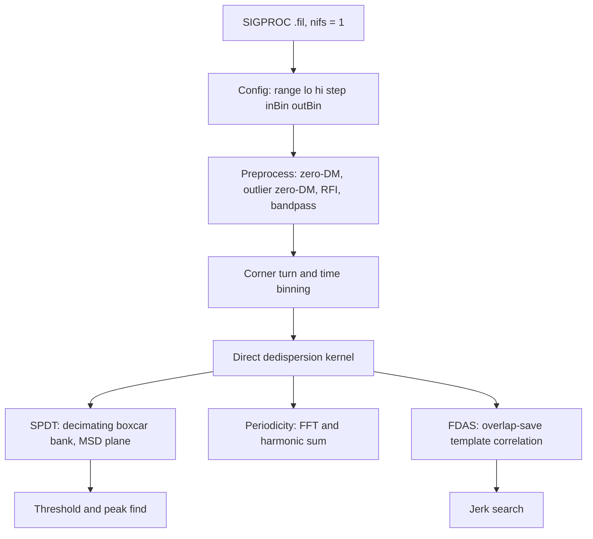

# AstroAccelerate math map

AstroAccelerate (Armour group, Oxford; CUDA, GPL-3.0) is a GPU library and standalone pipeline. It runs preprocessing, direct dedispersion, single-pulse detection (SPDT) with width-dependent noise statistics, periodicity search, Fourier-domain acceleration search (FDAS) and jerk search, in that fixed order ([repo](https://github.com/AstroAccelerateOrg/astro-accelerate), [MANUAL.md](https://github.com/AstroAccelerateOrg/astro-accelerate/blob/master/MANUAL.md)). Program-level notes: [04-other-search-codes.md](../reference/04-other-search-codes.md). Source paths are relative to the repository's `src/`.

**Tags.** [C] = described from AstroAccelerate's source by the reference set; [D] = derived; **[unverified]** = equation not transcribed from the kernel or paper.



## 1. Input [C]

Reads `tstart`, `tsamp`, `nbits`, `fch1`, `foff`, `nchans`, `nifs`; rejects `nifs != 1`; $N_{\rm samp}$ from file size and nbits.

- AstroAccelerate: `aa_sigproc_input.cpp`.
- Ours: `pulsar-analysis-codes/filterbank/src/lib.rs` `SigprocReader::open`.

## 2. Preprocessing

### 2.1 Zero-DM [D]

```math
x'(t,f)=x(t,f)-\frac{1}{N_f}\sum_{f'}x(t,f')
```

### 2.2 Zero-DM with outliers [unverified]

The band average is computed after rejecting outlying channels (iterative σ-clipping about the mean), so a few bright channels do not bias it. Threshold and iteration count not transcribed.

### 2.3 Bandpass normalisation [unverified]

Each channel is divided by (or has subtracted) its time-averaged level, $x'_c(t)=x_c(t)-\bar x_c$ or $x_c/\bar x_c$.

- AstroAccelerate: `input_data_preprocessing` in `include/aa_permitted_pipelines_generic.hpp`; flags `zero_dm`, `zero_dm_with_outliers`, `rfi`, `set_bandpass_average`.
- Paper: Eatough, Keane & Lyne 2009 (zero-DM).
- Ours: `pulsar-analysis-codes/rfi/src/lib.rs` `zero_dm` (option `keep_channel_mean`), `normalise`; `pulsar-analysis-codes/gpu/src/fbcuda.cu` `zero_dm_kernel`, `channel_mean_kernel`.

## 3. Dedispersion plan [C]

Piecewise `range lo hi step inBin outBin` lines: DM range, step, and a time-binning factor per range so that the sample time tracks the growing intra-channel smear. Binning by $b$ replaces $t_{\rm samp}$ by $b\,t_{\rm samp}$ and sums $b$ samples.

- AstroAccelerate: `input_files/*.txt`, `aa_ddtr_plan`, `aa_ddtr_strategy`, `aa_bin_gpu`.
- Paper: Cordes & McLaughlin 2003 (smearing budget).
- Ours: `pulsar-analysis-codes/definitions/src/dmplan.rs` (no per-range binning yet).

## 4. Direct dedispersion [unverified, textbook form]

```math
I_{\rm DM}(t)=\sum_{c=1}^{N_f}I\!\left(f_c,\ t+\left\lfloor\frac{k_{\rm DM}{\rm DM}(f_c^{-2}-f_{\rm ref}^{-2})}{t_{\rm samp}}\right\rceil\right)
```

After a corner turn (`aa_corner_turn`), many-core kernels accumulate channels for blocks of DMs and samples, reusing loaded input across neighbouring DMs.

- AstroAccelerate: `aa_device_dedispersion_kernel.cu`.
- Paper: Novotný et al. 2023, arXiv:2311.05341 (about 4× faster than other solutions on 8-bit, 8192-channel data).
- Ours: `pulsar-analysis-codes/dedispersion/src/lib.rs` `transpose`, `brute_force`; `pulsar-analysis-codes/gpu/src/fbcuda.cu` `transpose_kernel`, `dedisperse_kernel`. Adapting AstroAccelerate's kernel is planned.

## 5. Single-pulse detection: SPDT

### 5.1 Decimated boxcar bank [C]

First plane: boxcars $B_w(t)=\sum_{j=0}^{w-1}x_{t+j}$ up to `nBoxcars` taps. Each later iteration decimates by 2, $x^{(\ell+1)}_t=x^{(\ell)}_{2t}+x^{(\ell)}_{2t+1}$, and extends widths from `startTaps` by reusing partial sums, so the widths grow geometrically while outputs are evaluated at decimated resolution [unverified: exact tap schedule].

### 5.2 Width-dependent noise [C]

```math
{\rm S/N}_w(t)=\frac{B_w(t)-\mu_w}{\sigma_w}
```

$\mu_w$, $\sigma_w$ are interpolated from a mean/standard-deviation (MSD) "plane profile" measured at each width and decimation level, rather than assuming $\sigma_w=\sigma\sqrt w$. After decimation and partial-sum reuse the noise in a width-$w$ output is not exactly $\sigma\sqrt w$.

### 5.3 Outlier-rejected MSD [unverified]

```math
\mu^{(k+1)},\sigma^{(k+1)}=\operatorname{MSD}\big\{x:\lvert x-\mu^{(k)}\rvert<\kappa\,\sigma^{(k)}\big\}
```

Iterated σ-clipping with the `baselinenoise` flag; $\kappa$ not transcribed.

- AstroAccelerate: `aa_device_SPS_long.cu` `SPDT_search_long_MSD_plane`, `aa_device_MSD*.cu`, `aa_device_MSD_outlier_rejection_kernel.cu`, `aa_device_threshold.cu`, `aa_device_peak_find.cu`.
- Paper: Adámek & Armour 2020, ApJS 247, 56.
- Ours: `pulsar-analysis-codes/search/single_pulse/src/lib.rs` `boxcar_search` uses $\sigma\sqrt w$; SPDT statistics planned.

### 5.4 Output [C]

Binary float32 quadruplets $({\rm DM},\ t=n_{\rm TS}t_{\rm samp}+t_{\rm start},\ {\rm S/N},\ w=n_{\rm BW}\cdot{\rm inBin})$ in `analysed-t_*.dat` or `peak_analysed-t_*.dat`.

- AstroAccelerate: `aa_device_analysis.cu`.
- Ours: adapter planned.

## 6. Periodicity [unverified]

Per DM: real FFT, normalised powers, incoherent harmonic sums $P_m(k)=\sum_{h=1}^mP(hk)$ [unverified: exact bin mapping], threshold `periodicity_sigma_cutoff`.

- AstroAccelerate: `aa_device_periods.cu`, `aa_device_harmonic_summing*.cu`.
- Paper: Ransom, Eikenberry & Middleditch 2002 (statistics).

## 7. FDAS and jerk search [C for the method, unverified for the steps]

```math
A(r_0,z_0)=\sum_kA_k\,R^{*}_{z_0}(r_0-k),\qquad z=\dot fT^2
```

The spectrum is convolved with a bank of $z$ (and $w$) templates by overlap-save cuFFT to give the $f$–$\dot f$ plane; `z_max`, `z_step`, `w_max`, `w_step` are configurable. Template-step maths not transcribed.

- AstroAccelerate: `aa_fdas_host.cu`, `aa_fdas_device.cu`, `aa_device_acceleration_fdas.cu`, `aa_device_jerk_search.cu`.
- Paper: Dimoudi et al. 2018, ApJS 239, 28; Andersen & Ransom 2018 (jerk).
