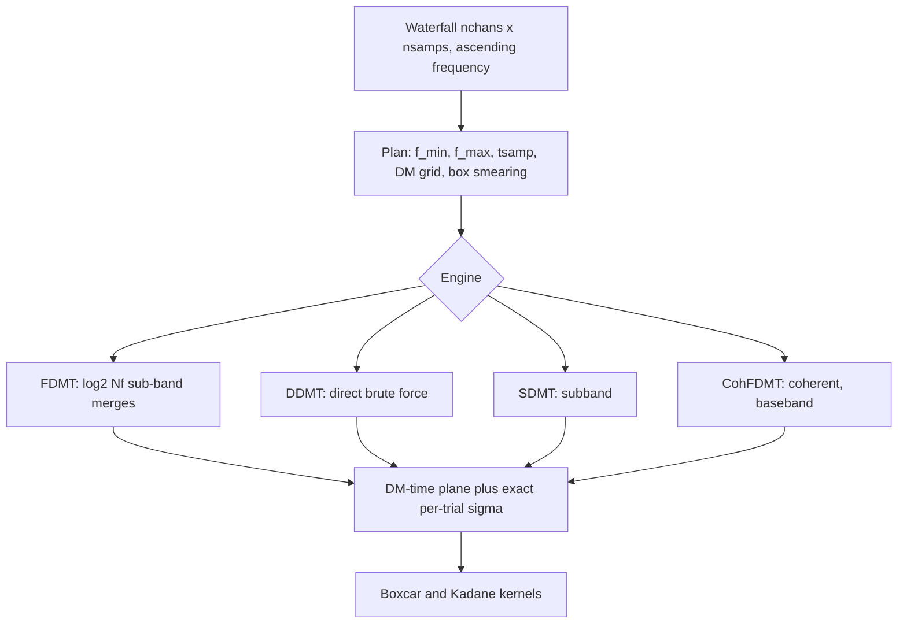

# dmt math map

dmt (Pravir Kumar; C++20 with OpenMP and AVX2/AVX-512/NEON, plus CUDA and HIP; MIT) is a dedispersion-transform library, not a pipeline. It offers FDMT, FDMT-FFT, direct (DDMT, DDMT-FFT), subband (SDMT) and coherent (CohFDMT) engines behind one plan object, plus boxcar and Kadane search kernels, and reports an exact noise σ for every DM trial ([dmt README](https://github.com/pravirkr/dmt)). Program-level notes are in [04-other-search-codes.md](../reference/04-other-search-codes.md); the FDMT derivation is in [05-algorithms-math.md](../reference/05-algorithms-math.md).

**Tags.** [V] = read in the primary paper; [C] = from dmt's README or source as read by the reference set; [D] = derived; **[unverified]** = not checked against a primary source or dmt's code.



## 1. Input conventions [C]

Input must be in **ascending** frequency; SIGPROC data with `foff < 0` are flipped with `to_ascending()`, and `sigproc_band(fch1, foff, nchans)` builds the band. Output times refer to $f_{\min}$ by default.

- dmt: Python helpers `dmtlib.to_ascending`, `sigproc_band`.
- Ours: `pulsar-analysis-codes/definitions/src/header.rs` `FreqAxis::reversed`, `is_descending`. Our default reference frequency is the **top** channel (`pulsar-analysis-codes/definitions/src/dmplan.rs`), so a shim must convert $f_{\min}$-referenced times.

## 2. Dispersion delay [C]

```math
\Delta t=k_{\rm DM}\,{\rm DM}\,(f^{-2}-f_{\min}^{-2}),\qquad k_{\rm DM}=1/2.41\times10^{-4}\ {\rm s\,MHz^2\,pc^{-1}\,cm^3}
```

The README calls this the "TEMPO2 value".

- Paper: Kulkarni 2020, arXiv:2007.02886.
- Ours: `pulsar-analysis-codes/definitions/src/consts.rs` `K_DM_PULSAR`.

## 3. DM grids [unverified]

`lib/dm_grids.cpp` builds the DM list. Its formula was not transcribed. A delay-space grid with one-sample steps across the band, $\delta{\rm DM}=t_{\rm samp}/[k_{\rm DM}(f_{\min}^{-2}-f_{\max}^{-2})]$, is the natural FDMT grid [unverified].

- Ours: `pulsar-analysis-codes/definitions/src/dmplan.rs` `DmPlan::linear`, `DmPlan::tolerance`.

## 4. Direct dedispersion: DDMT [unverified, textbook form]

```math
I_{\rm DM}(t)=\sum_{c=1}^{N_f}I\!\left(f_c,\ t+\left\lfloor\frac{k_{\rm DM}{\rm DM}(f_c^{-2}-f_{\rm ref}^{-2})}{t_{\rm samp}}\right\rceil\right)
```

Cost $N_fN_tN_\Delta$. DDMT-FFT applies the shifts as phase ramps in the Fourier domain [unverified].

- dmt: `lib/ddmt*.cpp`.
- Ours: `pulsar-analysis-codes/dedispersion/src/lib.rs` `brute_force`; `pulsar-analysis-codes/gpu/src/fbcuda.cu` `dedisperse_kernel`.

## 5. FDMT [V: Zackay & Ofek 2017, Eqs. 16–22, 25–29]

Initialisation, with $\delta f=(f_{\max}-f_{\min})/N_f$:

```math
A_f^{f+\delta f}(t,\Delta t)=\sum_{i=0}^{\Delta t}I(f,t+i)
```

Merge at iteration $i=1\ldots\log_2N_f$, $f_2=f_0+2^i\delta f$, $f_1=(f_0+f_2)/2$:

```math
C_{f_2,f_0}=\frac{f_1^{-2}-f_0^{-2}}{f_2^{-2}-f_0^{-2}},\quad t_1=t_0-C_{f_2,f_0}\Delta t,\quad A_{f_0}^{f_2}(t_0,\Delta t)=A_{f_0}^{f_1}(t_0,t_0-t_1)+A_{f_1}^{f_2}(t_1,t_1-t_2)
```

Delay range per sub-band and cost:

```math
\Delta t_{\max}(i,f_0)=N_\Delta\frac{f_0^{-2}-(f_0+2^i\delta f)^{-2}}{f_{\min}^{-2}-f_{\max}^{-2}},\qquad C_{\rm FDMT}\le2N_tN_f+N_tN_\Delta\log_2N_f
```

If $t_1<0$ the second term is dropped (plain copy). $A$ is the sum along the $\nu^{-2}$ curve between $(t_0,f_0)$ and $(t_0-\Delta t,f_2)$, in samples.

- dmt: `lib/fdmt.cpp`, `lib/fdmt_plan*.cpp`; Python `compute_fdmt`, `dedisperse(..., engine="fdmt_fft")`.
- Paper: Zackay & Ofek 2017, ApJ 835, 11, arXiv:1411.5373.

## 6. Box smearing [unverified]

The `use_box_smearing` flag accounts for the dispersion sweep within a channel by summing $\lceil\Delta t_{\rm chan}\rceil$ samples at initialisation (the FDMT initial cumulative sum above) rather than taking one sample. Exact behaviour not transcribed.


## 7. Exact per-trial noise [unverified]

For unit-variance white input, a dedispersed sample that sums $n_{\rm eff}(\Delta t)$ input samples has

```math
\sigma_{\rm trial}=\sqrt{n_{\rm eff}(\Delta t)}
```

dmt computes $n_{\rm eff}$ for every trial from the plan (`lib/fdmt_plan_noise.cpp`), so S/N needs no calibration run. Its exact counting rule was not read.


## 8. Subband (SDMT) and coherent (CohFDMT) engines [unverified]

SDMT is the two-stage subband method (see [presto.md](presto.md) section 4.2). CohFDMT applies FDMT-style merging to coherently dedispersed baseband channels; its equations were not read.

- Ours: `pulsar-analysis-codes/dedispersion/src/lib.rs` `subband`; coherent planned.

## 9. Search kernels [unverified]

Boxcar: $S/N_w(t)=(C_{t+w}-C_t)/(\sigma_{\rm trial}\sqrt w)$ on prefix sums $C$. Kadane: the maximum-sum contiguous window $\max_{a\le b}\sum_{j=a}^bx_j$ in one pass, $M_j=\max(x_j,M_{j-1}+x_j)$.

- dmt: `lib/boxcar_*.cpp`, `lib/kadane_plan.cpp`.
- Paper: Bentley 1984, *Programming Pearls* (Kadane's algorithm).
- Ours: `pulsar-analysis-codes/search/single_pulse/src/lib.rs` `boxcar_search`; Kadane planned.
