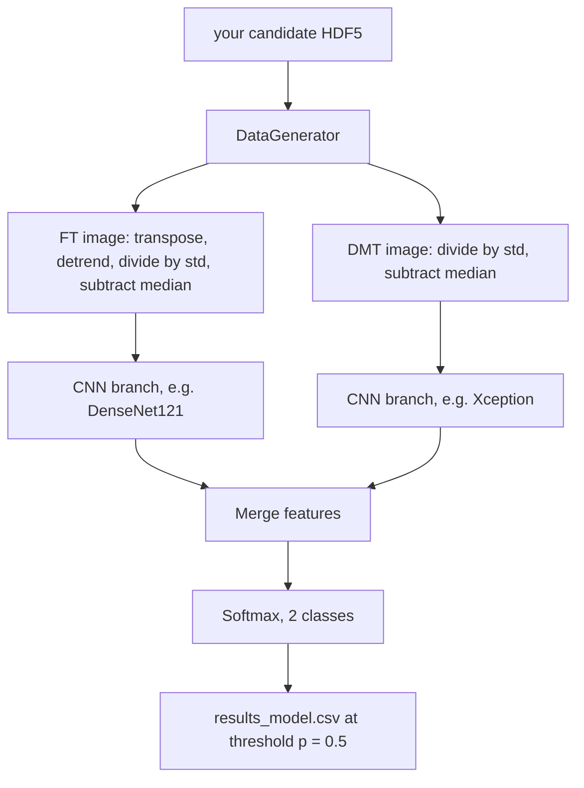

# FETCH math map

FETCH ("Fast Extragalactic Transient Candidate Hunter"; Devansh Agarwal and others; TensorFlow 2 / Keras, GPL-3.0) is the standard deep-learning classifier for single-pulse candidates. It reads your's candidate HDF5, normalises a frequency–time and a DM–time image, runs each through a CNN branch, merges the features and outputs a real-versus-RFI probability ([FETCH repo](https://github.com/devanshkv/fetch), default branch `tf2`; Agarwal et al. 2020, MNRAS 497, 1661, [arXiv:1902.06343](https://arxiv.org/abs/1902.06343)). Program-level notes: [04-other-search-codes.md](../reference/04-other-search-codes.md). Source paths are relative to the repository.

**Tags.** [C] = transcribed from FETCH's source by the reference set; **[unverified]** = standard form, not transcribed.



## 1. Frequency–time preprocessing [C for the order, unverified for the axis of each step]

```math
X'=\frac{\mathcal D(X^{\sf T})}{{\rm std}\big(\mathcal D(X^{\sf T})\big)},\qquad X''=X'-{\rm median}(X')
```

$X$ the 256×256 `data_freq_time` image; $\mathcal D$ a linear detrend along time per channel [unverified]; input shape 256×256×1.

- FETCH: `fetch/data_sequence.py` `DataGenerator`.

## 2. DM–time preprocessing [C]

```math
Y'=\frac{Y}{{\rm std}(Y)},\qquad Y''=Y'-{\rm median}(Y')
```

$Y$ the 256×256 `data_dm_time` image.

- FETCH: `fetch/data_sequence.py`.

## 3. Two-branch model [C for the structure, unverified for layer details]

```math
\mathbf h=\big[g_{\rm FT}(X'')\ \Vert\ g_{\rm DMT}(Y'')\big],\qquad p({\rm real})={\rm softmax}(\mathbf W\mathbf h+\mathbf b)_1
```

$g_{\rm FT}$ a DenseNet variant; $g_{\rm DMT}$ Xception, VGG16, InceptionV3 or InceptionResNetV2; 11 pre-trained models a–k (weights MD5-checked).

- FETCH: `fetch/models/*`, `fetch/utils.py`.
- Paper: Agarwal et al. 2020.

## 4. Decision and training [C]

Label = 1 if $p\ge0.5$ (`-p`). Fine-tuning uses Adam at learning rate $10^{-3}$ with binary cross-entropy,

```math
\mathcal L=-\frac1N\sum_n\big[y_n\ln p_n+(1-y_n)\ln(1-p_n)\big]
```

Reported accuracy and recall above 99.5% on the authors' test set; an independent 2025 study measured much lower recall on injected signals (arXiv:2511.17797), so retrain on local data.

- FETCH: `bin/predict.py`, `bin/train.py`.
- Ours: the `label` and `probability` fields of `pulsar-analysis-codes/definitions/src/candidates.rs` `SinglePulseCandidate` hold the output; the model is planned.
