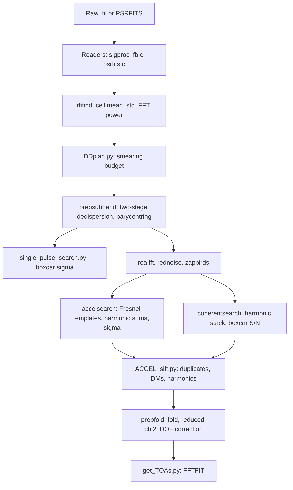

# PRESTO math map

PRESTO (Scott Ransom; C library plus C programs and Python scripts, GPL-2.0) takes raw SIGPROC or PSRFITS data through RFI masking, dedispersion, FFT, acceleration or coherent harmonic search, sifting, folding and TOAs. This map lists each mathematical operation in pipeline order, with the equation, where it lives in PRESTO, the paper behind it, and the module of ours that does or will do the same thing. Program-level detail is in [02-presto.md](../reference/02-presto.md), derivations in [05-algorithms-math.md](../reference/05-algorithms-math.md), and what we have already taken in CREDITS.md (not published). Source paths are relative to [github.com/scottransom/presto](https://github.com/scottransom/presto) at commit `4a5bd80`.

**Tags.** [V] = read in the primary paper; [C] = transcribed from PRESTO's source by the reference set; [D] = derived from tagged equations; **[unverified]** = standard form not checked against a primary source.



## 1. Reading raw data

### 1.1 SIGPROC channel order and band edge [C]

```math
f_{\rm lo}=f_{\rm ch1}-(N_{\rm chan}-1)\,\lvert f_{\rm off}\rvert,\qquad N_{\rm spec}=\frac{L_{\rm file}-L_{\rm hdr}}{N_{\rm chan}/(8/n_{\rm bits})}
```

$f_{\rm ch1}$, $f_{\rm off}$ in MHz from the header; $L$ in bytes; $n_{\rm bits}\le8$. Channel order is always reversed and sub-byte samples are emitted MSB first after walking bytes from the end, which equals SIGPROC's LSB-first order for `foff < 0`.

- PRESTO: `src/sigproc_fb.c` `read_filterbank_header`, `convert_filterbank_block`.
- Paper: none (SIGPROC convention; Lorimer 2011, ASCL:1107.016).
- Ours: `pulsar-analysis-codes/filterbank/src/lib.rs` `SigprocReader::open` (same sample count), `pulsar-analysis-codes/definitions/src/bits.rs` LSB-first unpack.

### 1.2 PSRFITS scaling, weights and polarisation sum [C]

```math
x_{t,p,c}=\big[(d_{t,p,c}-\lvert Z\rvert)\,s_{p,c}+o_{p,c}\big]\,w_c,\qquad I_{t,c}=x_{t,0,c}+x_{t,1,c}
```

$d$ raw unsigned sample, $Z$ = `ZERO_OFF`, $s$ = `DAT_SCL`, $o$ = `DAT_OFFS`, $w$ = `DAT_WTS` (0–1). Applied only when the first row holds non-trivial $s,o,w$. 4-bit unpack `>>4` then `&0x0F`; 2-bit `>>6, >>4, >>2, &3`; Parkes `FB_1BIT` data byte-reversed in 8-byte groups.

- PRESTO: `src/psrfits.c` `read_PSRFITS_files`, `get_PSRFITS_rawblock`.
- Paper: Hotan, van Straten & Manchester 2004, PASA 21, 302 (PSRFITS).
- Ours: `pulsar-analysis-codes/fits/src/lib.rs` `decode_row`, `ZeroOffPolicy::Spec`, `ScalePolicy::Auto`, `parkes_1bit_flip`.

### 1.3 Row placement from OFFS_SUB [C]

```math
s_{\rm row}=\frac{\texttt{OFFS\_SUB}-T_{\rm sub}/2}{t_{\rm bin}},\qquad T_{\rm sub}=n_{\rm sblk}\,t_{\rm bin}
```

`OFFS_SUB` is the row centre in s since the file start. PRESTO compares the implied row index with `NSUBOFFS`, trusts `OFFS_SUB`, pads missing rows and rejects files where only some `OFFS_SUB` are zero.

- PRESTO: `src/psrfits.c`.
- Paper: Hotan et al. 2004.
- Ours: `fb-io/src/psrfits.rs` `PsrfitsReader::open` (row placement and gap list).

## 2. RFI: rfifind

### 2.1 Cell statistics [C]

For each interval $i$ (default 30 s, `ptsperint` samples) and channel $c$: mean $\mu_{ic}$, standard deviation $\sigma_{ic}$, and the maximum normalised power of a real FFT of the chunk, searched with 4 harmonic sums, interbinning and `lobin = 5`, normalised by

```math
{\rm norm}=\sigma_{ic}^2\,n_{\rm pts}
```

Cells with $\sigma\le10^{-4}$ are skipped.

- PRESTO: `src/rfifind.c`, `include/rfifind.h` (`RFI_NUMHARMSUM 4`, `RFI_NUMBETWEEN 2`, `RFI_LOBIN 5`).
- Paper: Ransom 2001, PhD thesis (Harvard).
- Ours: `pulsar-analysis-codes/rfi/src/lib.rs` `interval_stats_mask` (mean and std only); FFT-power test planned (vendored rfifind).

### 2.2 Power threshold [C]

```math
P_{\rm reject}=\tfrac12\,Q^{-1}_{\chi^2_2}\!\left(\frac{Q_{\rm G}(\sigma_{\rm freq})}{n_{\rm pts}/2}\right)
```

$Q_{\rm G}$ Gaussian upper-tail probability, $Q^{-1}_{\chi^2_2}$ inverse $\chi^2_2$ survival function, $\sigma_{\rm freq}$ = `freqsig` (default 4). Implemented as `power_for_sigma(freqsig, 1, ptsperint/2)`.

- PRESTO: `src/rfifind_plot.c`, `src/characteristics.c`.
- Paper: Ransom, Eikenberry & Middleditch 2002 (REM02), AJ 124, 1788, Eq. 11.

### 2.3 Mean/std fence and row masking [C]

```math
\lvert x_{ic}-\tilde x\rvert>\sigma_{\rm time}\,\hat\sigma_x,\qquad \text{mask interval if } n_{\rm bad}>f_{\rm chan}N_{\rm chan},\quad \text{mask channel if } n_{\rm bad}>f_{\rm int}N_{\rm int}
```

$x$ is $\mu$ or $\sigma$; $\tilde x$ the interval or channel median; $\hat\sigma_x$ a robust global std from `calc_avgmedstd` (central 80%). Defaults `timesig 10`, `chanfrac 0.7`, `intfrac 0.3`, `clip 6`.

- PRESTO: `src/rfifind_plot.c`, `clig/rfifind_cmd.cli`.
- Paper: Ransom 2001.
- Ours: `fb-rfi/src/lib.rs` `interval_stats_mask` (median/MAD fence, no chanfrac/intfrac); mask I/O in `pulsar-analysis-codes/products/src/presto.rs` `PrestoMask`.

### 2.4 Zero-DM [D]

```math
x'(t,f)=x(t,f)-\frac{1}{N_f}\sum_{f'}x(t,f')
```

- PRESTO: `-zerodm` in `rfifind`, `prepdata`, `prepsubband`.
- Paper: Eatough, Keane & Lyne 2009, MNRAS 395, 410.
- Ours: `fb-rfi/src/lib.rs` `zero_dm`; `pulsar-analysis-codes/gpu/src/fbcuda.cu` `zero_dm_kernel`.

## 3. DM planning: DDplan.py

### 3.1 Smearing budget [C]

```math
t_{\rm tot}=\sqrt{2(1000\,t_{\rm samp})^2+t_{\rm chan}({\rm DM})^2+t_{\rm sub}^2+t_{\rm BW}(\tfrac12\delta{\rm DM})^2}\quad[{\rm ms}]
```

$t_{\rm chan}$ intra-channel smear at DM; $t_{\rm sub}$ smear of half the subband DM step across $B/N_{\rm sub}$; $t_{\rm BW}$ full-band smear for a DM error of half a step.

### 3.2 First-guess step [C], [D]

```math
\delta{\rm DM}_{\rm guess}=\frac{t_{\rm samp}\cdot0.0001205\,f_{\rm ctr}^3}{0.5\,B}=\frac{2.41\times10^{-4}\,t_{\rm samp}f_{\rm ctr}^3}{B}
```

$f$ and $B$ in MHz. Snapped to the ladder `[0.01, 0.02, 0.03, 0.05, 0.1, …, 300]` with fudge 1.2; downsampling doubles when channel smear exceeds the effective sample time.

- PRESTO: `bin/DDplan.py`.
- Paper: Cordes & McLaughlin 2003 (CM03), ApJ 596, 1142, Eqs. 2–4, 11.
- Ours: `pulsar-analysis-codes/definitions/src/dmplan.rs` `DmPlan::tolerance` uses a different (heimdall-style) criterion; DDplan port planned.

## 4. Dedispersion and barycentring

### 4.1 Delay [C]

```math
t_{\rm DM}(f)=\frac{\rm DM}{0.000241\,f^2}\ {\rm s},\qquad k_{\rm DM}=4149.378\ {\rm s\,MHz^2\,pc^{-1}\,cm^3}
```

Referred to the highest channel, which is never shifted; channel frequency is the centre, Doppler-corrected by the mean $v/c$ when barycentring.

- PRESTO: `src/dispersion.c` `delay_from_dm`.
- Paper: Kulkarni 2020, arXiv:2007.02886 (constant conventions).
- Ours: `pulsar-analysis-codes/definitions/src/consts.rs` `K_DM_PULSAR`, `dispersion_delay`; `dmplan.rs` `f_ref` = top channel.

### 4.2 Two-stage subband dedispersion [C], [D]

```math
d^{(1)}_c=\Big\lfloor\tfrac{t_{\rm DM_0}(f_c)-t_{\rm DM_0}(f_{{\rm top},s})}{t_{\rm samp}}\Big\rceil,\qquad d^{(2)}_s({\rm DM})=\Big\lfloor\tfrac{t_{\rm DM}(f_{{\rm top},s})}{t_{\rm samp}}\Big\rceil,\qquad t_{\rm sub}\approx\tfrac12 k_{\rm DM}\,\delta{\rm DM}_{\rm coarse}(f_{\rm sub,lo}^{-2}-f_{\rm sub,hi}^{-2})
```

Stage 1 (`subband_search_delays`) aligns channels inside subband $s$ at nominal DM$_0$ relative to its top channel; stage 2 (`float_dedisp`) shifts and sums subbands per trial DM. Default `-nsub 32`.

- PRESTO: `src/dispersion.c`, `src/prepsubband.c`.
- Paper: Ransom 2001; Barsdell et al. 2012, MNRAS 422, 379 (subband smearing).
- Ours: `pulsar-analysis-codes/dedispersion/src/lib.rs` `subband` (reference channel at the subband middle, not top).

### 4.3 Barycentring by sample insertion [C]

Topocentric TOAs every 20 s are converted with ERFA `barycenter()`; the drift ${\rm round}[(t_{\rm bary}-t_{\rm topo})/t_{\rm samp}]$ becomes a `diffbins` list where single samples are inserted or dropped. Channel frequencies are scaled by $(1+\langle v/c\rangle)$.

- PRESTO: `src/prepdata.c`, `src/barycenter.c`.
- Paper: ERFA / IAU SOFA; Edwards, Hobbs & Manchester 2006 for the delay terms.

## 5. Single-pulse search: single_pulse_search.py [C]

```math
\sigma_{\rm SP}=\frac{\sum_{i\in w}(x_i-\mu)}{\sigma_{\rm rms}\sqrt w},\qquad \sigma_{\rm rms}=1.148\times{\rm std}(\text{central 95\%})
```

Detrend in blocks of `-d`×1000 samples (linear, or median with `-f`); drop blocks whose σ is more than 4σ from the median block σ; boxcars `[1,2,3,4,6,9,14,20,30]` (to 300 with `-m`); threshold 5; duplicates pruned within `downfact/2`. The 1.148 factor rescales a 95%-trimmed std to a Gaussian σ [unverified: derivation not shown upstream].

- PRESTO: `bin/single_pulse_search.py`.
- Paper: Cordes & McLaughlin 2003, Eq. 15.
- Ours: `pulsar-analysis-codes/search/single_pulse/src/lib.rs` `boxcar_search` (same statistic, other ladder); `.singlepulse` I/O in `pulsar-analysis-codes/products/src/candidates.rs`.

## 6. Fourier transform and whitening

### 6.1 realfft packing [C]

```math
A_k=\sum_{j=0}^{N-1}x_j\,e^{-2\pi ijk/N},\quad k=0\ldots N/2-1;\qquad \text{bin 0}=(A_0,\ A_{N/2})
```

N/2 complex64 values; DC in the real part of bin 0 and Nyquist in its imaginary part; Fourier bin $r$ is frequency $r/T$.

- PRESTO: `src/fastffts.c`, `src/realfft.c`.
- Paper: Press et al., *Numerical Recipes* (packing) [unverified].

### 6.2 Normalisation and red-noise removal [V: REM02 Eqs. 10, 12], [C]

```math
P_k=\frac{\lvert A_k\rvert^2}{N\langle d^2\rangle},\quad {\rm Prob}(P\ge P')=e^{-P'},\qquad P_{k,{\rm norm}}=\frac{P_k}{\tilde P_{\rm local}/\ln2}
```

`dered_engine` sets bin 0 to $1+0i$; block length grows as `startwidth·ln(bin)` (6) to `endwidth` (100) until `endfreq` (6 Hz); amplitudes are divided by $\sqrt{\rm level}$ interpolated between block midpoints. accelsearch's block normalisation is `1/sqrt(median(|A|²)/ln 2)`.

- PRESTO: `src/misc_utils.c` `dered_engine`, `src/rednoise.c`, `src/accel_utils.c`.
- Paper: REM02.

### 6.3 Birdie zapping [C]

Zapped bins are replaced by $\chi^2_2$ noise with the local mean power measured 100 bins clear of the region, random phases and a fixed seed (v6.1.0+); topocentric birdie frequencies are mapped by $f_{\rm bary}=f_{\rm topo}(1+v/c)$ with `-baryv` [unverified: sign convention].

- PRESTO: `src/zapbirds.c`, `bin/makezaplist.py`.

## 7. Acceleration and jerk search: accelsearch

### 7.1 Fourier coordinates [V: Andersen & Ransom 2018 Eqs. 1–2]

```math
r=fT,\qquad z=\dot fT^2=\frac{a\,h\,T^2}{c\,P},\qquad w=\ddot fT^3=\frac{\dot a\,h\,f\,T^3}{c}
```

$T$ observation length (s), $a$ line-of-sight acceleration (m s⁻²), $h$ harmonic number, $c$ speed of light. Grid $\Delta r=0.5$, $\Delta z=2$, $\Delta w=20$.

### 7.2 Scalloping and interpolation [V: REM02 Eqs. 18, 30, 31]

```math
A_k=A_0e^{-i\pi(k-r)}{\rm sinc}[\pi(k-r)],\qquad A_r\simeq\sum_{k=r-m/2}^{r+m/2}A_ke^{-i\pi(r-k)}{\rm sinc}[\pi(r-k)],\qquad A_{k+1/2}\simeq\tfrac{\pi}{4}(A_k-A_{k+1})
```

### 7.3 Template correlation [D, from REM02's description], [C]

```math
A(r_0,z_0,w_0)=\sum_kA_k\,R^{*}_{z_0,w_0}(r_0-k)
```

$R_{z,w}$ is the Fourier response of a drifting sinusoid built from Fresnel integrals (`fresnl`); half-width `int(0.5·1.1·|z|) + 16` bins; overlap-save with 7470 good bins per 8K FFT (measured lengths since v6.3.3); candidates merged within 15 bins.

- PRESTO: `src/responses.c`, `src/corr_routines.c`, `src/accelsearch.c`, `include/accel.h`.
- Paper: REM02; Andersen & Ransom 2018, ApJL 863, L13.

### 7.4 Harmonic summing and significance [V: REM02 Eq. 11], [C], [V: Andersen & Ransom Eq. 6]

```math
{\rm Prob}(P_m\ge P')=\sum_{j=0}^{m-1}\frac{(P')^j}{j!}e^{-P'},\qquad \ln p=\ln Q_{\chi^2_{2m}}(2P_m)+\ln N_{\rm trials},\qquad \sigma=Q_{\rm G}^{-1}(p)
```

```math
N_{\rm trials}=\frac{r_{\rm hi}-r_{\rm lo}}{m}\,(N_z+1)\frac{\Delta z}{6.95}\,(N_w+1)\frac{\Delta w}{44.2}
```

Stages $m=2,4,8,16,32$ add planes of harmonics $(2k+1)/m$ at `r_sub = rint(2·r·h/m)·0.5`, `z_sub = nearest(0.5·z·h/m)·2`, `w_sub = nearest(0.05·w·h/m)·20`. `chi2_logp` switches to the A&S 26.4.19 asymptotic form at large χ². The 6.95 and 44.2 constants are unexplained upstream.

- PRESTO: `src/accel_utils.c` `add_search_ffdotpows`, `create_accelobs`; `src/characteristics.c` `candidate_sigma`, `chi2_logp`, `power_for_sigma`.
- Paper: REM02; Andersen & Ransom 2018.

### 7.5 Polishing

Nelder–Mead (GSL) over $(r,z,w)$ jointly across harmonics ("harmpolish"). Reported $f,\dot f,\ddot f$ are mid-observation values.

- PRESTO: `src/maximize_rz.c`, `src/maximize_rzw.c`.

## 8. Coherent harmonic summing: coherentsearch [V: Ransom 2026 Eqs. 3–4]

```math
{\rm S/N}=\max_{w,p}\frac{S_w(p)-\delta S_{\rm tot}}{\sigma\sqrt{w(1-\delta)}},\quad \delta=\frac wn,\quad S_w(p)=\sum_{i=0}^{w-1}P_{(p+i)\bmod n}
```

```math
{\rm var}(S_w)=2\sum_{j\ \rm filled,\ j<n/2}\lvert D_j\rvert^2+\tfrac12\lvert D_{n/2}\rvert^2,\qquad D_j=\frac{\sin(\pi jw/n)}{\sin(\pi j/n)}
```

$H$ harmonics (default 60) interpolated with an $m=16$ kernel of weights $1/(\delta r-j)$ scaled by $\overline{\sin(\pi\delta r)e^{i\pi\delta r}}/\pi$ (REM02 Eq. 30 tabulated); stacked half-complex with DC = 0; inverse real FFT to $n=2H$ bins; boxcars ×1.5 to 30% duty; decimation ladder reuses every $k$-th harmonic for $k\times$ the trial frequency. Assumes PRESTO's exact rednoise normalisation.

- PRESTO: `src/coherentsearch.c`, `src/cs_interp.c`, `src/cs_metric.c`, `src/cs_chunk.c`.
- Paper: Ransom 2026, arXiv:2610.11749.

## 9. Sifting: ACCEL_sift.py [C]

Duplicates within `r_err = 1.1` bins; at least 2 DMs with a peak above DM 2; harmonic removal for $f_1/f_2$ near integers 1–16 and ratios 3/2, 5/2, 2/3, 4/3, 5/3, 3/4, 5/4, 2/5, 3/5, 4/5 with $f_{\rm err}=r_{\rm err}/T$; DM parsed from file names with `_DM(\d+\.\d{2,3})(?!\d)`.

- PRESTO: `python/presto/sifting.py`, `examplescripts/ACCEL_sift.py`.

## 10. Folding: prepfold

### 10.1 Phase model [unverified]

```math
\phi(t)=\phi_0+f(t-t_0)+\tfrac12\dot f(t-t_0)^2+\tfrac16\ddot f(t-t_0)^3
```

Each sample is spread over the profile bins it overlaps (`fold()`); binary delays and on/off pairs are supported.

### 10.2 Reduced χ² with effective dof [C]

```math
\chi^2_{\rm red}=\frac{1}{n_b-1}\sum_{j=1}^{n_b}\frac{(p_j-\bar p)^2}{\sigma_p^2},\quad \sigma_p^2=\sigma^2_{\rm data}N_{\rm data}\Delta_{\rm bin},\qquad {\rm DOF_{eff}}=(n_b-1)\,0.96\,x\,(1+x^{1.806})^{-1/1.806},\ x=\frac{P}{n_bt_{\rm samp}}
```

Significance: `chi2_logp(redchi·dofeff, dofeff)` converted to σ (single trial).

### 10.3 Trial grid by sub-profile shifts [unverified]

```math
\Delta\phi_{ij}=\delta f\,t_i+\tfrac12\delta\dot f\,t_i^2+f\,k_{\rm DM}\,\delta{\rm DM}(\nu_j^{-2}-\nu_{\rm ref}^{-2})
```

`npart × nsub` sub-profiles are shifted and re-summed, not refolded; steps `pstep 2`, `pdstep 4`, `dmstep 2` bins; `npfact 2`, `ndmfact 3`.

- PRESTO: `src/fold.c`, `src/prepfold_pipeline.c`, `src/prepfold_utils.c`, `src/prepfold_plot.c`.
- Paper: Leahy et al. 1983, ApJ 266, 160 (epoch folding).

## 11. TOAs: get_TOAs.py (FFTFIT) [unverified]

```math
\chi^2(b,\tau)=\sum_{k=1}^{n_h}\frac{\lvert P_k-b\,S_ke^{-2\pi ik\tau/n_b}\rvert^2}{\sigma^2}
```

Pure-Python FFTFIT (`-A classic|aarchiba`) against a Gaussian, `.bestprof` or multi-Gaussian template.

- PRESTO: `bin/get_TOAs.py`, `python/presto/fftfit.py`.
- Paper: Taylor 1992, Phil. Trans. R. Soc. A 341, 117 (not retrieved).
