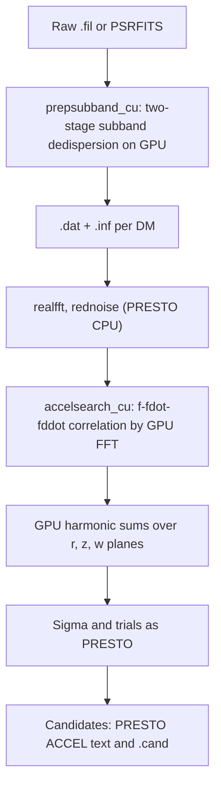

# PrestoZL math map

PrestoZL (Zhejiang Lab; CUDA, GPL-2.0) is a GPU fork of PRESTO. Its `accelsearch_cu` runs the Fourier-domain acceleration and jerk search, and `prepsubband_cu` runs subband dedispersion. Its README claims results "fully identical" to PRESTO v4.0, with 51–56× speed-ups for jerk search on one A40 against a 20-core CPU, and about 100× for `prepsubband_cu` ([PrestoZL](https://github.com/zhejianglab/PrestoZL)). Because it reproduces PRESTO, every equation below is PRESTO's; the map records which GPU stage computes it. The PrestoZL kernels themselves were **not read** for the reference set, so every kernel-level statement here is [unverified]. The underlying equations are tagged as in [presto.md](presto.md). Background: [05-algorithms-math.md](../reference/05-algorithms-math.md); research note periodicity_search.md (not published).

**Tags.** [V] = read in the primary paper; [C] = transcribed from PRESTO source; **[unverified]** = not checked against PrestoZL's own source.



## 1. Subband dedispersion: prepsubband_cu [C for the maths, unverified for the kernel]

```math
t_{\rm DM}(f)=\frac{\rm DM}{0.000241\,f^2},\qquad d^{(1)}_c=\Big\lfloor\tfrac{t_{\rm DM_0}(f_c)-t_{\rm DM_0}(f_{{\rm top},s})}{t_{\rm samp}}\Big\rceil,\qquad d^{(2)}_s=\Big\lfloor\tfrac{t_{\rm DM}(f_{{\rm top},s})}{t_{\rm samp}}\Big\rceil
```

$f$ in MHz, $t$ in s; stage 1 aligns channels within subband $s$ at nominal DM$_0$; stage 2 shifts subbands per trial DM.

- PrestoZL: `prepsubband_cu` [unverified file layout].
- PRESTO original: `src/dispersion.c` `subband_search_delays`, `float_dedisp`; `src/prepsubband.c`.
- Paper: Ransom 2001 (PRESTO); Mao et al. 2025, ApJS 280, 36 (PrestoZL).
- Ours: `pulsar-analysis-codes/dedispersion/src/lib.rs` `subband` (CPU, same two-stage idea); GPU vendor planned.

## 2. Fourier coordinates [V: Andersen & Ransom 2018 Eqs. 1–2]

```math
r=fT,\qquad z=\dot fT^2=\frac{a\,h\,T^2}{cP},\qquad w=\ddot fT^3
```

$T$ observation length (s); $a$ acceleration (m s⁻²); grid $\Delta r=0.5$, $\Delta z=2$, $\Delta w=20$.

- PrestoZL: `accelsearch_cu` plane layout [unverified].
- Paper: Andersen & Ransom 2018, ApJL 863, L13.

## 3. Template correlation on the GPU [D for the maths, unverified for the kernel]

```math
A(r_0,z_0,w_0)=\sum_kA_k\,R^{*}_{z_0,w_0}(r_0-k)
```

$R_{z,w}$ is PRESTO's Fresnel-integral response; the correlation is overlap-save, i.e. FFT of a spectrum block times the FFT of each conjugated template, then an inverse FFT, keeping the good bins. On the GPU this becomes batched cuFFT over many $(z,w)$ templates [unverified].

- PrestoZL: `accelsearch_cu` [unverified].
- PRESTO original: `src/responses.c`, `src/corr_routines.c`.
- Paper: Ransom, Eikenberry & Middleditch 2002 (REM02), AJ 124, 1788.

## 4. Harmonic summing [C]

```math
P_m(r,z,w)=\sum_{h\in\mathcal H_m}P\big({\rm rint}(2rh/m)/2,\ z_{\rm sub},\ w_{\rm sub}\big),\qquad m=1,2,4,8,16,32
```

Stage $m$ adds the planes of harmonics $(2k+1)/m$ to the running sum. PrestoZL fuses these gathers into GPU kernels [unverified].

- PRESTO original: `src/accel_utils.c` `add_search_ffdotpows`.
- Paper: REM02.

## 5. Significance and trials [V: REM02 Eq. 11], [C], [V: Andersen & Ransom Eq. 6]

```math
\ln p=\ln Q_{\chi^2_{2m}}(2P_m)+\ln N_{\rm trials},\qquad N_{\rm trials}=\frac{r_{\rm hi}-r_{\rm lo}}{m}(N_z+1)\frac{\Delta z}{6.95}(N_w+1)\frac{\Delta w}{44.2},\qquad \sigma=Q_{\rm G}^{-1}(p)
```

- PRESTO original: `src/characteristics.c` `candidate_sigma`; `src/accel_utils.c` `create_accelobs`.

## 6. Polishing and output

Survivors are optimised over $(r,z,w)$ and written in PRESTO's `_ACCEL_<z>[_JERK_<w>]` text and `.cand` binary (`fourierprops`, 88 bytes on LP64). Whether PrestoZL polishes on the GPU or the CPU was not checked [unverified]. The "fully identical" claim is against PRESTO v4.0; PRESTO v6.x changed medians, zap fills and normalisation, so identity with v6.3.3 must be re-tested.

