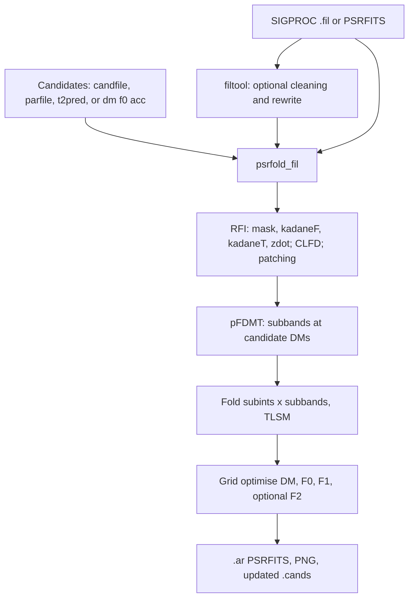

# PulsarX math map

PulsarX (Yunpeng Men; C++, GPL-3.0) is the fold-and-optimise back end used for peasoup candidates in TRAPUM and MMGPS. `psrfold_fil` folds many candidates in one pass over SIGPROC or PSRFITS data, cleans with the TransientX filter family and CLFD, and optimises DM, F0, F1 (optionally F2). The paper introduces a pruned FDMT (pFDMT) and a Tikhonov-regularised least-squares folding method (TLSM) ([PulsarX repo](https://github.com/ypmen/PulsarX), [XLibs](https://github.com/ypmen/XLibs); Men et al. 2023, A&A 679, A20, [arXiv:2309.02544](https://arxiv.org/abs/2309.02544)). **Neither pFDMT nor TLSM was found by name in the source**, and their equations were not available to the reference set, so those entries are [unverified]. Program-level notes: [04-other-search-codes.md](../reference/04-other-search-codes.md).

**Tags.** [C] = from PulsarX options or source as read by the reference set; [V] = paper; **[unverified]** = standard form, not checked against PulsarX.



## 1. Cleaning [C for the options]

`-z mask|kadaneF|kadaneT|zdot` are the TransientX filters (see [transientx.md](transientx.md)); `--clfd`, `--clfd2`, `--bandcorr` apply CLFD-style feature cleaning (see [clfd.md](clfd.md)); `--threPatch`, `--widthPatch`, `--fillPatch` patch bright short-duration regions.

- Ours: `pulsar-analysis-codes/rfi/src/lib.rs` `zero_dm`; the rest planned.

## 2. Pruned FDMT [V for the idea, unverified for the equations]

FDMT merges adjacent sub-bands along $\nu^{-2}$ paths (see [dmt.md](dmt.md) section 5):

```math
A_{f_0}^{f_2}(t_0,\Delta t)=A_{f_0}^{f_1}(t_0,t_0-t_1)+A_{f_1}^{f_2}(t_1,t_1-t_2)
```

pFDMT keeps only the merge paths that lead to the delays of the candidate DMs and reuses intermediate sums, so that for about 500 candidates dedispersion operations drop by about 50× against brute force.

- PulsarX: source file not located.
- Paper: Men et al. 2023; Zackay & Ofek 2017, ApJ 835, 11.

## 3. Phase model with acceleration and orbit [unverified]

```math
\phi(t)=\phi_0+F_0\,\Delta t+\tfrac12F_1\,\Delta t^2+\tfrac16F_2\,\Delta t^3,\qquad F_1^{\rm (acc)}=-\frac{a\,F_0}{c}
```

$\Delta t=t-t_{\rm pepoch}$; `--acc` $a$ in m s⁻² maps to an equivalent $F_1$ (sign convention [unverified]); `--binary` with `--PB --A1 --T0 --ECC --OM` replaces $t$ by the pulsar proper time through a Keplerian Roemer delay. `--parfile` and `--t2pred` use the full timing model or a TEMPO2 predictor (see [tempo2.md](tempo2.md)).

- PulsarX: `src/pulsar/psrfold_fil.cpp`.
- Ours: $F$-epoch shifting in `pulsar-analysis-codes/definitions/src/candidates.rs` `PeriodicCandidate::at_epoch`; folding planned.

## 4. Tikhonov-regularised least-squares folding [unverified]

The standard Tikhonov form, which TLSM is named after: with $\mathbf d$ the samples, $\mathbf A$ the sample-to-phase-bin projection, $\mathbf p$ the profile and $\mathbf L$ a smoothing operator,

```math
\hat{\mathbf p}=\arg\min_{\mathbf p}\lVert\mathbf A\mathbf p-\mathbf d\rVert^2+\lambda\lVert\mathbf L\mathbf p\rVert^2=(\mathbf A^{\sf T}\mathbf A+\lambda\mathbf L^{\sf T}\mathbf L)^{-1}\mathbf A^{\sf T}\mathbf d
```

which improves profile time resolution compared with plain bin averaging. PulsarX's actual $\mathbf A$, $\mathbf L$ and $\lambda$ were not read.

- Paper: Men et al. 2023; Tikhonov 1963.

## 5. Optimisation grid [C for the options, unverified for the statistic]

Sub-profiles (subints × subbands) are shifted by the phase change implied by trial $(\delta{\rm DM},\delta F_0,\delta F_1)$ and re-summed, as prepfold does:

```math
\Delta\phi_{ij}=\delta F_0\,t_i+\tfrac12\delta F_1\,t_i^2+F_0\,k_{\rm DM}\,\delta{\rm DM}(\nu_j^{-2}-\nu_{\rm ref}^{-2})
```

The figure of merit (S/N or χ²) was not transcribed. `--nodmsearch`, `--nof0search`, `--nof1search`, `--f2search` switch dimensions.

- PulsarX: `src/pulsar/psrfold_fil.cpp`.

## 6. Output

PSRFITS fold-mode archives (int16 `DATA` with `DAT_SCL`, `DAT_OFFS`), PNG diagnostics, and `.cands` with `#id dm acc F0 F1 S/N`.

