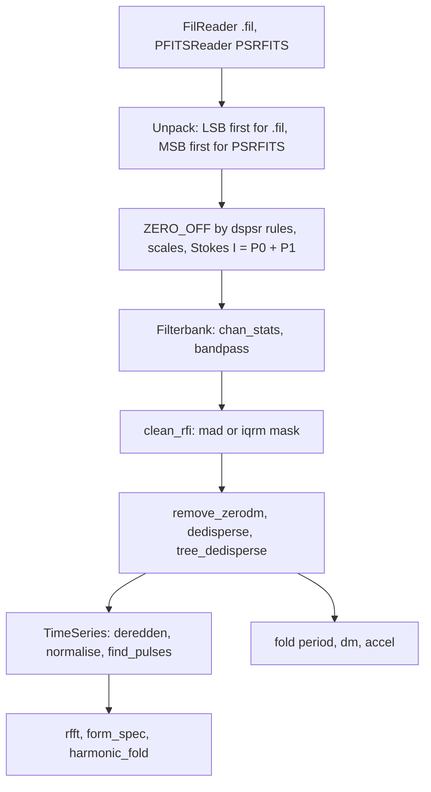

# sigpyproc3 math map

sigpyproc3 (FRBs organisation; Python with numba kernels, MIT; published on PyPI as `sigpyproc` from v2.0.0) is the general Python toolbox for filterbanks, time series and Fourier series. It reads SIGPROC and search-mode PSRFITS, cleans RFI with MAD or IQRM masks, dedisperses, folds and searches, and carries readable reference implementations of PRESTO-style and heimdall-style single-pulse search ([sigpyproc3 repo](https://github.com/FRBs/sigpyproc3), commit `5d8d38f`). It is the main source for our readers and IQRM; see CREDITS.md (not published). Program-level notes: [04-other-search-codes.md](../reference/04-other-search-codes.md); format details: [01-data-formats.md](../reference/01-data-formats.md). Source paths are relative to `src/sigpyproc/`.

**Tags.** [V] = paper; [C] = transcribed from sigpyproc3 source by the reference set; **[unverified]** = not transcribed.



## 1. Sub-byte unpacking [C]

```math
v_k=\big(b\gg s_k\big)\ \&\ (2^{n}-1),\qquad s_k=\begin{cases}n\,k & \text{bitorder little (SIGPROC)}\\ 8-n(k+1) & \text{bitorder big (PSRFITS)}\end{cases}
```

$b$ a byte, $n\in\{1,2,4\}$ bits, $k=0\ldots8/n-1$ the sample index within the byte. Since v2.0, 2- and 4-bit filterbank samples are LSB first "matching dspsr".

- sigpyproc3: `io/bits.py`.
- Ours: `pulsar-analysis-codes/definitions/src/bits.rs` `unpack_into`, `pack` (`BitOrder::LsbFirst`, `BitOrder::MsbFirst`).

## 2. PSRFITS decoding [C]

```math
x=(d-Z_{\rm eff})\,s+o,\qquad Z_{\rm eff}=\begin{cases}0 & n_{\rm bits}\in\{2,16\}\\ \texttt{ZERO\_OFF} & \text{otherwise}\end{cases},\qquad I=P_0+P_1
```

"2-bit levels are already the dspsr lookup"; "16-bit is a signed integer and dspsr does not subtract ZERO_OFF from it". Channel order follows `DAT_FREQ`, which must be uniform; gapped `OFFS_SUB` and split files are rejected; $t_{\rm start}=\texttt{STT\_IMJD}+(\texttt{STT\_SMJD}+\texttt{STT\_OFFS})/86400$ without adding `NSUBOFFS`.

- sigpyproc3: `io/pfits.py` `PFITSFile`, `readers.py` `PFITSReader`; key mapping in `io/params.py`.
- Paper: Hotan, van Straten & Manchester 2004 (PSRFITS).
- Ours: `pulsar-analysis-codes/fits/src/lib.rs` `ZeroOffPolicy::Dspsr`, `zero_for_bits`, `sum_pols`. Unlike sigpyproc3 we pad gaps instead of rejecting them, and keep the start as `pulsar-analysis-codes/definitions/src/time.rs` (integer MJD plus seconds).

## 3. MAD mask [C for the name, unverified for the two-pass rule]

```math
\hat\sigma=1.4826\,{\rm median}\lvert x-{\rm median}(x)\rvert,\qquad \text{flag }\lvert x-{\rm median}(x)\rvert>t\,\hat\sigma
```

`double_mad_mask` applies this twice, to a channel statistic and to its residual after a first pass [unverified].

- sigpyproc3: `core/rfi.py` `double_mad_mask`; `Filterbank.clean_rfi(method="mad", threshold=3)`.
- Paper: Rousseeuw & Croux 1993, JASA 88, 1273.
- Ours: `pulsar-analysis-codes/rfi/src/stats.rs` `median_mad`; `pulsar-analysis-codes/rfi/src/lib.rs` `interval_stats_mask`, `normalise`.

## 4. IQRM [V: Morello, Rajwade & Stappers 2022], [C]

```math
\Delta_i^k=x_i-x_{i+k},\qquad \mu_k=Q_k(0.5),\qquad \sigma_k=\frac{Q_k(0.75)-Q_k(0.25)}{\Phi^{-1}(0.75)-\Phi^{-1}(0.25)}\approx\frac{\rm IQR}{1.349},\qquad \Delta_i^k-\mu_k>t\,\sigma_k
```

Lags $k\in\pm1\ldots r$ (sigpyproc3 writes the difference as $x_i-x_{i+k}$; the paper as $x_i-x_{i-k}$, equivalent over both signs). Each flagged pair casts a vote; a vote $i\to j$ counts only if $i$ cast fewer votes than $j$ received, and any target of a counted vote is masked. Recommended $t=3$, $r\approx0.1N_{\rm chan}$.

- sigpyproc3: `core/rfi.py` `iqrm_mask`; `Filterbank.clean_rfi(method="iqrm")`.
- Paper: Morello, Rajwade & Stappers 2022, MNRAS 510, 1393, arXiv:2108.12434.
- Ours: `pulsar-analysis-codes/rfi/src/iqrm.rs` `lags` (paper's geometric lag rule), `iqrm`; `fb-rfi/src/lib.rs` `iqrm_mask`.

## 5. Zero-DM [D]

```math
x'(t,f)=x(t,f)-\frac{1}{N_f}\sum_{f'}x(t,f')
```

- sigpyproc3: `base.py` `Filterbank.remove_zerodm`.
- Paper: Eatough, Keane & Lyne 2009.
- Ours: `pulsar-analysis-codes/rfi/src/lib.rs` `zero_dm`.

## 6. Dedispersion [unverified, textbook form]

Direct: $I_{\rm DM}(t)=\sum_cI(f_c,t+\lfloor k_{\rm DM}{\rm DM}(f_c^{-2}-f_{\rm ref}^{-2})/t_{\rm samp}\rceil)$. Tree: Taylor's tree sums along straight-line sweeps in $\log_2N_f$ stages, exact only for linear sweeps.

- sigpyproc3: `base.py` `Filterbank.dedisperse`, `tree_dedisperse`, `dedisperse_plan`.
- Paper: Taylor 1974, A&AS 15, 367 (tree); Zackay & Ofek 2017 (comparison).
- Ours: `pulsar-analysis-codes/dedispersion/src/lib.rs` `brute_force`.

## 7. Single-pulse search [C for the structure, unverified for each statistic]

`TimeSeries.find_pulses` runs PRESTO-style (`algorithms/sps.py`) or heimdall-style (`algorithms/heimdall.py`) pipelines: detrend, normalise, boxcar ${\rm S/N}_w=\sum_{j\in w}(x_j-\mu)/(\sigma\sqrt w)$, threshold, cluster. The heimdall reimplementation reproduces prefix-sum boxcars, giant finding and friends-of-friends clustering (see [heimdall.md](heimdall.md)). Candidate tables use `width_bins` and `width_s`, centred for PRESTO/heimdall styles and **start** for its own matched filter.

- sigpyproc3: `algorithms/{box,sps,heimdall}.py`, `core/candidates.py`.
- Ours: `pulsar-analysis-codes/search/single_pulse/src/lib.rs`.

## 8. Folding and acceleration [unverified]

```math
\phi(t)=\frac{t}{P}\Big(1-\frac{a\,t}{2c}\Big),\qquad j={\rm floor}\big(n_b(\phi\bmod1)\big)
```

`Filterbank.fold(period, dm, accel, nbins=50, nints=32, nbands=32)` returns a FoldedData cube; `TimeSeries.resample(accel)` applies the quadratic time stretch of [peasoup.md](peasoup.md) section 5.

- sigpyproc3: `base.py`, `timeseries.py`, `foldedcube.py`.

## 9. Fourier tools [V: REM02 Eq. 31 for interbinning; unverified for the rest]

`FourierSeries.form_spec(interpolate=True)` uses $\lvert A_{k+1/2}\rvert^2$ with $A_{k+1/2}\simeq\frac\pi4(A_k-A_{k+1})$; `PowerSpectrum.harmonic_fold` sums $P(hk)$ over harmonics; `FourierSeries.recon_prof` rebuilds a profile by inverse FFT of selected harmonics.

- sigpyproc3: `fourierseries.py`.
