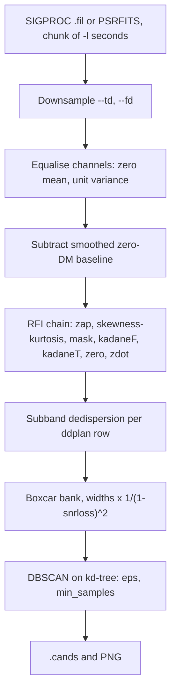

# TransientX math map

TransientX (Yunpeng Men; C++ with AVX2 and OpenMP, GPL-3.0) is a real-time CPU single-pulse search with a long chain of RFI filters, subband dedispersion driven by a ddplan, a geometric boxcar bank and DBSCAN clustering ([TransientX repo](https://github.com/ypmen/TransientX); Men & Barr 2024, A&A 683, A183, [arXiv:2401.13834](https://arxiv.org/abs/2401.13834)). Program-level notes: [04-other-search-codes.md](../reference/04-other-search-codes.md). Source paths are relative to the repository.

**Tags.** [C] = transcribed from TransientX source or docs by the reference set; [D] = derived; [V] = paper; **[unverified]** = not checked against source or paper.



## 1. Downsampling [unverified]

```math
x'_{t,c}=\sum_{i=0}^{n_t-1}\sum_{j=0}^{n_f-1}x_{n_tt+i,\ n_fc+j}
```

`--td` = $n_t$, `--fd` = $n_f$; per-ddplan-row `td`/`fd` downsampling limits intra-channel smearing.

- TransientX: `src/singlepulse/singlepulse.cpp`, `docs/pipeline/dedispersion.rst`.

## 2. Channel equalisation [C for the step, unverified for the estimator]

```math
x'_c(t)=\frac{x_c(t)-\mu_c}{\sigma_c}
```

- TransientX: `SinglePulse::prepare` in `src/singlepulse/singlepulse.cpp`.
- Ours: `pulsar-analysis-codes/rfi/src/lib.rs` `normalise` (median and 1.4826·MAD).

## 3. Zero-DM baseline and zdot [C]

Baseline: subtract a smoothed zero-DM profile $\tilde z(t)$ from every channel. zdot: remove the component of each channel correlated with the zero-DM series $z(t)$,

```math
x_c(t)\leftarrow x_c(t)-\frac{\langle x_c\,z\rangle}{\langle z\,z\rangle}\,z(t)
```

which handles channels with different RFI gains (plain zero-DM is the special case of unit gain).

- TransientX: `docs/pipeline/rfi_mitigation.rst`; filters in `src/singlepulse/`.
- Paper: Men et al. 2019 (zdot) [unverified citation]; Eatough, Keane & Lyne 2009 (zero-DM).
- Ours: `pulsar-analysis-codes/rfi/src/lib.rs` `zero_dm`; zdot planned.

## 4. Skewness–kurtosis IQR channel filter [C for the method, unverified for the fences]

Per channel, sample skewness $g_1=m_3/m_2^{3/2}$ and excess kurtosis $g_2=m_4/m_2^2-3$; channels outside Tukey fences of either statistic are zapped,

```math
x<Q_1-k\,{\rm IQR}\quad\text{or}\quad x>Q_3+k\,{\rm IQR},\qquad {\rm IQR}=Q_3-Q_1
```

- TransientX: `docs/pipeline/rfi_mitigation.rst`.
- Paper: Tukey 1977, *Exploratory Data Analysis*.
- Ours: moments in `pulsar-analysis-codes/rfi/src/stats.rs` `channel_stats`; IQRM over |skew| and |kurtosis| in `fb-rfi/src/lib.rs` `iqrm_mask`; the TransientX filter itself planned.

## 5. IQR time–frequency mask [unverified]

The same Tukey fence applied cell by cell to the time–frequency block (`mask`), after equalisation.


## 6. kadaneF and kadaneT [C for the method, unverified for the threshold]

Kadane's maximum-sum window finds the contiguous run with the largest summed excess, catching slowly varying RFI that a per-sample threshold misses:

```math
M_j=\max(y_j,\ M_{j-1}+y_j),\qquad S^\ast=\max_jM_j,\qquad y_j=x_j-\mu
```

`kadaneF` runs along frequency, `kadaneT` along time; a run is masked when $S^\ast/\sqrt{L}$ exceeds a threshold, $L$ the run length [unverified].

- Paper: Bentley 1984, *Programming Pearls* (Kadane).

## 7. ddplan and subband dedispersion [C], [V]

Plan rows `td fd dms ddm ndm snrloss maxwidth`. Subband dedispersion costs $O(N_{\rm DM}N_t\sqrt{N_f})$ and is reported to match FDMT in practice because it is cache-friendly. Two-stage maths as in [presto.md](presto.md) section 4.2.

- TransientX: `docs/pipeline/dedispersion.rst`; `src/singlepulse/`.
- Paper: Men & Barr 2024.
- Ours: `pulsar-analysis-codes/dedispersion/src/lib.rs` `subband`; ddplan port planned.

## 8. Boxcar widths and S/N [C], [D]

```math
\frac{w_{n+1}}{w_n}=\frac{1}{(1-L)^2},\qquad 1-\sqrt{\frac{w_n}{w_{n+1}}}=L,\qquad {\rm S/N}_w=\sum_{j\in w}x_j\sqrt{\frac{1}{w\,\sigma^2}}
```

$L$ = `snrloss`. For a top-hat pulse of width $W$ searched with boxcar $W_b$, the recovered fraction is $\min(W,W_b)/\sqrt{WW_b}$, so neighbouring widths lose at most $L$ [D]. Optional IQR noise estimates ($\sigma\approx{\rm IQR}/1.349$) for data with many bright bursts. The paper reports about 9% boxcar loss against a scattered Gaussian.

- TransientX: `src/singlepulse/boxcar.cpp`.
- Paper: Men & Barr 2024; Cordes & McLaughlin 2003, Eqs. 15–16.
- Ours: `pulsar-analysis-codes/search/single_pulse/src/lib.rs` `widths`, `boxcar_search`.

## 9. DBSCAN clustering [C]

Above-threshold points in (time, DM-delay) space go into a 2-D kd-tree; DBSCAN with $\varepsilon$ = `-r` (ms, at least $1.5t_{\rm samp}$) and `min_samples` = `-k`. A point is a core point if at least `min_samples` points lie within $\varepsilon$; clusters are connected core points plus their neighbours; isolated points are dropped as noise. `--drop` removes clusters whose width hits `maxwidth`.

- TransientX: `src/singlepulse/cluster.cpp`.
- Paper: Ester et al. 1996, KDD-96 (DBSCAN).
- Ours: `pulsar-analysis-codes/search/single_pulse/src/lib.rs` `cluster` is friends-of-friends (heimdall), not DBSCAN; DBSCAN port planned.

## 10. Output [C]

`.cands` columns `ibeam`, `cand_no`, `mjd` (15 decimals), `dm`, `width_ms`, `snr`, `fl`, `fh`, `png_name`, `id`, `filename`.

- TransientX: `src/singlepulse/candplot.cpp`.
- Ours: adapter planned; our CSV in `pulsar-analysis-codes/products/src/candidates.rs` `write_csv_single` already carries MJD and width in seconds.
