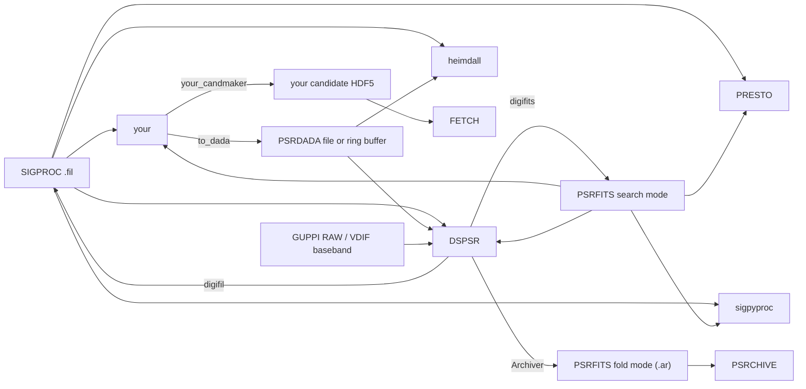
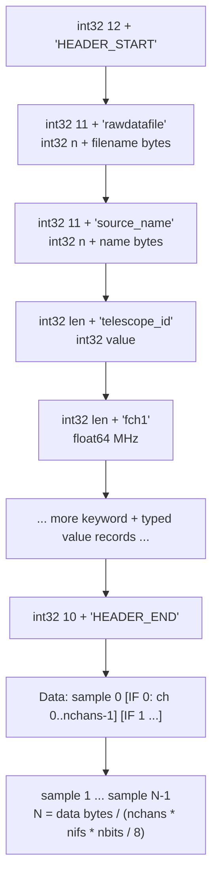
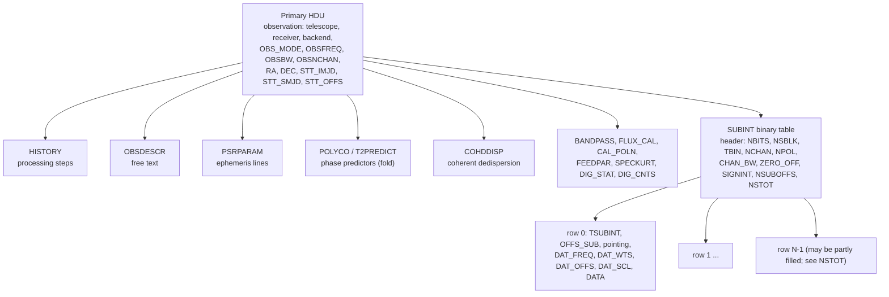
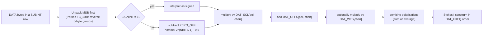
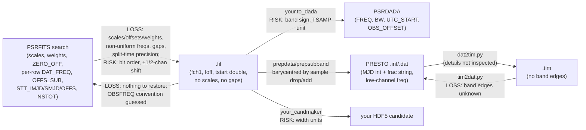

# Decoding pulsar search formats before they bite

Every format in the pulsar and transient search chain stores the same thing, a time by frequency (by polarisation) grid of detected power, but each makes different choices about **bit order, band direction, scaling and time precision**, and no reader honours all of them. SIGPROC filterbank (`.fil`) is a tiny binary keyword header plus raw time-major samples, with sub-byte samples packed **least-significant-bits first**. Search-mode PSRFITS stores the same samples in `SUBINT` table rows packed **most-significant-bits first**, with per-row, per-channel `DAT_SCL`, `DAT_OFFS`, `DAT_WTS`, a `ZERO_OFF` keyword and a split integer/fractional start time, none of which a `.fil` header can hold. PSRDADA is an ASCII `KEY value` header in front of raw voltages or spectra, and PRESTO, heimdall and your/FETCH each add their own headerless or ad hoc intermediate files. The tools that read these formats disagree on whether to subtract `ZERO_OFF`, whether to apply the scales, how to sum polarisations (sum versus average, a 2x level difference) and which way the band runs. Converting PSRFITS to filterbank therefore always loses information, and it corrupts data silently when the converter copies packed bytes or ignores row gaps. Our own converter in `pulsar-analysis-codes/fits/converter` does exactly that today: it copies 1/2/4-bit bytes unchanged, ignores every scaling column, trusts only the first row's frequencies and concatenates files without checking continuity.

Unless stated otherwise, the source facts come from reading code snapshots taken on 2026-11-24: SIGPROC (SixByNine fork, commit c8bcbd7), PRESTO (4a5bd80), sigpyproc3 (5d8d38f), your (5126d3b), heimdall (69a33da), PSRDADA (151198e), and the ATNF PSRFITS v6.1 definition page ([PSRFITS documentation](https://www.atnf.csiro.au/research/pulsar/psrfits_definition/PsrfitsDocumentation.html)). Line-level behaviour can change after those commits.

## Six on-disk families feed four kinds of tool

The formats fall into three layers. **Raw or channelised data** come as SIGPROC filterbank, search-mode PSRFITS, PSRDADA, GUPPI RAW and VDIF. **Search intermediates** are PRESTO's `.inf`/`.dat`/`.fft` and rfifind files, plus SIGPROC `.tim`. **Candidates and products** are ACCEL text and `.cand`, `.singlepulse`, `.pfd`, heimdall `.cand`, your/FETCH HDF5, and fold-mode PSRFITS archives. The diagram shows which tool reads which input in the codebases we inspected.

The edges come from each tool's reader classes: PRESTO's `sigproc_fb.c` and `psrfits.c` ([PRESTO src](https://github.com/scottransom/presto/tree/master/src)), heimdall's `SigprocFile.C` and `PSRDadaRingBuffer.C` ([heimdall Formats](https://sourceforge.net/p/heimdall-astro/code/ci/master/tree/Formats/)), `class Your(PsrfitsFile, SigprocFile)` and its `Writer.to_dada` ([your.py](https://github.com/thepetabyteproject/your/blob/main/your/your.py), [writer.py](https://github.com/thepetabyteproject/your/blob/main/your/writer.py)), sigpyproc's `FilReader`/`PFITSReader` ([readers.py](https://github.com/FRBs/sigpyproc3/blob/main/src/sigpyproc/readers.py)), DSPSR's `Kernel/Formats` directories (`fits`, `sigproc`, `dada` and about 40 others) and the `digifil`/`digifits` programs ([DSPSR Kernel/Formats](https://sourceforge.net/p/dspsr/code/ci/master/tree/Kernel/Formats/), [Signal/General](https://sourceforge.net/p/dspsr/code/ci/master/tree/Signal/General/)), PSRCHIVE's `Base/Formats` plugins ([PSRCHIVE Base/Formats](https://sourceforge.net/p/psrchive/code/ci/master/tree/Base/Formats/)), and FETCH's `DataGenerator` ([data_sequence.py](https://github.com/devanshkv/fetch/blob/tf2/fetch/data_sequence.py)). A full-text search of PRESTO, SIGPROC, sigpyproc3, your, heimdall and PSRDADA for `parquet|pyarrow|feather` hit only a PRESTO dependency lock file, so **no tool in this chain reads or writes Arrow or Parquet**.

## SIGPROC filterbank is a typed keyword stream with no endianness marker

### Byte layout

A `.fil` file is a sequence of keyword records between two delimiter strings, followed immediately by the data. Every string, keyword names included, is written by `send_string()` as a native `int32` length followed by that many ASCII bytes, with **no NUL terminator**. A typed value follows its keyword name as raw native-order bytes: `int` (4 B), `double` (8 B), `float` (4 B), `char` (1 B) or `long` (8 B on LP64). Bytes are swapped only when the writer's global `swapout` is set ([send_stuff.c](https://github.com/SixByNine/sigproc/blob/master/src/send_stuff.c)). The two string-valued keywords, `rawdatafile` and `source_name`, are followed by a second length-prefixed string that holds the value ([read_header.c](https://github.com/SixByNine/sigproc/blob/master/src/read_header.c)).

Readers are strict. SIGPROC's `get_string()` rejects any length outside 1..80, a file that does not start with `HEADER_START` is "not in standard format", an unknown keyword is fatal, and the returned header length is cross-checked against `ftell` ([read_header.c](https://github.com/SixByNine/sigproc/blob/master/src/read_header.c)). PRESTO's `read_filterbank_header()` uses the same algorithm, also exits on unknown keywords, and computes the sample count from the file size as `(filelen − headerlen) / (nchans / (8/nbits))` for nbits ≤ 8 ([sigproc_fb.c](https://github.com/scottransom/presto/blob/master/src/sigproc_fb.c)). Because **nothing marks byte order**, a reader can only detect a big-endian file by noticing an implausible first `int32` length and retrying with swapped bytes. Every file in current use is little-endian.

### Keywords and who reads them

The table merges SIGPROC's `header.h`/`read_header.c` types with the fields each downstream tool actually uses. "PRESTO" means `sigproc_fb.c` ([source](https://github.com/scottransom/presto/blob/master/src/sigproc_fb.c)), "heimdall" means `SigprocFile.C` ([source](https://sourceforge.net/p/heimdall-astro/code/ci/master/tree/Formats/SigprocFile.C)), and "sigpyproc" means `io/params.py` ([source](https://github.com/FRBs/sigpyproc3/blob/main/src/sigpyproc/io/params.py)), which reads every key here plus extras.

| Keyword | Type on disk | Unit | Meaning | Read by |
|---|---|---|---|---|
| `HEADER_START`, `HEADER_END` | string only | | delimiters | all |
| `rawdatafile` | string + string | | original file name, ≤ 80 chars | sigpyproc |
| `source_name` | string + string | | source name, ≤ 80 chars | sigpyproc, your |
| `telescope_id` | int32 | code | 0 Fake, 1 Arecibo, 4 Parkes, 6 GBT, 7 GMRT, 8 Effelsberg, 64 MeerKAT, ... | PRESTO (site name) |
| `machine_id` | int32 | code | backend: 10 BPSR, 14 GMRTNEW, 64 KAT, 83 ROACH, ... | PRESTO |
| `data_type` | int32 | | 1 filterbank, 2 time series, 3 profiles, 6 dedispersed subbands | sigpyproc |
| `barycentric`, `pulsarcentric` | int32 | flag | time reference frame | sigpyproc |
| `az_start`, `za_start` | double | deg | pointing at start | PRESTO |
| `src_raj` | double | packed `hhmmss.s` | e.g. 053431.97 = 05:34:31.97 | PRESTO, sigpyproc |
| `src_dej` | double | packed `±ddmmss.s` | the sign applies to the whole value | PRESTO, sigpyproc |
| `tstart` | double | MJD (UTC) | time of first sample | PRESTO, heimdall, sigpyproc, your |
| `tsamp` | double | s | sampling interval | PRESTO, heimdall, sigpyproc, your |
| `nbits` | int32 | bits | 1, 2, 4, 8, 16, 32 | PRESTO, heimdall, sigpyproc, your |
| `nsamples` | int32 | | legacy; read and **discarded** | nobody |
| `fch1` | double | MHz | centre of the first channel stored | PRESTO, heimdall, sigpyproc, your |
| `foff` | double | MHz | channel step; negative means frequency falls with channel index | PRESTO, heimdall, sigpyproc, your |
| `fchannel` | double, repeated | MHz | explicit table between `FREQUENCY_START`/`END`, max 4096 channels; sets `fch1 = foff = 0` | SIGPROC only |
| `nchans` | int32 | | channel count | PRESTO, heimdall, sigpyproc, your |
| `nifs` | int32 | | IFs/polarisations | PRESTO (`nifs > 1` sets `num_polns`) |
| `refdm` | double | pc cm⁻³ | DM of a `.tim` or subband file | sigpyproc |
| `period`, `nbins`, `npuls` | double, int32, long | s, , | folded-profile files | sigpyproc |
| `nbeams`, `ibeam` | int32 | | beam count and index | PRESTO (default `ibeam = 1`), heimdall |
| `signed` | char (1 B) | flag | signedness of 8-bit data | PRESTO, sigpyproc |

Telescope and machine codes come from SIGPROC's `aliases.c` ([source](https://github.com/SixByNine/sigproc/blob/master/src/aliases.c)). PRESTO keeps its own partly different tables in `get_telescope_name()`/`get_backend_name()` ([sigproc_fb.c](https://github.com/scottransom/presto/blob/master/src/sigproc_fb.c)), so **IDs above 10 depend on which tool wrote the file**. The reference writer has a bug worth knowing: `send_coords()` guards on `(raj != 0.0) || (raj != -1.0)`, which is always true, so `src_raj`, `src_dej`, `az_start` and `za_start` are always written, sentinel values included ([send_stuff.c](https://github.com/SixByNine/sigproc/blob/master/src/send_stuff.c)). When SIGPROC inverts the band on output, it rewrites `fch1 = fch1 + foff·(nchans−1)` and `foff = −foff` ([filterbank_header.c](https://github.com/SixByNine/sigproc/blob/master/src/filterbank_header.c)).

Readers use only a fraction of this table. **heimdall reads seven fields**: `nchans`, `nbits`, `ibeam`, `tsamp`, `fch1`, `foff` and `tstart`. **your's `pysigproc` supports only nbits 8, 16 and 32** and raises `nbits=%d not supported` for packed data ([pysigproc.py](https://github.com/thepetabyteproject/your/blob/main/your/formats/pysigproc.py)). AstroAccelerate rejects `nifs != 1` ([aa_sigproc_input.cpp](https://github.com/AstroAccelerateOrg/astro-accelerate/blob/master/src/aa_sigproc_input.cpp)).

### Sub-byte packing and band direction

SIGPROC's `read_block()` unpacks 1-bit data with `block[k++]=charblock[i]&1; charblock[i]>>=1`, 2-bit data as bits 0–1, 2–3, 4–5, 6–7, and 4-bit data low nibble first, so **the earliest channel sits in the least-significant bits** ([pack_unpack.c](https://github.com/SixByNine/sigproc/blob/master/src/pack_unpack.c), [read_block.c](https://github.com/SixByNine/sigproc/blob/master/src/read_block.c)). sigpyproc defaults to `bitorder="little"` for 1/2/4-bit filterbanks ([bits.py](https://github.com/FRBs/sigpyproc3/blob/main/src/sigpyproc/io/bits.py)), and its v2.0 release notes say 2- and 4-bit samples are packed LSB first "matching dspsr" ([HISTORY.rst](https://github.com/FRBs/sigpyproc3/blob/main/HISTORY.rst)). PRESTO reaches the same answer by a different route. `convert_filterbank_block()` always reverses channel order, walks packed bytes from the end of the spectrum and emits MSB first within each byte, then sets `lo_freq = fch1 − (nchan−1)·|foff|` ([sigproc_fb.c](https://github.com/scottransom/presto/blob/master/src/sigproc_fb.c)). That is correct for the usual `foff < 0` file. Reading the code, a file with `foff > 0` would come out with a reversed frequency axis. This has not been tested, so writers should emit `foff < 0` or check with PRESTO's `readfile`.

### Time series (.tim)

A `.tim` is the same header with `data_type = 2`, `nchans = 1`, `refdm` and `fch1` as the reference frequency, followed by float32 samples ([filterbank_header.c](https://github.com/SixByNine/sigproc/blob/master/src/filterbank_header.c), [header.c](https://github.com/SixByNine/sigproc/blob/master/src/header.c)). It does not record the band edges, so riptide asks for `fmin`, `fmax` and `nchans` in its YAML config when it reads `.tim` input ([riptide example.yaml](https://github.com/v-morello/riptide/blob/master/src/riptide/pipeline/config/example.yaml)).

## PSRFITS packs the same samples into scaled SUBINT rows

PSRFITS (Hotan, van Straten & Manchester 2004, [PASA 21, 302](https://ui.adsabs.harvard.edu/abs/2004PASA...21..302H)) is ordinary FITS. A primary HDU describes the observation and binary-table extensions carry everything else. `OBS_MODE` decides the interpretation: `SEARCH` for streamed multichannel data, `PSR` for folded profiles, `CAL` for profiles folded on the noise diode ([PSRFITS documentation](https://www.atnf.csiro.au/research/pulsar/psrfits_definition/PsrfitsDocumentation.html)).

### Primary HDU keywords

| Keyword | Type | Unit | Meaning | Used by |
|---|---|---|---|---|
| `HDRVER`, `FITSTYPE` | str | | `'6.1'`, `'PSRFITS'` | validators |
| `TELESCOP` | str | | should follow TEMPO2 site names | PRESTO (Parkes FB_1BIT check), DSPSR, PSRCHIVE |
| `ANT_X/Y/Z` | double | m | ITRF antenna position | timing |
| `FRONTEND`, `IBEAM`, `NRCVR` | str, str, int | | receiver, beam, receptor count | sigpyproc (`IBEAM` → `ibeam`) |
| `FD_POLN`, `FD_HAND`, `FD_SANG`, `FD_XYPH` | str, int, double, double | , , deg, deg | feed basis (`LIN`/`CIRC`), handedness, angles | PSRCHIVE calibration |
| `BACKEND`, `BECONFIG` | str | | backend and its configuration | PRESTO (FB_1BIT check) |
| `BE_PHASE`, `BE_DCC`, `BE_DELAY`, `TCYCLE` | int, int, double, double | , , s, s | cross-product sign, sideband flag, backend delay, cycle time | DSPSR, PSRCHIVE |
| `OBS_MODE` | str | | `PSR`, `CAL`, `SEARCH` | everyone |
| `DATE-OBS` | str | UTC | approximate start | informational |
| `OBSFREQ` | double | MHz | centre of channel `OBSNCHAN/2` (channels numbered from 1), **not** the band centre | your writer, fallbacks |
| `OBSBW`, `OBSNCHAN` | double, int | MHz | nominal total bandwidth and channel count | sigpyproc (`OBSNCHAN` → `nchans`) |
| `CHAN_DM` | double | pc cm⁻³ | DM of on-line coherent dedispersion | PRESTO, sigpyproc |
| `SRC_NAME`, `RA`, `DEC` | str | `hh:mm:ss.ssss`, `−dd:mm:ss.sss` | source and position | PRESTO, sigpyproc |
| `TRK_MODE`, `SCANLEN`, `STT_CRD*`, `STP_CRD*` | | , s, | tracking mode and start/stop coordinates | informational |
| `CAL_MODE`, `CAL_FREQ`, `CAL_DCYC`, `CAL_PHS` | | , Hz, , | injected calibrator | PSRCHIVE |
| `STT_IMJD` | int | day | integer UTC MJD of the first sample's leading edge | PRESTO, sigpyproc, your |
| `STT_SMJD` | int | s | integer seconds past 0h UTC | PRESTO, sigpyproc, your |
| `STT_OFFS` | double | s | fractional seconds | PRESTO, sigpyproc, your |
| `STT_LST` | double | s | approximate LST at start | informational |

### SUBINT header keywords

| Keyword | Type | Unit | Meaning | Used by |
|---|---|---|---|---|
| `EPOCHS` | str | | `VALID`, `MIDTIME` or `STT_MJD` (default): how row epochs relate to phase | fold-mode readers |
| `INT_TYPE`, `INT_UNIT` | str | | time-axis type and unit | fold-mode readers |
| `POL_TYPE` | str | | `AA+BB` (NPOL=1), `AABB`, `AABBCRCI`, `IQUV` | PRESTO, sigpyproc, your |
| `NPOL` | int | | polarisation products in `DATA` | all |
| `TBIN` | double | s | sampling interval (search) or bin width (fold) | all (`tsamp`) |
| `NBIN` | int | | profile bins; 1 in search mode | fold readers |
| `NBITS` | int | bits | bits per sample in search mode; ignored in fold mode | all |
| `ZERO_OFF` | double | digitiser units | offset of the nominal zero: actual = unsigned value − ZERO_OFF | PRESTO (absolute value), sigpyproc (dspsr rules); **your never** |
| `SIGNINT` | int | flag | 1 = signed integers in search mode | readers that honour it |
| `NSUBOFFS` | int | rows | rows preceding this file in a time-split set | PRESTO (cross-checked against `OFFS_SUB`), sigpyproc (kept but not added) |
| `NCHAN`, `CHAN_BW` | int, double | , MHz | channels in this file; `CHAN_BW < 0` means frequency falls with channel index | all |
| `NCHNOFFS` | int | | first channel's true index in frequency-split files | rare |
| `DM`, `RM` | double | pc cm⁻³, rad m⁻² | values used for post-detection dedispersion | fold readers |
| `NSBLK` | int | samples | samples per row, "typically 4096" | all |
| `NSTOT` | int | samples | valid samples in this file; the last row may be partly filled | careful readers |

### SUBINT columns

| Column | TFORM | Unit | Meaning | Used by |
|---|---|---|---|---|
| `INDEXVAL` | 1D | | time-like coordinate if `INT_TYPE ≠ TIME` | fold |
| `TSUBINT` | 1D | s | duration of the row | sigpyproc |
| `OFFS_SUB` | 1D | s | time since start **at the centre** of the row | PRESTO (gap padding), sigpyproc (gaps rejected) |
| `LST_SUB`, `RA_SUB`, `DEC_SUB`, `GLON_SUB`, `GLAT_SUB` | 1D | s, deg | pointing at row centre | drift scans |
| `FD_ANG`, `POS_ANG`, `PAR_ANG` | 1E | deg | feed, position and parallactic angle | polarimetry |
| `TEL_AZ`, `TEL_ZEN` | 1E | deg | azimuth and zenith angle at row centre | sigpyproc, our converter (first row) |
| `AUX_DM`, `AUX_RM` | 1D | | extra time-varying DM/RM | rare |
| `DAT_FREQ` | NCHAN·D | MHz | centre of each channel, **per row** | PRESTO (endpoints), sigpyproc (must be uniform), your |
| `DAT_WTS` | NCHAN·E | | weight 0–1; 0 = RFI or outside band | PRESTO, sigpyproc, your |
| `DAT_OFFS` | NCHAN·NPOL·E | | offset per channel and polarisation | PRESTO, sigpyproc, your |
| `DAT_SCL` | NCHAN·NPOL·E | | scale per channel and polarisation | PRESTO, sigpyproc, your |
| `DATA` | I (fold) or B (search) | | TDIM (NBIN, NCHAN, NPOL) for fold; (NCHAN, NPOL, NSBLK·NBITS/8) for search | all |

All three tables come from the v6.1 definition ([PSRFITS documentation](https://www.atnf.csiro.au/research/pulsar/psrfits_definition/PsrfitsDocumentation.html)), and the "used by" columns from PRESTO's `read_PSRFITS_files()` ([psrfits.c](https://github.com/scottransom/presto/blob/master/src/psrfits.c)), sigpyproc's `PFITSFile` ([pfits.py](https://github.com/FRBs/sigpyproc3/blob/main/src/sigpyproc/io/pfits.py)) and your's `PsrfitsFile` ([psrfits.py](https://github.com/thepetabyteproject/your/blob/main/your/formats/psrfits.py)). sigpyproc maps PSRFITS to SIGPROC keys as `IBEAM→ibeam`, `NBITS→nbits`, `OBSNCHAN→nchans`, `SRC_NAME→source_name`, `RA→src_raj`, `DEC→src_dej`, `CHAN_BW→foff` and `TBIN→tsamp` ([params.py](https://github.com/FRBs/sigpyproc3/blob/main/src/sigpyproc/io/params.py)).

### Bit packing and the scaling equation

Search-mode `DATA` is a byte array of 1/2/4/8-bit integers in channel, polarisation, sample order with channels contiguous. Sub-byte values are "packed with earlier samples in higher-order bits of the byte" ([PSRFITS documentation](https://www.atnf.csiro.au/research/pulsar/psrfits_definition/PsrfitsDocumentation.html)), **the reverse of SIGPROC**. PRESTO unpacks 4-bit as `uctmp>>4` then `uctmp&0x0F` and 2-bit as `>>6, >>4, >>2, &3`. As a special case it byte-reverses 8-byte groups of 1-bit data when `TELESCOP` is Parkes and `BACKEND` is `FB_1BIT` ([psrfits.c](https://github.com/scottransom/presto/blob/master/src/psrfits.c)). your's 2/4-bit unpackers are MSB first ([psrfits.py](https://github.com/thepetabyteproject/your/blob/main/your/formats/psrfits.py)), and sigpyproc uses `bitorder="big"` for PSRFITS ([pfits.py](https://github.com/FRBs/sigpyproc3/blob/main/src/sigpyproc/io/pfits.py)).

The physical value of a sample is **`(DATA − ZERO_OFF) · DAT_SCL + DAT_OFFS`**, with `ZERO_OFF` "normally" 2^(NBITS−1) − 0.5 for unsigned data. Fold mode stores 16-bit signed integers with profile bins contiguous and uses `DATA · DAT_SCL + DAT_OFFS` ([PSRFITS documentation](https://www.atnf.csiro.au/research/pulsar/psrfits_definition/PsrfitsDocumentation.html)). The prose spells the keyword `ZERO_OFFS`, but the table name is `ZERO_OFF`. The spec also says search spectra, usually normalised as (S−R)/R before few-bit digitisation, "are normally analysed directly without application of the scale factors and offsets". That sentence is why the tools disagree.

Each tool takes a different path through that diagram. **PRESTO** computes `((raw − |ZERO_OFF|)·scale + offset)·weight` for every nbits, 16- and 32-bit included, but applies weights, offsets and scales only when the **first row** is non-trivial, unless the user forces it. It silently makes a negative `ZERO_OFF` positive. **sigpyproc** follows "dspsr unpacker rules": it subtracts `ZERO_OFF` except for 2-bit data ("2-bit levels are already the dspsr lookup") and 16-bit data ("16-bit is a signed integer and dspsr does not subtract ZERO_OFF from it"). **your** applies `data *= DAT_SCL; data += DAT_OFFS; data *= DAT_WTS` and **never reads `ZERO_OFF`** at all ([psrfits.c](https://github.com/scottransom/presto/blob/master/src/psrfits.c), [pfits.py](https://github.com/FRBs/sigpyproc3/blob/main/src/sigpyproc/io/pfits.py), [psrfits.py](https://github.com/thepetabyteproject/your/blob/main/your/formats/psrfits.py)). **DSPSR** leaves scales and offsets off unless the user passes `-scloffs` ("denormalize PSRFITS using DAT_SCL and DAT_OFFS"), and `-W` disables weights ([dspsr.C](https://sourceforge.net/p/dspsr/code/ci/master/tree/Signal/Pulsar/dspsr.C)). Polarisations are combined differently too. PRESTO sums AA and BB, your averages them (×0.5), and sigpyproc forms P0+P1 for coherence data, so **absolute levels differ by a factor of two between tools**. your can also form I, (I±V)/2 or (I±Q)/2 from IQUV data.

Frequency and time handling differ just as much. PRESTO takes `df = (f[N−1] − f[0])/(N−1)` from `DAT_FREQ`, only warns ("Channel spacing changes") if the spacing varies by more than 1e-7 MHz, and flips the band when `hi_freq < lo_freq`. sigpyproc refuses non-uniform `DAT_FREQ` and keeps the file's channel order. For time, PRESTO compares `NSUBOFFS` with what `OFFS_SUB` implies, trusts `OFFS_SUB`, pads missing rows, and rejects files in which only some `OFFS_SUB` values are zero ("Not good PSRFITS"). sigpyproc refuses gapped or split files outright and computes `tstart = STT_IMJD + (STT_SMJD + STT_OFFS)` without adding `NSUBOFFS`.

### Fold mode and the auxiliary HDUs

Fold-mode files, the archives that DSPSR's `Archiver` writes and PSRCHIVE reads ([03-dspsr-psrchive-timing](./03-dspsr-psrchive-timing.md)), use the same `SUBINT` table with `NBIN > 1`, 16-bit `DATA` of shape (NBIN, NCHAN, NPOL), and phase information carried in `POLYCO` or `T2PREDICT` plus the ephemeris in `PSRPARAM`. The `POLYCO` HDU holds `DATE_PRO`, `POLYVER`, `NSPAN` (minutes), `NCOEF` (≤ 15), `NPBLK`, `NSITE`, `REF_FREQ`, `PRED_PHS`, `REF_MJD`, `REF_PHS`, `REF_F0`, `LGFITERR` and `COEFF`. `HISTORY` records each processing step (`PROC_CMD`, `DEDISP`, `SC_MTHD`, `CAL_MTHD`, `RFI_MTHD` and others), and `BANDPASS` stores the original bandpasses with the same `DATA · DAT_SCL + DAT_OFFS` scaling ([PSRFITS documentation](https://www.atnf.csiro.au/research/pulsar/psrfits_definition/PsrfitsDocumentation.html)). PSRCHIVE's PSRFITS plugin ships a `psrheader.fits` template that defines the fold-mode header it writes ([PSRCHIVE Base/Formats](https://sourceforge.net/p/psrchive/code/ci/master/tree/Base/Formats/)). Which of these tables PSRCHIVE reads back was not verified at source level.

## PSRDADA, GUPPI and VDIF carry raw streams with minimal metadata

A **PSRDADA** file or ring-buffer block starts with a fixed-size ASCII header of newline-separated `KEY value` pairs, accessed through `ascii_header_set`/`ascii_header_get`. Those functions do not know the header size, so overflow is the caller's problem ([header.tex](https://sourceforge.net/p/psrdada/code/ci/master/tree/doc/header.tex)). `HDR_SIZE` gives the header length, commonly 4096 B, which matches the default `DADA_DEFAULT_HEADER_SIZE = sysconf(_SC_PAGE_SIZE)`. The default ring buffer has key `0x0000dada` and 4 blocks of `page_size·128` bytes, and headers travel in their own ring buffer, one header per sub-block ([dada_def.h](https://sourceforge.net/p/psrdada/code/ci/master/tree/src/dada_def.h)).

| Key | Example | Unit | Meaning | Read by heimdall |
|---|---|---|---|---|
| `HDR_VERSION`, `HDR_SIZE` | `1.0`, `4096` | , bytes | header version and length | |
| `INSTRUMENT`, `TELESCOPE` | `CASPSR`, `PKS` | | backend and site | |
| `SOURCE`, `RA`, `DEC` | | | target | |
| `UTC_START`, `MJD_START` | `2010-04-13-02:05:45` | | observation start | yes (`UTC_START`) |
| `OBS_OFFSET` | `0` | bytes | offset of this file's first byte from the observation start | |
| `FREQ` (heimdall also takes `CFREQ`) | `1382` | MHz | centre frequency | yes |
| `BW` (heimdall also takes `BANDWIDTH`) | `-400` | MHz | bandwidth; negative = inverted band | yes |
| `NCHAN`, `NPOL`, `NBIT`, `NDIM` | `1`, `2`, `8`, `1` | | channels, polarisations, bits, 1 real or 2 complex | yes (NCHAN, NPOL, NBIT) |
| `TSAMP` | `0.00125` | µs (inferred, see below) | sampling interval | yes |
| `BEAM` | | | beam index | yes |
| `RESOLUTION`, `ORDER` | `4`, e.g. `TF` | bytes, | splitting granularity and sample order | DSPSR and instrument code |

The keys and example values are from the spec and the shipped example header ([header.tex](https://sourceforge.net/p/psrdada/code/ci/master/tree/doc/header.tex), [header.dada](https://sourceforge.net/p/psrdada/code/ci/master/tree/examples/src/header.dada)). heimdall builds its frequency axis as `f0 = cfreq − bw/2 + (bw/nchan)/2` and `df = bw/nchan`, so a negative `BW` produces a descending band ([PSRDadaRingBuffer.C](https://sourceforge.net/p/heimdall-astro/code/ci/master/tree/Formats/PSRDadaRingBuffer.C)). `RESOLUTION` and `ORDER` do not appear in `header.tex`, so their meaning is set by instruments and DSPSR's `DADAHeader.C`/`ASCIIObservation.C`, which we did not read. **TSAMP units need checking per instrument.** The spec text we read gives no unit. Our inference is microseconds: a 400 MHz real-sampled single-channel stream like the CASPSR example samples every 1.25 ns, which is 0.00125 µs, whereas a SIGPROC `tsamp` is in seconds. A DADA-to-filterbank bridge that copies the number without conversion is off by 10⁶.

**GUPPI RAW** frames have an ASCII header of 80-character FITS-like cards ending in `END` padded with 77 spaces, then a binary block of 8-bit samples. Files typically hold 128 frames, and each channel's block ends with overlap samples that repeat the start of the next block, which a reader must drop ([Baseband GUPPI](https://baseband.readthedocs.io/en/stable/guppi/index.html)). **VDIF** (spec 1.1.1 at [vlbi.org](https://vlbi.org/vlbi-standards/vdif/)) uses little-endian frames with a 32-byte header (16 B in legacy mode) whose last four words depend on the Extended Data Version. Frames that share channels form a thread, and the threads covering one time segment form a frameset ([Baseband VDIF](https://baseband.readthedocs.io/en/stable/vdif/index.html)). In our tool set only DSPSR reads either of these directly. Everything else sees them after `digifil`/`digifits` have turned them into filterbank or PSRFITS.

## PRESTO's intermediates are raw C structs behind text sidecars

PRESTO pairs headerless native-endian arrays with a human-readable `.inf`. Every binary format below follows an in-memory C struct and carries **no version field and no endianness marker** ([02-presto](./02-presto.md) covers the programs that write them).

| File | Written by | Layout |
|---|---|---|
| `.inf` | prepdata, prepsubband, rfifind, realfft | text, fixed left-hand labels `=` value (below) |
| `.dat` | prepdata, prepsubband | float32 samples, no header; length and `dt` come from `.inf` |
| `.fft` | realfft | N/2 complex64; the Nyquist term sits in the imaginary part of bin 0 |
| `_red.fft` | rednoise | same layout, whitened normalisation |
| `.subNN` | prepsubband `-sub` | partially dedispersed subbands, name `%s_DM%.*f.sub%0Nd` |
| `_rfifind.mask` | rfifind | binary, below |
| `.bytemask` | rfifind | uint8 `[numint][numchan]` bit flags |
| `.stats` | rfifind | int32 numchan, numint, ptsperint, lobin, numbetween; then float32 `datapow`, `dataavg`, `datastd`, each `[numchan·numint]` |
| `.rfi` | rfifind | int32 numchan, numint, ptsperint, lobin, numbetween, harmsum, numrfi; float32 fracterror, freqsigma; then numrfi records {float freq_avg, freq_var, sigma_avg; int numobs; bitmask times[⌈numint/8⌉]; bitmask chans[⌈numchan/8⌉]} |
| `_ACCEL_<z>[_JERK_<w>]` | accelsearch | text tables, with the `.inf` appended |
| `_ACCEL_<z>.cand` | accelsearch | raw array of `fourierprops` structs |
| `.singlepulse` | single_pulse_search.py | text: `# DM Sigma Time (s) Sample Downfact` |
| `.pfd` | prepfold | sequential binary, below |

Sources: [ioinf.c](https://github.com/scottransom/presto/blob/master/src/ioinf.c), [makeinf.h](https://github.com/scottransom/presto/blob/master/include/makeinf.h), [fastffts.c](https://github.com/scottransom/presto/blob/master/src/fastffts.c), [prepsubband.c](https://github.com/scottransom/presto/blob/master/src/prepsubband.c), [mask.c](https://github.com/scottransom/presto/blob/master/src/mask.c), [rfifind.c](https://github.com/scottransom/presto/blob/master/src/rfifind.c), [rfi_utils.c](https://github.com/scottransom/presto/blob/master/src/rfi_utils.c), [accel_utils.c](https://github.com/scottransom/presto/blob/master/src/accel_utils.c), [single_pulse_search.py](https://github.com/scottransom/presto/blob/master/bin/single_pulse_search.py).

### .inf

`writeinf()` emits, in order: data file name without suffix, telescope, instrument, object, J2000 RA (`hh:mm:ss.ssss`), J2000 Dec, observer, **epoch of observation (MJD) written as `%d.%s`**, meaning an integer plus a fractional string so full precision survives, barycentred flag, number of bins, bin width in seconds (`%.15g`), a breaks flag with `On/Off bin pair` lines, EM band, and for radio data beam diameter, DM, **central frequency of the low channel**, total bandwidth, number of channels and channel bandwidth, then analyst and notes ([ioinf.c](https://github.com/scottransom/presto/blob/master/src/ioinf.c)). The epoch refers to the first sample at the centre of the **highest** channel, because PRESTO never shifts the top channel during dedispersion ([PRESTO FAQ](https://github.com/scottransom/presto/blob/master/FAQ.md)). `.dat` files are barycentred by default, by adding or dropping samples rather than resampling ([prepdata.c](https://github.com/scottransom/presto/blob/master/src/prepdata.c)). sigpyproc accepts both the current `(1 yes, 0 no)` label and an older `(1=yes, 0=no)` spelling it once wrote ([params.py](https://github.com/FRBs/sigpyproc3/blob/main/src/sigpyproc/io/params.py)).

### rfifind mask

| Field | Type | Meaning |
|---|---|---|
| `timesigma`, `freqsigma` | double | sigma cutoffs |
| `mjd` | double | MJD of time zero |
| `dtint` | double | seconds per interval |
| `lofreq`, `dfreq` | double | low-channel frequency and channel width, MHz |
| `numchan`, `numint`, `ptsperint` | int32 | dimensions |
| `num_zap_chans` + list | int32 + int32[n] | channels zapped everywhere |
| `num_zap_ints` + list | int32 + int32[n] | intervals zapped entirely |
| `num_chans_per_int` | int32[numint] | per-interval zap counts |
| `chans[ii]` | int32[n_ii] | present **only when 0 < n_ii < numchan** |

The last row is the trap: a fully zapped interval has no list, so a reader that does not reproduce the condition desynchronises ([mask.c](https://github.com/scottransom/presto/blob/master/src/mask.c), [mask.h](https://github.com/scottransom/presto/blob/master/include/mask.h)). The `.bytemask` flags are `GOODDATA 0x00`, `PADDING 0x01`, `OLDMASK 0x02`, `USERCHAN 0x04`, `USERINTS 0x08`, `BAD_POW 0x10`, `BAD_STD 0x20` and `BAD_AVG 0x40`.

### ACCEL candidates

The text file has a fundamentals table (Cand, Sigma, Summed Power, Coherent Power, Num Harm, Period ms, Frequency Hz, FFT `r`, Freq Deriv Hz/s, FFT `z`, FFT `w`, Accel m/s², Notes) and a harmonics table (Cand, Harm, Sigma, Power/Loc Pow, Raw Power, FFT `r`/Pred `r`, FFT `z`/Pred `z`, FFT `w`/Pred `w`, Phase, Centroid, Purity, Notes) ([accel_utils.c](https://github.com/scottransom/presto/blob/master/src/accel_utils.c)). The binary `.cand` is `fwrite(props, sizeof(fourierprops), numcands)` of `{double r; float rerr; double z; float zerr; double w; float werr; float pow, powerr, sig, rawpow, phs, phserr, cen, cenerr, pur, purerr, locpow}` ([accelsearch.c](https://github.com/scottransom/presto/blob/master/src/accelsearch.c), [presto.h](https://github.com/scottransom/presto/blob/master/include/presto.h)). With natural alignment on LP64 that is **88 bytes per record including two 4-byte pads** after `rerr` and `zerr`, so a NumPy dtype that omits the pads reads garbage. `r`, `z` and `w` are in Fourier units (bins, ḟT², f̈T³), and accelsearch quotes f and ḟ at the observation midpoint, while prepfold refers to the start ([PRESTO FAQ](https://github.com/scottransom/presto/blob/master/FAQ.md)). Pipelines also parse the DM from filenames with `_DM(\d+\.\d{2,3})(?!\d)` ([sifting.py](https://github.com/scottransom/presto/blob/master/python/presto/sifting.py)).

### .pfd and polycos

The prepfold `.pfd` file is read field by field in this order ([prepfold.py](https://github.com/scottransom/presto/blob/master/python/presto/prepfold.py), [prepfold_utils.c](https://github.com/scottransom/presto/blob/master/src/prepfold_utils.c)):

1. five int32: `numdms, numperiods, numpdots, nsub, npart` (the reader byte-swaps if any absolute value exceeds 100000);
2. seven int32: `proflen, numchan, pstep, pdstep, dmstep, ndmfact, npfact`;
3. four length-prefixed strings: `filenm, candnm, telescope, pgdev`, then `char[16] rastr, decstr`;
4. doubles `dt, startT, endT, tepoch, bepoch, avgvoverc, lofreq, chan_wid, bestdm`;
5. three {float pow, float pad, double p1, p2, p3} groups (topocentric, barycentric, fold), then seven orbit doubles `p, e, x, w, t, pd, wd`;
6. double arrays `dms`, `periods` and `pdots`, then `profs[npart][nsub][proflen]`;
7. `foldstats[npart][nsub]`, each of 7 doubles.

The Python reader also applies GBT SPIGOT/GUPPI-era `lofreq` and epoch corrections. Polycos follow the TEMPO1 text format: line 1 holds the name, date, UTC, TMID, DM, Doppler and log RMS; line 2 holds RPHASE, F0, the observatory, span (min), NCOEFF and frequency; then come coefficient lines three per line. Phase is evaluated as `RPHASE + DT·60·F0 + Σ COEFF(n)·DT^(n−1)` with `DT = (T − TMID)·1440` minutes ([TEMPO polyco spec](https://tempo.sourceforge.net/ref_man_sections/tz-polyco.txt)). PRESTO's `polycos.py` parses this format ([polycos.py](https://github.com/scottransom/presto/blob/master/python/presto/polycos.py)) and since v6.0 generates polycos with `tempo2 -tempo1 -polyco` ([CHANGELOG](https://github.com/scottransom/presto/blob/master/CHANGELOG.md)). The maths and TEMPO2's Chebyshev predictor are covered in [05-algorithms-math](./05-algorithms-math.md).

## Candidate files disagree on what "width" means

heimdall writes one tab-separated text file per gulp, named `<output_dir>/<UTC YYYY-MM-DD-hh:mm:ss>_<beam>.cand`, with nine columns: `snr`, `samp_idx`, `time_s` (= samp_idx·dt), `filter_index` (boxcar width = 2^filter_index samples), `dm_index`, `dm`, `members` (events in the cluster), `begin_sample` and `end_sample` ([pipeline.cu](https://sourceforge.net/p/heimdall-astro/code/ci/master/tree/Pipeline/pipeline.cu), [label_candidate_clusters.cu](https://sourceforge.net/p/heimdall-astro/code/ci/master/tree/Pipeline/label_candidate_clusters.cu)). your's `your_candmaker.py` takes a CSV with `file`, `snr`, `width` (log2 samples, used as `2 ** row["width"]`), `dm`, `label`, `stime` (s), `chan_mask_path` and `num_files`. It extracts a dispersion-sweep-sized chunk, dedisperses, builds a 256-trial DM–time image from 0 to 2·DM, decimates time by `width//2` and resizes to 256×256 ([your_candmaker.py](https://github.com/thepetabyteproject/your/blob/main/bin/your_candmaker.py)). `Candidate.save_h5` writes the `data_freq_time` dataset (dims time, frequency; gzip 9), an optional `data_dm_time` (dims dm, time) and attributes `cand_id`, `tcand`, `dm`, `dm_opt`, `snr`, `snr_opt`, `width`, `label`, `rfi_mask`, `kill_mask`, `filelist`, `tsamp`, `nchans`, `foff`, `nspectra` plus every header field ([candidate.py](https://github.com/thepetabyteproject/your/blob/main/your/candidate.py)). FETCH's `DataGenerator` reads those two datasets at 256×256×1. It transposes, detrends and standardises the frequency–time image and standardises the DM–time image, then writes `results_<model>.csv` with `candidate`, `probability` and `label` ([data_sequence.py](https://github.com/devanshkv/fetch/blob/tf2/fetch/data_sequence.py), [predict.py](https://github.com/devanshkv/fetch/blob/tf2/bin/predict.py)).

| Producer | Width field | Unit | Sample-index convention |
|---|---|---|---|
| heimdall `.cand` | `filter_index` | log2 samples | boxcar centre |
| your_candmaker CSV | `width` | log2 samples | `stime` in seconds |
| PRESTO `.singlepulse` | `Downfact` | samples (linear) | boxcar centre |
| sigpyproc pulse CSV | `width_bins`, `width_s` | samples, s | centre for PRESTO/heimdall styles, **start** for its matched filter |
| TransientX `.cands` | `width_ms` | ms | `mjd` to 15 decimals |

The sigpyproc conventions come from `core/candidates.py` ([candidates.py](https://github.com/FRBs/sigpyproc3/blob/main/src/sigpyproc/core/candidates.py)) and the TransientX columns from `candplot.cpp` ([candplot.cpp](https://github.com/ypmen/TransientX/blob/master/src/singlepulse/candplot.cpp)). Feeding PRESTO's linear `Downfact` into your_candmaker as `width` turns a 16-sample pulse into a 65536-sample window, so every merge step must normalise widths to one unit. Heimdall times also need care. `time_s` is `samp_idx·dt`, an offset rather than an MJD, so a candidate's absolute time is only as good as the `tstart` (or `UTC_START`) of the input that heimdall read.

## Every conversion path loses something, and some corrupt silently

The tables above reduce to one comparison. Each row is a decision any converter or reader must make, and the tools make it differently.

| Decision | Spec | PRESTO | DSPSR | sigpyproc | your | heimdall |
|---|---|---|---|---|---|---|
| Sub-byte order | PSRFITS MSB first; SIGPROC LSB first | follows both (and Parkes FB_1BIT quirk) | LSB first for filterbank | follows both | PSRFITS MSB; no sub-byte `.fil` | not verified |
| `ZERO_OFF` | subtract | subtract absolute value, all nbits | skip for 2- and 16-bit (via sigpyproc's mirror) | dspsr rules | never | n/a |
| `DAT_SCL`/`DAT_OFFS` | "normally" not applied in search | applied if first row non-trivial | only with `-scloffs` | applied | applied if non-trivial | n/a |
| `DAT_WTS` | 0–1 weights | applied with the scales | on unless `-W` | applied | applied | n/a |
| Pol combination | | AA+BB sum | | P0+P1 | (AA+BB)/2 | single stream |
| Non-uniform `DAT_FREQ` | allowed | warn only | | reject | | `fch1`/`foff` only |
| Row gaps (`OFFS_SUB`) | continuity assumed across split files | pad | | reject | not inspected | none to check |
| Band direction | `CHAN_BW < 0` descending | assumes `foff < 0` for `.fil` | | keeps file order | | negative `foff`/`BW` honoured |

Sources for each cell are given in the sections above. The DSPSR cells rest on its CLI help strings and on sigpyproc's comments that mirror it, not on DSPSR's own unpacker source, which we did not read.

Five conversions cause most of the damage. **PSRFITS to filterbank** loses all scaling and weighting, because a `.fil` header has no slot for per-channel scales, offsets or weights ([read_header.c](https://github.com/SixByNine/sigproc/blob/master/src/read_header.c)). They must either be baked into requantised samples, which can clip at 8 bits, or dropped, which throws the bandpass information away for good. The same conversion loses row gaps and partial last rows, because a `.fil` has no gap marker and its length implies its sample count, and it loses non-uniform channel tables beyond SIGPROC's 4096-entry `fchannel` limit, which heimdall and PRESTO ignore anyway. **Frequency conventions** shift by half a channel. By the spec, `OBSFREQ = fch1 + (N/2 − 1)·foff`, the true band centre is `fch1 + (N−1)/2·foff`, and your's writer uses `fch1 + N·foff/2` ([fitswriter.py](https://github.com/thepetabyteproject/your/blob/main/your/formats/fitswriter.py)), which matches neither. **`DAT_FREQ` should be treated as authoritative** whenever it exists. **Start times** degrade from PSRFITS's integer day + integer second + double fraction to a single float64 MJD. Near MJD 60000 a double resolves 2⁻³⁷ day ≈ 0.63 µs, which is harmless for search and visible for precision timing. **Time-split PSRFITS sets** depend on whether a writer puts the `NSUBOFFS` offset into `STT_*`. No authoritative ruling was found, sigpyproc does not add it, and PRESTO cross-checks `OFFS_SUB`. **Packed data** suffers the worst failure, a channel permutation that repeats every 2, 4 or 8 channels and is easy to miss on a waterfall plot, whenever PSRFITS bytes are copied into a `.fil` without repacking.

## Conclusion

The one structural lesson is that **SIGPROC filterbank is a lossy, interpretation-free target and PSRFITS is a self-describing but ambiguous source**. Most bugs arise in the gap between them, where a converter must make policy choices (bit order, `ZERO_OFF`, scales, weights, polarisation sum, band direction, gaps) that the spec leaves open and the readers resolve differently. A good converter therefore does more than translate fields. It declares its policy, validates continuity and uniformity before writing a byte, and records what it did, because a `.fil` cannot. The same applies one level down. PRESTO's binaries and the candidate formats have no version or unit metadata, so any pipeline that mixes tools should normalise widths, epochs and frequency references to one convention at its edges and treat `DAT_FREQ` and `OFFS_SUB` as the ground truth.

Several points remain unverified. DSPSR's own `FITSUnpacker`/`SigProcFile` code was not read, so its column of the comparison rests on CLI help text and sigpyproc's mirrored comments. PRESTO's behaviour with `foff > 0` is inferred from code, not tested. The `NSUBOFFS`-in-`STT_*` convention for split files has no authoritative ruling. FETCH was checked only at the data-loader level.
