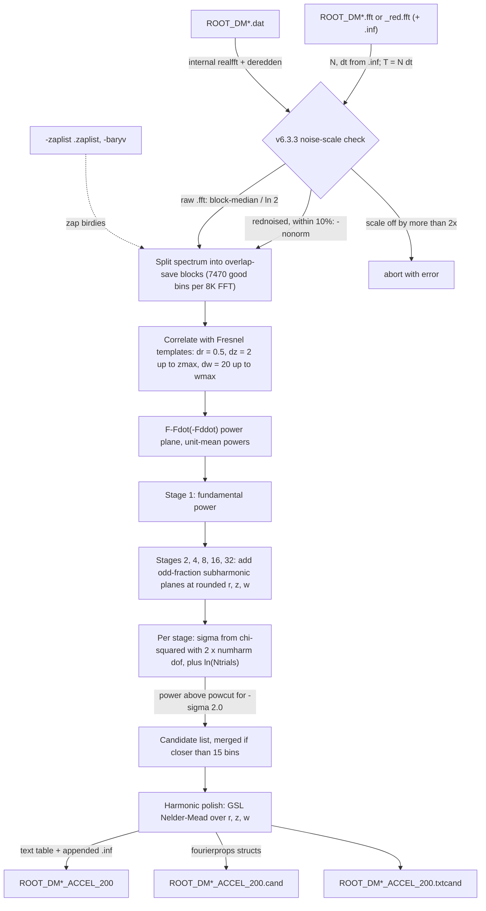
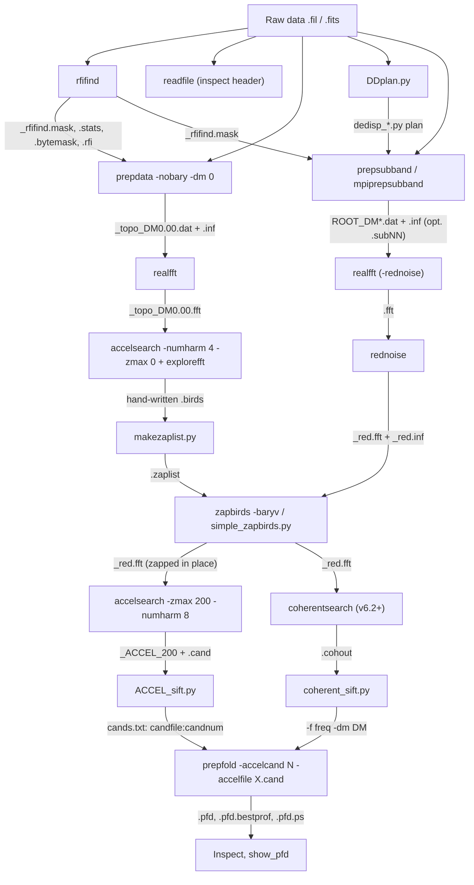
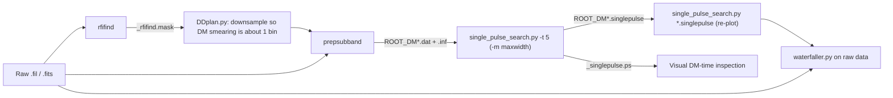
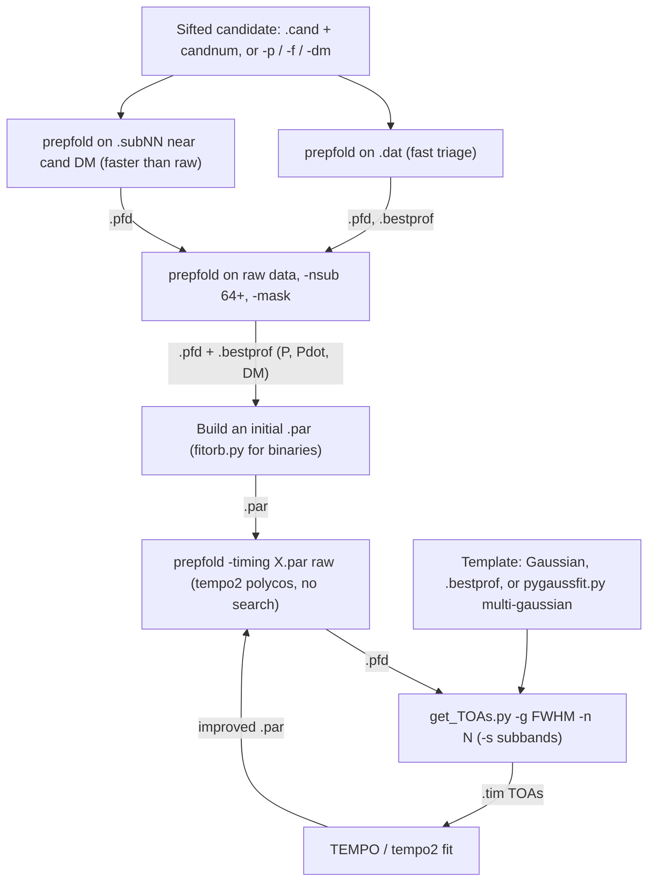

# PRESTO chains sixteen programs through headerless files

PRESTO is Scott Ransom's GPL-2.0 pulsar search toolkit. It is a C library (`libpresto`) plus C command-line programs and Python scripts. Together they take a raw SIGPROC filterbank or PSRFITS file to a timed pulsar through one fixed chain. **`rfifind` writes a mask. `prepsubband` writes dedispersed, barycentred `.dat` + `.inf` pairs. `realfft` and `rednoise` write whitened `.fft` spectra. `accelsearch` (or, since v6.2.0, `coherentsearch`) writes candidates. `ACCEL_sift.py` ranks them, `prepfold` folds them into `.pfd` files, and `get_TOAs.py` turns `.pfd` files into TOAs** ([PRESTO_search_tutorial.pdf](https://github.com/scottransom/presto/blob/master/docs/PRESTO_search_tutorial.pdf)). Single-pulse searching branches off the same `.dat` files through `single_pulse_search.py`. The maths sits almost entirely in the frequency domain. Powers are normalised to unit mean by a block median divided by ln 2. The f–ḟ(–f̈) plane is built by correlating short FFT segments with Fresnel-integral templates at Δr = ½, Δz = 2 and Δw = 20. Harmonic sums are converted to an "equivalent Gaussian sigma" through a χ² with 2·numharm degrees of freedom and a trials correction ([src/accel_utils.c](https://github.com/scottransom/presto/blob/master/src/accel_utils.c), [src/characteristics.c](https://github.com/scottransom/presto/blob/master/src/characteristics.c)). PRESTO changed a lot between v5.0.0 (April 2024) and v6.3.3 (17 November 2026). The build moved to meson, the code became Fortran- and TEMPO-free, zapped bins became noise-filled, rednoised input became auto-detected, and accelsearch became about 8× faster ([CHANGELOG.md](https://github.com/scottransom/presto/blob/master/CHANGELOG.md)). As a result, intermediates from different versions are not byte-comparable. The intermediate files are mostly raw native-endian dumps of C arrays and structs with no header or version. They carry their metadata in an ASCII `.inf` sidecar, in filenames, and in conventions that exist only in code. A tool outside PRESTO that wants to reuse them has to re-implement those conventions. There is **no FFA program** in PRESTO; FFA search lives in riptide and is covered in [04-other-search-codes.md](04-other-search-codes.md).

This file is one of a set: [00-overview.md](00-overview.md), [01-data-formats.md](01-data-formats.md) (byte layouts of `.fil`, PSRFITS and every PRESTO file), [03-dspsr-psrchive-timing.md](03-dspsr-psrchive-timing.md), [04-other-search-codes.md](04-other-search-codes.md), [05-algorithms-math.md](05-algorithms-math.md) (full derivations). Every claim here comes from a reading of the PRESTO repository at commit `4a5bd80` (2026-11-18), which is development just after v6.3.3. In the citations below, source paths point to `github.com/scottransom/presto/blob/master/`.

## Twelve stages, one naming convention, and a handful of file types

PRESTO's architecture is easiest to understand as a dataflow. Each program reads one or two file types and writes the next, and nearly all metadata travels in the `.inf` sidecar. The table below is the per-program reference. Defaults come from the `clig/*_cmd.cli` option specifications, which generate both the C argument parsers and the man pages. "Root" means the output basename given with `-o` or derived from the input.

| Program | Consumes | Produces | Key options (defaults) | Source files |
|---|---|---|---|---|
| `readfile` | `.fil`, `.fits` | header dump to stdout | none of note; SIGPROC block = 2400 spectra | [src/readfile.c](https://github.com/scottransom/presto/blob/master/src/readfile.c), [src/sigproc_fb.c](https://github.com/scottransom/presto/blob/master/src/sigproc_fb.c), [src/psrfits.c](https://github.com/scottransom/presto/blob/master/src/psrfits.c) |
| `rfifind` | raw `.fil`/`.fits` | `_rfifind.mask`, `.stats`, `.bytemask`, `.rfi`, `.inf`, `.ps` | `-time 30` s, `-timesig 10`, `-freqsig 4`, `-chanfrac 0.7`, `-intfrac 0.3`, `-clip 6`, `-nocompute`, `-zerodm`, `-ncpus` | [src/rfifind.c](https://github.com/scottransom/presto/blob/master/src/rfifind.c), [src/rfifind_plot.c](https://github.com/scottransom/presto/blob/master/src/rfifind_plot.c), [src/mask.c](https://github.com/scottransom/presto/blob/master/src/mask.c), [src/rfi_utils.c](https://github.com/scottransom/presto/blob/master/src/rfi_utils.c), [clig/rfifind_cmd.cli](https://github.com/scottransom/presto/blob/master/clig/rfifind_cmd.cli) |
| `DDplan.py` | obs. parameters or a raw file | printed plan; `-w` → `dedisp_*.py` script | `-r` time resolution, `-s` subbands; dDM ladder 0.01…300; fudge factor 1.2 | [bin/DDplan.py](https://github.com/scottransom/presto/blob/master/bin/DDplan.py) |
| `prepdata` | raw file or `.dat`, `_rfifind.mask` | one `ROOT.dat` (float32) + `ROOT.inf` | `-dm`, `-nobary`, `-mask`, `-downsamp`, `-numout` | [src/prepdata.c](https://github.com/scottransom/presto/blob/master/src/prepdata.c), [src/dispersion.c](https://github.com/scottransom/presto/blob/master/src/dispersion.c), [src/barycenter.c](https://github.com/scottransom/presto/blob/master/src/barycenter.c) |
| `prepsubband` / `mpiprepsubband` | raw file (or `.subNN`), mask | `ROOT_DM<dm>.dat` + `.inf` for each DM; optional `ROOT_DM<dm>.subNN` | `-lodm 0`, `-dmstep 1.0`, `-numdms 10`, `-nsub 32`, `-downsamp 1` (≤128), `-dmprec 2`, `-sub -subdm` | [src/prepsubband.c](https://github.com/scottransom/presto/blob/master/src/prepsubband.c), [src/mpiprepsubband.c](https://github.com/scottransom/presto/blob/master/src/mpiprepsubband.c), [clig/prepsubband_cmd.cli](https://github.com/scottransom/presto/blob/master/clig/prepsubband_cmd.cli) |
| `realfft` | `.dat` (or `.fft` for inverse) | `.fft` (N/2 complex64), or `_red.fft` with `-rednoise` | direction from suffix, `-fwd`/`-inv`, `-tmpdir` (two-pass above ~10⁹ points), `-rednoise` (v6.1.0) | [src/realfft.c](https://github.com/scottransom/presto/blob/master/src/realfft.c), [src/fastffts.c](https://github.com/scottransom/presto/blob/master/src/fastffts.c), [clig/realfft_cmd.cli](https://github.com/scottransom/presto/blob/master/clig/realfft_cmd.cli) |
| `rednoise` | `.fft` | `_red.fft` + `_red.inf` | `-startwidth 6`, `-endwidth 100`, `-endfreq 6` Hz, `-inplace` (v6.1.0) | [src/rednoise.c](https://github.com/scottransom/presto/blob/master/src/rednoise.c), [src/misc_utils.c](https://github.com/scottransom/presto/blob/master/src/misc_utils.c), [clig/rednoise_cmd.cli](https://github.com/scottransom/presto/blob/master/clig/rednoise_cmd.cli) |
| `zapbirds` / `simple_zapbirds.py` / `makezaplist.py` | `.fft`, `.birds` → `.zaplist`, `.inf` | the same `.fft`, modified in place | `-zap -zapfile X.zaplist -baryv <v/c>`; noise fill by default since v6.1.0 (`-constamp` for the old behaviour) | [src/zapbirds.c](https://github.com/scottransom/presto/blob/master/src/zapbirds.c), [bin/simple_zapbirds.py](https://github.com/scottransom/presto/blob/master/bin/simple_zapbirds.py), [bin/makezaplist.py](https://github.com/scottransom/presto/blob/master/bin/makezaplist.py) |
| `accelsearch` | `.fft`/`_red.fft` (or `.dat`) + `.inf` | `ROOT_ACCEL_<z>` (text), `.cand` (binary), `.txtcand`; `_ACCEL_<z>_JERK_<w>` with jerk | `-numharm 8`, `-zmax 200`, `-wmax` off, `-sigma 2.0`, `-flo 1` Hz, `-fhi 10000` Hz, `-inmem`, `-nonorm`, `-zaplist`, `-ncpus` | [src/accelsearch.c](https://github.com/scottransom/presto/blob/master/src/accelsearch.c), [src/accel_utils.c](https://github.com/scottransom/presto/blob/master/src/accel_utils.c), [src/responses.c](https://github.com/scottransom/presto/blob/master/src/responses.c), [include/accel.h](https://github.com/scottransom/presto/blob/master/include/accel.h), [clig/accelsearch_cmd.cli](https://github.com/scottransom/presto/blob/master/clig/accelsearch_cmd.cli) |
| `ACCEL_sift.py` | all `*ACCEL_*0` + `*DM*.inf` | ranked list on stdout (`candfile:candnum`) | `sigma_threshold 4.0`, `c_pow_threshold 100`, `r_err 1.1`, `short_period 0.0005` s, `long_period 15` s, `harm_pow_cutoff 8.0` | [examplescripts/ACCEL_sift.py](https://github.com/scottransom/presto/blob/master/examplescripts/ACCEL_sift.py), [python/presto/sifting.py](https://github.com/scottransom/presto/blob/master/python/presto/sifting.py) |
| `prepfold` / `prepfold_multi` | raw, `.dat`, `.subNN` or events; candidate given by `-accelfile .cand`, `-p`, `-f`, `-par`, `-timing` | `.pfd`, `.pfd.bestprof`, `.pfd.ps`, `.png` | `-npart 64`, `-pstep 2`, `-pdstep 4`, `-dmstep 2`, `-npfact 2`, `-ndmfact 3`, `-n` = samples per period, `-nosearch`, `-fine`, `-usepoly` | [src/prepfold.c](https://github.com/scottransom/presto/blob/master/src/prepfold.c), [src/prepfold_pipeline.c](https://github.com/scottransom/presto/blob/master/src/prepfold_pipeline.c), [src/prepfold_utils.c](https://github.com/scottransom/presto/blob/master/src/prepfold_utils.c), [src/fold.c](https://github.com/scottransom/presto/blob/master/src/fold.c), [clig/prepfold_cmd.cli](https://github.com/scottransom/presto/blob/master/clig/prepfold_cmd.cli) |
| `single_pulse_search.py` | `.dat` + `.inf` (or `.singlepulse` to re-plot) | `ROOT_DM<dm>.singlepulse`, `_singlepulse.ps` | `-t 5.0` σ, boxcars ≤30 bins (`-m` for up to 300), `-d` detrend blocks ×1000 samples, `-f` fast, `-b` no bad-block removal | [bin/single_pulse_search.py](https://github.com/scottransom/presto/blob/master/bin/single_pulse_search.py) |
| `explorefft` / `exploredat` | `.fft` (+ optional `.zaplist`) / `.dat` | interactive PGPLOT display | n/a | [src/explorefft.c](https://github.com/scottransom/presto/blob/master/src/explorefft.c), [src/exploredat.c](https://github.com/scottransom/presto/blob/master/src/exploredat.c) |
| `get_TOAs.py` | `.pfd` (folded with `-timing`/`-nosearch`, or `-u` for searched folds), template | TOAs on stdout (TEMPO/tempo2) | `-g FWHM` Gaussian template, `-n` TOAs (must factor npart), `-s` subbands, `-A classic\|aarchiba` FFTFIT | [bin/get_TOAs.py](https://github.com/scottransom/presto/blob/master/bin/get_TOAs.py), [python/presto/fftfit.py](https://github.com/scottransom/presto/blob/master/python/presto/fftfit.py) |
| `coherentsearch` / `coherent_sift.py` | `_red.fft` + `.inf` | `ROOT.cohout` (or `_deep.cohout`), `.ps`/`.png` | `-nharms 60`, `-m 16`, `-hidr 0.5`, `-threshold 8.0`, `-maxdecim 6`, `-lofreq 0.1`, `-hifreq 125` Hz, `-ncands 100`, `-deep` | [src/coherentsearch.c](https://github.com/scottransom/presto/blob/master/src/coherentsearch.c), [src/cs_interp.c](https://github.com/scottransom/presto/blob/master/src/cs_interp.c), [src/cs_metric.c](https://github.com/scottransom/presto/blob/master/src/cs_metric.c), [src/cs_chunk.c](https://github.com/scottransom/presto/blob/master/src/cs_chunk.c), [bin/coherent_sift.py](https://github.com/scottransom/presto/blob/master/bin/coherent_sift.py) |
| `search_bin` | `.fft` + `.inf` | binary-candidate list, refined by `bincand` | `-minfft 32`, `-maxfft 65536`, `-overlap 0.25`, `-harmsum 3`, `-flo 1`, `-fhi 2000` Hz, `-ncand 100` | [src/search_bin.c](https://github.com/scottransom/presto/blob/master/src/search_bin.c), [src/minifft.c](https://github.com/scottransom/presto/blob/master/src/minifft.c), [clig/search_bin_cmd.cli](https://github.com/scottransom/presto/blob/master/clig/search_bin_cmd.cli) |

### Only four programs read raw-file headers; the rest trust `.inf`

Only the programs that open raw data parse an observatory header: `readfile`, `rfifind`, `prepdata`, `prepsubband`/`mpiprepsubband`, and `prepfold` when it folds raw data. From a SIGPROC file, PRESTO's `read_filterbank_header()` uses **nbits, signed, nchans, nifs, tsamp, fch1, foff, az_start, za_start, ibeam, telescope_id, machine_id, tstart, src_raj and src_dej**. It ignores `nsamples` and computes the number of spectra from the file size ([src/sigproc_fb.c](https://github.com/scottransom/presto/blob/master/src/sigproc_fb.c)). From PSRFITS it reads **STT_IMJD/SMJD/OFFS, TBIN, NSBLK, NSUBOFFS, OFFS_SUB, NPOL, POL_TYPE, CHAN_DM, DAT_FREQ, DAT_WTS/OFFS/SCL and ZERO_OFF**. It subtracts the absolute value of ZERO_OFF, applies scales and weights only when the first row is non-trivial, and pads dropped rows that it detects from OFFS_SUB ([src/psrfits.c](https://github.com/scottransom/presto/blob/master/src/psrfits.c)). Two reader behaviours matter to anyone writing files for PRESTO. First, the SIGPROC reader **always reverses channel order** and derives `lo_freq = fch1 − (nchan−1)|foff|`, which assumes `foff < 0`. Second, for SIGPROC input the block size ("spectra per subint") is **hard-coded to 2400**, and `-downsamp` must divide it ([src/sigproc_fb.c](https://github.com/scottransom/presto/blob/master/src/sigproc_fb.c), [FAQ.md](https://github.com/scottransom/presto/blob/master/FAQ.md)). The full field-by-field treatment, including how other tools differ, is in [01-data-formats.md](01-data-formats.md).

Every downstream program reads only the `.inf` sidecar. The fields it carries are N, dt, epoch MJD (integer plus fractional string), RA/Dec, DM, the barycentred flag, on/off bin pairs, the low-channel centre frequency, total bandwidth, number of channels and channel width ([src/ioinf.c](https://github.com/scottransom/presto/blob/master/src/ioinf.c), [include/makeinf.h](https://github.com/scottransom/presto/blob/master/include/makeinf.h)). The following mapping of programs to fields is inferred from what each algorithm needs. `realfft`, `rednoise` and `accelsearch` need N and dt, since T = N·dt converts bins to Hz and z to ḟ. `single_pulse_search.py` needs dt and DM. `prepfold` on a `.dat` needs the epoch, dt, the barycentred flag and the frequency settings. `ACCEL_sift.py` takes the DM from the **filename**, not the `.inf`.

## How each program works, with its key formula

The equations below are the ones each program actually implements. Their derivations and primary-literature context are in [05-algorithms-math.md](05-algorithms-math.md).

### readfile prints headers and fixes block sizes

`readfile` is step 1 of the tutorial. It prints the parsed header of a raw file, including the derived "spectra per subint" that controls every later block-based operation ([PRESTO_search_tutorial.pdf](https://github.com/scottransom/presto/blob/master/docs/PRESTO_search_tutorial.pdf)). Running it first is also the cheapest way to check that PRESTO's channel-order and frequency assumptions match a file that a different tool wrote.

### rfifind flags (interval × channel) cells on three statistics

`rfifind` splits the observation into intervals of `-time` seconds (default **30 s**; the tutorial uses 2 s) and computes three statistics for every interval-and-channel cell. These are the mean, the standard deviation, and the maximum normalised power from a real FFT of that chunk. The FFT search sums up to 4 harmonics with interbinning and skips bins below 5 (`RFI_NUMHARMSUM 4`, `RFI_NUMBETWEEN 2`, `RFI_LOBIN 5`), normalising by `std²·ptsperint` ([src/rfifind.c](https://github.com/scottransom/presto/blob/master/src/rfifind.c), [include/rfifind.h](https://github.com/scottransom/presto/blob/master/include/rfifind.h)). A cell is flagged for power when

$$P_{\max} > P_{\rm reject} = \tfrac12\,\chi^{2\,-1}_{2}\!\left(Q(\sigma_{\rm freq})\,/\,(\text{ptsperint}/2)\right),$$

which is `power_for_sigma(freqsig, 1, ptsperint/2)`. It is flagged for mean or standard deviation when the value deviates from the interval or channel median by more than `timesig` × a robust global σ ([src/rfifind_plot.c](https://github.com/scottransom/presto/blob/master/src/rfifind_plot.c)). Whole intervals are zapped when more than `chanfrac` (**0.7**) of their channels are bad, and whole channels when more than `intfrac` (**0.3**) of their intervals are bad ([docs/rfifind.1](https://github.com/scottransom/presto/blob/master/docs/rfifind.1)). Time-domain clipping at **6σ** is on unless `-noclip` is given. `-nocompute` re-thresholds an existing `.stats` file without touching the raw data, which is the fast way to tune a mask. The FAQ warns that rfifind cannot remove 50/60 Hz mains harmonics from accelsearch results; that is the job of birdie zapping ([FAQ.md](https://github.com/scottransom/presto/blob/master/FAQ.md)).

### DDplan.py keeps total smearing under a tolerance

`DDplan.py` picks DM ranges, steps, downsampling factors and subband DM steps so that total smearing stays near the effective sample time. In milliseconds it adds four terms in quadrature:

$$t_{\rm tot}=\sqrt{2(1000\,dt)^2 + t_{\rm chan}({\rm DM})^2 + t_{\rm sub}^2 + t_{\rm BW}(\tfrac12\Delta{\rm DM})^2},\qquad \Delta{\rm DM}_{\rm guess}\approx \frac{dt\cdot 0.0001205\, f_{\rm ctr}^3}{0.5\,{\rm BW}}.$$

The chosen step is the nearest value on the ladder `[0.01 … 300]`, with a fudge factor of 1.2. The downsampling factor doubles whenever channel smearing exceeds dt ([bin/DDplan.py](https://github.com/scottransom/presto/blob/master/bin/DDplan.py)). v5.1.0 corrected how DM smearing enters this sum ([CHANGELOG.md](https://github.com/scottransom/presto/blob/master/CHANGELOG.md)). The underlying smearing terms follow Cordes & McLaughlin (2003) ([arXiv:astro-ph/0304364](https://arxiv.org/abs/astro-ph/0304364)); see [05-algorithms-math.md](05-algorithms-math.md).

### prepdata dedisperses once and barycentres by adding or dropping samples

`prepdata` writes a single dedispersed float32 `.dat` with its `.inf`. The delay is

$$t_{\rm DM}(f)=\frac{\rm DM}{0.000241\,f_{\rm MHz}^2}\ {\rm s},$$

so the constant is k = 1/2.41×10⁻⁴ = 4149.378 s MHz², the conventional value that is 0.0137% above the physical one ([src/dispersion.c](https://github.com/scottransom/presto/blob/master/src/dispersion.c), [Kulkarni 2020](https://arxiv.org/abs/2007.02886)). Channel frequencies are channel centres. The highest channel is never shifted, so the `.inf` epoch is the start of the first sample at the centre of the top channel ([FAQ.md](https://github.com/scottransom/presto/blob/master/FAQ.md)). Barycentring is on by default. Topocentric times are converted every **20 s** (`TDT`). The average v/c Doppler-corrects the channel frequencies. The barycentric-minus-topocentric drift is then applied by **inserting or deleting whole samples** (`diffbins`) rather than resampling, which leaves a uniform barycentric grid ([src/prepdata.c](https://github.com/scottransom/presto/blob/master/src/prepdata.c)). Since v6.0.0 `barycenter()` uses ERFA instead of TEMPO. It agrees with TEMPO to about 10 µs absolute and 1 µs differential, and it ignores the `ephem` argument ([src/barycenter.c](https://github.com/scottransom/presto/blob/master/src/barycenter.c), [CHANGELOG.md](https://github.com/scottransom/presto/blob/master/CHANGELOG.md)).

### prepsubband always uses two-stage subband dedispersion

`prepsubband` produces many DM trials in one pass, always in two stages. First, channels are combined into `-nsub` subbands (default **32**) that are internally dedispersed to a nominal DM. `subband_search_delays()` subtracts each subband's top-channel delay, so the subbands stay mutually offset. Second, `float_dedisp()` shifts and sums the subbands for each trial DM ([src/dispersion.c](https://github.com/scottransom/presto/blob/master/src/dispersion.c), [docs/prepsubband.1](https://github.com/scottransom/presto/blob/master/docs/prepsubband.1)). The residual subband smearing is the $t_{\rm sub}$ term that DDplan budgets for. Filenames encode the DM with `-dmprec` decimals (default 2), as `ROOT_DM12.34.dat`, and `-sub` writes `ROOT_DM<X>.subNN` files for later re-dedispersion or fast folding ([src/prepsubband.c](https://github.com/scottransom/presto/blob/master/src/prepsubband.c)). In `mpiprepsubband`, one rank reads and broadcasts the data and each other rank executes one DDplan "call" ([FAQ.md](https://github.com/scottransom/presto/blob/master/FAQ.md)). OpenMP was turned off in the dedispersion routines in v5.3.0 ([CHANGELOG.md](https://github.com/scottransom/presto/blob/master/CHANGELOG.md)). PRESTO's own advice is to parallelise by running one process per DM range rather than by relying on `-ncpus`.

### realfft packs N reals into N/2 complex values

`realfft` computes the forward transform with sign −1 as a length-N/2 complex FFT followed by Numerical-Recipes-style untangling. It stores **N/2 complex64 values, with DC in the real part of bin 0 and the Nyquist value in its imaginary part** ([src/fastffts.c](https://github.com/scottransom/presto/blob/master/src/fastffts.c)). Fourier bin r corresponds to frequency r/T. Above about 10⁹ points it switches to an out-of-core two-pass algorithm. v6.1.0 added `-rednoise`, which writes `_red.fft` directly and is bit-identical to running `realfft` and then `rednoise` ([clig/realfft_cmd.cli](https://github.com/scottransom/presto/blob/master/clig/realfft_cmd.cli), [CHANGELOG.md](https://github.com/scottransom/presto/blob/master/CHANGELOG.md)).

### rednoise divides by a running median/ln 2 on log-growing blocks

For exponentially distributed noise powers the median equals ln 2 × the mean, so dividing by median/ln 2 normalises to unit mean while resisting strong lines ([Ransom, Eikenberry & Middleditch 2002](https://arxiv.org/abs/astro-ph/0204349)). `dered_engine()` sets bin 0 to 1+0i. It grows the block length as `startwidth·ln(bin)` up to `endwidth` (defaults **6 → 100 bins**) until the block frequency reaches `endfreq` (**6 Hz**). It then divides the amplitudes by $\sqrt{\text{level}}$, where level = median(P)/ln 2 is interpolated linearly between block midpoints ([src/misc_utils.c](https://github.com/scottransom/presto/blob/master/src/misc_utils.c)). The output is a unit-mean spectrum, and both `coherentsearch` and v6.3.3 `accelsearch` now **assume exactly this normalisation**.

### zapbirds replaces known interference with synthetic noise

Birdies are periodic RFI. They are found by running `accelsearch -numharm 4 -zmax 0` on the topocentric DM-0 series and inspecting it in `explorefft` ([PRESTO_search_tutorial.pdf](https://github.com/scottransom/presto/blob/master/docs/PRESTO_search_tutorial.pdf)). They are recorded in a 5-column `.birds` file (freq Hz, width Hz, number of harmonics, grow flag, bary flag). `makezaplist.py` expands that into a `.zaplist`, zapping at least 40 bins for known pulsars ([bin/makezaplist.py](https://github.com/scottransom/presto/blob/master/bin/makezaplist.py)). `zapbirds -baryv <v/c>` then maps the topocentric birdie frequencies onto the barycentred spectra. Since v6.1.0, zapped bins are filled with χ²₂ noise that matches the local mean power, measured 100 bins clear of the region, with random phases and a fixed seed. Before v6.1.0 they were set to a constant amplitude, which is still available as `-constamp` ([docs/zapbirds.1](https://github.com/scottransom/presto/blob/master/docs/zapbirds.1), [CHANGELOG.md](https://github.com/scottransom/presto/blob/master/CHANGELOG.md)). `simple_zapbirds.py X.birds *.fft` does the whole procedure and computes v/c itself.

### accelsearch searches the f–ḟ–f̈ volume by template correlation

`accelsearch` implements the Fourier-domain acceleration search of Ransom, Eikenberry & Middleditch (2002) ([arXiv:astro-ph/0204349](https://arxiv.org/abs/astro-ph/0204349)) and the jerk extension of Andersen & Ransom (2018) ([arXiv:1807.07900](https://arxiv.org/abs/1807.07900)). It works in dimensionless Fourier coordinates:

$$r=fT,\qquad z=\dot f\,T^2=\frac{a\,h\,T^2}{c\,P},\qquad w=\ddot f\,T^3 .$$

The search grid is Δr = 0.5 (interbinning), Δz = 2 and Δw = 20. Each (z, w) template is the complex-conjugate Fresnel-integral response, with half-width `int(0.5·1.1·|z|) + 16` bins. It is correlated with overlap-save FFTs that keep 7470 good points per 8K transform; since v6.3.3 the transform lengths come from a measured list of "good" sizes ([include/accel.h](https://github.com/scottransom/presto/blob/master/include/accel.h), [src/responses.c](https://github.com/scottransom/presto/blob/master/src/responses.c), [CHANGELOG.md](https://github.com/scottransom/presto/blob/master/CHANGELOG.md)). Powers are normalised per block by `1/sqrt(median(|A|²)/ln 2)`. Since v6.3.3, rednoised input that passes a 10% scale check is searched with `-nonorm`, and input whose scale is off by more than 2× aborts ([src/accel_utils.c](https://github.com/scottransom/presto/blob/master/src/accel_utils.c)).

Harmonic summing runs in stages of 2, 4, 8, 16 and 32 harmonics. At stage N it adds the planes of the odd fractions (2k+1)/N at rounded sub-coordinates $r_{\rm sub}={\rm rint}(2rh/N)/2$, $z_{\rm sub}\approx zh/N$ (to Δz) and $w_{\rm sub}\approx wh/N$ (to Δw). The even fractions were already added at earlier stages ([src/accel_utils.c](https://github.com/scottransom/presto/blob/master/src/accel_utils.c) `calc_required_r/z/w`, `add_search_ffdotpows`). Note that `-zmax`, `-flo` and `-fhi` all refer to the **highest** harmonic ([FAQ.md](https://github.com/scottransom/presto/blob/master/FAQ.md)). Each stage's summed power P with n harmonics is converted to a significance:

$$\ln p = \ln Q_{\chi^2}(2P;\,2n) + \ln N_{\rm trials},\qquad \sigma = \Phi^{-1}_{\rm upper}(p),$$
$$N_{\rm trials} = \frac{(r_{hi}-r_{lo})}{n}\,(n_z+1)\frac{\Delta z}{6.95}\,(n_w+1)\frac{\Delta w}{44.2},$$

where the z and w factors drop out when zmax or wmax is 0 ([src/characteristics.c](https://github.com/scottransom/presto/blob/master/src/characteristics.c), `create_accelobs` in [src/accel_utils.c](https://github.com/scottransom/presto/blob/master/src/accel_utils.c), Eq. 6 of [Andersen & Ransom 2018](https://arxiv.org/abs/1807.07900)). Survivors are optimised jointly over harmonics ("harmpolish") with GSL Nelder–Mead, which replaced the NR amoeba in v6.0. The per-harmonic sigmas at the bottom of the text file are single-trial, while the top-of-file sigmas include the trials correction ([FAQ.md](https://github.com/scottransom/presto/blob/master/FAQ.md)). The reported f, ḟ and f̈ are **averages over the observation (midpoint)**, whereas prepfold references the start. The permissive `-sigma 2.0` default is deliberate: thresholding is meant to happen in sifting and folding. The tutorial's rule of thumb is that 8 harmonics suffice for millisecond pulsars, that zmax should stay at or below about 200, and that run time doubles per harmonic stage and grows linearly with zmax ([PRESTO_search_tutorial.pdf](https://github.com/scottransom/presto/blob/master/docs/PRESTO_search_tutorial.pdf)). Jerk search pays off when T is about 5–15% of the orbital period; it found Ter5am ([arXiv:1807.07900](https://arxiv.org/abs/1807.07900)).

### ACCEL_sift.py ranks candidates across DMs by filename

`ACCEL_sift.py` globs every `*ACCEL_*0` file and parses each DM with the regex `_DM(\d+\.\d{2,3})(?!\d)`. It then removes duplicates within `r_err` = 1.1 bins, requires each candidate to appear at **at least 2 DMs** with a peak above DM 2.0, and removes harmonics: integer ratios up to 16 plus ratios such as 3/2, 2/3, 5/4 and 4/5. It prints the survivors sorted by sigma as `candfile:candnum` lines, with ASCII sigma-vs-DM sketches ([python/presto/sifting.py](https://github.com/scottransom/presto/blob/master/python/presto/sifting.py), [examplescripts/ACCEL_sift.py](https://github.com/scottransom/presto/blob/master/examplescripts/ACCEL_sift.py)). The example script uses a 4.0σ threshold where the module default is 6.0. It compares single-trial sigmas so that candidates are comparable across DMs ([FAQ.md](https://github.com/scottransom/presto/blob/master/FAQ.md)). Renaming files breaks the sifter.

### prepfold folds once, then searches by shifting sub-profiles

`prepfold` folds data into an npart × nsub × proflen cube (default **64 parts**, `-n` = samples per period). `fold()` treats each sample as finite-duration and spreads it across the profile bins it overlaps ([src/fold.c](https://github.com/scottransom/presto/blob/master/src/fold.c)). It does not refold for each trial. Instead it **shifts sub-profiles by trial phase delays** and recombines them. The trial grid spans 2·npfact·proflen+1 period and ṗ trials and 2·ndmfact·proflen+1 DM trials, with steps of `pstep` = 2, `pdstep` = 4 and `dmstep` = 2 profile bins of drift ([src/prepfold_pipeline.c](https://github.com/scottransom/presto/blob/master/src/prepfold_pipeline.c), [clig/prepfold_cmd.cli](https://github.com/scottransom/presto/blob/master/clig/prepfold_cmd.cli)). The step sizes follow from $\Delta\phi=\Delta f\,T+\tfrac12\Delta\dot f\,T^2$ quantised in bins ([FAQ.md](https://github.com/scottransom/presto/blob/master/FAQ.md)). The figure of merit is the epoch-folding reduced χ² (Leahy et al. 1983), with an empirically corrected number of degrees of freedom:

$$\chi^2_{\rm red}=\frac{\sum(p_j-\bar p)^2}{\sigma_p^2\,(n_b-1)},\quad \sigma_p^2=\sigma^2_{\rm data}N_{\rm data}\,\frac{1}{n_b},\quad {\rm DOF}_{\rm corr}=n\,0.96\,(1+n^{1.806})^{-1/1.806},\ n=\frac{P}{n_b\,dt}.$$

The significance printed in `.bestprof` ("Prob(Noise) < … (~X sigma)") is $Q_{\chi^2}(\chi^2_{\rm red}{\rm DOF}_{\rm eff};{\rm DOF}_{\rm eff})$ converted to σ, where the effective dof are the nominal ones scaled by the Monte-Carlo correction ${\rm DOF}_{\rm corr}$, which accounts for samples that straddle profile bins ([src/fold.c](https://github.com/scottransom/presto/blob/master/src/fold.c), [src/prepfold_plot.c](https://github.com/scottransom/presto/blob/master/src/prepfold_plot.c)). It is single-trial and valid only when the off-pulse reduced χ² is about 1; `-fixchi` rescales to enforce that ([FAQ.md](https://github.com/scottransom/presto/blob/master/FAQ.md)). Since v6.3.0, raw-data folds longer than 2 h (or with `-usepoly`) use tempo2 polycos instead of a cubic topocentric fit. For a 2 ms pulsar the cubic fit's phase error is about 0.002 turns at 2 h but 3 turns at 20 h. `prepfold_multi` (v6.0.0) folds many candidates in one raw-data pass ([CHANGELOG.md](https://github.com/scottransom/presto/blob/master/CHANGELOG.md)).

### single_pulse_search.py runs a boxcar matched filter on each `.dat`

`single_pulse_search.py` detrends each `.dat` in blocks of `-d`×1000 samples, using piecewise-linear `scipy.signal.detrend` or, with `-f`, median removal. It estimates each block's σ as the standard deviation of the central 95% × 1.148, and drops blocks whose σ is more than 4σ from the median of the block σs. Since v6.1.2 it also skips dead blocks. It then convolves the series, via FFT in chunks of 8000, with boxcars of **1, 2, 3, 4, 6, 9, 14, 20 and 30 bins** (extended to 45…300 with `-m`). Kernels are normalised by $1/\sqrt{w}$, so

$$\sigma_{\rm SP} = \frac{\sum_{i\in w}(x_i-\mu)}{\sigma_{\rm rms}\sqrt{w}},$$

which is invariant under downsampling while the pulse stays resolved ([bin/single_pulse_search.py](https://github.com/scottransom/presto/blob/master/bin/single_pulse_search.py)). Events above `-t` **5.0** are kept, duplicates within downfact/2 are pruned, and the results go to ASCII `# DM Sigma Time(s) Sample Downfact` lines. The default ladder is roughly geometric with ratio ×1.5. Morello et al. (2020) find that even a ×2 ladder keeps about 93% average efficiency for a Gaussian pulse of unknown width, so this denser ladder loses less ([arXiv:2004.03701](https://arxiv.org/abs/2004.03701)). Clustering across DMs is not done here; it is left to plotting and to other tools (see [04-other-search-codes.md](04-other-search-codes.md)). v6.1.0 stopped dropping the last ≤7999 samples of each file and removed the `presto.singlepulse` subpackage ([CHANGELOG.md](https://github.com/scottransom/presto/blob/master/CHANGELOG.md)).

### explorefft and exploredat are the eyes of the pipeline

These interactive PGPLOT viewers show `.fft` power spectra and `.dat` time series. They are used mainly to measure birdie widths for `.birds` files, and explorefft can overlay a `.zaplist` ([PRESTO_search_tutorial.pdf](https://github.com/scottransom/presto/blob/master/docs/PRESTO_search_tutorial.pdf)). Until v6.1.0, explorefft under-reported power at high |z| ([CHANGELOG.md](https://github.com/scottransom/presto/blob/master/CHANGELOG.md)).

### get_TOAs.py turns `.pfd` cubes into TOAs with FFTFIT

`get_TOAs.py` cross-correlates each of `-n` sub-integrations (which must divide npart), and optionally `-s` subbands, against a template. The template can be a `-g FWHM` Gaussian, a `.bestprof`, or a multi-Gaussian from `pygaussfit.py`. It writes TEMPO/tempo2 TOAs ([PRESTO_search_tutorial.pdf](https://github.com/scottransom/presto/blob/master/docs/PRESTO_search_tutorial.pdf)). The fit is FFTFIT, Taylor's (1992) Fourier-domain phase-gradient method, which minimises $\sum_k|P_k-bS_ke^{-2\pi ik\tau/N}|^2$ over shift τ and scale b ([Taylor 1992](https://ui.adsabs.harvard.edu/abs/1992RSPTA.341..117T)). It has been pure Python since v6.0, with `-A classic|aarchiba` choosing between two implementations ([python/presto/fftfit.py](https://github.com/scottransom/presto/blob/master/python/presto/fftfit.py), [CHANGELOG.md](https://github.com/scottransom/presto/blob/master/CHANGELOG.md)). Valid input is a `.pfd` folded with `-timing <par>` or `-nosearch`, or a searched fold with `-u` (v6.3.0). The step from TOAs to a timing solution is covered in [03-dspsr-psrchive-timing.md](03-dspsr-psrchive-timing.md).

### coherentsearch rebuilds profiles from 60 complex harmonics

New in v6.2.0, `coherentsearch` is a C port of CoherentSearch.jl and has **no acceleration dimension**. For each trial frequency it interpolates the complex amplitudes of H harmonics (default 60) with an m = 16-bin kernel, following REM02 Eq. 30. It then inverse-FFTs the harmonic stack into a profile and scores it with a geometric boxcar bank (×1.5 steps up to a duty cycle of 0.3):

$$S/N=\max_{w,p}\frac{S_w(p)-\frac{w}{n}S_{\rm tot}}{\sigma_w},$$

where σ_w is computed analytically from which harmonics are filled, assuming unit-mean powers ([src/cs_interp.c](https://github.com/scottransom/presto/blob/master/src/cs_interp.c), [src/cs_metric.c](https://github.com/scottransom/presto/blob/master/src/cs_metric.c)). A decimation ladder reuses every k-th harmonic to test k× the frequency. `-deep` raises the harmonic count to 120 and decimation to 12, and lowers `-hifreq` to 5 Hz. In over 860,000 white-noise injections at matched false-alarm rate, Ransom (2026) reports **76% recovery, against 64% for riptide's FFA and 42% for accelsearch**, with a threshold that stays stable in red noise ([arXiv:2610.11749](https://arxiv.org/abs/2610.11749)). Because its analytic σ assumes PRESTO's exact `rednoise` normalisation, it must be fed `_red.fft` files ([ROADMAP.md](https://github.com/scottransom/presto/blob/master/ROADMAP.md)).

### search_bin hunts orbital sidebands with mini-FFTs

`search_bin` implements the phase-modulation search of Ransom, Cordes & Eikenberry (2003, ApJ 589, 911). It runs power-of-two "mini-FFTs" (32 to 65536 bins, 25% overlap) over stretches of the harmonically summed power spectrum to find the sideband comb that a short-period binary imprints, and `bincand` then refines the candidates ([docs/search_bin.1](https://github.com/scottransom/presto/blob/master/docs/search_bin.1), [src/search_bin.c](https://github.com/scottransom/presto/blob/master/src/search_bin.c)). Its own man page admits it "has not (yet!) led to the discovery of a new pulsar".

## Three standard workflows share the same `.dat` trunk

The tutorial's 13 steps form a periodicity trunk with single-pulse and timing branches ([PRESTO_search_tutorial.pdf](https://github.com/scottransom/presto/blob/master/docs/PRESTO_search_tutorial.pdf)). The birdie preamble exists because RFI is topocentric while the searched series are barycentric. Birdies are therefore identified on a `-nobary` DM-0 series and then mapped onto the barycentred trials with `-baryv`. Representative commands from the tutorial are `rfifind -time 2.0 -o Lband X.fil`, then `prepsubband -nsub 32 -lodm 0 -dmstep 2 -numdms 24 -downsamp 4 -mask Lband_rfifind.mask -o Lband X.fil`, then `accelsearch -zmax 0 Lband_DM*.fft`, and finally `prepfold -accelcand 1 -accelfile Lband_DM62.00_ACCEL_0.cand Lband_DM62.00.dat`.

### Periodicity search

### Single-pulse search

### Folding and timing

The folding loop runs `.pfd` → TOAs → refined `.par` → refold, with each pass narrowing the phase model; the handoff to PSRCHIVE-based timing is described in [03-dspsr-psrchive-timing.md](03-dspsr-psrchive-timing.md). Survey drivers such as `bin/GBNCC_search.py` and `bin/PALFA_presto_search.py`, and `examplescripts/full_analysis.py`, encode the same chain as scripts ([bin/](https://github.com/scottransom/presto/tree/master/bin)).

## Versions 5.0 to 6.3.3 rewrote the numerics underneath stable command lines

Every release from v5.0.0 to v6.3.3 kept the command lines stable, but several releases changed the numbers that programs produce. That matters for anyone comparing archived intermediates.

| Version (date) | Changes that matter for results or reuse |
|---|---|
| v5.0.0 (2024-04-21) | Build moved to meson + meson-python. Python ≥ 3.8. Spigot code and slalib removed. |
| v5.0.2 (2024-06-22) | NumPy 2.0 C API. Python ≥ 3.9. |
| v5.1.0 (2025-08-27) | DDplan smearing fix; `stacksearch.py`, `fourier_fold.py`, `pfdzap.py` added. |
| v5.2.0 (2025-10-29) | GSL required; declarations updated for GCC 15. |
| v5.3.0 (2026-03-05) | rfifind OpenMP; accelsearch speed-ups; fixes for data longer than 2³¹/2³² points; OpenMP off in dedispersion. |
| v6.0.0 (2026-07-05) | No `$PRESTO` env var; ERFA barycentring (TEMPO not needed); tempo2 polycos; Fortran-free (FFTFIT in Python); GSL Nelder–Mead replaces amoeba; GSL median (even-length medians change); `prepfold_multi`; conda-forge `presto-pulsar`. |
| v6.1.0 (2026-09-10) | Zapped bins noise-filled by default. A 2001-era optimizer kernel-width bug fixed (recovered power at \|z\| = 200 rises from 0.5995 to 0.9994; search sigmas unaffected). `realfft -rednoise`, `rednoise -inplace`. Single-pulse tail searched. Fix for SIGPROC declinations between 0 and −1°. |
| v6.1.1 / v6.1.2 (Oct–Nov 2026) | `-accelcand` jerk with `-start` fixed; accelsearch about 2.4× faster without FMA; `mask.c` out-of-bounds read (it could change which channels were masked) fixed; dead single-pulse blocks skipped. |
| v6.2.0 (2026-11-10) | `coherentsearch` + `coherent_sift.py`; Python ≥ 3.12. |
| v6.3.0 (2026-11-14) | Polyco folding (automatic for folds over 2 h); `get_TOAs.py -u`; FFTs with ≥ 2³¹ bins; `-rlo/-rhi` honoured. |
| v6.3.1 / v6.3.2 (Nov 14–15) | SIMD dispatch for coherentsearch; accelsearch threads over blocks with byte-identical output for any `-ncpus`. |
| v6.3.3 (2026-11-17) | Fused harmonic-sum stages and SIMD gather: about 8× faster than v5.3.1–v6.1.1 on one thread. Measured FFT lengths (rerun `makewisdom`). `-nonorm`. Auto no-block-median for rednoised input (6–11% fewer false candidates above σ = 2). Error if normalisation is off by more than 2×. |

Sources: [CHANGELOG.md](https://github.com/scottransom/presto/blob/master/CHANGELOG.md), [GitHub releases](https://github.com/scottransom/presto/releases), [docs/accel_speed_releases.png](https://github.com/scottransom/presto/blob/master/docs/accel_speed_releases.png). The v6.3.3 benchmark was `-zmax 200 -numharm 8` on a 100M-bin spectrum on a 16-core Sapphire Rapids machine.

Three of these changes alter output on identical input. **v6.0.0 changed even-length medians**, which affects every median normalisation. **v6.1.0 changed zapped-bin contents.** **v6.3.3 changed how rednoised spectra are normalised.** The v6.1.2 mask fix can also change which channels are masked. Speed work in v6.3.2 was explicitly designed to give byte-identical output across thread counts, but nothing is promised across versions. Since v6.1.0 the conda package is plain GPL-2.0-only ([COPYING](https://github.com/scottransom/presto/blob/master/COPYING), [CITATION.cff](https://github.com/scottransom/presto/blob/master/CITATION.cff)). Two caveats on the table: the dates are GitHub publication times, not tag times, and the burst of six releases in nine days in November 2026 means that "PRESTO 6.3" does not name one numerical behaviour.

## Intermediate files encode PRESTO's memory layout, not a portable schema

PRESTO's intermediates are efficient for PRESTO and awkward for anything else, for five structural reasons. The byte-level layouts are in [01-data-formats.md](01-data-formats.md).

**Bare arrays with sidecars.** `.dat` is headerless native-endian float32, and `.fft` is N/2 headerless complex64 with the Nyquist value hidden in the imaginary part of bin 0. Neither file can be interpreted without its `.inf`, which holds N, dt, epoch, DM and frequencies in a fixed-label ASCII layout with no version field ([include/makeinf.h](https://github.com/scottransom/presto/blob/master/include/makeinf.h), [src/fastffts.c](https://github.com/scottransom/presto/blob/master/src/fastffts.c)). A `_red.fft` is byte-identical in layout to an `.fft` but has a different normalisation (unit mean, DC = 1), and nothing in the file says which one it is.

**Struct dumps.** `.mask`, `.stats`, `.bytemask`, `.rfi`, `.cand` and `.pfd` are sequential `fwrite`s of C variables and structs in native byte order. `.cand` is an array of `fourierprops` whose size depends on compiler padding; it is about 88 bytes on LP64. `.mask` omits the per-interval channel list when an interval is fully zapped, so a reader that misses that conditional desynchronises. `.pfd` readers detect byte order heuristically and byte-swap ([src/mask.c](https://github.com/scottransom/presto/blob/master/src/mask.c), [include/presto.h](https://github.com/scottransom/presto/blob/master/include/presto.h), [src/prepfold_utils.c](https://github.com/scottransom/presto/blob/master/src/prepfold_utils.c), [python/presto/prepfold.py](https://github.com/scottransom/presto/blob/master/python/presto/prepfold.py)).

**Metadata in filenames.** The DM lives in `_DM12.34`, zmax and wmax in `_ACCEL_200_JERK_600`, and the subband index in `.subNN`. The sifter recovers DM with a regex, and its accepted precision changed in v6.1.0 ([python/presto/sifting.py](https://github.com/scottransom/presto/blob/master/python/presto/sifting.py)).

**Semantics living only in code.** z and w are in Fourier units ($\dot fT^2$, $\ddot fT^3$), not physical ones. accelsearch reports parameters at the midpoint, while prepfold references the start. The `.inf` epoch is the first sample at the top-channel centre. "Sigma" is trials-corrected in one part of an ACCEL file and single-trial in another. `.dat` files are barycentred by inserting and deleting samples, so they are on neither a topocentric grid nor a resampled one, and birdie work therefore needs the observation's average v/c ([FAQ.md](https://github.com/scottransom/presto/blob/master/FAQ.md), [src/prepdata.c](https://github.com/scottransom/presto/blob/master/src/prepdata.c)).

**Normalisation coupling.** `coherentsearch`'s analytic noise model "assumes exactly" the `realfft` → `rednoise` normalisation, and v6.3.3 accelsearch auto-detects it ([ROADMAP.md](https://github.com/scottransom/presto/blob/master/ROADMAP.md), [CHANGELOG.md](https://github.com/scottransom/presto/blob/master/CHANGELOG.md)). A spectrum whitened by another tool therefore either triggers the 2× abort or silently gets a different false-alarm rate.

The practical bridges are PRESTO's own converters, such as `dat2tim.py`, `tim2dat.py`, `psrfits2fil.py` and `pfd_for_timing.py`, and its Python readers (`presto.infodata`, `presto.prepfold`, `presto.rfifind`), which serve as the de facto reference implementations ([bin/](https://github.com/scottransom/presto/tree/master/bin)).

## Conclusion

PRESTO's portability problem is not the binary formats themselves, which are simple enough to parse. It is that correctness depends on invariants spread across sidecars, filenames, struct padding and normalisation conventions that changed three times between v6.0.0 and v6.3.3. Any pipeline that mixes PRESTO with other codes should do three things. It should treat the `.inf` + filename pair as the schema and validate it. It should record the PRESTO version and normalisation state next to every `.fft` and candidate file, because the files cannot record it themselves. And it should convert to self-describing containers at the boundaries (`.dat` to `.tim`, `.pfd` to PSRCHIVE) rather than passing raw intermediates between tools.

The second takeaway concerns the search algorithms themselves. With `coherentsearch` beating accelsearch 76% to 42% in Ransom's own injections, the default PRESTO periodicity search for isolated or slowly accelerated pulsars is shifting away from incoherent harmonic summing. accelsearch remains the only PRESTO path for significant acceleration or jerk, and PRESTO still has no FFA. The open question is how coherentsearch compares with accelsearch at nonzero z, and the 2026 paper does not answer it.
