# Twelve search codes share one skeleton

Outside PRESTO, the open pulsar and FRB search codes split into five jobs, and each job has a clear leader. **For single pulses, heimdall (GPU), AstroAccelerate (GPU) and TransientX (CPU) all run the same sequence: clean, dedisperse, detrend and normalise, boxcar matched filter, threshold, merge duplicates.** They differ mainly in the dedispersion engine and in how they merge duplicates. **For periodicity, peasoup (GPU FFT with time-domain acceleration resampling) and riptide (CPU FFA) do different jobs, and neither replaces the other. PulsarX folds and optimises what they find.** dmt is the fastest and most active dedispersion library: FDMT runs at 55x real time on 8 EPYC cores and 776x on one L40S ([dmt README](https://github.com/pravirkr/dmt)). It is a library, not a pipeline. sigpyproc and `your` are the Python I/O and utility layers. FETCH is the standard classifier for `your` candidate cut-outs. ASTROFLOW and DRAFTS fold detection and classification into object-detection networks. Three codes see the most production use in surveys. TRAPUM and MMGPS on MeerKAT run peasoup on every beam and fold its candidates with PulsarX ([arXiv:2212.08528](https://arxiv.org/pdf/2212.08528)). FRB work often chains heimdall → `your_candmaker` → FETCH. No published benchmark runs all of these codes on the same data. Every "best at" claim below rests on design, the authors' own papers, or survey usage.

This page is one of a set. [00-overview.md](00-overview.md) maps the whole reference. [01-data-formats.md](01-data-formats.md) details the SIGPROC, PSRFITS and PSRDADA header fields that these codes read. [02-presto.md](02-presto.md) covers PRESTO, the baseline everything here is compared to. [03-dspsr-psrchive-timing.md](03-dspsr-psrchive-timing.md) covers what happens after folding. [05-algorithms-math.md](05-algorithms-math.md) derives the dispersion, FDMT, FFA and harmonic-sum maths that are only quoted here.

Unless stated otherwise, every claim was checked against shallow clones of each code's default branch taken on 2026-11-24. "Last commit" means `git log -1` on that branch.

## One skeleton, five variations

Every single-pulse code follows the same sequence of stages. What distinguishes one code from another is the algorithm each uses at a few of those stages. Dedispersion is the first difference:

- heimdall and peasoup use brute-force GPU dedispersion from Barsdell's `dedisp` library.
- AstroAccelerate uses its own many-core direct kernels.
- TransientX uses CPU subband dedispersion.
- PulsarX uses a pruned FDMT.
- dmt offers FDMT, FDMT-FFT, direct, subband and coherent engines behind one plan object.

The second difference is how duplicates are merged. heimdall links detections friends-of-friends, using fixed tolerances in time, filter and DM index. TransientX uses DBSCAN, whose `min_samples` density criterion also throws away isolated noise points. The third difference is whether a learned model runs after detection: FETCH, ASTROFLOW and DRAFTS add one.

The periodicity codes split by the transform they use. peasoup resamples the time series to remove a trial acceleration, then takes an FFT and sums harmonics incoherently. riptide folds directly with the FFA. Morello et al. show that the FFA "closely approaches the theoretical optimum" sensitivity and that it beats FFT plus incoherent harmonic summing most clearly at long periods and short duty cycles ([arXiv:2004.03701](https://arxiv.org/abs/2004.03701)). Neither code folds candidates into archives in production. peasoup's README sends users to PulsarX `psrfold_fil` ([peasoup README](https://github.com/ewanbarr/peasoup)).

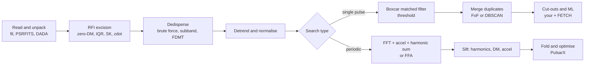

## GPU and CPU single-pulse engines

### heimdall: the simple GPU FRB search that most pipelines are built on

| Item | Detail |
|---|---|
| Role | Real-time GPU single-pulse / FRB search |
| Inputs | SIGPROC filterbank (`-f`) or PSRDADA ring buffer (`-k`) |
| Header fields read | SIGPROC: `nchans`, `nbits`, `ibeam`, `tsamp`, `fch1`, `foff`, `tstart`. DADA: `NCHAN`, `BANDWIDTH`/`BW`, `CFREQ`/`FREQ`, `NPOL`, `NBIT`, `TSAMP`, `BEAM`, `UTC_START` |
| Output | `<UTC>_<beam>.cand`, 9 tab-separated columns: `snr`, `sample_idx`, `time_s`, `filter_idx`, `dm_trial_idx`, `dm`, `members`, `begin`, `end` |
| Hardware | CUDA only (Thrust + `dedisp`) |
| Maintenance | Low. Last commit 2023-06-15, on SourceForge |
| Key files | `Pipeline/pipeline.cu`, `matched_filter.cu`, `remove_baseline.cu`, `find_giants.cu`, `hd/are_coincident.cuh`, `label_candidate_clusters.cu`, `merge_candidates.cu`, `Formats/SigprocFile.C` |
| Paper | Barsdell et al. 2012 covers `dedisp` only ([arXiv:1201.5380](https://arxiv.org/abs/1201.5380)) |

The canonical code is on SourceForge ([heimdall repo](https://sourceforge.net/p/heimdall-astro/code/ci/master/tree/)). There is no `ajameson` GitHub mirror.

**Pipeline.** `hd_execute()` in `pipeline.cu` processes the data in gulps of **262,144 samples** by default ([pipeline.cu](https://sourceforge.net/p/heimdall-astro/code/ci/master/tree/Pipeline/pipeline.cu)). For each gulp it runs these steps in order:

1. Zero-DM narrow-band and broad-band RFI cleaning. Masked samples are replaced with values drawn from nearby data.
2. Manual channel zapping.
3. `dedisp` brute-force dedispersion with adaptive time scrunching.
4. Per DM trial, baseline removal.
5. Normalisation to unit RMS.
6. A boxcar bank with power-of-two widths up to **4096 samples**.
7. Giant finding at a default threshold of **6σ**.
8. Once every DM trial is done, GPU cluster labelling and merging across the whole gulp.

Most of the defaults live in `default_params.C` ([default_params.C](https://sourceforge.net/p/heimdall-astro/code/ci/master/tree/Pipeline/default_params.C)):

- `baseline_length` = 2 s
- `dm_tol` = 1.25
- `dm_pulse_width` = 40 µs
- `cand_sep_time` = 3 and `cand_sep_filter` = 3 (both in index units)
- `cand_sep_dm` = 200 DM trials (this is in trial indices, not DM units)

**Maths.** Baseline removal is a robust running-median-like detrend. The series is repeatedly median-of-5 scrunched down to about $2N/(2r)$ points, where $r$ is the smoothing radius `baseline_length/(2·dt)`. It is then linearly stretched back to $N$ samples and subtracted ([remove_baseline.cu](https://sourceforge.net/p/heimdall-astro/code/ci/master/tree/Pipeline/remove_baseline.cu)).

The matched filter takes a single prefix sum, $S[k]=\sum_{j<k}x[j]$. The boxcar of width $w$ is then $y[i]=S[i+\lceil w/2\rceil]-S[i-\lfloor w/2\rfloor]$, and the S/N is $y/\sqrt{w}$ because $\sigma=1$ after normalisation ([matched_filter.cu](https://sourceforge.net/p/heimdall-astro/code/ci/master/tree/Pipeline/matched_filter.cu)).

Two giants $i$ and $j$ are coincident when all three of these hold:

- $|t_i-t_j|\le 3\cdot\max(2^{f_i},2^{f_j})$
- $|f_i-f_j|\le 3$
- $|{\rm dm}_i-{\rm dm}_j|\le 200$ trials

Equivalence chains are then resolved on the GPU to give friends-of-friends components. Each component keeps its highest-S/N member, along with a member count ([are_coincident.cuh](https://sourceforge.net/p/heimdall-astro/code/ci/master/tree/Pipeline/hd/are_coincident.cuh)).

**Performance.** heimdall leaves room for engineering gains. Heimdall++ re-engineers the GPU parallelism and reports **2.66x** speed-ups on single files and 2.05x in multi-file batches on an RTX 3080 Ti, with consistent results ([arXiv:2512.00398](https://arxiv.org/abs/2512.00398)). The `dedisp` paper's benchmark is older: a single GPU computes 1 minute of 1024-channel, 64 µs data over 1196 DMs in under a third of real time ([Barsdell et al. 2012](https://ar5iv.labs.arxiv.org/html/1201.5380)).

sigpyproc 2.0 ships an inspectable Python reimplementation of heimdall's boxcar, giant-finding and clustering stages ([heimdall.py](https://github.com/FRBs/sigpyproc3/blob/main/src/sigpyproc/algorithms/heimdall.py)).

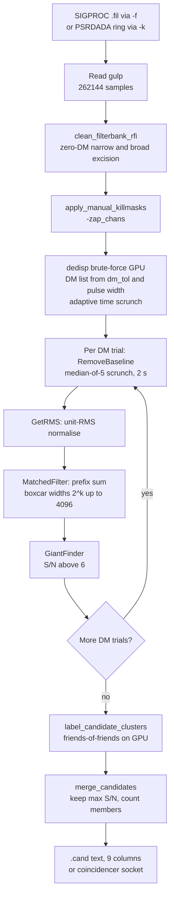

### AstroAccelerate: the most complete GPU library, with width-aware noise statistics

| Item | Detail |
|---|---|
| Role | GPU library and standalone pipeline: dedispersion, single-pulse search, periodicity, FDAS acceleration, jerk |
| Inputs | SIGPROC filterbank (rejects `nifs != 1`), plus a PRESTO-input reader |
| Header fields read | `tstart`, `tsamp`, `nbits`, `fch1`, `foff`, `nchans`, `nifs`. nsamp is computed from file size and nbits |
| Output | Single-pulse: binary float32 `(DM, time, SNR, width)` in `analysed-t_*.dat` or `peak_analysed-t_*.dat`. FDAS: `acc_list_<DM>.dat` |
| Hardware | CUDA only. The dedispersion paper also covers CPUs |
| Maintenance | Moderate. Last default-branch commit 2025-12-01; pushed 2026-09-25 |
| Key files | `include/aa_permitted_pipelines_generic.hpp`, `src/aa_device_dedispersion_kernel.cu`, `aa_device_SPS_long.cu`, `aa_device_MSD*.cu`, `aa_fdas_host.cu`, `aa_device_jerk_search.cu`, `aa_sigproc_input.cpp` |
| Papers | Novotný et al. 2023, dedispersion ([arXiv:2311.05341](https://arxiv.org/abs/2311.05341)); Adámek & Armour 2020, single-pulse detection; Dimoudi et al. 2018, FDAS |

Repository: [AstroAccelerate repo](https://github.com/AstroAccelerateOrg/astro-accelerate). File details: [aa_sigproc_input.cpp](https://github.com/AstroAccelerateOrg/astro-accelerate/blob/master/src/aa_sigproc_input.cpp), [aa_device_analysis.cu](https://github.com/AstroAccelerateOrg/astro-accelerate/blob/master/src/aa_device_analysis.cu).

**How you drive it.** AstroAccelerate is driven by a plan, not by command-line options. A configuration file gives piecewise `range lo hi step inBin outBin` dedispersion lines and turns components on with flags such as `analysis`, `acceleration`, `periodicity`, `zero_dm` and `rfi` ([ska_test_file.txt](https://github.com/AstroAccelerateOrg/astro-accelerate/blob/master/input_files/ska_test_file.txt)).

**How it runs.** The C++ API turns each component plan into a GPU-tuned strategy, checks that the combination of components is allowed, and fixes the execution order. That order is:

1. Preprocessing: zero-DM, outlier zero-DM, RFI and bandpass normalisation.
2. Dedispersion, chunk by chunk.
3. Single-pulse detection on each chunk.
4. After all chunks: periodicity, then FDAS, then jerk search.

Sources: [MANUAL.md](https://github.com/AstroAccelerateOrg/astro-accelerate/blob/master/MANUAL.md), [aa_permitted_pipelines_generic.hpp](https://github.com/AstroAccelerateOrg/astro-accelerate/blob/master/include/aa_permitted_pipelines_generic.hpp).

**Maths.** The single-pulse detector (SPDT) builds its boxcar bank iteratively. After the first set of taps, each iteration does two things:

- It decimates the series by 2 and reuses the partial boxcar sums, so the widths grow geometrically while each output is evaluated at decimated resolution.
- It takes the S/N not from one global σ but from a mean and σ interpolated from a **width-dependent mean/std "plane profile"**. That profile can optionally use outlier rejection.

This corrects the noise level for each width and each decimation level, which a fixed $1/\sqrt{w}$ assumes away ([aa_device_SPS_long.cu](https://github.com/AstroAccelerateOrg/astro-accelerate/blob/master/src/aa_device_SPS_long.cu)).

FDAS is the Fourier-domain correlation method of PRESTO's accelsearch, moved to the GPU. The spectrum is convolved with a bank of $z$ templates (and optionally $w$) by overlap-save cuFFT ([aa_fdas_host.cu](https://github.com/AstroAccelerateOrg/astro-accelerate/blob/master/src/aa_fdas_host.cu)).

**Performance.** All of these figures are from the authors:

- Brute-force dedispersion runs about **4x faster** than other available solutions on 8-bit, 8192-channel input, and at least 20x faster than real time for 11 telescope configurations ([arXiv:2311.05341](https://arxiv.org/abs/2311.05341)).
- The GPU jerk search on a Titan V runs almost **90x faster** than 4-thread PRESTO, with harmonic summing excluded from the timing ([arXiv:1911.01353](https://arxiv.org/pdf/1911.01353)).

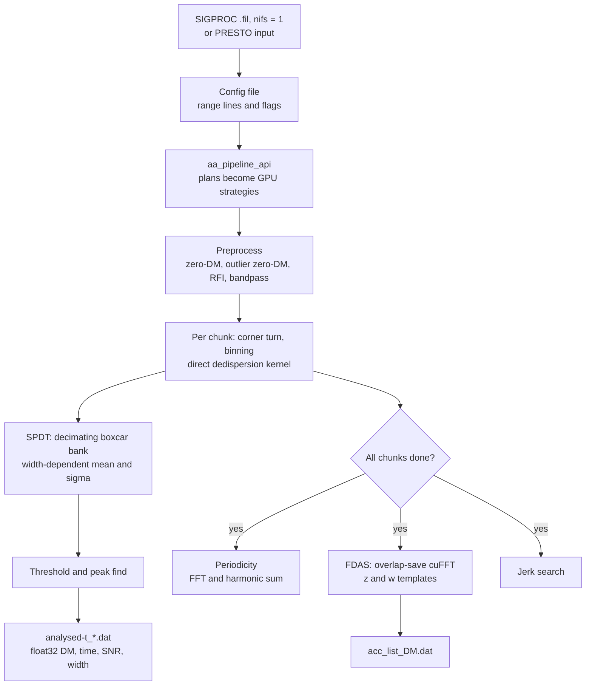

### TransientX: the best-documented CPU-only single-pulse search

| Item | Detail |
|---|---|
| Role | Real-time CPU single-pulse search with built-in RFI filtering and candidate plots |
| Inputs | SIGPROC filterbank, or PSRFITS (`--psrfits`, with `--wts`, `--scloffs`, `--zero_off`), read in chunks of `-l` seconds |
| Output | `.cands` text: `ibeam`, `cand_no`, `mjd`, `dm`, `width_ms`, `snr`, `fl`, `fh`, `png_name`, `id`, `filename`; a PNG per candidate; optional classifier images (`--saveimage`) |
| Hardware | CPU (AVX2 + OpenMP) |
| Maintenance | Active. Last commit 2026-07-23 |
| Key files | `src/singlepulse/singlepulse.cpp`, `boxcar.cpp`, `cluster.cpp`, `candplot.cpp`, `replot_fil.cpp`, `docs/pipeline/*.rst` |
| Paper | Men & Barr 2024, A&A 683, A183 ([arXiv:2401.13834](https://arxiv.org/abs/2401.13834)) |

Repository: [TransientX repo](https://github.com/ypmen/TransientX). Input options: [docs/pipeline.rst](https://github.com/ypmen/TransientX/blob/master/docs/pipeline.rst). Output format: [candplot.cpp](https://github.com/ypmen/TransientX/blob/master/src/singlepulse/candplot.cpp).

**Pipeline.** `SinglePulse::prepare/run` runs these stages in order ([singlepulse.cpp](https://github.com/ypmen/TransientX/blob/master/src/singlepulse/singlepulse.cpp)):

1. Downsample (`--td`, `--fd`).
2. Equalise each channel to zero mean and unit variance.
3. Subtract a smoothed zero-DM baseline.
4. Run an ordered chain of RFI filters (listed under Maths).
5. Subband dedispersion driven by a ddplan.
6. Boxcar filtering.
7. DBSCAN clustering.
8. Candidate plotting.

The ddplan has columns `td fd dms ddm ndm snrloss maxwidth`. Each DM range can therefore be downsampled before dedispersion, which limits intra-channel smearing ([dedispersion.rst](https://github.com/ypmen/TransientX/blob/master/docs/pipeline/dedispersion.rst)).

**Maths.** The RFI chain can include any of these filters ([rfi_mitigation.rst](https://github.com/ypmen/TransientX/blob/master/docs/pipeline/rfi_mitigation.rst)):

- Manual `zap`.
- A skewness–kurtosis IQR channel filter.
- An IQR time–frequency `mask`.
- `kadaneF` and `kadaneT`, which use Kadane's maximum-sum window to find slowly varying RFI.
- `zero`.
- `zdot`, which subtracts the zero-DM-correlated component from each channel: $x_c(t)\leftarrow x_c(t)-\frac{\langle x_c z\rangle}{\langle z z\rangle}z(t)$.

Boxcar widths grow geometrically by $1/(1-\text{snrloss})^2$, so neighbouring trial widths lose at most a fraction `snrloss` of S/N. The S/N uses a $\sqrt{1/(w\,\sigma^2)}$ normalisation, with optional IQR noise estimates ([boxcar.cpp](https://github.com/ypmen/TransientX/blob/master/src/singlepulse/boxcar.cpp)).

Clustering is DBSCAN on a 2-D kd-tree in (time, DM-delay) space. Its parameters are `eps` = `-r` (with a minimum of 1.5 samples) and `min_samples` = `-k`. `--drop` discards candidates whose width hits the maximum width, since these are likely RFI ([cluster.cpp](https://github.com/ypmen/TransientX/blob/master/src/singlepulse/cluster.cpp)).

**Performance and sensitivity.** The paper reports **real-time performance on one CPU core for 4096 channels × 4096 DMs at 153 µs**. It says subband dedispersion matches FDMT in practice because it is cache-friendly, even though its complexity is $O(N_{\rm DM}N_t\sqrt{N_f})$. It also reports a **~9% boxcar S/N loss** against a scattered Gaussian pulse ([arXiv:2401.13834](https://arxiv.org/html/2401.13834v1)).

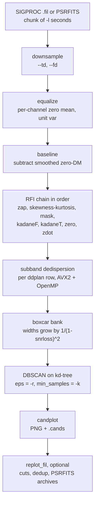

### dmt: the modern dedispersion engine, not a pipeline

| Item | Detail |
|---|---|
| Role | Dedispersion-transform library: FDMT, FDMT-FFT, DDMT (direct), SDMT (subband), DDMT-FFT, CohFDMT (coherent, baseband); plus boxcar and Kadane search kernels |
| Inputs | In-memory waterfall `(nchans, nsamps)` in **ascending** frequency; packed 1–16-bit input read directly. Helpers `sigproc_band(fch1, foff, nchans)` and `to_ascending()` convert SIGPROC layout |
| Output | DM–time plane plus the plan, with **exact per-trial σ** (S/N needs no calibration run); white-noise series for periodicity searches |
| Hardware | CPU (OpenMP + AVX2/AVX-512/NEON) and GPU (CUDA ≥12.2 and HIP); the two agree to float rounding |
| Maintenance | Very active. v0.8.0 released 2026-11-11; last commit 2026-11-20 |
| Key files | `lib/fdmt*.cpp`, `lib/ddmt*.cpp`, `lib/sdmt.cpp`, `lib/cfdmt*.cpp`, `lib/boxcar_*.cpp`, `lib/kadane_plan.cpp`, `lib/dm_grids.cpp`, `lib/fdmt_plan_noise.cpp`, `src/dmt_python.cpp` |

Sources: [dmt README](https://github.com/pravirkr/dmt), [CHANGELOG](https://github.com/pravirkr/dmt/blob/main/CHANGELOG.md).

**Interfaces and conventions.** From Python, the entry points are `dmtlib.compute_fdmt(...)` and `dmtlib.dedisperse(..., engine="fdmt_fft")`. The C++ class `dmt::algorithms::FDMT` takes `f_min`, `f_max`, `nchans`, `nsamps`, `tsamp`, a delay range, `use_box_smearing`, and an execution target (cpu, cuda or hip). By default, output times refer to $f_{\min}$. The dispersion constant is the TEMPO2 value, $1/2.41\times10^{-4}$. Streaming blocks are joined exactly through an internal history buffer.

**Maths.** FDMT works up a tree, merging adjacent sub-bands:

$A_{[f_0,f_2]}(\Delta t,t)=A_{[f_0,f_1]}(\Delta t_1,t)+A_{[f_1,f_2]}(\Delta t-\Delta t_1,t-\Delta t_1)$

There are $\log_2 N_f$ iterations, at a cost of about $N_tN_\Delta\log_2N_f$, against $N_tN_fN_\Delta$ for brute force ([Zackay & Ofek 2017, arXiv:1411.5373](https://arxiv.org/abs/1411.5373)). The derivation is in [05-algorithms-math.md](05-algorithms-math.md).

**Performance.** The `meerkat_lband` preset is 4096 channels, 856–1712 MHz, 612.48 µs sampling and up to 4057 DMs. On it, FDMT runs at **55x real time on 8 EPYC 9654 threads** and **776x real time on one L40S**. That is about 19x (CPU) and 6x (GPU) faster than dmt's own brute-force engine ([dmt README](https://github.com/pravirkr/dmt)). These are the best-documented cross-engine numbers found.

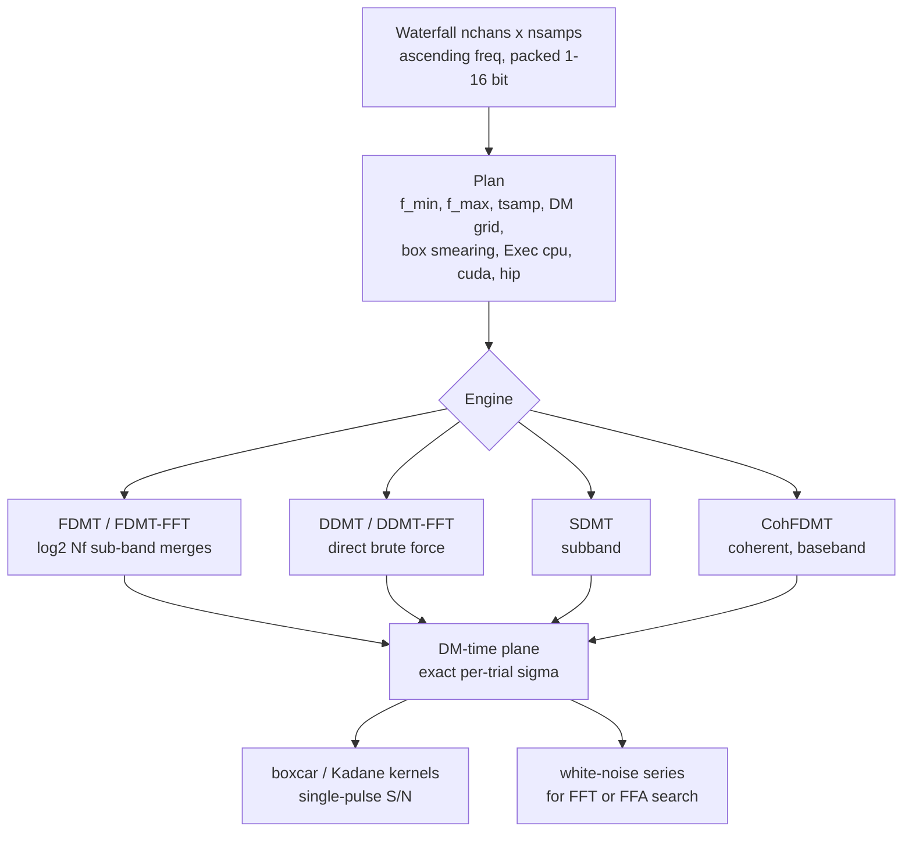

## Periodicity search and folding

### peasoup: the GPU binary-pulsar FFT search used in MeerKAT surveys

| Item | Detail |
|---|---|
| Role | GPU dedispersion + time-domain-resampling acceleration search + FFT + incoherent harmonic sum; newer Keplerian template-bank search |
| Inputs | SIGPROC filterbank (`include/data_types/filterbank.hpp`, `header.hpp`); optional killmask, zaplist and template bank |
| Output | `<outdir>/overview.xml` with search parameters and candidates (the binary `candidates.peasoup` write is commented out); optional PRESTO-compatible `.dat` (`-d --nosearch`) |
| Hardware | CUDA (up to 12.6), cuFFT, `dedisp`; multi-GPU via `DMDispenser` |
| Maintenance | Low cadence. Last commit 2025-08-05; an active fork (josephwkania/peasoup) was pushed 2026-11 |
| Key files | `src/pipeline_multi.cu`, `src/kernels.cu`, `src/folding_kernels.cu`, `include/utils/utils.hpp`, `include/transforms/*.hpp` |

Sources: [peasoup README](https://github.com/ewanbarr/peasoup), [pipeline_multi.cu](https://github.com/ewanbarr/peasoup/blob/master/src/pipeline_multi.cu).

**Pipeline.**

1. The DM list is built with `dedisp`'s generator (DM range, pulse width, tolerance).
2. The data are dedispersed on the GPU in gulps.
3. Each GPU worker takes the next DM trial from the dispenser and whitens it: R2C FFT, power spectrum, running-median dereddening, birdie zapping, statistics, then C2R back to a whitened series.
4. For each trial acceleration, the worker resamples in the time domain, takes an FFT, forms the interbinned spectrum, normalises, sums harmonics, finds peaks on the fundamental and on each harmonic sum, and distils harmonics.
5. Candidates are distilled by acceleration within each DM, then by DM and harmonics globally.
6. The results are written to XML.

Folding is not peasoup's job. The README says to use `psrfold_fil` (recommended), `prepfold` or `dspsr`.

**Maths.** Resampling removes the quadratic Doppler phase about the middle of the series. With `accel_fact` $=a\,t_{\rm samp}/(2c)$, each output sample is $\text{out}[i]=\text{in}[\text{round}(i+i\cdot\text{accel\_fact}\cdot(i-N))]$ ([kernels.cu](https://github.com/ewanbarr/peasoup/blob/master/src/kernels.cu)).

The acceleration step comes from the total smearing ([utils.hpp](https://github.com/ewanbarr/peasoup/blob/master/include/utils/utils.hpp)):

- Intra-channel DM smear: $t_{\rm dm}=4.15\times10^{-3}|{\rm DM}-{\rm cDM}|(f_{\rm bot}^{-2}-f_{\rm top}^{-2})$, with $f$ in GHz.
- Total broadening: $t_b=\sqrt{t_{\rm dm}^2+w^2+t_{\rm samp}^2}$.
- Step: $\delta a=2t_b\cdot24c/T_{\rm obs}^2\cdot\sqrt{{\rm tol}^2-1}$. `tol` ≈ 1.1 gives about 10% smearing.

**Newer features** ([peasoup README](https://github.com/ewanbarr/peasoup)):

- Template-bank searches: circular orbits with 3 parameters, and elliptical orbits with the BT or ELL8 resamplers.
- Segmented searches.
- `--cdm`, for finer acceleration steps near a coherent DM.
- Single-precision harmonic sums.

**Performance.** In the HTRU-S GPU reprocessing, median times per DM trial were 43 ms for dedispersion, 128 ms for acceleration search and 182 ms for the full search ([arXiv:1811.04929](https://arxiv.org/pdf/1811.04929)). TRAPUM runs it on up to 864 beams on 60 nodes, each with 2× GTX 1080 Ti, and folds the candidates with PulsarX ([arXiv:2212.08528](https://arxiv.org/pdf/2212.08528)).

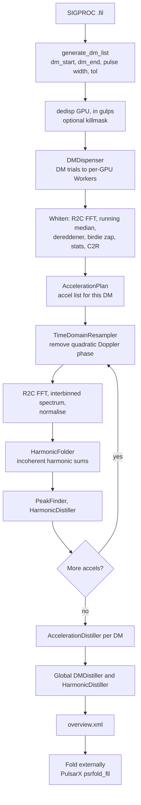

### riptide: the most sensitive pulsar search for long periods and narrow pulses

| Item | Detail |
|---|---|
| Role | FFA periodicity search pipeline (`rffa`) and Python library |
| Inputs | Dedispersed time series: PRESTO `.inf/.dat` or SIGPROC `.tim` (parses `src_raj`, `tstart`, `tsamp`, `nbits`, `fch1`, `refdm`). For `.tim`, `fmin`, `fmax` and `nchans` must be supplied in the YAML config |
| Output | `peaks.csv`, `clusters.csv`, `candidates.csv`, `candidate_NNNN.json`, optional PNG plots |
| Hardware | CPU only. C++ core with pybind11; one process per DM trial |
| Maintenance | Active. v0.2.7; last commit 2026-09-20 |
| Key files | `src/riptide/cpp/{transforms,periodogram,snr,running_median}.hpp`, `search.py`, `pipeline/pipeline.py`, `reading/{sigproc,presto}.py` |
| Paper | Morello et al. 2020, MNRAS 497, 4654 ([arXiv:2004.03701](https://arxiv.org/abs/2004.03701)) |

Repository: [riptide repo](https://github.com/v-morello/riptide). Inputs and config: [reading/sigproc.py](https://github.com/v-morello/riptide/blob/master/src/riptide/reading/sigproc.py), [example.yaml](https://github.com/v-morello/riptide/blob/master/src/riptide/pipeline/config/example.yaml).

**Pipeline.** `Pipeline.process` runs these steps ([pipeline.py](https://github.com/v-morello/riptide/blob/master/src/riptide/pipeline/pipeline.py)):

1. Select DM trials, including a cap on DM·|sin b| (default 45), so that only a minimal subset is searched.
2. For each DM trial: deredden with a running median, normalise, run `ffa_search` over each period range, then detect peaks.
3. Cluster the peaks by frequency.
4. Flag harmonics and apply the candidate filters.
5. Build candidates: refold each one at its best DM.

`ffa_search` defaults to a period range of 1–30 s, `bins_min`/`bins_max` of 240/260, a maximum duty cycle of 0.20, and trial widths spaced by a factor of 1.5 ([search.py](https://github.com/v-morello/riptide/blob/master/src/riptide/search.py)).

**Maths.** The FFA reshapes the series into $m$ rows of $p$ bins and merges halves recursively with integer circular shifts. This folds all $m$ trial periods in $[p,p+1)$ in $O(mp\log_2m)$ operations instead of $O(m^2p)$ ([transforms.hpp](https://github.com/v-morello/riptide/blob/master/src/riptide/cpp/transforms.hpp)).

Because the FFA folds only at integer bins per period, a continuous period range needs a ladder of downsampling factors. The series is first downsampled so that $\text{ds}\cdot t_{\rm samp}\cdot b_{\min}=P_{\min}$. The FFA runs for every integer $b$ in $[b_{\min},b_{\max}]$, and the downsampling factor then grows geometrically ([periodogram.hpp](https://github.com/v-morello/riptide/blob/master/src/riptide/cpp/periodogram.hpp)).

The S/N is an exact matched filter for a top-hat pulse on an unknown flat baseline. For $n$ bins and width $w$, the template height is $h=\sqrt{(n-w)/(nw)}$ and the baseline offset is $b=\frac{w}{n-w}h$. Then ${\rm S/N}=((h+b)\,d_{\max}-b\sum x)/\sigma$, where $d_{\max}$ is the largest circular $w$-bin window sum ([snr.hpp](https://github.com/v-morello/riptide/blob/master/src/riptide/cpp/snr.hpp)).

**Performance and sensitivity.** The paper puts the average FFA efficiency with boxcars at **≈0.93**. One 9-minute DM trial takes about **1 s on a 16-core node**. Cost grows sharply for $P\lesssim500$ ms, and there is no acceleration search ([ar5iv 2004.03701](https://ar5iv.labs.arxiv.org/html/2004.03701)).

riptide is no longer the most sensitive option for isolated pulsars. Ransom's 2026 coherent harmonic-summing code recovered **76% of injected pulsars, against 64% for riptide and 42% for accelsearch**, at matched false-alarm rate ([arXiv:2610.11749](https://arxiv.org/abs/2610.11749)). PRESTO now ships it as `coherentsearch`; see [02-presto.md](02-presto.md).

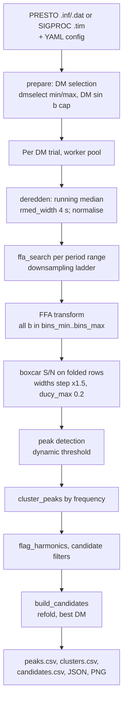

### PulsarX: the fold-and-optimise back end for large candidate lists

| Item | Detail |
|---|---|
| Role | CPU toolkit: `filtool` (clean and rewrite filterbank), `dedisperse_all_fil` (dedispersed series, `--format presto`), `psrfold_fil` and related programs (fold and optimise), `dmffdot`, `pulsarsearch`/`gridsearch`, injector, header tools |
| Inputs | SIGPROC or PSRFITS search data plus candidates: `--dm/--f0/--f1/--f2/--acc`, binary orbits (`--PB --A1 --T0 --ECC --OM`), `--parfile`, `--t2pred`, or `--candfile` with columns `#id dm acc F0 F1 S/N` |
| Output | PSRFITS fold archives (`.ar`), PNG diagnostic plots, updated `.cands` |
| Hardware | CPU |
| Maintenance | Very active. Last commit 2026-11-08 |
| Key files | `src/pulsar/{psrfold_fil,filtool,dedisperse_all_fil,dmffdot,gridsearch}.cpp`, `include/template/*.template`, shared XLibs repo |
| Paper | Men et al. 2023, A&A 679, A20 ([arXiv:2309.02544](https://arxiv.org/abs/2309.02544)) |

Repositories: [PulsarX repo](https://github.com/ypmen/PulsarX), [XLibs](https://github.com/ypmen/XLibs). Program list: [PulsarX src/pulsar](https://github.com/ypmen/PulsarX/tree/main/src/pulsar). Options: [psrfold_fil.cpp](https://github.com/ypmen/PulsarX/blob/main/src/pulsar/psrfold_fil.cpp).

**What `psrfold_fil` does.** It folds many candidates against the same data in one pass. The options group as follows:

- **Cleaning:** CLFD, RFI filters (`-z mask|kadaneF|kadaneT|zdot`, the same family as TransientX) and patching.
- **Folding layout:** subintegration length, subband count and bin plans.
- **Optimisation:** a grid search over DM, F0 and F1 (optionally F2). Each dimension can be switched off.

**Two algorithms.** The paper introduces two ideas ([arXiv:2309.02544](https://arxiv.org/abs/2309.02544)):

- **Pruned FDMT.** It reuses intermediate results and prunes the computation paths that no candidate needs. For about 500 candidates, this cuts dedispersion operations by about **50x** compared with brute force.
- **Tikhonov-regularised least-squares folding.** This improves profile time resolution.

The survey payoff is large. In MMGPS, `psrfold_fil` cut folding time **"from months to days"** ([URSI AP-RASC 2025](https://www.ursi.org/proceedings/procAP25/papers/0943.pdf)).

**Gap.** A grep for "fdmt" and "tikhonov" found neither algorithm by name in PulsarX or XLibs, so their source files are still unidentified.

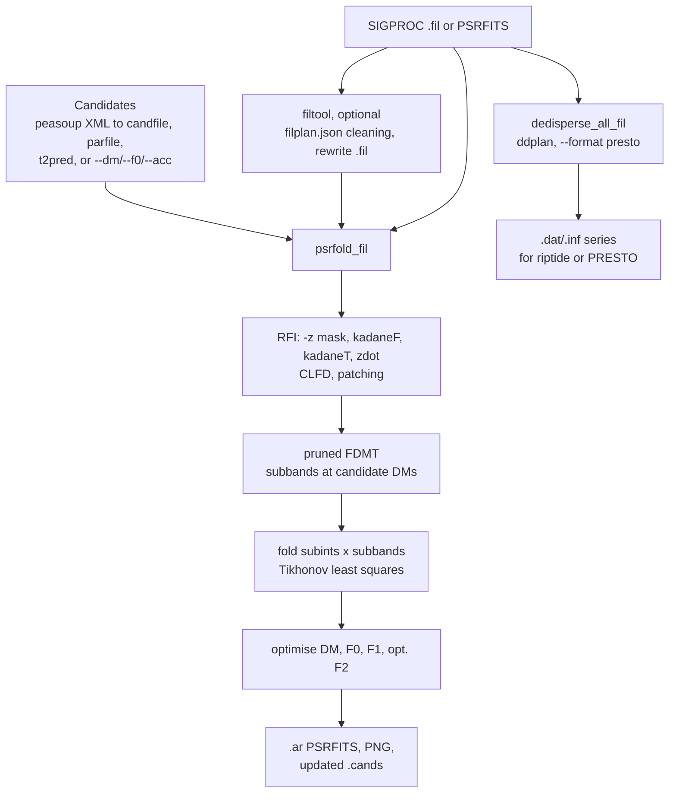

## Python toolkits and learned classifiers

### sigpyproc: the general Python toolbox, with reference single-pulse search

| Item | Detail |
|---|---|
| Role | Python filterbank / time-series / Fourier-series toolbox; CLI `spp_*`; reference implementations of PRESTO-style and heimdall-style single-pulse search |
| Inputs | SIGPROC (`FilReader`), search-mode PSRFITS (`PFITSReader`; Stokes I = P0+P1; DAT_FREQ order; dspsr ZERO_OFF rules; gapped OFFS_SUB rejected), `.dat/.inf`, `.tim`, `.fft/.spec` |
| Output | New filterbanks, `RFIMask`, TimeSeries, FourierSeries, FoldedData cubes, candidate tables (knows heimdall columns), `.dat/.tim` |
| Hardware | CPU (numba kernels) |
| Maintenance | Very active. v2.0.0 released 2026-10-17 (first PyPI release as `sigpyproc`); `legacy` branch keeps the old API |
| Key files | `src/sigpyproc/{base,readers,header,timeseries,fourierseries,foldedcube}.py`, `core/{rfi,candidates}.py`, `algorithms/{box,sps,heimdall,period}.py`, `io/{sigproc,pfits,bits}.py`, `apps/spp_*.py` |

Sources: [HISTORY.rst](https://github.com/FRBs/sigpyproc3/blob/main/HISTORY.rst), [readers.py](https://github.com/FRBs/sigpyproc3/blob/main/src/sigpyproc/readers.py), [core/candidates.py](https://github.com/FRBs/sigpyproc3/blob/main/src/sigpyproc/core/candidates.py).

**What the classes cover.** The abstract `Filterbank` class has methods for ([base.py](https://github.com/FRBs/sigpyproc3/blob/main/src/sigpyproc/base.py)):

- Gulped reading (`read_plan`).
- Statistics and the bandpass.
- Direct and tree dedispersion.
- Zero-DM removal, downsampling, subbanding and requantising.
- `clean_rfi(method="mad"|"iqrm")`.
- `fold(period, dm, accel)`.

`TimeSeries` adds `deredden`, `rfft`, `apply_boxcar`, `resample(accel)` and `find_pulses`. `PowerSpectrum` adds `harmonic_fold` and `find_peaks` ([timeseries.py](https://github.com/FRBs/sigpyproc3/blob/main/src/sigpyproc/timeseries.py), [fourierseries.py](https://github.com/FRBs/sigpyproc3/blob/main/src/sigpyproc/fourierseries.py)).

**Maths.** IQRM works on one per-channel statistic $x_i$ at a time. For each lag $k\in\pm1..r$, it forms lagged differences $d_{ik}=x_i-x_{i+k}$ and flags Tukey-IQR outliers in each lag's distribution. Channels are then masked by a vote across lags ([core/rfi.py](https://github.com/FRBs/sigpyproc3/blob/main/src/sigpyproc/core/rfi.py)).

**Format details.** Since v2.0, 1-, 2- and 4-bit filterbank samples are unpacked least-significant-bit first, matching dspsr. Each reader's quirks are listed in [01-data-formats.md](01-data-formats.md).

sigpyproc has no performance benchmark. Treat it as a correctness and exploration tool, not a throughput engine.

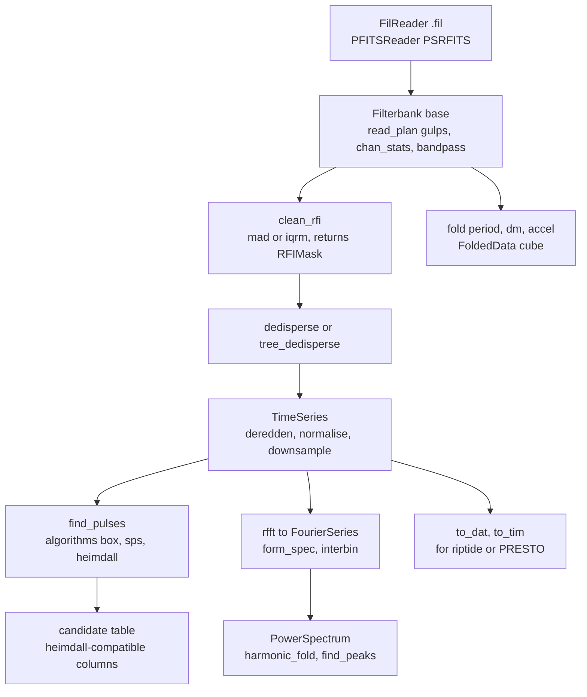

### your: the unified reader and the candidate cut-out maker that feeds FETCH

| Item | Detail |
|---|---|
| Role | Unified reader for PSRFITS and SIGPROC (`Your`); format writer (`Writer`: `to_fil`, `to_fits`, `to_dada`); candidate cut-out maker (`your_candmaker`); heimdall driver (`your_heimdall`); RFI utilities |
| Inputs | SIGPROC (8, 16 and 32 bit only; sub-byte raises an error) and PSRFITS (applies DAT_SCL/OFFS/WTS, **ignores ZERO_OFF**, MSB-first 2/4-bit, averages AA and BB ×0.5); candidate CSV with `file, snr, width (log2 samples), dm, label, stime, chan_mask_path, num_files` |
| Output | Per-candidate HDF5: datasets `data_freq_time` and `data_dm_time` (256×256 default); attributes `cand_id, tcand, dm, dm_opt, snr, snr_opt, width, label, rfi_mask, kill_mask, filelist`, header fields |
| Hardware | CPU, with optional GPU (cupy/numba) dedispersion |
| Maintenance | Active. v0.6.8; last commit 2026-09-19 |
| Key files | `your/your.py`, `your/writer.py`, `your/candidate.py`, `your/formats/*.py`, `your/utils/{rfi,heimdall,gpu}.py`, `bin/your_candmaker.py` |
| Paper | Aggarwal et al. 2020, JOSS 5(55), 2750 ([JOSS](https://joss.theoj.org/papers/10.21105/joss.02750.pdf)) |

Sources: [your.py](https://github.com/thepetabyteproject/your/blob/main/your/your.py), [psrfits.py](https://github.com/thepetabyteproject/your/blob/main/your/formats/psrfits.py), [pysigproc.py](https://github.com/thepetabyteproject/your/blob/main/your/formats/pysigproc.py).

**Candidate pipeline.** For each CSV row, `your_candmaker` runs these steps ([candidate.py](https://github.com/thepetabyteproject/your/blob/main/your/candidate.py), [your_candmaker.py](https://github.com/thepetabyteproject/your/blob/main/bin/your_candmaker.py)):

1. Read a chunk long enough to span the dispersion sweep.
2. Dedisperse it.
3. Build a 256-step DM–time "butterfly" from 0 to 2·DM.
4. Optionally optimise the DM for S/N.
5. Median-decimate by `width//2`.
6. Resize to 256×256.
7. Write HDF5.

The `width` column is log₂ of the width in samples, the same convention as heimdall's `filter_idx`. A heimdall `.cand` row can therefore pass straight through.

**RFI utilities.** Two filters are available: a Savitzky–Golay fit to the bandpass, and spectral kurtosis with median ± 1.4826·σ·MAD bounds ([rfi.py](https://github.com/thepetabyteproject/your/blob/main/your/utils/rfi.py)).

**Format caveats.** These matter when mixing tools. Because `your` averages AA and BB where PRESTO and sigpyproc sum them, absolute levels differ by **2x**. Its PSRFITS writer sets `fcenter = fch1 + nchans·foff/2`, which can shift frequencies by half a channel on a round trip ([fitswriter.py](https://github.com/thepetabyteproject/your/blob/main/your/formats/fitswriter.py); details in [01-data-formats.md](01-data-formats.md)).

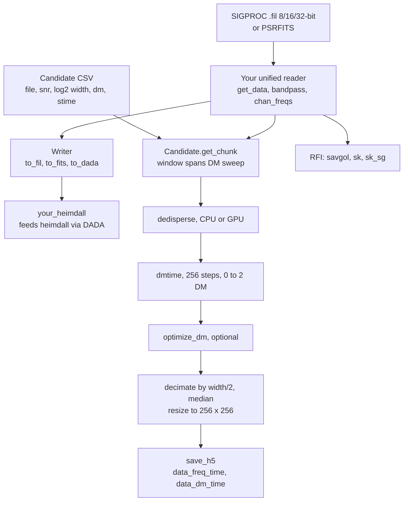

### FETCH: the de facto FRB candidate classifier

| Item | Detail |
|---|---|
| Role | Deep-learning real-vs-RFI classifier for single-pulse candidates |
| Inputs | `your` candidate HDF5. `DataGenerator` reads `data_freq_time` (transposed, detrended, divided by std, median-subtracted) and `data_dm_time` (divided by std, median-subtracted), 256×256×1 each |
| Output | `results_<model>.csv` with `candidate, probability, label` (threshold `-p`, default 0.5) |
| Hardware | CPU or GPU through TensorFlow 2 / Keras |
| Maintenance | Moderate. Default branch `tf2`, last commit 2025-06-09; setup.py version 0.2.0 |
| Key files | `fetch/data_sequence.py`, `fetch/utils.py`, `fetch/models/*`, `bin/predict.py`, `bin/train.py` |
| Paper | Agarwal et al. 2020, MNRAS 497, 1661 ([arXiv:1902.06343](https://arxiv.org/abs/1902.06343)) |

Sources: [FETCH repo](https://github.com/devanshkv/fetch), [data_sequence.py](https://github.com/devanshkv/fetch/blob/tf2/fetch/data_sequence.py), [predict.py](https://github.com/devanshkv/fetch/blob/tf2/bin/predict.py).

**Models.** Each model has two branches. One CNN reads the frequency–time image (a DenseNet variant) and one reads the DM–time image (Xception, VGG16, InceptionV3 or InceptionResNetV2). The branches' features are merged into a 2-class softmax. There are **11 pre-trained models, a–k**. Their weights are downloaded and checked by MD5. Fine-tuning uses Adam at a learning rate of 1e-3 with binary cross-entropy ([fetch/models](https://github.com/devanshkv/fetch/tree/tf2/fetch/models), [utils.py](https://github.com/devanshkv/fetch/blob/tf2/fetch/utils.py)).

**Accuracy.** The authors report over **99.5% accuracy and recall** for every model on their own test set ([arXiv:1902.06343](https://arxiv.org/abs/1902.06343v2)). An independent check found much lower recall: the Northern HTRU single-pulse study (2025) measured FETCH recall on injected signals well below 0.99 for all models ([arXiv:2511.17797](https://arxiv.org/pdf/2511.17797)). Retrain on local data before trusting it on a new telescope.

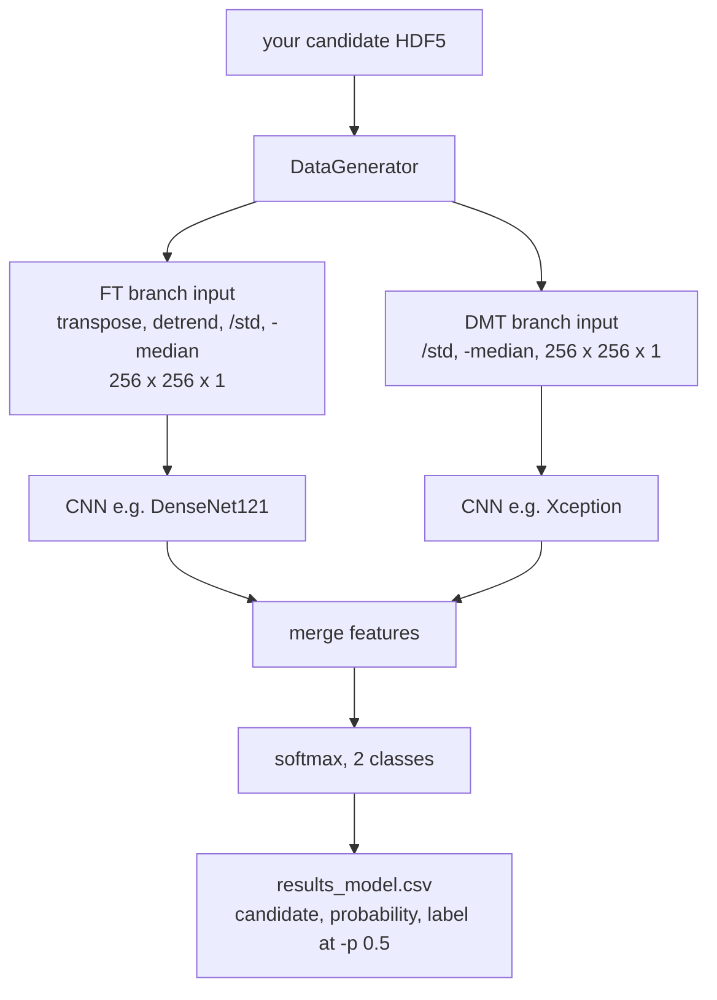

### ASTROFLOW and DRAFTS: detectors built around object-detection networks

**ASTROFLOW** ([repo](https://github.com/lintian233/astroflow), PyPI `pulseflow`, last push 2026-06-26) is a real-time GPU pipeline that runs end to end from raw data to candidates. It reads `.fil`, PSRFITS and PSRDADA, configured by a single YAML file. The pipeline runs these stages:

1. CUDA RFI mitigation: IQRM and zero-DM.
2. CUDA dedispersion, in subband or default mode.
3. A **YOLOv11n** object detector on DM–time images, or a classic boxcar detector instead.
4. Output: candidate PNGs and CSVs.

Main source files are `src/core/dedispered.cu`, `src/core/iqrm.cu` and `src/detection/{aidetection,boxcardetection}.cpp` ([configuration.md](https://github.com/lintian233/astroflow/blob/main/docs/configuration.md)). The paper reports about **10x faster than real time** on a 150 s, 2048-channel observation on consumer GPUs. It also says heimdall and TransientX recover most bursts on FAST data but produce substantially more false detections ([arXiv:2511.02328](https://arxiv.org/abs/2511.02328)).

**DRAFTS** ([repo](https://github.com/SukiYume/DRAFTS), last commit 2026-10-02) is built around FAST data and runs four stages:

1. FITS organisation and prefetching, summing the first two polarisations.
2. GPU RFI removal, fine-channel dedispersion and downsampling. These run in CuPy, and the data are handed to PyTorch through DLPack.
3. A **CenterNet** detector on 512×512 time–DM images, which finds each burst's arrival time and DM.
4. A **ConvNeXt** binary classifier on dedispersed time–frequency cut-outs.

On FRB 20190520B it found **more than 3x the bursts heimdall found** ([arXiv:2410.03200](https://arxiv.org/html/2410.03200v1)). Both codes were surveyed only at README and configuration level.

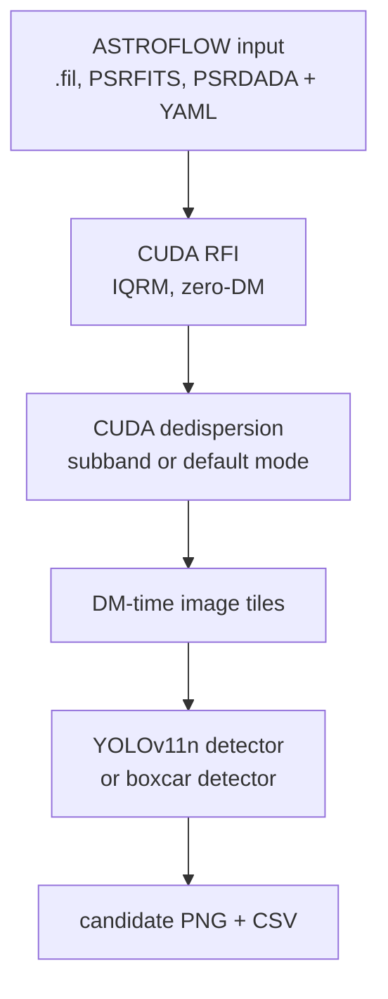

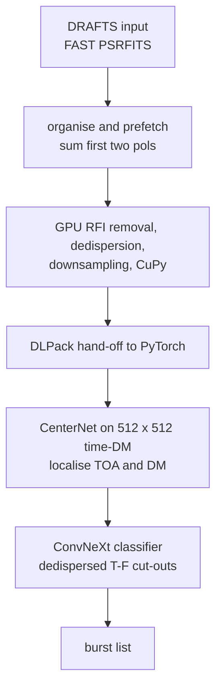

## Where the codes overlap and how they are chained

The table below gives each code's coverage of each stage. A dash means the code does not do that stage. "Lib" means the capability is a library call, not a pipeline stage. Each cell's source is in that code's section above.

| Code | Inputs | RFI | Dedispersion | Single-pulse detect | Duplicate merge | Periodicity | Folding | Cut-outs / ML | HW | Licence | Last activity |
|---|---|---|---|---|---|---|---|---|---|---|---|
| heimdall | fil, DADA | zero-DM narrow+broad | brute force (dedisp) | boxcar 2^k, prefix sum | FoF on GPU | — | — | — | GPU | GPL / AFL ambiguous | 2023-06 |
| AstroAccelerate | fil, PRESTO | zero-DM, outlier zero-DM, rfi | direct many-core | SPDT, width-aware σ | peak find | FFT + harmonic sum; FDAS; jerk | — | — | GPU | GPL-3.0 | 2025-12 |
| TransientX | fil, PSRFITS | zap, SK, IQR mask, kadane, zdot | subband (CPU) | boxcar, snrloss widths | DBSCAN kd-tree | — | replot only | PNG, `--saveimage` | CPU | GPL-3.0 | 2026-07 |
| dmt | in-memory array | — | FDMT, FFT, direct, subband, coherent | lib: boxcar, Kadane | — | feeds series | — | — | CPU + GPU (CUDA, HIP) | MIT | 2026-11 |
| peasoup | fil | killmask, birdies | brute force (dedisp) | — | Harmonic/Accel/DM distillers | resample + FFT + harmonic sum; template bank | basic fold optimiser, external recommended | — | GPU | Apache-2.0 | 2025-08 |
| riptide | .dat/.inf, .tim | running-median deredden | — (DM selection only) | — | frequency clustering, harmonic flags | FFA | refold candidates | PNG | CPU | MIT | 2026-09 |
| PulsarX | fil, PSRFITS + candidates | filtool, zdot, kadane, CLFD | pruned FDMT, ddplan | — | — | grid optimise DM/F0/F1/F2 | full: .ar PSRFITS | PNG | CPU | GPL-3.0 | 2026-11 |
| sigpyproc | fil, PSRFITS, .dat, .tim | MAD, IQRM | direct, tree | PRESTO-style and heimdall-style reference | heimdall-style | FFT, harmonic fold, resample | fold cube | — | CPU (numba) | MIT | 2026-10 |
| your | fil, PSRFITS, writes DADA | Savitzky–Golay, SK | per-candidate | drives heimdall | — | — | — | FT + DMT HDF5 cut-outs | CPU + opt. GPU | GPL-3.0 | 2026-09 |
| FETCH | your HDF5 | — | — | — | — | — | — | 2-branch CNN classifier | CPU / GPU (TF2) | GPL-3.0 | 2025-06 |
| ASTROFLOW | fil, PSRFITS, DADA | IQRM, zero-DM | GPU subband / default | YOLOv11n or boxcar | detector | — | — | built-in | GPU | BSD-3 | 2026-06 |
| DRAFTS | FAST PSRFITS | GPU dynamic RFI | GPU fine-channel | CenterNet | detector | — | — | ConvNeXt classifier | GPU | MIT | 2026-10 |

**Real overlaps.** The matrix shows four places where codes do the same job and you have to choose between them.

1. **GPU single-pulse search: heimdall, AstroAccelerate and ASTROFLOW.** heimdall's normalisation assumes one global σ. AstroAccelerate corrects σ for each width and decimation level. The inference is that this gives AstroAccelerate the better sensitivity for each GPU-second, but nobody has measured that head to head. ASTROFLOW replaces the threshold-and-cluster step with a learned detector.
2. **Single-pulse search on the CPU: TransientX and sigpyproc.** TransientX is the production engine. sigpyproc is the readable reference.
3. **Dedispersion.** Five codes each implement it separately. dmt is the only one that can sit underneath the others as a shared engine.
4. **Pulsar periodicity: peasoup and AstroAccelerate for binaries, riptide for long periods.** peasoup resamples in the time domain. AstroAccelerate's FDAS correlates in the Fourier domain, which is the PRESTO approach. riptide covers the long-period, narrow-pulse regime that both FFT codes handle worst.

Some pairs that look like competitors are actually complements. peasoup and riptide search different parts of parameter space. PulsarX is the downstream folder for both. `your` and FETCH are glue for any single-pulse code that emits heimdall-style candidates.

**Chaining.** These codes are mostly chained through file formats, as the diagram below shows. The heimdall `.cand` columns are the de facto single-pulse interchange format. A heimdall row's `filter_idx` is log₂ width, which `your_candmaker` reads directly ([your_candmaker.py](https://github.com/thepetabyteproject/your/blob/main/bin/your_candmaker.py)). On the pulsar side, TRAPUM and MMGPS feed peasoup XML candidates to PulsarX ([arXiv:2212.08528](https://arxiv.org/pdf/2212.08528)).

Several hand-offs need care because the tools disagree on conventions:

- **Width:** heimdall and `your` use log₂ width, sigpyproc uses `width_bins`, and PRESTO `.singlepulse` uses Downfact in samples.
- **Band direction:** dmt wants ascending frequency, while SIGPROC data usually have `foff < 0`.
- **Polarisation scaling:** `your` averages the two polarisations, PRESTO and sigpyproc sum them.

The dashed edges in the diagram are possible routes that use documented formats, not pipelines found in a published survey.

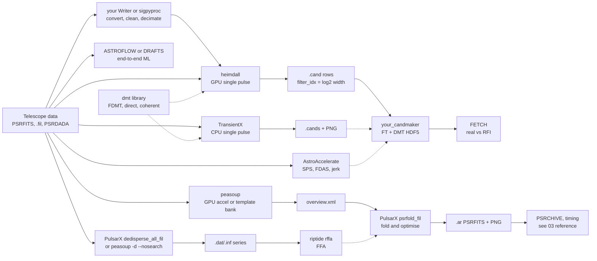

## What each code is best at

| Task | Best pick | Runner-up | Why |
|---|---|---|---|
| Simplest real-time GPU FRB search to deploy | heimdall | AstroAccelerate | Mature, a single binary, takes DADA input, and `your_heimdall` already drives it ([pipeline.cu](https://sourceforge.net/p/heimdall-astro/code/ci/master/tree/Pipeline/pipeline.cu)). Heimdall++ shows 2–2.7x headroom ([arXiv:2512.00398](https://arxiv.org/abs/2512.00398)) |
| GPU single-pulse sensitivity and an all-in-one GPU library | AstroAccelerate | heimdall | σ corrected per width ([aa_device_SPS_long.cu](https://github.com/AstroAccelerateOrg/astro-accelerate/blob/master/src/aa_device_SPS_long.cu)); ~4x faster dedispersion than other codes ([arXiv:2311.05341](https://arxiv.org/abs/2311.05341)); also has periodicity, FDAS and jerk |
| CPU-only single-pulse search | TransientX | sigpyproc | Real time on one core for 4096 ch × 4096 DMs; rich RFI chain; DBSCAN ([arXiv:2401.13834](https://arxiv.org/abs/2401.13834)) |
| Raw dedispersion throughput on CPU and GPU | dmt | AstroAccelerate | FDMT at 55x real time on CPU and 776x on one L40S; exact per-trial σ ([dmt README](https://github.com/pravirkr/dmt)) |
| GPU binary-pulsar search | peasoup | AstroAccelerate FDAS / jerk | Production use in TRAPUM/MMGPS; template banks for orbits ([peasoup README](https://github.com/ewanbarr/peasoup)) |
| Long-period, low duty-cycle pulsars | riptide | PRESTO `coherentsearch` (see [02-presto.md](02-presto.md)) | FFA efficiency ≈0.93 ([arXiv:2004.03701](https://arxiv.org/abs/2004.03701)); coherent summing now recovers more injections ([arXiv:2610.11749](https://arxiv.org/abs/2610.11749)) |
| Folding and optimising thousands of candidates | PulsarX | sigpyproc `fold` | Pruned FDMT cuts dedispersion work ~50x; survey folding went from months to days ([arXiv:2309.02544](https://arxiv.org/abs/2309.02544)) |
| Python exploration, readable reference algorithms | sigpyproc | your | numba; heimdall and PRESTO-style single-pulse search in Python ([sigpyproc tree](https://github.com/FRBs/sigpyproc3/tree/main/src/sigpyproc)) |
| Format conversion and FRB candidate cut-outs | your | sigpyproc | `Writer` to fil, PSRFITS and DADA; the FETCH-standard HDF5 ([candidate.py](https://github.com/thepetabyteproject/your/blob/main/your/candidate.py)) |
| FRB candidate classification, standard | FETCH | DRAFTS ConvNeXt stage | 11 pre-trained models; widest adoption ([arXiv:1902.06343](https://arxiv.org/abs/1902.06343)). Recall drops on independent data ([arXiv:2511.17797](https://arxiv.org/pdf/2511.17797)) |
| Most bursts recovered on FAST-like data | DRAFTS | ASTROFLOW | More than 3x heimdall's bursts on FRB 20190520B ([arXiv:2410.03200](https://arxiv.org/html/2410.03200v1)) |
| End-to-end ML-first real-time pipeline | ASTROFLOW | DRAFTS | About 10x real time on consumer GPUs; fewer false positives than heimdall and TransientX ([arXiv:2511.02328](https://arxiv.org/abs/2511.02328)) |
| Widest set of RFI filters | TransientX / PulsarX | sigpyproc (IQRM) | zdot, skewness–kurtosis, kadaneF/T, IQR mask in one chain ([rfi_mitigation.rst](https://github.com/ypmen/TransientX/blob/master/docs/pipeline/rfi_mitigation.rst)) |

**Caveats on the table.** The "best" calls for sensitivity are the weakest in it. No study runs heimdall, AstroAccelerate, TransientX and ASTROFLOW on identical injected data. Their speed figures were also measured on different channel counts, DM grids, bit depths and GPU generations. The same problem applies to GPU-versus-CPU periodicity speed-ups. Those were measured against PRESTO v4–v5, and CPU accelsearch became about 8x faster in v6.3.3, so the published GPU advantage overstates today's gap ([PRESTO CHANGELOG](https://github.com/scottransom/presto/blob/master/CHANGELOG.md)).

**Known gaps in this survey.** Several items were not resolved:

- The location of PulsarX's pFDMT and TLSM source files.
- heimdall's exact RFI thresholds and dedisp's DM-list formula.
- AstroAccelerate's FDAS template-step maths.
- ASTROFLOW and DRAFTS internals below README and configuration level.

## Conclusion

The codes have converged on the same stage boundaries. That makes the boundaries themselves (the waterfall layout, the DM-time plane, the candidate row and the cut-out HDF5) the most valuable thing to standardise. Each stage already has a strong open implementation, so a team does not need to write a new search code to get a new search. What is missing is a set of interchange contracts that let dmt's engines sit under TransientX-style detection, feed `your`/FETCH cut-outs, and route periodicity candidates to PulsarX without the width, band-direction and polarisation-scaling mismatches noted above.

The second point is that leadership is moving. In 2026 the most active work is in CPU-portable libraries (dmt, sigpyproc 2.0, riptide) and in ML-first detectors (ASTROFLOW, DRAFTS). The GPU codes that set the standard a decade ago (heimdall, peasoup) now see little upstream development. Two things are needed before committing compute to any one engine. One is an injection-recovery harness run on identical data across heimdall, AstroAccelerate, TransientX and a dmt-based detector. The other is FETCH retrained on local RFI. Until both exist, the "best at" calls here are informed choices, not measurements.
