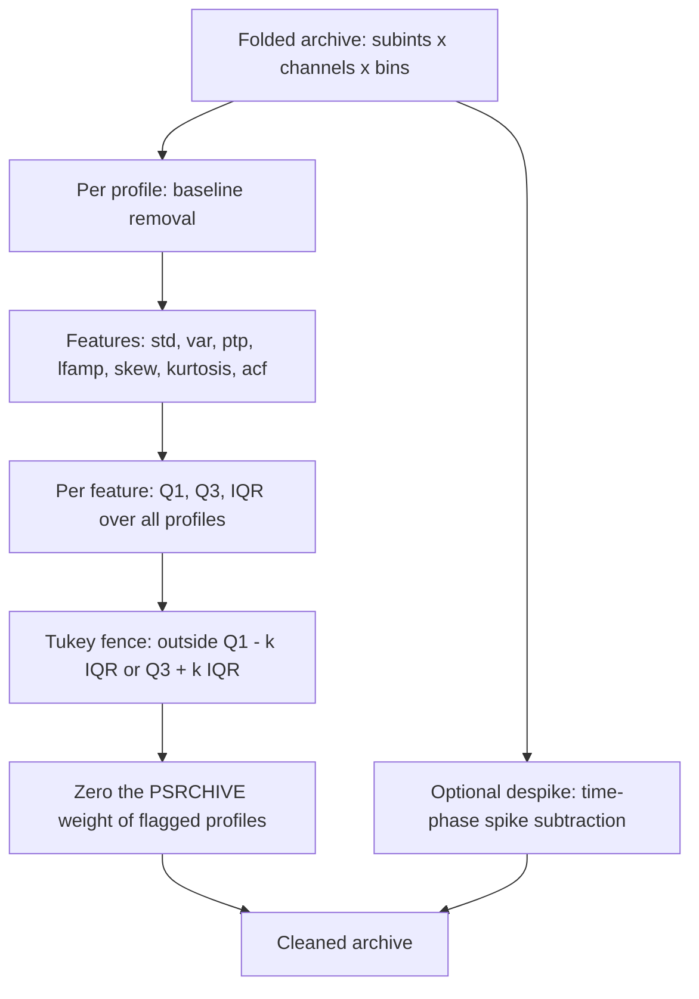

# clfd math map

clfd ("clean folded data"; Vincent Morello; Python on PSRCHIVE's bindings, MIT) removes RFI from folded archives. It reduces every (sub-integration, channel) profile to a few scalar features, flags outliers in each feature with Tukey's rule, and sets the PSRCHIVE weights of flagged profiles to zero; an optional step subtracts time–phase spikes ([clfd repo](https://github.com/v-morello/clfd)). It was developed for the GPU reprocessing of the HTRU-S survey. Notes: [io_formats_and_rfi.md](../research_notes/unified-search-stack/io_formats_and_rfi.md). The reference set read clfd at README level only, so the feature definitions below are [unverified] standard forms.

**Tags.** [C] = described from clfd's documentation by the research notes; **[unverified]** = standard form, not checked against clfd's code.



## 1. Profile features [C for the list, unverified for each definition]

For one profile $p_j$, $j=0\ldots n_b-1$, mean $\bar p$:

```math
{\rm std}=\sqrt{\tfrac1{n_b}\textstyle\sum_j(p_j-\bar p)^2},\qquad {\rm var}={\rm std}^2,\qquad {\rm ptp}=\max_jp_j-\min_jp_j
```

```math
{\rm lfamp}=\Big\lvert\sum_jp_je^{-2\pi ij/n_b}\Big\rvert,\qquad {\rm skew}=\frac{m_3}{m_2^{3/2}},\qquad {\rm kurtosis}=\frac{m_4}{m_2^2}-3,\qquad {\rm acf}=\frac{\sum_j(p_j-\bar p)(p_{j+1}-\bar p)}{\sum_j(p_j-\bar p)^2}
```

lfamp is the amplitude of the lowest non-zero Fourier harmonic, sensitive to slow baseline variations; acf is the lag-one autocorrelation [unverified: lag and normalisation].

- clfd: `clfd/features.py` [unverified file name].
- Ours: moments of the same form in [`fb-rfi/src/stats.rs`](../../filterbank/crates/fb-rfi/src/stats.rs) `channel_stats` (applied to channels of a filterbank block, not to folded profiles); folded version planned.

## 2. Tukey outlier rule [C for the rule, unverified for the default k]

For each feature over all (subint, channel) profiles:

```math
\text{flag if }x<Q_1-k\,{\rm IQR}\ \text{ or }\ x>Q_3+k\,{\rm IQR},\qquad {\rm IQR}=Q_3-Q_1
```

A profile is zapped if any selected feature flags it. Tukey's conventional $k=1.5$; clfd's default `qmask` value was not checked.

- clfd: `clfd/profile_masking.py` [unverified file name].
- Paper: Tukey 1977, *Exploratory Data Analysis*; Morello et al. 2019, MNRAS 483, 3673 (HTRU-S reprocessing) [unverified citation].
- Ours: quantiles in [`fb-rfi/src/stats.rs`](../../filterbank/crates/fb-rfi/src/stats.rs) `quantile`; IQR-based fences in [`fb-rfi/src/iqrm.rs`](../../filterbank/crates/fb-rfi/src/iqrm.rs) `iqrm` (one-sided, in Gaussian σ). Folded-data cleaning planned (fold).

## 3. Despiking [unverified]

Sum over frequency to a time–phase plane, find samples exceeding a robust threshold (median + $k$·MAD), and subtract their contribution channel by channel.

- clfd: `--despike`.
- Ours: planned.

## 4. Weights [C]

Flagged profiles get PSRCHIVE weight 0, so every later average ($\bar p=\sum w_ip_i/\sum w_i$) ignores them.

- Ours: the same weights-as-mask approach in [`fb-defs/src/mask.rs`](../../filterbank/crates/fb-defs/src/mask.rs) `RfiMask`.
