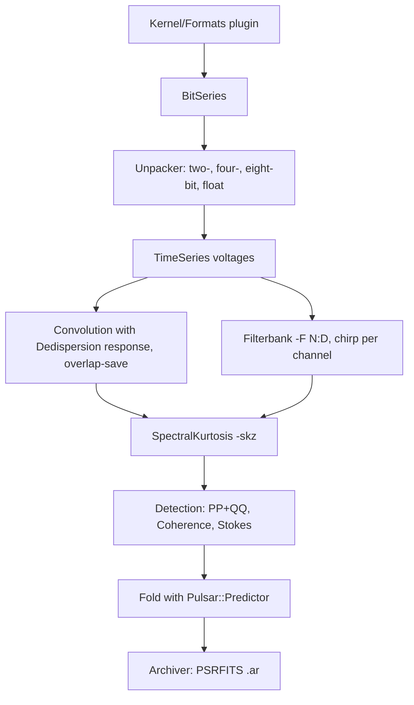

# DSPSR math map

DSPSR (Willem van Straten, Matthew Bailes and others; C++ with mature CUDA, AFL 2.1) turns baseband voltages or filterbank samples into folded profiles: unpack, coherent dedispersion by overlap-save, optional synthetic filterbank, spectral kurtosis, detection, and folding with a phase predictor. `digifil` and `digifits` reuse the same engine to write coherently dedispersed filterbanks ([DSPSR source](https://sourceforge.net/p/dspsr/code/ci/master/tree/), commit `3f3d5b4`; van Straten & Bailes 2011, PASA 28, 1). Program-level notes: [03-dspsr-psrchive-timing.md](../reference/03-dspsr-psrchive-timing.md). Source paths are relative to the repository.

**Tags.** [V] = paper; [C] = transcribed from DSPSR's source by the reference set; [D] = derived; **[unverified]** = not checked against DSPSR's own code.



## 1. Unpacking and PSRFITS scaling [C for the options; DSPSR unpacker source not read]

`-scloffs` applies `DAT_SCL`/`DAT_OFFS` ("denormalize PSRFITS"); `-W` disables `DAT_WTS`; the `ZERO_OFF` rules below are known only through sigpyproc3's mirror:

```math
x=d-Z_{\rm eff},\qquad Z_{\rm eff}=\begin{cases}0&n_{\rm bits}\in\{2,16\}\\ \texttt{ZERO\_OFF}&\text{otherwise}\end{cases}
```

2-bit data go through a level lookup (`TwoBitCorrection`), with `-2 code` 2-bit excision.

- DSPSR: `Signal/Pulsar/dspsr.C` (options), `Kernel/Formats/fits/FITSUnpacker.C`, `Kernel/Classes/TwoBitCorrection.C`.
- Paper: van Straten & Bailes 2011.
- Ours: [`fb-io/src/psrfits.rs`](../../filterbank/crates/fb-io/src/psrfits.rs) `ZeroOffPolicy::Dspsr`, `ScalePolicy`.

## 2. Dispersion constant and delay [C]

```math
t(f)=\frac{{\rm DM}/2.41\times10^{-4}}{f^2}\ {\rm s},\qquad D=\frac{\rm DM}{2.41\times10^{-4}}\ {\rm s\,MHz^2}
```

`dm_dispersion = 2.41e-4`; the code comment quotes 2.410331(2)×10⁻⁴, the physical value, but the rounded convention is what is used.

- DSPSR: `Signal/General/Dedispersion.C` `delay_time`.
- Paper: Kulkarni 2020, arXiv:2007.02886.
- Ours: [`fb-defs/src/consts.rs`](../../filterbank/crates/fb-defs/src/consts.rs) `K_DM_PULSAR`, `dispersion_delay`.

## 3. Smearing across a band [C]

```math
t_{\rm smear}=t\big(f_c-\lvert B\rvert/2\big)-t\big(f_c+\lvert B\rvert/2\big)
```

- DSPSR: `Signal/General/PlasmaResponse.C`; companion `dmsmear`.
- Ours: [`fb-defs/src/consts.rs`](../../filterbank/crates/fb-defs/src/consts.rs) `intrachannel_smearing` (derivative form $2k_{\rm DM}{\rm DM}\Delta\nu/f^3$).

## 4. Coherent dedispersion chirp [V: van Straten & Bailes 2011 Eqs. 3, 5], [C]

```math
H(\nu_0+\nu)=\exp\!\left[i\frac{2\pi D\nu^2}{\nu_0^2(\nu_0+\nu)}\right],\qquad t_d=D(\nu_{\min}^{-2}-\nu_{\max}^{-2})
```

As coded:

```math
\phi(f)=-{\rm sign}(B)\frac{2\pi(10^6\,{\rm DM}/2.41\times10^{-4})}{f_0^2}\frac{f^2}{f_0+f}-2\pi f\,\delta_{\rm frac},\qquad H(f)=e^{i\phi(f)}
```

$f_0$ channel centre (MHz), $f$ offset within the channel (MHz), $\delta_{\rm frac}$ fractional-sample inter-channel delay. Dedispersion multiplies the voltage spectrum by the chirp's conjugate (sign set by sideband and FFT convention).

- DSPSR: `Signal/General/Dedispersion.C` `build_compute`.
- Paper: Hankins 1971; Hankins & Rickett 1975; van Straten & Bailes 2011.
- Ours: planned.

## 5. Overlap-save sizing and optimal FFT [C]

```math
n_{\rm filt}=\big\lceil1.1\,t_{\rm smear}\,r\big\rceil,\qquad n_{\rm fft}^\ast=\arg\min_{n=2^k>n_{\rm filt}}\frac{n\log_2n}{n-n_{\rm filt}}
```

$r$ sampling rate; `smearing_buffer = 0.1` covers "pollution due to the cyclical convolution effect"; `impulse_pos` samples are dropped from the start and `impulse_neg` from the end of each inverse FFT. Example: $n_{\rm filt}\approx1100$ gives costs 23.8, 16.4, 15.02, 15.01 for 2k, 4k, 8k, 16k.

- DSPSR: `Signal/General/PlasmaResponse.C`, `Signal/General/OptimalFFT.C` `get_nfft`; `-x nfft`, `--fft-bench`.
- Ours: planned.

## 6. Synthetic filterbank [D, from code structure]

`-F N:D`: one forward FFT of length $n_{\rm fft}$, the chirp applied per output channel, then $N$ inverse FFTs of length $n_{\rm fft}/N$, which coherently dedisperses each output channel with a shorter kernel.

- DSPSR: `Signal/General/Filterbank.C`.
- Ours: planned.

## 7. Spectral kurtosis [V: Nita & Gary 2010], [C]

```math
\widehat{SK}=\frac{M+1}{M-1}\left[\frac{M\,S_2}{S_1^2}-1\right],\qquad S_1=\sum_{i=1}^MP_i,\quad S_2=\sum_{i=1}^MP_i^2,\qquad {\rm var}=\frac{4M^2}{(M-1)(M+2)(M+3)}\to\frac4M
```

Per channel and polarisation ($N=d=1$); default `std_devs(3.0)`, a symmetric window $1\pm3\sqrt{\rm var}$, plus time- and frequency-scrunched SK. Nita & Gary's Pearson Type III bounds are asymmetric (for $N=10$, $M=300$, $d=1$: [0.76754, 1.28212] against symmetric [0.74288, 1.25712]).

- DSPSR: `Signal/General/SKFilterbank.C`, `SpectralKurtosis.C`, `SKDetector.C`, `SKMasker.C`; `-skz`, `-skzm`, `-skzs`.
- Paper: Nita & Gary 2010, MNRAS 406, L60, arXiv:1005.4371.
- Ours: [`fb-rfi/src/lib.rs`](../../filterbank/crates/fb-rfi/src/lib.rs) `spectral_kurtosis` (generalised $MNd$ form, exact variance, symmetric window as DSPSR).

## 8. Detection [C]

```math
S_0=\lvert p\rvert^2+\lvert q\rvert^2,\quad S_1=\lvert p\rvert^2-\lvert q\rvert^2,\quad S_2=2(p_rq_r+p_iq_i),\quad S_3=2(p_rq_i-p_iq_r)
```

$p$, $q$ complex receptor voltages; `-d 1` gives PP+QQ, `-d 4` the coherence products.

- DSPSR: `Signal/General/Detection.C`, `stokes_detect.ic`.
- Ours: total intensity only, [`fb-defs/src/block.rs`](../../filterbank/crates/fb-defs/src/block.rs) `Block::total_intensity`.

## 9. Folding [C]

Phase from a `Pulsar::Predictor` generated for start−864 s to +86 400 s (polyco or TEMPO2 Chebyshev; see [tempo2.md](tempo2.md)). Bin count:

```math
n_b=\max\{2^k\le1024:\ P/2^k\ge1.2\,t_{\rm samp}\}
```

unless `-b` is given.

- DSPSR: `Signal/Pulsar/Fold.C` `get_folding_predictor`, `choose_nbin`.
- Ours: planned (fold).
