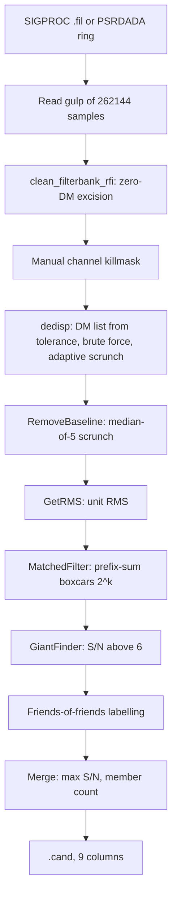

# heimdall math map

heimdall (Ben Barsdell, Andrew Jameson and others; CUDA with Thrust and the `dedisp` library) is the simple real-time GPU single-pulse search that many FRB pipelines are built on. Per gulp it cleans RFI, dedisperses, removes a baseline, normalises, runs a power-of-two boxcar bank, finds giants and merges them friends-of-friends ([heimdall repo](https://sourceforge.net/p/heimdall-astro/code/ci/master/tree/), commit `69a33da`). It is the main source for our single-pulse stage; what we took is recorded in [CREDITS.md](../CREDITS.md). Program-level notes: [04-other-search-codes.md](../reference/04-other-search-codes.md).

**Tags.** [C] = transcribed from heimdall's source by the reference set; [D] = derived; **[unverified]** = not checked against a primary source.



## 1. Input frequency axis [C]

SIGPROC: `nchans`, `nbits`, `ibeam`, `tsamp`, `fch1`, `foff`, `tstart`. PSRDADA:

```math
f_0=f_{\rm c}-\frac{B}{2}+\frac{B/N_{\rm chan}}{2},\qquad \delta f=\frac{B}{N_{\rm chan}}
```

$f_{\rm c}$ = `FREQ`/`CFREQ` (MHz), $B$ = `BW`/`BANDWIDTH` (negative for an inverted band).

- heimdall: `Formats/SigprocFile.C`, `Formats/PSRDadaRingBuffer.C`.
- Ours: [`fb-io/src/sigproc.rs`](../../filterbank/crates/fb-io/src/sigproc.rs); DADA planned (see [psrdada.md](psrdada.md)).

## 2. RFI: zero-DM excision [unverified]

Narrow-band and broad-band excision around the zero-DM series $z(t)=N_f^{-1}\sum_fx(t,f)$: samples whose statistic exceeds a threshold are replaced with values drawn at random from nearby good data. Thresholds were not transcribed.

- heimdall: `Pipeline/clean_filterbank_rfi.cu`.
- Paper: Eatough, Keane & Lyne 2009 (zero-DM).
- Ours: [`fb-rfi/src/lib.rs`](../../filterbank/crates/fb-rfi/src/lib.rs) `zero_dm` (subtraction, not replacement); masked samples filled with the channel mean in [`fb-pipeline/src/single_pulse.rs`](../../filterbank/crates/fb-pipeline/src/single_pulse.rs) `clean_block`.

## 3. DM list [C for the inputs, unverified for the formula]

`dedisp_generate_dm_list(dm_min, dm_max, pulse_width = 40 µs, tol = 1.25)` chooses successive DMs so the total smearing grows by at most the factor `tol`, with the effective width a quadrature sum of sample time, intrinsic width and intra-channel and DM-step smear. The exact formula lives in dedisp and was not transcribed. A form with the same ingredients is

```math
w_{\rm eff}=\sqrt{t_{\rm samp}^2+W^2+t_{\rm chan}({\rm DM})^2},\qquad \delta{\rm DM}=\frac{2\,w_{\rm eff}\sqrt{{\rm tol}^2-1}}{k_{\rm DM}(f_{\rm lo}^{-2}-f_{\rm hi}^{-2})}
```

which is what our planner uses [unverified as a transcription of dedisp].

- heimdall: `Pipeline/default_params.C` (`dm_tol = 1.25`, `dm_pulse_width = 40`); dedisp `generate_dm_list`.
- Paper: Barsdell et al. 2012, MNRAS 422, 379; Cordes & McLaughlin 2003, Eqs. 2, 11–14.
- Ours: [`fb-defs/src/dmplan.rs`](../../filterbank/crates/fb-defs/src/dmplan.rs) `DmPlan::tolerance` (default `tol = 1.25` in [`single_pulse.rs`](../../filterbank/crates/fb-pipeline/src/single_pulse.rs)).

## 4. Dedispersion [C]

Brute force (dedisp) with nearest-sample delays; each gulp produces $N_{\rm out}=N_{\rm samp}-d_{\max}$ samples; adaptive time scrunching gives each DM its own scrunch factor once smearing exceeds the sample time.

- heimdall: `Pipeline/pipeline.cu`; dedisp library.
- Paper: Barsdell et al. 2012.
- Ours: [`fb-dedisp/src/lib.rs`](../../filterbank/crates/fb-dedisp/src/lib.rs) `brute_force` (`nout = nsamp − maxd`, no scrunching); [`cuda/src/fbcuda.cu`](../../filterbank/cuda/src/fbcuda.cu) `dedisperse_kernel`; gulp overlap in [`fb-io/src/reader.rs`](../../filterbank/crates/fb-io/src/reader.rs) `BlockIter`.

## 5. Baseline removal [C]

Smoothing radius $r=$ `baseline_length`$/(2t_{\rm samp})$ with `baseline_length = 2 s`. The series is repeatedly median-of-5 scrunched down to about $N/r$ points, linearly stretched back to $N$ samples, and subtracted:

```math
b^{(\ell+1)}_k={\rm median}\big(b^{(\ell)}_{5k},\ldots,b^{(\ell)}_{5k+4}\big),\qquad x'_i=x_i-{\rm interp}(b^{(L)})_i
```

- heimdall: `Pipeline/remove_baseline.cu`.
- Ours: [`fb-sp/src/lib.rs`](../../filterbank/crates/fb-sp/src/lib.rs) `baseline_subtract` (one median per window of `baseline_window` samples, linear interpolation).

## 6. Normalisation [C for the role, unverified for the estimator]

Each DM trial is scaled to unit RMS by `GetRMSPlan`; the estimator is robust (median-based) [unverified]. Optional `-boxcar_renorm` re-measures noise after filtering.

- heimdall: `Pipeline/get_rms.cu`.
- Ours: [`fb-sp/src/lib.rs`](../../filterbank/crates/fb-sp/src/lib.rs) `robust_std` ($1.4826\,{\rm median}\lvert x\rvert$).

## 7. Matched filter [C]

```math
S[k]=\sum_{j<k}x[j],\qquad y_w[i]=S[i+\lceil w/2\rceil]-S[i-\lfloor w/2\rfloor],\qquad {\rm S/N}=\frac{y_w}{\sqrt w},\quad w=2^b,\ b=0\ldots12
```

Centred boxcar; σ = 1 after normalisation; widths up to 4096, time-decimated above that.

- heimdall: `Pipeline/matched_filter.cu`.
- Paper: Cordes & McLaughlin 2003, Eq. 15 (S/N ∝ area/√width); Morello et al. 2020, Eqs. 37–38 (prefix form).
- Ours: [`fb-sp/src/lib.rs`](../../filterbank/crates/fb-sp/src/lib.rs) `boxcar_search` (leading boxcar, reported at the centre by `to_candidates`); [`cuda/src/fbcuda.cu`](../../filterbank/cuda/src/fbcuda.cu) `boxcar_kernel`.

## 8. Giant finding [C]

Samples with ${\rm S/N}>6$ (default) are segmented into giants with peak, begin and end samples.

- heimdall: `Pipeline/find_giants.cu`.
- Ours: run merging inside `boxcar_search`; threshold default 6 in `SearchParams`.

## 9. Friends-of-friends clustering [C]

```math
\lvert s_i-s_j\rvert\le\tau_{\rm tol}\max(2^{b_i},2^{b_j}),\qquad \lvert b_i-b_j\rvert\le b_{\rm tol},\qquad \lvert d_i-d_j\rvert\le d_{\rm tol}
```

$s$ sample, $b$ filter index, $d$ DM-trial index; defaults $\tau_{\rm tol}=3$, $b_{\rm tol}=3$, $d_{\rm tol}=200$ trials. Components are found by replacing each label with the minimum label of its root chain; each keeps its max-S/N member and a member count.

- heimdall: `Pipeline/hd/are_coincident.cuh`, `label_candidate_clusters.cu`, `merge_candidates.cu`.
- Ours: [`fb-sp/src/lib.rs`](../../filterbank/crates/fb-sp/src/lib.rs) `cluster` (union-find; width tolerance in ladder index; default DM tolerance 20).

## 10. Output [C]

Nine tab-separated columns per gulp in `<UTC>_<beam>.cand`: `snr`, `samp_idx`, `time_s` $=$ `samp_idx`$\cdot t_{\rm samp}$, `filter_index` (width $2^{b}$), `dm_index`, `dm`, `members`, `begin_sample`, `end_sample`.

- heimdall: `Pipeline/pipeline.cu`.
- Ours: [`fb-formats/src/candidates.rs`](../../filterbank/crates/fb-formats/src/candidates.rs) `read_heimdall`, `write_heimdall`.
