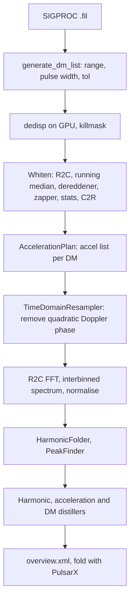

# peasoup math map

peasoup (Ewan Barr and others; CUDA with cuFFT and dedisp, Apache-2.0) is the GPU binary-pulsar FFT search run on every TRAPUM and MMGPS beam. It dedisperses with dedisp, whitens each DM trial, removes trial accelerations by time-domain resampling, then FFTs, interbins, harmonic-sums, peak-finds and distils candidates. Folding is left to PulsarX ([peasoup repo](https://github.com/ewanbarr/peasoup)). Program-level notes: [04-other-search-codes.md](../reference/04-other-search-codes.md). Source paths are relative to the repository.

**Tags.** [C] = transcribed from peasoup source by the reference set; [D] = derived; **[unverified]** = not transcribed.



## 1. DM list [C for the call, unverified for the formula]

`Dedisperser.generate_dm_list(dm_start, dm_end, dm_pulse_width, dm_tol)` wraps dedisp's tolerance ladder; see [heimdall.md](heimdall.md) section 3 for the form.

- peasoup: `src/pipeline_multi.cu`, `include/transforms/dedisperser.hpp`.
- Paper: Barsdell et al. 2012, MNRAS 422, 379.
- Ours: [`fb-defs/src/dmplan.rs`](../../filterbank/crates/fb-defs/src/dmplan.rs) `DmPlan::tolerance`.

## 2. Dedispersion [unverified, textbook form]

Brute force with nearest-sample delays (dedisp), killmask channels excluded.

- Ours: [`fb-dedisp/src/lib.rs`](../../filterbank/crates/fb-dedisp/src/lib.rs) `brute_force`.

## 3. Whitening [C for the order, unverified for the estimators]

```math
P_k=\lvert A_k\rvert^2,\qquad A'_k=\frac{A_k}{\sqrt{{\rm RM}(P)_k}},\qquad \text{zap}\ k\in\mathcal Z,\qquad \mu,\sigma\leftarrow P'
```

R2C FFT, power spectrum, running median ${\rm RM}$, dereddening (`Dereddener`), birdie zapping from a zaplist (`Zapper`), mean and rms of the whitened powers kept for later normalisation, then C2R back to a whitened series [unverified: exact median scaling].

- peasoup: `include/transforms/{ffter,spectrumformer,dereddener,birdiezapper}.hpp`.
- Paper: Ransom, Eikenberry & Middleditch 2002 (median whitening).
- Ours: planned (periodicity-fft).

## 4. Acceleration step [C]

```math
t_{\rm dm}=4.15\times10^{-3}\,\lvert{\rm DM}-{\rm cDM}\rvert\,(f_{\rm bot}^{-2}-f_{\rm top}^{-2}),\qquad t_b=\sqrt{t_{\rm dm}^2+W^2+t_{\rm samp}^2},\qquad \delta a=\frac{2\,t_b\cdot24\,c}{T^2}\sqrt{{\rm tol}^2-1}
```

$f$ in GHz across one channel ($f_c\pm\Delta f/2$), $t$ in s; cDM the coherent DM (`--cdm`); $W$ = `pulse_width`; $T$ observation length; ${\rm tol}\approx1.1$ gives about 10% smearing; zero is included when the range spans it. Note $4.15\times10^{-3}$ s GHz² corresponds to $k_{\rm DM}=4150$, not 4149.378; it is used for step planning only.

- peasoup: `include/utils/utils.hpp` `AccelerationPlan`.
- Ours: the same quadrature-and-tolerance form drives [`fb-defs/src/dmplan.rs`](../../filterbank/crates/fb-defs/src/dmplan.rs) `DmPlan::tolerance` for DM; acceleration planned.

## 5. Time-domain resampling [C], [D]

```math
x'_i=x\!\left[{\rm round}\big(i+\alpha\,i\,(i-N)\big)\right],\qquad \alpha=\frac{a\,t_{\rm samp}}{2c}
```

Equivalent to $t'\approx t+a\,t(t-T)/(2c)$ [D]: the quadratic Doppler phase is removed about the midpoint, avoiding a net frequency shift.

- peasoup: `src/kernels.cu` `TimeDomainResampler.resampleII`, `getAcceleratedIndexII`.
- Paper: standard resampling form (Lorimer & Kramer 2005) [unverified].
- Ours: planned.

## 6. Interbinned spectrum and normalisation [C for the call], [V: REM02 Eq. 31]

```math
A_{k+1/2}\simeq\tfrac{\pi}{4}(A_k-A_{k+1}),\qquad P_k=\max\big(\lvert A_k\rvert^2,\ \lvert A_{k+1/2}\rvert^2\big),\qquad P'_k=\frac{P_k-\mu}{\sigma}
```

The max-of-bin-and-interbin choice is [unverified]; normalisation uses the statistics from step 3.

- peasoup: `src/kernels.cu` `form_interpolated`; `stats::normalise`.
- Ours: planned.

## 7. Harmonic folding and peak finding [unverified]

```math
P_m(k)=\sum_{h=1}^{m}P'\big({\rm round}(hk/m)\big)\quad\text{or}\quad\sum_{h=1}^mP'(hk)\ \text{(fold to the fundamental)}
```

Sums for $m=2,4,8,16$ (`nharmonics`), peaks found on the fundamental and every sum (`PeakFinder.find_candidates`).

- peasoup: `include/transforms/harmonicfolder.hpp`, `peakfinder.hpp`.
- Ours: planned.

## 8. Distillers [C for the order, unverified for tolerances]

`HarmonicDistiller` removes candidates whose frequency is $f_1\approx(p/q)f_2$ for small integers within a tolerance; `AccelerationDistiller` merges the same signal across accelerations (a frequency shift $\delta f=a f T/(2c)$ [unverified]); `DMDistiller` merges across DMs; then a global harmonic pass.

- peasoup: `include/transforms/distiller.hpp`, `src/pipeline_multi.cu`.
- Ours: planned (sift).

## 9. Template banks [unverified]

Keplerian resampling over a bank of circular orbits (three parameters: $P_b$, projected semi-major axis, phase) or elliptical orbits (BT or ELL8 resamplers): each sample is mapped to emission time $t_e=t-\Delta_R(t)$ with the Roemer delay of the trial orbit, then FFT-searched as above.

- peasoup: `include/transforms/template_bank_reader.hpp`, README.
- Ours: planned.
