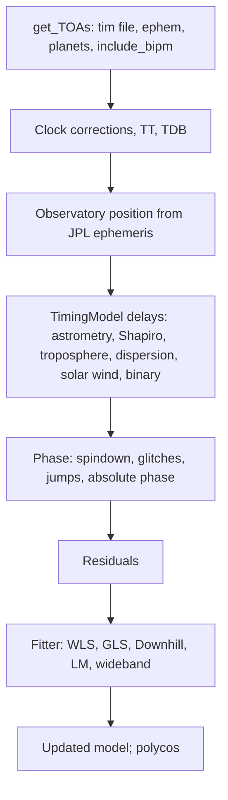

# PINT math map

PINT (NANOGrav; pure Python on NumPy and Astropy, BSD) is an independent reimplementation of pulsar timing: TOA handling with clock corrections and solar-system ephemerides, a component-based timing model, polyco generation and evaluation, and WLS, GLS, downhill, LM and wideband fitters, plus maximum-likelihood noise estimation ([PINT repo](https://github.com/nanograv/PINT), commit `d88d1d2`; Luo et al. 2021, ApJ 911, 45; Susobhanan et al. 2024, ApJ 971, 150). Our plan uses PINT in-process for fitting ([06-our-plan.md](../reference/06-our-plan.md)). Program-level notes: [03-dspsr-psrchive-timing.md](../reference/03-dspsr-psrchive-timing.md). Source paths are relative to `src/pint/`.

**Tags.** [V] = TEMPO polyco spec or Edwards et al. 2006; [C] = transcribed from PINT source by the reference set; **[unverified]** = standard form, not line-verified against PINT.



## 1. TOAs and clocks [C for the interface, unverified for the chain]

`get_TOAs(..., ephem, include_bipm, bipm_version, planets)`: site clock → GPS → UTC → TAI → TT(BIPM), then TDB; observatory position from a JPL DE ephemeris.

- PINT: `toa.py`, `observatory/`.
- Ours: planned (timing).

## 2. Delay chain [V: Edwards et al. 2006 for the terms; unverified for PINT's ordering]

```math
t_{\rm em}=t_{\rm TDB}-\Delta_{R\odot}-\Delta_{S\odot}-\Delta_{\rm trop}-\frac{D\,{\rm DM}}{\nu^2}-\Delta_{\rm SW}-\Delta_{\rm bin},\qquad D=\frac1{2.41\times10^{-4}}
```

Planetary Shapiro terms for Jupiter, Saturn, Venus, Uranus, Neptune and Earth; see [tempo2.md](tempo2.md) section 2 for the term formulas.

- PINT: `models/astrometry.py`, `solar_system_shapiro.py`, `troposphere_delay.py`, `dispersion_model.py`, `solar_wind_dispersion.py`, `binary_bt.py`, `binary_dd.py`, `binary_ddk.py`, `binary_ell1.py`, `timing_model.py`.
- Ours: dispersion constant in [`fb-defs/src/consts.rs`](../../filterbank/crates/fb-defs/src/consts.rs) `K_DM_PULSAR`; the rest planned.

## 3. Spin-down phase [unverified]

```math
\phi(t)=\sum_{n\ge0}\frac{F_n}{(n+1)!}\,\Delta t^{\,n+1},\qquad \Delta t=t_{\rm em}-t_{\rm PEPOCH}
```

with glitch, jump and absolute-phase (TZR) components added.

- PINT: `models/spindown.py`, `glitch.py`, `jump.py`, `absolute_phase.py`.
- Ours: [`fb-defs/src/candidates.rs`](../../filterbank/crates/fb-defs/src/candidates.rs) `PeriodicCandidate::at_epoch` ($f$, $\dot f$, $\ddot f$ shifted by the same series).

## 4. Polyco evaluation [V: TEMPO polyco spec], [C]

```math
\phi(t)={\rm RPHASE}+60\,\Delta T\,F_0+\sum_{n=1}^{N_c}C_n\Delta T^{n-1},\qquad \Delta T=(t-{\rm TMID})\times1440
```

`evalabsphase` uses `dt = (t - tmid)*MIN_PER_DAY`, exactly the TEMPO form.

- PINT: `polycos.py` `evalabsphase`.
- Ours: planned (fold).

## 5. Fitters [unverified]

```math
\text{WLS: }\delta\mathbf p=(\mathbf M^{\sf T}\mathbf N^{-1}\mathbf M)^{-1}\mathbf M^{\sf T}\mathbf N^{-1}\mathbf r,\qquad \text{GLS: }\delta\mathbf p=(\mathbf M^{\sf T}\mathbf C^{-1}\mathbf M+\mathbf\Phi^{-1})^{-1}\mathbf M^{\sf T}\mathbf C^{-1}\mathbf r
```

$\mathbf M$ design matrix $\partial r/\partial p$, $\mathbf N$ diagonal white-noise covariance, $\mathbf C$ full noise covariance (white plus correlated), $\mathbf\Phi$ prior on noise-basis amplitudes [unverified]. Downhill variants accept a step only if $\chi^2$ falls; LM adds damping $\lambda\,{\rm diag}(\mathbf M^{\sf T}\mathbf N^{-1}\mathbf M)$.

- PINT: `fitter.py` (`WLSFitter`, `GLSFitter`, `DownhillWLSFitter`, `DownhillGLSFitter`, `LMFitter`, `WidebandTOAFitter`).
- Paper: Luo et al. 2021; Susobhanan et al. 2024 (noise estimation).
- Ours: planned (optional import).
