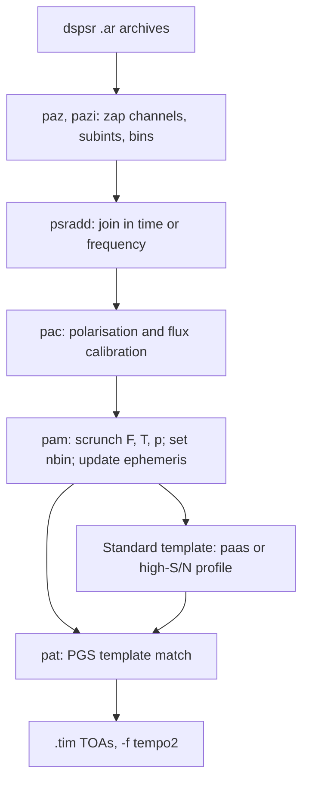

# PSRCHIVE math map

PSRCHIVE (Willem van Straten, Aidan Hotan and others; C++, AFL 2.1, no GPU code) stores folded profiles as `Pulsar::Archive` objects (Integration × pol × chan × bin), usually PSRFITS fold-mode `.ar` files, and supplies the tools that zap, add, calibrate, scrunch and time them. For a search pipeline its key mathematics is the fold-mode scaling and `pat`'s Fourier phase-gradient (PGS) template match ([PSRCHIVE source](https://sourceforge.net/p/psrchive/code/ci/master/tree/), commit `d77bc07`; Hotan, van Straten & Manchester 2004, PASA 21, 302). Program-level notes: [03-dspsr-psrchive-timing.md](../reference/03-dspsr-psrchive-timing.md). Source paths are relative to the repository.

**Tags.** [C] = from PSRCHIVE source or the PSRFITS spec as read by the reference set; [S] = textbook form of Taylor 1992, paper not retrieved; **[unverified]** = standard form, not checked against PSRCHIVE's code.



## 1. Fold-mode PSRFITS scaling [C]

```math
p_{\rm bin}=\texttt{DATA}\cdot\texttt{DAT\_SCL}+\texttt{DAT\_OFFS},\qquad \text{optionally}\ \times\ \texttt{DAT\_WTS}
```

`DATA` int16 in (NBIN, NCHAN, NPOL) order, bins contiguous; scale and offset per channel and polarisation; no sub-byte packing and no `ZERO_OFF`.

- PSRCHIVE: `Base/Formats/PSRFITS/` (`psrheader.fits` template).
- Spec: [ATNF PSRFITS definition](https://www.atnf.csiro.au/research/pulsar/psrfits_definition/PsrfitsDocumentation.html).
- Ours: search-mode equivalent in [`fb-io/src/psrfits.rs`](../../filterbank/crates/fb-io/src/psrfits.rs) `decode_row`; fold-mode writer planned.

## 2. Zapping and weights [unverified]

Zapping sets a profile's weight to 0; later averages are weighted, $\bar p=\sum_iw_ip_i/\sum_iw_i$.

- PSRCHIVE: `paz`, `pazi`, `psrzap`.
- Ours: the same weights-as-mask idea in [`fb-defs/src/mask.rs`](../../filterbank/crates/fb-defs/src/mask.rs) `RfiMask`; folded-data zapping planned (see [clfd.md](clfd.md)).

## 3. Scrunching and dedispersion of archives [unverified]

Frequency scrunching first rotates each channel by its dispersion phase relative to the reference frequency, then adds:

```math
\Delta\phi_c=F_0\,k_{\rm DM}\,{\rm DM}\,(\nu_c^{-2}-\nu_{\rm ref}^{-2}),\qquad p_{\rm F}(\phi)=\sum_cw_c\,p_c(\phi+\Delta\phi_c)
```

Time scrunching adds sub-integrations with predictor-consistent phases.

- PSRCHIVE: `pam -F`, `-T`, `-p`, `--setnbin`; `Base/Classes/Integration*.C`.
- Ours: planned (fold).

## 4. PGS template match: Taylor (1992) [S]

With profile and template DFTs $P_k=\lvert P_k\rvert e^{i\phi_k}$, $S_k=\lvert S_k\rvert e^{i\theta_k}$, $n_b$ bins and per-harmonic noise $\sigma$:

```math
\chi^2(b,\tau)=\sum_{k=1}^{n_h}\frac{\lvert P_k-b\,S_ke^{-i2\pi k\tau/n_b}\rvert^2}{\sigma^2},\qquad \hat b=\frac{\sum_k\lvert P_k\rvert\lvert S_k\rvert\cos(\phi_k-\theta_k+2\pi k\tau/n_b)}{\sum_k\lvert S_k\rvert^2}
```

```math
\sigma_\tau^2=\frac{\sigma^2}{2\hat b\sum_kk^2\lvert P_k\rvert\lvert S_k\rvert\cos(\phi_k-\theta_k+2\pi k\tau/n_b)}\left(\frac{n_b}{2\pi}\right)^2
```

Minimising over $\tau$ is equivalent to maximising $\sum_k\lvert P_k\rvert\lvert S_k\rvert\cos(\cdot)$, done by Van Wijngaarden–Dekker–Brent; sub-bin precision without interpolating the cross-correlation. TOA = sub-integration epoch + $\tau\times P$.

- PSRCHIVE: `More/Timing/PhaseGradShift.C`, `More/General/Pulsar/ScalarTemplateMatching.h`, `More/General/model_profile.C`, `More/Applications/pat.C`.
- Paper: Taylor 1992, Phil. Trans. R. Soc. A 341, 117; comparison in Wang et al. 2022, arXiv:2111.13482.
- Ours: planned (timing).

## 5. Other `pat` estimators [unverified]

By reference only: FDM (Fourier domain with MCMC, `FourierDomainFit.C`), GIS (Gaussian interpolation of the cross-correlation, `GaussianShift.C`), PIS (parabolic, `ParIntShift.C`), ZPS (zero-pad, `ZeroPadShift.C`), SIS (sinc, `SincInterpShift.C`), COF (centre of flux, $\tau=\sum_j\phi_jp_j/\sum_jp_j$, `FluxCentroid.C`), RVM (`RotatingVectorModelShift.C`), and matrix template matching across Stokes (`-p`, `MatrixTemplateMatching.C`).

- Ours: planned through the PSRCHIVE adapter.

## 6. TOA output [C]

`pat -f tempo2` writes `FORMAT 1` lines: file, frequency (MHz), MJD, uncertainty (µs), site code, optional `-flag value` pairs.

- Ours: planned (timing).
