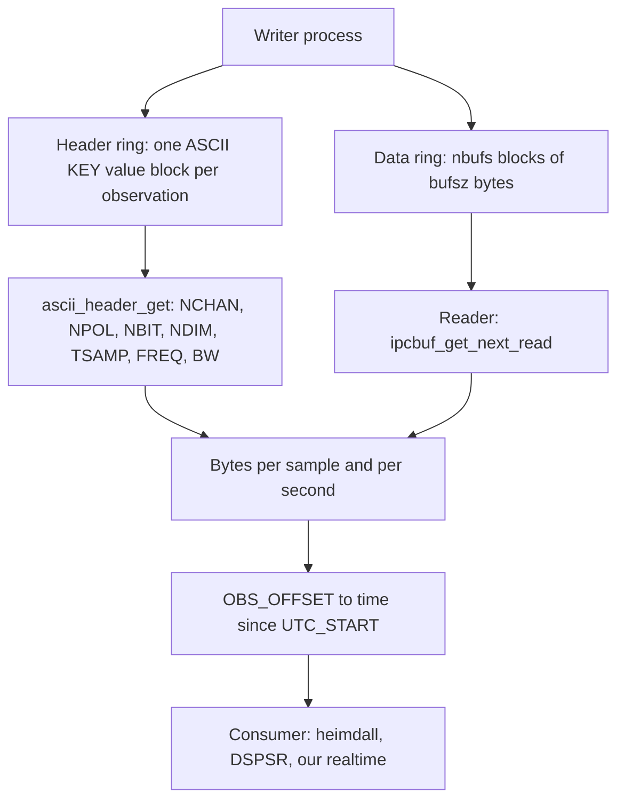

# PSRDADA math map

PSRDADA (Willem van Straten, Andrew Jameson and others; C) is the shared-memory ring-buffer system that carries raw voltages or spectra between processes in real-time pulsar backends, and the matching `.dada` file format. Its arithmetic is small: an ASCII header, ring-buffer geometry, and byte offsets that convert to time ([psrdada repo](https://sourceforge.net/p/psrdada/code/ci/master/tree/), commit `151198e`). Format details: [01-data-formats.md](../reference/01-data-formats.md). Source paths are relative to the repository.

**Tags.** [C] = from PSRDADA's spec or source as read by the reference set; [D] = derived; **[unverified]** = inferred, not stated by the spec.



## 1. Header [C]

A fixed-size block of newline-separated `KEY value` pairs, accessed with `ascii_header_set` / `ascii_header_get`, which do not know the header size. `HDR_SIZE` (commonly 4096 B, matching `DADA_DEFAULT_HEADER_SIZE = sysconf(_SC_PAGE_SIZE)`) gives the length. Standard keys include `HDR_VERSION`, `HDR_SIZE`, `UTC_START`, `MJD_START`, `OBS_OFFSET`, `FREQ`, `BW`, `NCHAN`, `NPOL`, `NBIT`, `NDIM`, `TSAMP`.

- PSRDADA: `doc/header.tex`, `src/ascii_header.c`, `examples/src/header.dada`.
- Ours: planned (io DADA reader, per [06-our-plan.md](../reference/06-our-plan.md)).

## 2. Ring-buffer geometry [C]

```math
\text{bufsz}=128\times\text{page\_size},\qquad n_{\rm bufs}=4,\qquad \text{key}=\texttt{0x0000dada}
```

Defaults; headers travel in their own ring, one header per sub-block.

- PSRDADA: `src/dada_def.h`, `src/ipcbuf.c`, `src/dada_hdu.c`.
- Ours: planned (vendor the `ipcbuf` / `dada_hdu` client C).

## 3. Bytes per sample and data rate [D] [unverified]

```math
B_{\rm samp}=\frac{N_{\rm chan}\,N_{\rm pol}\,N_{\rm dim}\,N_{\rm bit}}{8},\qquad R=\frac{B_{\rm samp}}{t_{\rm samp}},\qquad t_{\rm samp}=\texttt{TSAMP}\times10^{-6}\ {\rm s}
```

$N_{\rm dim}=1$ real, 2 complex. **TSAMP units are inferred as µs**: the shipped CASPSR example has `TSAMP 0.00125` for a 400 MHz real-sampled single-channel stream, i.e. 1.25 ns. A bridge to SIGPROC (`tsamp` in s) that copies the number is off by $10^6$.

- Ours: planned; must convert to seconds before filling [`ObsHeader`](../../filterbank/crates/fb-defs/src/header.rs) `tsamp`.

## 4. OBS_OFFSET to time [D] [unverified]

```math
t_{\rm first}=t_{\rm UTC\_START}+\frac{\texttt{OBS\_OFFSET}}{R}
```

`OBS_OFFSET` is "the number of bytes from the start of the observation" of this file's or block's first byte, so a file or ring block maps to a sample index $n_0=\texttt{OBS\_OFFSET}/B_{\rm samp}$.

- Ours: planned; time kept as [`Epoch`](../../filterbank/crates/fb-defs/src/time.rs) (integer MJD plus seconds).

## 5. Frequency axis as heimdall builds it [C]

```math
f_0=\texttt{FREQ}-\frac{\texttt{BW}}{2}+\frac{\texttt{BW}/N_{\rm chan}}{2},\qquad \delta f=\frac{\texttt{BW}}{N_{\rm chan}}
```

A negative `BW` gives a descending band. `RESOLUTION` (splitting granularity in bytes) and `ORDER` (e.g. `TF`) are defined by instruments and DSPSR, not by `header.tex`.

- heimdall: `Formats/PSRDadaRingBuffer.C`.
- Ours: planned; [`FreqAxis::uniform`](../../filterbank/crates/fb-defs/src/header.rs) takes $f_0$ and $\delta f$ directly.
