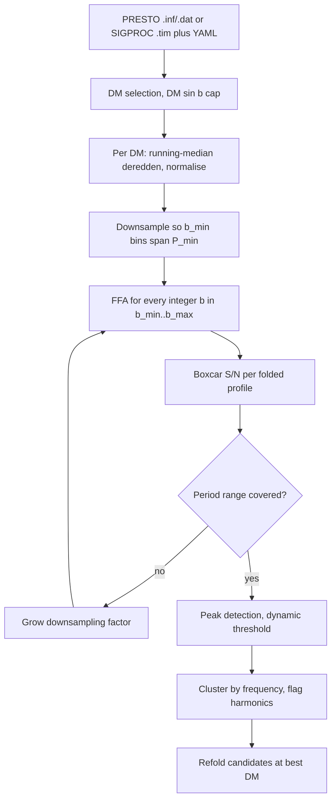

# riptide math map

riptide (Vincent Morello; C++ core with pybind11 and a Python pipeline, MIT) is a Fast Folding Algorithm periodicity search, the most sensitive classic method for long periods and narrow pulses. Its pipeline selects DM trials, dereddens and normalises each series, runs the FFA over a ladder of downsampling factors, scores every folded profile with an exact boxcar S/N, then detects, clusters and harmonic-flags peaks ([riptide repo](https://github.com/v-morello/riptide); Morello et al. 2020, MNRAS 497, 4654, [arXiv:2004.03701](https://arxiv.org/abs/2004.03701)). Program-level notes: [04-other-search-codes.md](../reference/04-other-search-codes.md); FFA derivation: [05-algorithms-math.md](../reference/05-algorithms-math.md). Source paths are relative to `src/riptide/`.

**Tags.** [V] = paper; [C] = transcribed from riptide's source by the reference set; [D] = derived; **[unverified]** = standard form, not read line by line.



## 1. Input and DM selection [C]

`.tim` lacks band edges, so `fmin`, `fmax`, `nchans` come from the YAML config; an internal DM plan picks a minimal subset of the available trials, capped at ${\rm DM}\,\lvert\sin b\rvert\le45$ by default ($b$ Galactic latitude).

- riptide: `reading/sigproc.py`, `reading/presto.py`, `pipeline/pipeline.py`, `pipeline/config/example.yaml`.
- Ours: [`fb-formats/src/presto.rs`](../../filterbank/crates/fb-formats/src/presto.rs) `read_dat`, [`fb-io/src/sigproc.rs`](../../filterbank/crates/fb-io/src/sigproc.rs) `write_tim`; DM selection planned.

## 2. Dereddening and normalisation [C for parameters, unverified for the form]

```math
x'_i=\frac{x_i-{\rm RM}_W(x)_i}{\hat\sigma},\qquad W=\max(\lceil4\ {\rm s}/t_{\rm samp}\rceil,\ 101)
```

${\rm RM}_W$ a running median of width `rmed_width` (4 s) with at least `rmed_minpts` (101) points; then unit variance.

- riptide: `cpp/running_median.hpp`, `time_series.py` `deredden`, `normalise`.
- Ours: [`fb-sp/src/lib.rs`](../../filterbank/crates/fb-sp/src/lib.rs) `baseline_subtract` (block median, not running median); planned for ffa.

## 3. Ranging: downsampling ladder [C]

```math
d_0\,t_{\rm samp}\,b_{\min}=P_{\min},\qquad b\in[b_{\min},b_{\max}]\ (\text{default }240\text{–}260),\qquad {\rm ceilshift}=\big\lceil c\,(r-1)\,(1-c/P_{\max})\big\rceil
```

At each downsampling factor the FFA runs for every integer $b$; the factor then grows geometrically until $P_{\max}$ is reached; `ceilshift(rows, cols, pmax)` limits which rows are evaluated. Default periods 1–30 s with at least 8 periods in the data (`fpmin`). The v0.2.6 fix for downsampled variance near integer factors is part of this step.

- riptide: `cpp/periodogram.hpp`, `cpp/downsample.hpp`, `search.py` `ffa_search`.
- Ours: planned (ffa).

## 4. FFA transform [V for cost, unverified for the recursion as written]

Reshape a series into $m$ rows of $p$ bins. With $s=0\ldots m-1$ the total drift in bins across the rows and $\phi$ the phase bin (mod $p$):

```math
F_m[s](\phi)=F^{\rm top}_{m/2}\!\left[\lfloor s/2\rfloor\right](\phi)+F^{\rm bot}_{m/2}\!\left[\lfloor s/2\rfloor\right]\!\left(\phi+\lceil s/2\rceil\right)
```

This folds all $m$ trial periods in $[p,p+1)$ samples in $O(mp\log_2m)$ instead of $O(m^2p)$; per octave of period the cost is $bN\log_2N$ [V: Morello et al. 2020, Eqs. 39–40]. Non-integer drifts are identical to the nearest integer drift, so this is the finest resolution sampling allows.

- riptide: `cpp/transforms.hpp`.
- Paper: Staelin 1969, Proc. IEEE 57, 724; Morello et al. 2020.
- Ours: planned (vendor the core as-is).

## 5. Boxcar S/N on folded profiles [C], [D]

For $n$ bins and width $w$, a zero-mean, unit-norm boxcar of height $h$ and baseline $-b$:

```math
h=\sqrt{\frac{n-w}{nw}},\qquad b=\frac{w}{n-w}h,\qquad {\rm S/N}=\frac{(h+b)\,d_{\max}-b\sum_ix_i}{\sigma}
```

$d_{\max}$ the largest circular $w$-bin window sum. Substituting gives Ransom 2026's $(S_w-\delta S_{\rm tot})/(\sigma\sqrt{w(1-\delta)})$, $\delta=w/n$ [D]. Widths step by `wtsp = 1.5` up to `ducy_max = 0.2`. Window sums use prefix sums $S_w(p)=C_{p+w}-C_p$ [V: Morello et al. 2020, Eqs. 37–38].

- riptide: `cpp/snr.hpp`.
- Paper: Morello et al. 2020; Ransom 2026, arXiv:2610.11749, Eq. 3.
- Ours: the same prefix-sum boxcar on time series in [`fb-sp/src/lib.rs`](../../filterbank/crates/fb-sp/src/lib.rs) `boxcar_search`; profile version planned.

## 6. Optimality [V]

```math
E=\mathbf s\cdot\mathbf s',\qquad U'_z=U_z/E,\qquad E_{\rm FFA}\approx0.930,\qquad U_{\rm FFA}\approx1.075\,\Phi^{-1}(\alpha)
```

Folding and correlating with the true template is the most powerful test (Karlin–Rubin); a mismatched template of efficiency $E$ raises the detectable amplitude by $1/E$; boxcars spaced ×2 give $E\approx0.93$.

- Paper: Morello et al. 2020, Eqs. 22–26.

## 7. Peak detection, clustering, harmonics [C for the method, unverified for constants]

The periodogram is split into segments in $\log\nu$; in each, a median and IQR-based scale set a dynamic threshold, ${\rm S/N}_{\rm thr}(\nu)=\tilde S+k\,{\rm IQR}/1.349$, fitted smoothly in $\log\nu$ [unverified]. Peaks are clustered by frequency and harmonically related clusters flagged when $f_1/f_2$ is close to a ratio of small integers.

- riptide: `peak_detection.py`, `clustering.py`, `pipeline/harmonic_testing.py` [unverified file names].
- Ours: planned (sift).
