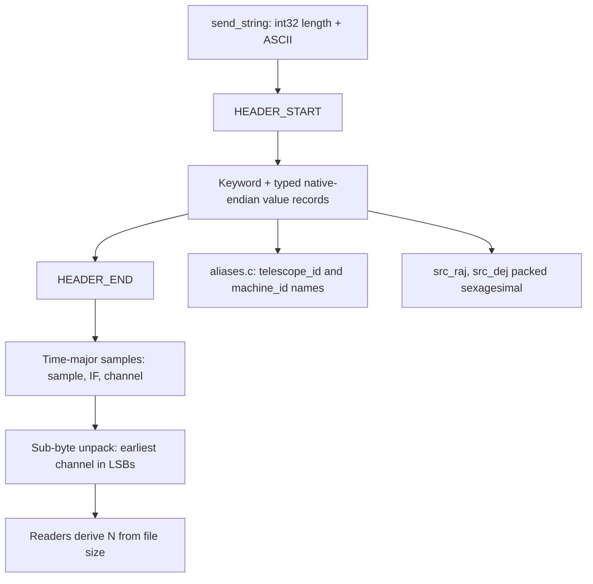

# SIGPROC math map

SIGPROC (Duncan Lorimer and others; C; we read the SixByNine fork at commit `c8bcbd7`) defines the filterbank (`.fil`) and time-series (`.tim`) formats that most search codes read. Its "math" is mostly encoding: a typed keyword header, packed coordinates, sub-byte packing order and a few derived quantities ([SixByNine/sigproc](https://github.com/SixByNine/sigproc); Lorimer 2011, ASCL:1107.016). Format details: [01-data-formats.md](../reference/01-data-formats.md). Source paths are relative to `src/`. What we took is in [CREDITS.md](../CREDITS.md).

**Tags.** [C] = transcribed from SIGPROC's source by the reference set; [D] = derived; **[unverified]** = not re-checked against the file.



## 1. Header string encoding [C]

```math
\text{string}(s)=\underbrace{\texttt{int32}(\lvert s\rvert)}_{4\ {\rm B,\ native}}\ \Vert\ s_{\rm ASCII},\qquad 1\le\lvert s\rvert\le80
```

No NUL terminator. `rawdatafile` and `source_name` are followed by a second string holding the value. Unknown keywords are fatal; the header length is cross-checked against `ftell`. No byte-order marker exists, so a big-endian file is detectable only by an implausible first length.

- SIGPROC: `send_stuff.c` `send_string`, `read_header.c` `get_string`, `read_header`.
- Ours: [`fb-io/src/sigproc.rs`](../../filterbank/crates/fb-io/src/sigproc.rs) `read_str`, `put_str`, `parse_header`.

## 2. Keyword types [C]

`int` (4 B): `telescope_id`, `machine_id`, `data_type`, `barycentric`, `pulsarcentric`, `nbits`, `nsamples`, `nchans`, `nifs`, `nbins`, `nbeams`, `ibeam`. `double` (8 B): `az_start`, `za_start`, `src_raj`, `src_dej`, `tstart` (MJD UTC), `tsamp` (s), `fch1`, `foff` (MHz), `refdm`, `period`. `char` (1 B): `signed`. `long` (8 B on LP64): `npuls`. `fchannel` doubles repeat between `FREQUENCY_START` and `FREQUENCY_END` (at most 4096) and set `fch1 = foff = 0`.

- SIGPROC: `header.h`, `read_header.c`.
- Ours: `fb-io/src/sigproc.rs` `parse_header` (also accepts `refrm`).

## 3. Packed coordinates [C], [D]

```math
\texttt{src\_raj}=10^4h+10^2m+s\quad(\text{hhmmss.s}),\qquad \alpha_{\rm deg}=15\Big(h+\frac{m}{60}+\frac{s}{3600}\Big)
```

```math
\texttt{src\_dej}=\pm(10^4d+10^2m+s)\quad(\pm\text{ddmmss.s}),\qquad \delta_{\rm deg}=\pm\Big(d+\frac{m}{60}+\frac{s}{3600}\Big)
```

The sign applies to the whole value. The reference writer's `send_coords()` guard `(raj != 0.0) || (raj != -1.0)` is always true, so sentinel values are always written.

- SIGPROC: `send_stuff.c` `send_coords`; `filterbank_header.c`.
- Ours: `fb-io/src/sigproc.rs` `packed_to_deg`, `deg_to_packed`; sentinels filtered in `SigprocReader::open`.

## 4. Telescope and machine IDs [C for the IDs listed, unverified for the rest]

Lookup tables, not formulas: telescopes 0 Fake, 1 Arecibo, 4 Parkes, 6 GBT, 7 GMRT, 8 Effelsberg, 64 MeerKAT, …; machines 10 BPSR, 14 GMRTNEW, 64 KAT, 83 ROACH, …. PRESTO's `get_telescope_name()`/`get_backend_name()` differ for some IDs above 10, so IDs depend on the writer.

- SIGPROC: `aliases.c`.
- Ours: `fb-io/src/sigproc.rs` `TELESCOPES`, `MACHINES`, `telescope_name`, `telescope_id`, `machine_name`, `machine_id`.

## 5. Sub-byte packing, LSB first [C]

```math
v_k=\big(b\gg n\,k\big)\ \&\ (2^n-1),\qquad k=0\ldots\tfrac8n-1
```

1-bit: `block[k++] = charblock[i] & 1; charblock[i] >>= 1`; 2-bit: bits 0–1, 2–3, 4–5, 6–7; 4-bit: low nibble first. The earliest channel sits in the least-significant bits, the reverse of PSRFITS.

- SIGPROC: `pack_unpack.c`, `read_block.c`.
- Ours: [`fb-io/src/bits.rs`](../../filterbank/crates/fb-io/src/bits.rs) `unpack_into`, `pack` with `BitOrder::LsbFirst`; used by `SigprocReader::read`, `SigprocWriter::write_values`.

## 6. Sample count [D]

```math
N_{\rm samp}=\frac{8\,(L_{\rm file}-L_{\rm hdr})}{n_{\rm bits}\,N_{\rm chan}\,N_{\rm if}}
```

The `nsamples` keyword is legacy and ignored by readers.

- SIGPROC / PRESTO: `read_header.c`; PRESTO `sigproc_fb.c`.
- Ours: `fb-io/src/sigproc.rs` `SigprocReader::open`.

## 7. Band inversion and channel frequencies [C]

```math
f_c=f_{\rm ch1}+c\,f_{\rm off},\qquad f'_{\rm ch1}=f_{\rm ch1}+f_{\rm off}(N_{\rm chan}-1),\qquad f'_{\rm off}=-f_{\rm off}
```

`fch1` is the centre of the first stored channel; `foff < 0` means frequency falls with channel index.

- SIGPROC: `filterbank_header.c`.
- Ours: [`fb-defs/src/header.rs`](../../filterbank/crates/fb-defs/src/header.rs) `FreqAxis::uniform`, `FreqAxis::reversed`; `fb convert --order descending` in [`fb-cli/src/convert.rs`](../../filterbank/crates/fb-cli/src/convert.rs).

## 8. Time series (.tim) [C]

Same header with `data_type = 2`, `nchans = 1`, `refdm` and `fch1` as the reference frequency, then float32 samples. Band edges are not recorded.

- SIGPROC: `filterbank_header.c`, `header.c`.
- Ours: `fb-io/src/sigproc.rs` `write_tim`.
