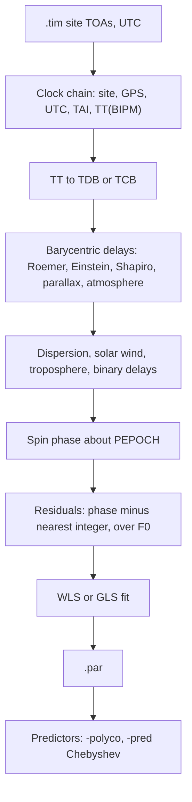

# TEMPO2 math map

TEMPO2 (George Hobbs, Russell Edwards, Richard Manchester and others; C/C++, GPL-3.0) turns site arrival times into barycentric times, fits a timing model to them, and generates the predictors (TEMPO polycos and 2-D Chebyshev `t2pred.dat`) that DSPSR and folders use ([TEMPO2 source](https://bitbucket.org/psrsoft/tempo2/src/master/), commit `b74248f`; Hobbs, Edwards & Manchester 2006, MNRAS 369, 655; Edwards, Hobbs & Manchester 2006, MNRAS 372, 1549). Program-level notes: [03-dspsr-psrchive-timing.md](../reference/03-dspsr-psrchive-timing.md). Source paths are relative to the repository.

**Tags.** [V] = read in Edwards et al. 2006 or the TEMPO polyco spec; [C] = transcribed from TEMPO2 source by the reference set; [D] = derived; **[unverified]** = standard form, not line-verified.



## 1. Clock chain [unverified]

$t_{\rm TT}=t_{\rm site}+\Delta_{\rm site\to GPS}+\Delta_{\rm GPS\to UTC}+\Delta_{\rm UTC\to TAI}+32.184\ {\rm s}+\Delta_{\rm BIPM}$; then TT→TDB (or TCB, the default unless `UNITS TDB`).

- TEMPO2: `clkcorr.C`, `toa2utc.C`, `utc2tai.C`, `tai2tt.C`, `tt2tdb.C`.
- Ours: planned (timing; via PINT).

## 2. Barycentric correction [V: Edwards et al. 2006 Eqs. 8, 9, 13, 32–33]

```math
\Delta_\odot=\Delta_A+\Delta_{R\odot}+\Delta_p+\Delta_{D\odot}+\Delta_{E\odot}+\Delta_{S\odot}
```

```math
\Delta_{R\odot}=-\frac{\mathbf r\cdot\hat{\mathbf R}_{BB}}{c},\qquad \Delta_{E\odot\oplus}=\frac1{c^2}\int\Big(U_\oplus+\frac{v_\oplus^2}2+\ldots\Big)dt,\qquad \Delta_{S\odot}=-\sum_j\frac{2Gm_j}{c^3}\ln\big[\lvert\mathbf r_j\rvert(1-\cos\psi_j)\big]
```

Atmospheric, Roemer, parallax, dispersion, Einstein and Shapiro terms; $\hat R_0=(\cos\alpha\cos\delta,\sin\alpha\cos\delta,\sin\delta)$ plus proper motion; Shapiro summed over the Sun, Venus, Jupiter, Saturn, Uranus, Neptune. Scale: Roemer up to ~500 s; $2GM_\odot/c^3\approx9.85$ µs [D].

- TEMPO2: `formBats.C`, `get_obsCoord.C`, `shapiro_delay.C`, `jpleph.c`.
- Paper: Edwards, Hobbs & Manchester 2006.
- Ours: planned.

## 3. Dispersion delay [C]

```math
\Delta_D=\frac{D\cdot{\rm DM}}{\nu^2},\qquad D=\frac1{2.41\times10^{-4}}\ {\rm s\,MHz^2\,pc^{-1}\,cm^3}
```

Referenced to infinite frequency; solar-wind and troposphere terms are separate (`sw_delay.C`, `tropo.C`).

- TEMPO2: `dm_delays.C`.
- Ours: [`fb-defs/src/consts.rs`](../../filterbank/crates/fb-defs/src/consts.rs) `K_DM_PULSAR` (same constant; our search references the top channel, not infinite frequency).

## 4. Spin phase and residuals [unverified]

```math
\phi(t)=\phi_0+F_0\Delta t+\tfrac12F_1\Delta t^2+\tfrac16F_2\Delta t^3+\ldots,\qquad R=\frac{\phi-{\rm nint}(\phi)}{F_0}
```

$\Delta t$ barycentric time since PEPOCH after binary delays (`BTmodel.C`, `DDmodel.C`, `ELL1model.C`, …). Absolute phase is anchored by TZRMJD, TZRFRQ, TZRSITE.

- TEMPO2: `formResiduals.C`.
- Ours: the same Taylor series for epoch shifts in [`fb-defs/src/candidates.rs`](../../filterbank/crates/fb-defs/src/candidates.rs) `PeriodicCandidate::at_epoch`.

## 5. Fitting [unverified]

Linearised least squares on the design matrix $M_{ip}=\partial R_i/\partial p$:

```math
\delta\mathbf p=(\mathbf M^{\sf T}\mathbf W\mathbf M)^{-1}\mathbf M^{\sf T}\mathbf W\mathbf R\ \ (\text{WLS},\ W={\rm diag}\,\sigma_i^{-2}),\qquad \delta\mathbf p=(\mathbf M^{\sf T}\mathbf C^{-1}\mathbf M)^{-1}\mathbf M^{\sf T}\mathbf C^{-1}\mathbf R\ \ (\text{GLS})
```

GLS uses a red-noise covariance $\mathbf C$ via Cholesky factorisation; iterate.

- TEMPO2: `doFit.C`, `t2fit*.C`, `cholesky*.C`.
- Paper: Hobbs, Edwards & Manchester 2006.
- Ours: planned (PINT preferred).

## 6. TEMPO polyco output [V: TEMPO polyco spec]

```math
\phi(t)={\rm RPHASE}+60\,\Delta T\,F_0+\sum_{n=1}^{N_c}C_n\Delta T^{n-1},\qquad f(t)=F_0+\frac1{60}\sum_{n=2}^{N_c}(n-1)C_n\Delta T^{n-2},\qquad \Delta T=1440\,(t-{\rm TMID})
```

$\Delta T$ in minutes. Generated by `tempo2 -polyco` (or `-tempo1 -polyco`); without TZRMJD TEMPO2 warns and falls back to PEPOCH.

- TEMPO2: `polyco.C`, `t1polyco.c`.
- Spec: [tz-polyco.txt](https://tempo.sourceforge.net/ref_man_sections/tz-polyco.txt).
- Ours: planned (fold).

## 7. 2-D Chebyshev predictor [C]

```math
x=-1+\frac{2({\rm mjd}-{\rm mjd}_s)}{{\rm mjd}_e-{\rm mjd}_s},\qquad y=-1+\frac{2(\nu-\nu_s)}{\nu_e-\nu_s},\qquad \phi({\rm mjd},\nu)=\sum_{i,j}c_{ij}T_i(x)T_j(y)+\frac{D_{\rm const}}{\nu^2}
```

Evaluated by 2-D Clenshaw recurrence with the ½$c_0$ convention; $D_{\rm const}$ the file's `DISPERSION_CONSTANT`; coefficients fitted at Chebyshev nodes $x_k=\cos[\pi(k-\tfrac12)/n]$; frequency from the derivative series scaled by $2/[({\rm mjd}_e-{\rm mjd}_s)\,86400]$. `T2Predictor_GetPhase` / `GetFrequency` serve polycos and Chebyshev models through one API.

- TEMPO2: `cheby2d.c`, `tempo2pred.c`; `tempo2 -pred "site mjd1 mjd2 f1 f2 ntimecoeff nfreqcoeff seg_length"`.
- Ours: planned (fold; adapt `cheby2d.c`).
