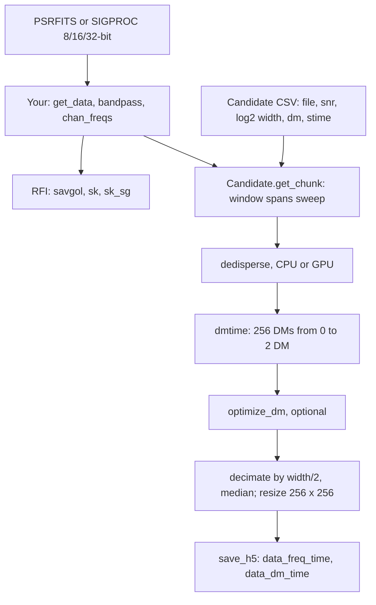

# your math map

your ("Your Unified Reader"; thepetabyteproject; Python with optional cupy/numba GPU code, GPL-3.0) reads PSRFITS and SIGPROC through one `Your` class, writes `.fil`, PSRFITS and PSRDADA, and makes the frequency–time and DM–time candidate cut-outs that FETCH classifies ([your repo](https://github.com/thepetabyteproject/your), commit `5126d3b`; Aggarwal et al. 2020, JOSS 5, 2750). Program-level notes: [04-other-search-codes.md](../reference/04-other-search-codes.md). Source paths are relative to the repository.

**Tags.** [C] = transcribed from your's source by the reference set; [D] = derived; **[unverified]** = not transcribed.



## 1. Reading [C]

PSRFITS: `data *= DAT_SCL; data += DAT_OFFS; data *= DAT_WTS`, **no `ZERO_OFF`**; 2/4-bit unpacked MSB first; AA and BB averaged,

```math
I=\tfrac12(AA+BB)
```

(PRESTO and sigpyproc3 sum, so levels differ by 2×); from IQUV it can form $I$, $(I\pm V)/2$, $(I\pm Q)/2$. SIGPROC: 8, 16, 32 bit only.

- your: `your/formats/psrfits.py`, `your/formats/pysigproc.py`, `your/your.py`.
- Ours: [`fb-io/src/psrfits.rs`](../../filterbank/crates/fb-io/src/psrfits.rs) `ZeroOffPolicy::Ignore` reproduces the no-`ZERO_OFF` reading; we sum polarisations instead of averaging.

## 2. PSRFITS writer centre frequency [C], [D]

```math
f_{\rm centre}^{\rm your}=f_{\rm ch1}+\frac{N\,f_{\rm off}}{2},\qquad f_{\rm centre}^{\rm true}=f_{\rm ch1}+\frac{(N-1)f_{\rm off}}{2},\qquad \texttt{OBSFREQ}^{\rm spec}=f_{\rm ch1}+\Big(\frac N2-1\Big)f_{\rm off}
```

your's value matches neither the band centre nor the spec's `OBSFREQ`, so a round trip can shift frequencies by half a channel.

- your: `your/formats/fitswriter.py`.
- Ours: [`fb-io/src/psrfits.rs`](../../filterbank/crates/fb-io/src/psrfits.rs) uses `DAT_FREQ` when present.

## 3. Dispersion delay [unverified]

```math
\Delta t_c=k_{\rm DM}\,{\rm DM}\,(f_c^{-2}-f_{\max}^{-2})
```

The constant used by `Your.dispersion_delay` was not transcribed.

- your: `your/your.py` `dispersion_delay`.
- Ours: [`fb-defs/src/consts.rs`](../../filterbank/crates/fb-defs/src/consts.rs) `dispersion_delay`.

## 4. Candidate cut-out geometry [C]

Input CSV `file, snr, width, dm, label, stime, chan_mask_path, num_files`, where **width is $\log_2$ samples** (used as `2 ** row["width"]`, heimdall's `filter_idx` convention). Steps:

```math
T_{\rm chunk}\gtrsim\Delta t_{\rm sweep}({\rm DM}),\qquad {\rm DM}_j=\frac{2\,{\rm DM}}{255}\,j,\ j=0\ldots255,\qquad d=\Big\lfloor\frac{2^{\rm width}}{2}\Big\rfloor
```

`get_chunk` reads a window spanning the sweep, `dedisperse`, `dmtime(dmsteps=256)` builds the DM–time "butterfly" over $[0,2\,{\rm DM}]$ (step formula [unverified]), optional `optimize_dm` maximises S/N over DM, `decimate(factor=width//2, mode="median")`, resize to 256×256.

- your: `your/candidate.py`, `bin/your_candmaker.py`.
- Ours: heimdall width convention in [`fb-formats/src/candidates.rs`](../../filterbank/crates/fb-formats/src/candidates.rs) `read_heimdall`; cut-outs planned (classify).

## 5. HDF5 output [C]

Datasets `data_freq_time` (time × frequency, gzip 9) and optional `data_dm_time` (DM × time); attributes `cand_id`, `tcand`, `dm`, `dm_opt`, `snr`, `snr_opt`, `width`, `label`, `rfi_mask`, `kill_mask`, `filelist`, `tsamp`, `nchans`, `foff`, `nspectra` and header fields.

- your: `your/candidate.py` `save_h5`.
- Ours: planned (adapter).

## 6. Savitzky–Golay bandpass filter [C for the method, unverified for parameters]

Fit a Savitzky–Golay smoothing polynomial $\tilde B(f)$ to the bandpass $B(f)$ and flag channels where $\lvert B(f)-\tilde B(f)\rvert$ exceeds a threshold in robust σ.

- your: `your/utils/rfi.py` `savgol_filter`.
- Paper: Savitzky & Golay 1964, Anal. Chem. 36, 1627; Agarwal et al. 2020.
- Ours: planned.

## 7. Spectral-kurtosis filter [C]

```math
\widehat{SK}=\frac{M+1}{M-1}\left[\frac{MS_2}{S_1^2}-1\right],\qquad \text{flag }\lvert\widehat{SK}-{\rm median}\rvert>\sigma\cdot1.4826\,{\rm MAD}
```

Robust median ± MAD bounds instead of the analytic variance. `sk_sg_filter` combines both filters.

- your: `your/utils/rfi.py` `sk_filter`, `sk_sg_filter`.
- Paper: Nita & Gary 2010.
- Ours: [`fb-rfi/src/lib.rs`](../../filterbank/crates/fb-rfi/src/lib.rs) `spectral_kurtosis` (analytic variance); MAD in [`fb-rfi/src/stats.rs`](../../filterbank/crates/fb-rfi/src/stats.rs) `median_mad`.
