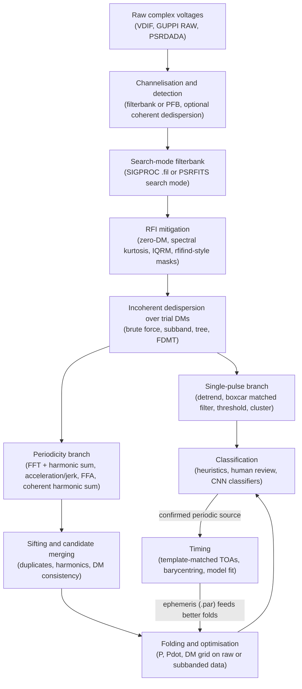
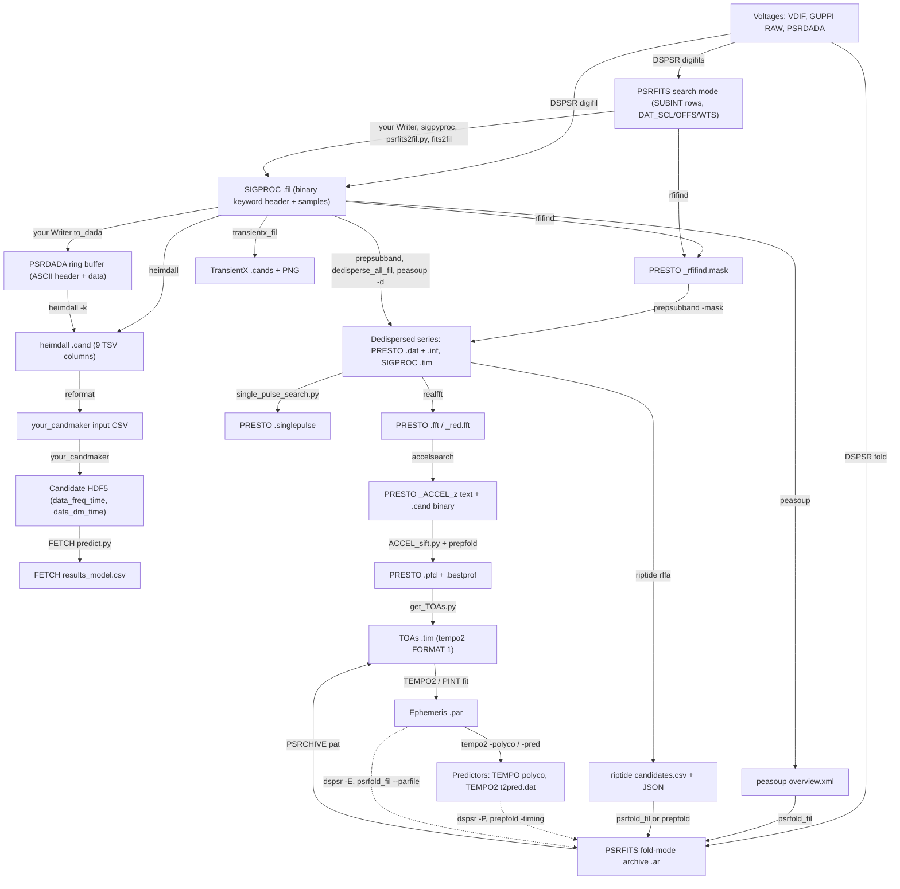

# Fourteen packages carry voltages to timing solutions

This file is the index of the reference set in this folder. It covers the software that takes radio pulsar and fast-transient data from raw voltages to timing solutions: which package does what, how data pass between them, and where a newcomer should start.

## How to read this set

| File | What it covers |
|---|---|
| [00-overview.md](./00-overview.md) | This file: the end-to-end chain, where each package sits, format flow, glossary |
| [01-data-formats.md](./01-data-formats.md) | SIGPROC `.fil`/`.tim`, PSRFITS, PSRDADA/GUPPI/VDIF, PRESTO files, heimdall `.cand`, FETCH HDF5, plus conversion pitfalls |
| [02-presto.md](./02-presto.md) | PRESTO programs, the 13-step tutorial workflow, file outputs, internal math, 2024–2026 version changes |
| [03-dspsr-psrchive-timing.md](./03-dspsr-psrchive-timing.md) | DSPSR coherent dedispersion and folding, PSRCHIVE archives and `pat`, TEMPO/TEMPO2/PINT predictors and fitting |
| [04-other-search-codes.md](./04-other-search-codes.md) | heimdall, AstroAccelerate, dmt, TransientX, PulsarX, riptide, peasoup, sigpyproc, your, FETCH (plus ASTROFLOW and DRAFTS) |
| [05-algorithms-math.md](./05-algorithms-math.md) | Equations behind dispersion, dedispersion, RFI statistics, matched filtering, FFT/FFA/coherent searches, folding and timing |
| [06-our-plan.md](./06-our-plan.md) | How this repository plans to build its own search stack on top of what the other files describe |

**Suggested reading paths.** If you are new to pulsar data, read this file, then the dispersion and matched-filter sections of [05-algorithms-math.md](./05-algorithms-math.md), then the tutorial workflow in [02-presto.md](./02-presto.md). PRESTO's 13 steps are the clearest map of the whole chain. If you are hunting FRBs or single pulses, go from this file to the heimdall, TransientX, your and FETCH sections of [04-other-search-codes.md](./04-other-search-codes.md), then to the heimdall `.cand` and FETCH HDF5 sections of [01-data-formats.md](./01-data-formats.md). If you need to write a converter or reader, read the pitfalls list in [01-data-formats.md](./01-data-formats.md) before anything else. If you are timing a known pulsar, [03-dspsr-psrchive-timing.md](./03-dspsr-psrchive-timing.md) has the full DSPSR → PSRCHIVE → TEMPO2/PINT path.

## Bottom line

**No single package covers the whole chain, but together they form a small set of well-worn pipelines with a few dominant interchange formats.** DSPSR owns the voltage end (coherent dedispersion, channelisation, folding against TEMPO/TEMPO2 predictors). PRESTO is the only package that spans filterbank to TOAs on its own. A ring of specialised codes handles one or two stages each: heimdall, AstroAccelerate, TransientX and dmt for dedispersion and single pulses; peasoup, riptide and AstroAccelerate for periodicity; PulsarX for folding; your and FETCH for machine-learning classification; and sigpyproc as a Python toolbox. At the timing end, PSRCHIVE's `pat` turns folded archives into TOAs and TEMPO2 or PINT fits a timing model to them. Data move between these codes in five format families: voltage formats (VDIF, GUPPI RAW, PSRDADA), search-mode filterbanks (SIGPROC `.fil` and PSRFITS search mode), dedispersed time series (PRESTO `.dat`/`.inf`, SIGPROC `.tim`), candidate lists (heimdall `.cand`, PRESTO ACCEL, TransientX `.cands`, CSV/HDF5), and folded archives plus timing files (PSRFITS fold mode, `.pfd`, `.par`/`.tim`, polycos). Most interoperability bugs happen where filterbank formats are converted. Tools disagree on sub-byte bit order, `ZERO_OFF`, scale/offset/weight handling, band direction and polarisation summing, and a `.fil` file cannot record per-channel scales, weights or row gaps ([PSRFITS v6.1 definition](https://www.atnf.csiro.au/research/pulsar/psrfits_definition/PsrfitsDocumentation.html), [SIGPROC read_header.c](https://github.com/SixByNine/sigproc/blob/master/src/read_header.c)). For a newcomer, the practical rule is to learn the chain through PRESTO, learn the formats before writing any glue code, and treat each specialised code as a drop-in replacement for one PRESTO stage.

## Nine stages turn raw voltages into timing solutions

Every pulsar or transient search, whatever the software, runs the same physical sequence. The telescope records complex voltages. These are channelised into a filterbank of detected powers, written as SIGPROC or PSRFITS. RFI is excised, the data are dedispersed over many trial DMs, and the dedispersed time series go down one of two branches. The single-pulse branch matched-filters each series with boxcars and clusters the hits. The periodicity branch Fourier-transforms (or FFA-folds) the series and sums harmonics. Survivors are folded, classified (by eye, by heuristics or by a neural network) and, for confirmed pulsars, timed.

The stages are linked by a handful of equations, and these are what make the software interchangeable. Dispersion delays a signal by Δt = k_DM · DM · (f₁⁻² − f₂⁻²). The physical constant is k_DM = 4148.806 s MHz² pc⁻¹ cm³, but pulsar software uses the fixed convention 1/(2.41×10⁻⁴) = 4149.378, which is **0.0137% larger**, so DMs from codes using different constants are not exactly comparable ([Kulkarni 2020](https://ar5iv.arxiv.org/html/2007.02886), [van Straten & Bailes 2011](https://arxiv.org/abs/1008.3973)). DSPSR, PRESTO and dmt all code the 2.41×10⁻⁴ convention ([DSPSR Dedispersion.C](https://sourceforge.net/p/dspsr/code/ci/master/tree/Signal/General/Dedispersion.C), [PRESTO dispersion.c](https://github.com/scottransom/presto/blob/master/src/dispersion.c), [dmt README](https://github.com/pravirkr/dmt)). Trial-DM spacing follows from adding sampling, intra-channel, DM-error and scattering smearing in quadrature ([Cordes & McLaughlin 2003](https://arxiv.org/abs/astro-ph/0304364)). PRESTO's `DDplan.py` puts that rule into practice ([DDplan.py](https://github.com/scottransom/presto/blob/master/bin/DDplan.py)).

The voltage stage is special because only there can dispersion be removed *coherently*. DSPSR multiplies the voltage spectrum by the inverse cold-plasma chirp and uses overlap-save. It picks the power-of-two FFT length that minimises nfft·log₂nfft/(nfft−nfilt), and it pads the smearing length by 10% ([DSPSR PlasmaResponse.C](https://sourceforge.net/p/dspsr/code/ci/master/tree/Signal/General/PlasmaResponse.C), [OptimalFFT.C](https://sourceforge.net/p/dspsr/code/ci/master/tree/Signal/General/OptimalFFT.C)). Once data are detected into a filterbank, only incoherent dedispersion is possible. Algorithm choice is then a cost trade-off. Brute force scales as N_f·N_t·N_Δ. The tree algorithm is cheaper but assumes linear sweeps. FDMT is exact for the ν⁻² law at roughly N_t·N_Δ·log₂N_f ([Zackay & Ofek 2017](https://arxiv.org/abs/1411.5373)).

The two search branches use different statistics, and that is why the codes split along this line. The single-pulse S/N is a boxcar sum normalised by σ√w. A correct-width boxcar recovers about 94% of the optimal S/N for a Gaussian pulse, and a factor-2 width ladder averages about 93% ([Morello et al. 2020](https://arxiv.org/abs/2004.03701), [Ransom 2026](https://arxiv.org/abs/2610.11749)). Periodicity searches work on normalised FFT powers, which follow a χ²₂ distribution. Summing m harmonics gives a χ²₂ₘ statistic. Interbinning cuts the worst-case amplitude scalloping loss from 36% to 7.4% ([Ransom, Eikenberry & Middleditch 2002](https://arxiv.org/abs/astro-ph/0204349)). Binary motion smears the spin frequency, so acceleration (z = ḟT²) and jerk (w = f̈T³) searches add template dimensions. The jerk term pays off when the observation spans about 5–15% of the orbit ([Andersen & Ransom 2018](https://arxiv.org/abs/1807.07900)). The FFA folds all trial periods directly and is more sensitive than FFT plus incoherent harmonic summing at every period and duty cycle, most of all for narrow pulses ([Morello et al. 2020](https://arxiv.org/abs/2004.03701)). Full derivations are in [05-algorithms-math.md](./05-algorithms-math.md).

## Fourteen packages cover overlapping slices of the chain

The diagram below places each package on the stages it actually implements. A package appears on a stage only if the notes found code for it. PRESTO's `get_TOAs.py`, for example, produces TOAs, but PRESTO has no timing-model fitter of its own.

```mermaid
flowchart LR
    subgraph S1["1. Voltages and channelisation"]
        DSPSR1["DSPSR<br/>coherent dedispersion, filterbank, SK, digifil/digifits"]
    end
    subgraph S2["2. Filterbank I/O and conversion"]
        YOUR1["your (Your, Writer)"]
        SPP1["sigpyproc (FilReader, PFITSReader)"]
        PR1["PRESTO readfile, psrfits2fil.py"]
    end
    subgraph S3["3. RFI mitigation"]
        PR2["PRESTO rfifind"]
        TX1["TransientX / PulsarX filtool<br/>zdot, SK-IQR, kadane"]
        SPP2["sigpyproc MAD, IQRM"]
        YOUR2["your SK, Savitzky-Golay"]
        HD1["heimdall zero-DM"]
        AA1["AstroAccelerate zero-DM"]
    end
    subgraph S4["4. Dedispersion"]
        PR3["PRESTO prepsubband"]
        HD2["heimdall (dedisp, GPU)"]
        AA2["AstroAccelerate DDTR (GPU)"]
        DMT["dmt FDMT/DDMT (CPU+GPU)"]
        TX2["TransientX subband (CPU)"]
        PX1["PulsarX dedisperse_all_fil"]
        PS1["peasoup (dedisp, GPU)"]
    end
    subgraph S5["5a. Single-pulse search"]
        PR4["PRESTO single_pulse_search.py"]
        HD3["heimdall boxcar + friends-of-friends"]
        AA3["AstroAccelerate SPDT"]
        TX3["TransientX boxcar + DBSCAN"]
        SPP3["sigpyproc find_pulses"]
    end
    subgraph S6["5b. Periodicity search"]
        PR5["PRESTO accelsearch, coherentsearch"]
        AA4["AstroAccelerate FDAS, jerk"]
        PS2["peasoup time-domain resampling + FFT"]
        RT["riptide FFA"]
    end
    subgraph S7["6. Folding and optimisation"]
        PR6["PRESTO prepfold"]
        PX2["PulsarX psrfold_fil"]
        DSPSR2["DSPSR fold to PSRFITS"]
    end
    subgraph S8["7. Classification"]
        YOUR3["your_candmaker (FT + DM-time cut-outs)"]
        FETCH["FETCH CNN models a-k"]
        SIFT["PRESTO ACCEL_sift.py heuristics"]
    end
    subgraph S9["8. TOAs and timing"]
        PAT["PSRCHIVE pat"]
        GT["PRESTO get_TOAs.py"]
        TIM["TEMPO / TEMPO2 / PINT fit"]
    end
    S1 --> S2 --> S3 --> S4
    S4 --> S5
    S4 --> S6
    S5 --> S8
    S6 --> S7 --> S8
    S8 --> S9
```

### Stage coverage at a glance

"Core" means the package's main purpose or a full implementation. "Part" means a secondary or partial capability. A dash means none found.

| Package | Voltages / channelise | Filterbank I/O | RFI | Dedispersion | Single pulse | FFT / accel | FFA | Fold / optimise | Classify | TOAs | Timing fit |
|---|---|---|---|---|---|---|---|---|---|---|---|
| PRESTO | – | core | core | core | core | core | – | core | part (sifting) | part | – |
| DSPSR | core | core (about 40 formats) | core (SK) | core (coherent) | part (`-s`) | – | – | core | – | – | – |
| PSRCHIVE | – | part (archives) | part (`paz`, `pazi`) | part (archives) | – | – | – | part (post-fold) | – | core | – |
| TEMPO / TEMPO2 / PINT | – | – | – | – | – | – | – | part (predictors) | – | – | core |
| heimdall | – | part (`.fil`, DADA) | part | core (GPU) | core | – | – | – | – | – | – |
| AstroAccelerate | – | part (`.fil`) | part | core (GPU) | core | core | – | – | – | – | – |
| dmt | – | part (packed input) | – | core (CPU+GPU) | part (boxcar) | – | – | – | – | – | – |
| TransientX | – | part (`.fil`, PSRFITS) | core | core (CPU) | core | – | – | part (`replot_fil`) | part (images) | – | – |
| PulsarX | – | part (`filtool`) | core | core | – | – | – | core | – | – | – |
| riptide | – | part (`.dat`, `.tim`) | part (dereddening) | – | – | – | core | part | – | – | – |
| peasoup | – | part (`.fil`) | part (birdies) | core (GPU) | – | core (GPU) | – | part | – | – | – |
| sigpyproc | – | core | core | core | part | part | – | part | – | – | – |
| your | – | core (+ DADA write) | part | part | part (runs heimdall) | – | – | – | core (cut-outs) | – | – |
| FETCH | – | – | – | – | – | – | – | – | core | – | – |

Sources for the table are the per-package paragraphs below and the detail files [02-presto.md](./02-presto.md), [03-dspsr-psrchive-timing.md](./03-dspsr-psrchive-timing.md) and [04-other-search-codes.md](./04-other-search-codes.md).

### Package status snapshot

| Package | Language / hardware | Licence | Latest activity seen (Nov 2026) |
|---|---|---|---|
| PRESTO | C + Python, CPU (OpenMP) | GPL-2.0 | v6.3.3, 2026-11-17; commits to 2026-11-18 |
| DSPSR | C++, CPU + CUDA | AFL 2.1 | HEAD 2026-05-27 |
| PSRCHIVE | C++ + SWIG Python | AFL 2.1 | HEAD 2026-04-17 |
| TEMPO2 | C/C++ | GPL v3 | HEAD 2026-04-21 |
| PINT | Python | BSD | 1.1.8, 2026-10-08 |
| heimdall | C++/CUDA | ambiguous (GPL text vs AFL 2.1 headers) | 2023-06-15 |
| AstroAccelerate | CUDA C++ + Python wrapper | GPL-3.0 | last commit 2025-12-01 |
| dmt | C++20 + Python, CPU + CUDA/HIP | MIT | v0.8.0, 2026-11-11 |
| TransientX | C++, CPU | GPL-3.0 | 2026-07-23 |
| PulsarX | C++, CPU | GPL-3.0 | 2026-11-08 |
| riptide | C++ core + Python, CPU | MIT | 2026-09-20 |
| peasoup | CUDA C++ | Apache-2.0 | 2025-08-05 |
| sigpyproc | Python + numba, CPU | MIT | v2.0.0, 2026-10-17 |
| your | Python (optional GPU) | GPL-3.0 | 2026-09-19 |
| FETCH | Python, TensorFlow 2 | GPL-3.0 | default branch 2025-06-09 |

Dates and licences come from each repository as recorded in [02-presto.md](./02-presto.md), [03-dspsr-psrchive-timing.md](./03-dspsr-psrchive-timing.md) and [04-other-search-codes.md](./04-other-search-codes.md).

### One paragraph per package

**PRESTO** is the reference end-to-end search package. It is a GPL-2.0 C library with command-line tools and Python scripts. Its canonical 13-step workflow runs `readfile` → `rfifind` → `DDplan.py` → `prepsubband` → `realfft`/`rednoise`/`zapbirds` → `accelsearch` → `ACCEL_sift.py` → `prepfold` → `get_TOAs.py`, and `single_pulse_search.py` branches off the dedispersed `.dat` files ([PRESTO search tutorial](https://github.com/scottransom/presto/blob/master/docs/PRESTO_search_tutorial.pdf)). Its periodicity core is Fourier-domain acceleration and jerk search with harmonic summing of up to 32 harmonics. v6.2.0 added `coherentsearch`, a coherent harmonic-summing search. In over 860,000 injections it recovered **76% of pulsars, against 64% for riptide and 42% for accelsearch** at matched false-alarm rate ([Ransom 2026, arXiv:2610.11749](https://arxiv.org/abs/2610.11749)). PRESTO has no FFA program ([PRESTO ROADMAP.md](https://github.com/scottransom/presto/blob/master/ROADMAP.md)). Development is very active: v6.0 removed the Fortran and TEMPO dependencies, and v6.3.3 made `accelsearch` about 8× faster than v5.3.1–v6.1.1 ([PRESTO CHANGELOG](https://github.com/scottransom/presto/blob/master/CHANGELOG.md)). Its intermediate files are headerless or raw C-struct dumps, and the pipeline depends on filename conventions. That makes it the hardest package to interoperate with, as explained in the formats section below.

**DSPSR** is the voltage-domain engine. It is a C++ library of `Operation` and `Transformation` classes whose data path runs File → `BitSeries` → Unpacker → `TimeSeries` → Filterbank/Convolution → Detection → Fold → `PhaseSeries` → Archiver. It reads about 40 backend formats, including VDIF, Mark5, GUPPI, DADA, PSRFITS and SIGPROC ([DSPSR docs](https://dspsr.readthedocs.io/en/latest/), [Kernel/Formats](https://sourceforge.net/p/dspsr/code/ci/master/tree/Kernel/Formats/)). It provides coherent dedispersion, synthetic filterbanks (`-F N:D`), Stokes detection, spectral-kurtosis RFI excision and folding against polyco or TEMPO2 predictors, with CUDA engines for most operations ([DSPSR dspsr.C](https://sourceforge.net/p/dspsr/code/ci/master/tree/Signal/Pulsar/dspsr.C)). For search pipelines its key role is as a producer of search data: `digifil` writes SIGPROC filterbanks and `digifits` writes PSRFITS search mode from the same pipeline ([Signal/General](https://sourceforge.net/p/dspsr/code/ci/master/tree/Signal/General/)). Its fold output is a PSRCHIVE archive, and peasoup's README lists `dspsr` as one of the folders for its candidates ([peasoup README](https://github.com/ewanbarr/peasoup)).

**PSRCHIVE** is the folded-data library and toolset. It defines `Pulsar::Archive` → `Integration` → `Profile`, with file formats as plugins (PSRFITS, Timer, EPN, PRESTO, ASCII and others) ([PSRCHIVE Base/Formats](https://sourceforge.net/p/psrchive/code/ci/master/tree/Base/Formats/)). Its applications cover archive manipulation (`pam`, `psradd`), interactive and automatic zapping (`paz`, `pazi`, `psrzap`), plotting (`psrplot`, `pav`), polarimetric and flux calibration (`pac`, `pcm`, `fluxcal`) and, most importantly for timing, `pat` ([More/Applications](https://sourceforge.net/p/psrchive/code/ci/master/tree/More/Applications/)). `pat` measures TOAs by template matching. Its default is the Fourier phase-gradient (PGS) method of Taylor (1992), and alternatives include GIS, PIS, ZPS, SIS, FDM, COF, RVM and matrix template matching. It writes parkes, tempo2, itoa or princeton TOA formats ([pat.C](https://sourceforge.net/p/psrchive/code/ci/master/tree/More/Applications/pat.C)).

**TEMPO, TEMPO2 and PINT** close the chain, and they also feed back into it. All three model the arrival time at the site through clock corrections, barycentring (Roemer, Einstein and Shapiro delays), dispersion and binary delays, and a spin-phase Taylor series. They then fit the model to TOAs by linearised least squares ([Edwards, Hobbs & Manchester 2006](https://arxiv.org/abs/astro-ph/0607664)). They also produce the *phase predictors* that folding codes need. TEMPO-format polycos give phase = RPHASE + 60·ΔT·F0 + Σ COEFF(n)·ΔT^(n−1), with ΔT in minutes ([TEMPO polyco spec](https://tempo.sourceforge.net/ref_man_sections/tz-polyco.txt)). TEMPO2's `t2pred.dat` predictors are piecewise 2-D Chebyshev series in time and frequency ([tempo2 cheby2d.c](https://bitbucket.org/psrsoft/tempo2/src/master/cheby2d.c)). DSPSR, PSRCHIVE and PRESTO's `prepfold -timing`/`-usepoly` consume them. PINT is the actively developed Python implementation (BSD; WLS, GLS, downhill, LM and wideband fitters; release 1.1.8 on 2026-10-08) ([PINT fitter.py](https://github.com/nanograv/PINT/blob/master/src/pint/fitter.py), [PINT CHANGELOG](https://github.com/nanograv/PINT/blob/master/CHANGELOG.md)). The notes covered TEMPO (TEMPO1) only through its polyco specification.

**heimdall** is the classic GPU single-pulse search and the de facto source of FRB candidate lists. For each gulp of SIGPROC or PSRDADA data it runs zero-DM RFI cleaning, brute-force dedispersion with the `dedisp` library (with adaptive time scrunching), median-of-5 baseline removal, normalisation, power-of-two boxcars computed from a prefix sum, giant finding, and GPU friends-of-friends clustering in (time, filter, DM-trial) space ([heimdall pipeline.cu](https://sourceforge.net/p/heimdall-astro/code/ci/master/tree/Pipeline/pipeline.cu), [are_coincident.cuh](https://sourceforge.net/p/heimdall-astro/code/ci/master/tree/Pipeline/hd/are_coincident.cuh)). Its 9-column `.cand` text output (snr, sample, time, filter index, DM index, DM, members, begin, end) is the interchange format that your and FETCH were built around. The code is in low-activity maintenance: the last commit was 2023-06-15 ([heimdall SourceForge](https://sourceforge.net/p/heimdall-astro/code/ci/master/tree/)).

**AstroAccelerate** is a GPU library and standalone pipeline that covers dedispersion, single-pulse detection, periodicity, Fourier-domain acceleration (FDAS) and jerk search in one execution plan ([AstroAccelerate MANUAL.md](https://github.com/AstroAccelerateOrg/astro-accelerate/blob/master/MANUAL.md)). Its single-pulse detector (SPDT) builds a decimated boxcar bank and normalises each width with its own mean and σ estimate (with optional outlier rejection). That is the main sensitivity argument for it over heimdall's fixed 1/√w normalisation ([aa_device_SPS_long.cu](https://github.com/AstroAccelerateOrg/astro-accelerate/blob/master/src/aa_device_SPS_long.cu)). FDAS is a GPU version of PRESTO-style template correlation ([aa_fdas_host.cu](https://github.com/AstroAccelerateOrg/astro-accelerate/blob/master/src/aa_fdas_host.cu)). Outputs are binary float32 (DM, time, S/N, width) records and text acceleration candidate lists.

**dmt** is a modern dedispersion library rather than a pipeline. It offers FDMT, FDMT-FFT, direct (DDMT), SDMT and coherent FDMT engines behind one plan and DM-grid layer, on CPU (OpenMP plus AVX2/AVX-512/NEON) and GPU (CUDA and HIP) with matching results. It reads packed 1–16-bit input, streams blocks exactly, and gives the exact noise σ of every DM trial, "so S/N needs no calibration run" ([dmt README](https://github.com/pravirkr/dmt)). It is MIT-licensed and the most actively released code in the set (v0.8.0 on 2026-11-11). It is the natural engine for a new pipeline to build on.

**TransientX** is the strongest CPU-only single-pulse search. Its pipeline runs downsampling, per-channel equalisation, zero-DM baseline subtraction, a configurable chain of RFI filters (zdot, skewness–kurtosis IQR, IQR mask, kadaneF/T), subband dedispersion from a ddplan, geometric-width boxcars set by an allowed S/N loss, and kd-tree DBSCAN clustering. Outputs are a `.cands` list plus PNGs ([TransientX singlepulse.cpp](https://github.com/ypmen/TransientX/blob/master/src/singlepulse/singlepulse.cpp)). The paper reports about **9% S/N loss** for a boxcar against a scattered Gaussian pulse ([Men & Barr 2024, arXiv:2401.13834](https://arxiv.org/abs/2401.13834)). `replot_fil` can re-fold candidates into PSRFITS archives.

**PulsarX** is the folding and candidate-optimisation back end that pairs with FFT and FFA searches. It shares RFI and dedispersion code with TransientX. `filtool` cleans and rewrites filterbanks, `dedisperse_all_fil` writes dedispersed series (including PRESTO `.dat`/`.inf`), and `psrfold_fil` folds candidate lists, par files or TEMPO2 predictors into PSRFITS `.ar` archives while optimising DM, F0, F1 and F2 ([PulsarX src/pulsar](https://github.com/ypmen/PulsarX/tree/main/src/pulsar)). Its paper introduces a pruned FDMT that cuts dedispersion operations by **a factor of about 50** for about 500 candidates, and it is used in the MeerKAT MMGPS and TRAPUM surveys ([Men et al. 2023, arXiv:2309.02544](https://arxiv.org/abs/2309.02544)). peasoup's README recommends it as the folder ([peasoup README](https://github.com/ewanbarr/peasoup)).

**riptide** is the FFA periodicity search. It reads dedispersed series (PRESTO `.inf`/`.dat` or SIGPROC `.tim`), dereddens with a running median, runs the FFA over geometric downsampling cycles, and scores folded profiles with an exact boxcar matched-filter S/N. It then clusters peaks, flags harmonics and writes CSV and JSON candidates ([riptide pipeline.py](https://github.com/v-morello/riptide/blob/master/src/riptide/pipeline/pipeline.py), [snr.hpp](https://github.com/v-morello/riptide/blob/master/src/riptide/cpp/snr.hpp)). Its paper shows the FFA is near-optimal, with an efficiency of about 0.93 using a factor-2 boxcar ladder, and beats FFT plus incoherent harmonic summing especially at long periods and small duty cycles ([Morello et al. 2020](https://arxiv.org/abs/2004.03701)).

**peasoup** is a GPU FFT acceleration search. It dedisperses SIGPROC filterbanks with `dedisp`, then for each DM whitens the spectrum, zaps birdies, and loops over accelerations. Each trial resamples the time series to remove a constant acceleration, takes an FFT, forms an interbinned spectrum, sums harmonics and finds peaks. Harmonic, acceleration and DM distillers then merge the candidates into an `overview.xml` ([peasoup pipeline_multi.cu](https://github.com/ewanbarr/peasoup/blob/master/src/pipeline_multi.cu)). Newer versions add Keplerian template-bank searches and a dedispersion-only mode that writes PRESTO `.dat`. It does not fold: the README sends users to `psrfold_fil`, `prepfold` or `dspsr` ([peasoup README](https://github.com/ewanbarr/peasoup)).

**sigpyproc** (the sigpyproc3 repository) is the general Python filterbank toolbox. v2.0.0 (2026-10-17) is pure Python plus numba. It reads SIGPROC and PSRFITS search data following DSPSR's unpacker rules, and it implements bandpass, dedispersion (direct and tree), MAD and IQRM cleaning, subbanding, folding, FFTs, harmonic folding and both PRESTO-style and heimdall-style single-pulse searches, as "inspectable reference" implementations ([sigpyproc HISTORY.rst](https://github.com/FRBs/sigpyproc3/blob/main/HISTORY.rst), [base.py](https://github.com/FRBs/sigpyproc3/blob/main/src/sigpyproc/base.py), [heimdall.py](https://github.com/FRBs/sigpyproc3/blob/main/src/sigpyproc/algorithms/heimdall.py)). It is the fastest way to prototype or check any stage between filterbank and candidate.

**your** ("Your Unified Reader") hides the difference between PSRFITS and SIGPROC behind one `Your` class, and its `Writer` converts between `.fil`, PSRFITS and PSRDADA ([your.py](https://github.com/thepetabyteproject/your/blob/main/your/your.py), [writer.py](https://github.com/thepetabyteproject/your/blob/main/your/writer.py)). Its main role in the chain is `your_candmaker`. This takes a candidate CSV whose width column is log₂ of the width in samples (matching heimdall's filter index), dedisperses a window around each event, builds a DM–time "bow tie", decimates and resizes to 256×256, and saves an HDF5 file with `data_freq_time` and `data_dm_time` ([candidate.py](https://github.com/thepetabyteproject/your/blob/main/your/candidate.py)). It can also drive heimdall directly from a DADA buffer (`your_heimdall.py`). Two cautions: its PSRFITS reader never subtracts `ZERO_OFF`, and its SIGPROC reader supports only 8-, 16- and 32-bit data ([your psrfits.py](https://github.com/thepetabyteproject/your/blob/main/your/formats/psrfits.py), [pysigproc.py](https://github.com/thepetabyteproject/your/blob/main/your/formats/pysigproc.py)).

**FETCH** is the deep-learning classifier at the end of the single-pulse branch. It reads `your` candidate HDF5 files and runs two-branch CNNs: one on the frequency–time image and one on the DM–time image, with features merged into a two-class softmax. Eleven pre-trained models (a–k) combine DenseNet, Xception, VGG16, InceptionV3 and InceptionResNetV2 backbones. `predict.py` writes `results_<model>.csv` with probability and label ([FETCH data_sequence.py](https://github.com/devanshkv/fetch/blob/tf2/fetch/data_sequence.py), [FETCH models](https://github.com/devanshkv/fetch/tree/tf2/fetch/models), [Agarwal et al. 2020](https://arxiv.org/abs/1902.06343)). Newer pipelines move ML earlier in the chain. ASTROFLOW runs a YOLOv11n detector on DM–time images, and DRAFTS uses CenterNet detection followed by a ConvNeXt classifier ([ASTROFLOW](https://github.com/lintian233/astroflow), [DRAFTS](https://github.com/SukiYume/DRAFTS)).

## Five format families carry data between packages, and every hop can lose information

Packages connect through files far more than through APIs. The diagram shows the main hand-offs. Dashed arrows are feedback or optional paths.

The **filterbank layer** is where most of the risk sits. A SIGPROC file is a binary keyword header in the writer's native byte order, bracketed by `HEADER_START`/`HEADER_END`, followed by time-major samples. Sub-byte samples are packed **least-significant bits first**, and `nsamples` is ignored on read, so the file size is authoritative ([SIGPROC pack_unpack.c](https://github.com/SixByNine/sigproc/blob/master/src/pack_unpack.c), [read_header.c](https://github.com/SixByNine/sigproc/blob/master/src/read_header.c)). PSRFITS search mode stores `NSBLK` samples per `SUBINT` row, packs **earlier samples in higher-order bits**, and defines physical values as (DATA − ZERO_OFF)·DAT_SCL + DAT_OFFS, optionally weighted by DAT_WTS ([PSRFITS v6.1](https://www.atnf.csiro.au/research/pulsar/psrfits_definition/PsrfitsDocumentation.html)). Readers disagree on almost every one of these choices. PRESTO subtracts |ZERO_OFF| for all bit depths. sigpyproc follows DSPSR and skips it for 2- and 16-bit data. `your` never subtracts it ([PRESTO psrfits.c](https://github.com/scottransom/presto/blob/master/src/psrfits.c), [sigpyproc pfits.py](https://github.com/FRBs/sigpyproc3/blob/main/src/sigpyproc/io/pfits.py), [your psrfits.py](https://github.com/thepetabyteproject/your/blob/main/your/formats/psrfits.py)). PRESTO sums AA+BB, `your` averages them and sigpyproc forms P0+P1, so absolute levels differ by a factor of 2 between tools. PRESTO's `.fil` reader always reverses channel order on the assumption that `foff < 0` ([PRESTO sigproc_fb.c](https://github.com/scottransom/presto/blob/master/src/sigproc_fb.c)). The safest converter policy is the one spelled out in [01-data-formats.md](./01-data-formats.md): unpack MSB-first, declare a ZERO_OFF and scaling policy, check DAT_FREQ is uniform, handle OFFS_SUB gaps and NSTOT, write `foff < 0`, and repack LSB-first. This repository's `converter/` (`fits2fil`) sits exactly on this hop.

The **time-series and search-product layer** is dominated by PRESTO's conventions. A `.dat` file is raw float32 with no header, and all its metadata lives in the `.inf` text sidecar. A `.fft` file packs N/2 complex64 values with the Nyquist term in bin 0's imaginary part. `.mask`, `.cand` and `.pfd` are raw C-struct dumps in native byte order, and sifting reads the DM from the filename with the regex `_DM(\d+\.\d{2,3})` ([PRESTO makeinf.h](https://github.com/scottransom/presto/blob/master/include/makeinf.h), [fastffts.c](https://github.com/scottransom/presto/blob/master/src/fastffts.c), [sifting.py](https://github.com/scottransom/presto/blob/master/python/presto/sifting.py)). Even so, `.dat`/`.inf` has become a shared format. PulsarX and peasoup can write it, and riptide and AstroAccelerate can read it ([PulsarX src/pulsar](https://github.com/ypmen/PulsarX/tree/main/src/pulsar), [peasoup README](https://github.com/ewanbarr/peasoup), [riptide example.yaml](https://github.com/v-morello/riptide/blob/master/src/riptide/pipeline/config/example.yaml)). One caveat: PRESTO `.dat` files are barycentred by default, with single samples added or dropped rather than resampled ([PRESTO prepdata.c](https://github.com/scottransom/presto/blob/master/src/prepdata.c)).

The **candidate layer** has no shared standard, only the heimdall-shaped convention that your and FETCH adopted. The width field alone means four different things: heimdall uses a filter index (log₂ samples), the your CSV uses log₂ width, sigpyproc uses `width_bins`, and PRESTO `.singlepulse` uses a downsampling factor in samples ([sigpyproc candidates.py](https://github.com/FRBs/sigpyproc3/blob/main/src/sigpyproc/core/candidates.py), [your_candmaker.py](https://github.com/thepetabyteproject/your/blob/main/bin/your_candmaker.py)). None of the inspected codes uses Arrow or Parquet. The **fold and timing layer** is the most standardised. PSRFITS fold mode stores the ephemeris (PSRPARAM) and predictor (POLYCO or T2PREDICT tables) alongside the profiles ([PSRFITS v6.1](https://www.atnf.csiro.au/research/pulsar/psrfits_definition/PsrfitsDocumentation.html)). `pat -f tempo2` writes the `FORMAT 1` TOA lines that TEMPO2 and PINT read ([pat.C](https://sourceforge.net/p/psrchive/code/ci/master/tree/More/Applications/pat.C)).

## Five well-worn pipelines cover most real use

Newcomers do best by recognising which of a few established pipelines their problem matches, rather than surveying all fourteen packages. Each pipeline below is assembled from the hand-offs documented above.

The **classic CPU pulsar search** is PRESTO end to end: `rfifind` → `prepsubband` → `realfft`/`rednoise`/zap → `accelsearch` (or `coherentsearch`) → `ACCEL_sift.py` → `prepfold` → `get_TOAs.py`. It is well documented, easy to inspect, and since v6.3 fast enough to be competitive on multi-core machines ([PRESTO tutorial](https://github.com/scottransom/presto/blob/master/docs/PRESTO_search_tutorial.pdf), [CHANGELOG](https://github.com/scottransom/presto/blob/master/CHANGELOG.md)). The **GPU binary-pulsar survey** pipeline used in MeerKAT surveys replaces the middle with peasoup (dedispersion, resampling acceleration search) and the end with PulsarX `psrfold_fil` ([peasoup README](https://github.com/ewanbarr/peasoup), [Men et al. 2023](https://arxiv.org/abs/2309.02544)). The **long-period or narrow-duty-cycle search** feeds `.dat` or `.tim` series from any dedisperser into riptide, then folds with PulsarX or prepfold ([Morello et al. 2020](https://arxiv.org/abs/2004.03701)).

The **real-time FRB pipeline** runs heimdall (or AstroAccelerate, or TransientX on CPU-only clusters) on filterbank or DADA streams, reformats the `.cand` rows, cuts out candidates with `your_candmaker`, and classifies them with FETCH ([your utils/heimdall.py](https://github.com/thepetabyteproject/your/blob/main/your/utils/heimdall.py), [FETCH predict.py](https://github.com/devanshkv/fetch/blob/tf2/bin/predict.py)). The **timing pipeline** for a known pulsar starts from voltages or search data: `dspsr -E pulsar.par` folds coherently into PSRFITS archives, PSRCHIVE cleans and scrunches them (`paz`, `pam`), `pat -s template -f tempo2` produces TOAs, and TEMPO2 or PINT refits the `.par`. The new `.par` then generates better predictors for the next round of folding ([DSPSR Fold.C](https://sourceforge.net/p/dspsr/code/ci/master/tree/Signal/Pulsar/Fold.C), [tempo2 help.txt](https://bitbucket.org/psrsoft/tempo2/src/master/help.txt)).

The overlap between packages is real, and the head-to-head evidence is thin. The notes found **no benchmark that runs all codes on identical data**. Claims such as "AstroAccelerate's width-dependent noise model makes it more sensitive than heimdall" or "TransientX is the best CPU option" rest on design and on each code's own paper. The one controlled cross-code comparison found is Ransom's 2026 injection study of coherentsearch, riptide and accelsearch. It comes from the coherentsearch author, and PRESTO's ROADMAP quotes riptide anywhere from 50% to 71% depending on configuration ([PRESTO ROADMAP.md](https://github.com/scottransom/presto/blob/master/ROADMAP.md), [arXiv:2610.11749](https://arxiv.org/abs/2610.11749)). Treat it as strong but not yet independently replicated.

## Glossary

| Term | Meaning |
|---|---|
| DM (dispersion measure) | Integrated electron column ∫n_e dl in pc cm⁻³. Sets the ν⁻² delay Δt = k_DM·DM·(f₁⁻² − f₂⁻²). Software mostly uses k_DM = 1/2.41×10⁻⁴ s MHz² pc⁻¹ cm³ ([Kulkarni 2020](https://ar5iv.arxiv.org/html/2007.02886)) |
| Trial DM / DM plan | The grid of DMs searched. Spacing grows with DM so that DM-error smearing stays below the other smearing terms (`DDplan.py`, TransientX ddplan) |
| Coherent dedispersion | Removing dispersion from complex voltages by multiplying the spectrum by the inverse chirp H(ν), which eliminates intra-channel smearing ([van Straten & Bailes 2011](https://arxiv.org/abs/1008.3973)) |
| Incoherent dedispersion | Shifting and summing detected filterbank channels. Brute force, subband, tree and FDMT are variants |
| Subband | A group of adjacent channels partially dedispersed to a nominal DM, then combined into many nearby DMs. This is PRESTO's two-stage `prepsubband` and TransientX's method ([PRESTO dispersion.c](https://github.com/scottransom/presto/blob/master/src/dispersion.c)) |
| FDMT | Fast Dispersion Measure Transform: an exact ν⁻² dedispersion built by merging adjacent sub-bands over log₂N_f iterations ([Zackay & Ofek 2017](https://arxiv.org/abs/1411.5373)) |
| Filterbank | Detected power in N frequency channels × time samples. Also the SIGPROC `.fil` file format |
| Search mode / fold mode | PSRFITS layouts: streamed filterbank samples (`OBS_MODE = SEARCH`) versus folded profiles (`PSR`) ([PSRFITS v6.1](https://www.atnf.csiro.au/research/pulsar/psrfits_definition/PsrfitsDocumentation.html)) |
| Zero-DM filter | Subtracting the band-averaged (DM = 0) signal from every channel. Removes broadband undispersed RFI and acts as a high-pass filter with cutoff ≈ 500/DM Hz ([Eatough et al. 2009](https://ar5iv.labs.arxiv.org/html/0901.3993)) |
| SK (spectral kurtosis) | SK = ((M+1)/(M−1))·(M·S₂/S₁² − 1). Equals 1 for Gaussian noise with variance ≈ 4/M, and deviations flag RFI (DSPSR `-skz`, your) ([Nita & Gary 2010](https://arxiv.org/html/1005.4371v1)) |
| IQRM | Inter-Quartile Range Mitigation: flags channels whose per-channel statistic is an outlier in lagged differences, using IQR/1.349 as σ, a t·σ fence and voting across lags ([Morello et al. 2022](https://ar5iv.labs.arxiv.org/html/2108.12434)) |
| MAD | Median absolute deviation. σ ≈ 1.4826·MAD for Gaussian data. A robust noise estimate used by your and sigpyproc |
| rfifind mask | PRESTO's per-(interval, channel) mask built from mean, std and FFT-power outliers ([PRESTO rfifind.c](https://github.com/scottransom/presto/blob/master/src/rfifind.c)) |
| Birdie | A periodic RFI line in the power spectrum (e.g. mains harmonics), removed with a zaplist |
| Dereddening | Normalising a power spectrum (or time series) by a running median to remove red noise. Unit-mean exponential powers have median ln 2 |
| Boxcar | A top-hat matched filter of width w samples. S/N = Σ(x − μ)/(σ√w). Codes use width ladders (powers of 2 in heimdall, geometric in TransientX and riptide) |
| Matched filter | The filter that maximises S/N for a known pulse shape. Boxcars approximate it at about 93–94% efficiency for Gaussian pulses ([Morello et al. 2020](https://arxiv.org/abs/2004.03701)) |
| Friends-of-friends / DBSCAN | Clustering that merges detections of one event across (time, DM, width). heimdall links within fixed tolerances. DBSCAN (TransientX) also requires a minimum number of neighbours |
| Harmonic sum | Adding powers at f, 2f, 3f… to raise sensitivity to narrow pulses. Incoherent sums follow χ²₂ₘ, while coherent sums (coherentsearch) add complex amplitudes |
| Interbinning | Estimating half-bin Fourier amplitudes as (π/4)(A_k − A_{k+1}), which cuts worst-case scalloping loss from 36% to 7.4% ([Ransom et al. 2002](https://arxiv.org/abs/astro-ph/0204349)) |
| r, z, w | Fourier coordinates in PRESTO: r = fT (bin), z = ḟT² (bins drifted from acceleration), w = f̈T³ (from jerk) ([Andersen & Ransom 2018](https://arxiv.org/abs/1807.07900)) |
| Acceleration search | Searching over z, either by Fourier-domain template correlation (accelsearch, AstroAccelerate FDAS) or by time-domain resampling before the FFT (peasoup) |
| Jerk search | Adding the w dimension. Useful when the observation covers about 5–15% of the binary orbit |
| FFA | Fast Folding Algorithm: folds all trial periods in [p, p+1) samples in O(m·p·log₂m) by recursive shift-and-add. riptide implements it ([riptide transforms.hpp](https://github.com/v-morello/riptide/blob/master/src/riptide/cpp/transforms.hpp)) |
| Coherent harmonic summing | Interpolating about 60 complex harmonics per trial, inverse-FFTing them to a profile and boxcar-scoring it (PRESTO `coherentsearch`) ([Ransom 2026](https://arxiv.org/abs/2610.11749)) |
| Sifting | Removing duplicate, harmonic and DM-inconsistent periodicity candidates before folding (`ACCEL_sift.py`, peasoup distillers, riptide harmonic flagging) |
| Folding | Averaging data modulo a trial period into phase bins. prepfold scores folds by reduced χ² with an empirical effective-dof correction ([PRESTO fold.c](https://github.com/scottransom/presto/blob/master/src/fold.c)) |
| H-test | Unbinned periodicity test H = max_m(Z²_m − 4m + 4), with P(>H) = e^(−0.4H) ([de Jager & Büsching 2010](https://arxiv.org/abs/1005.4867)) |
| Polyco | TEMPO polynomial phase predictor over a short span: phase = RPHASE + 60·ΔT·F0 + Σ COEFF·ΔT^(n−1), with ΔT in minutes from TMID ([TEMPO polyco spec](https://tempo.sourceforge.net/ref_man_sections/tz-polyco.txt)) |
| t2pred | TEMPO2 predictor: piecewise 2-D Chebyshev series in (MJD, frequency) plus a dispersion term ([tempo2 cheby2d.c](https://bitbucket.org/psrsoft/tempo2/src/master/cheby2d.c)) |
| Par file / tim file | Timing-model parameters (F0, F1, DM, astrometry, binary) and lists of TOAs with uncertainties and site codes |
| TOA | Time of arrival: the epoch of a reference pulse phase, measured by cross-correlating a profile with a template. PGS (Taylor 1992) is the PSRCHIVE default ([pat.C](https://sourceforge.net/p/psrchive/code/ci/master/tree/More/Applications/pat.C)) |
| Barycentring | Converting topocentric times to the Solar System barycentre using Roemer, Einstein and Shapiro delays ([Edwards et al. 2006](https://arxiv.org/abs/astro-ph/0607664)) |
| FT / DM–time images | The dedispersed frequency–time cut-out and the DM–time "bow tie" around a candidate. These are FETCH's two inputs |
| ZERO_OFF, DAT_SCL, DAT_OFFS, DAT_WTS | PSRFITS search-mode digitiser zero point and per-channel scale, offset and weight. Tools handle them inconsistently |
| NSBLK, OFFS_SUB, NSTOT | PSRFITS samples per row, row-centre time and valid samples per file. Needed to detect gaps and partial rows |

## What remains uncertain

Several gaps in the underlying notes limit what this set can claim. TEMPO (TEMPO1) was examined only through its polyco specification. The TEMPO2 papers and Taylor (1992) were not read in full, so some timing equations in [05-algorithms-math.md](./05-algorithms-math.md) are marked as standard forms rather than line-verified. PulsarX's pFDMT and Tikhonov-regularised folding are confirmed only from the paper abstract, and their source files were not located. DSPSR's own PSRFITS and SIGPROC readers were not inspected directly, so its ZERO_OFF behaviour is inferred from sigpyproc's comments that mirror it. FETCH's exact input handling was confirmed in its `DataGenerator`, but no cross-code sensitivity benchmark exists for the single-pulse codes. Version drift also matters. PRESTO results changed across 6.x (zapped-bin noise filling from v6.1.0, rednoise normalisation from v6.3.3), and its intermediate files do not record a version, so stored products should carry one externally ([PRESTO CHANGELOG](https://github.com/scottransom/presto/blob/master/CHANGELOG.md)).

## Conclusion

The search ecosystem is a set of stage specialists held together by a few shared file conventions, most of them inherited from PRESTO and heimdall. Its weak points are therefore not the algorithms, which are well understood and mostly published, but the hand-offs. The most error-prone joints are filterbank conversion, the four meanings of "width", PRESTO's filename-encoded metadata and the 0.0137% split between dispersion constants. A newcomer gains more from mastering the formats file than from comparing search codes, because any of the specialised codes can be swapped in once the data reaching it are correct.

The momentum of the field also points somewhere specific. The most active codes in late 2026 are PRESTO (coherentsearch and big speed-ups), dmt (exact-noise FDMT on CPU and GPU), PulsarX and sigpyproc 2.0. heimdall is effectively frozen, and FETCH is moderately maintained while newer pipelines fold ML detection into the search itself. A new stack built today has a clear template: a dmt-class dedispersion core, IQRM/SK-style robust RFI statistics, an FFA or coherent-harmonic periodicity search alongside acceleration search, PSRFITS fold archives for timing compatibility, and an explicit, versioned candidate schema to replace the de facto `.cand` convention. That last item is the gap no existing package fills, and it is where [06-our-plan.md](./06-our-plan.md) picks up.
