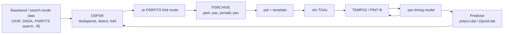
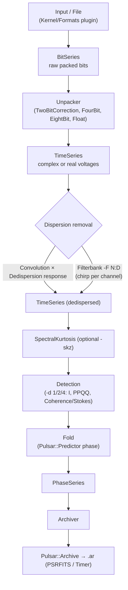
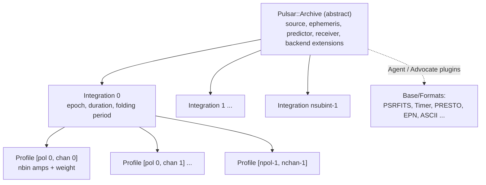
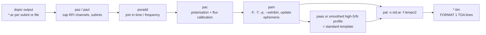
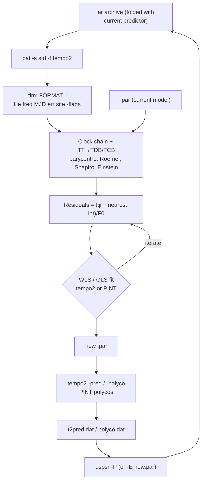

# DSPSR, PSRCHIVE and timing software close the fold–time loop

DSPSR, PSRCHIVE and the timing packages (TEMPO, TEMPO2, PINT) together form the "known pulsar" half of radio pulsar processing, and they work as one closed loop. **DSPSR** turns raw voltages or filterbank samples into folded, calibrated-ready profiles. It coherently dedisperses with the cold-plasma chirp using overlap-save FFTs, detects Stokes parameters, flags RFI with spectral kurtosis, and folds with a phase predictor. **PSRCHIVE** stores those profiles as `Pulsar::Archive` objects, usually PSRFITS fold-mode `.ar` files, and supplies the tools that clean, average, calibrate and finally time them. Its `pat` program turns each profile into a time of arrival (TOA) by Fourier-domain template matching. **TEMPO2** and **PINT** move those TOAs to the solar-system barycentre, fit a timing model (`.par`) to the TOAs (`.tim`), and emit a new predictor (`polyco.dat` or `t2pred.dat`) that DSPSR uses to fold the next observation. DSPSR and PSRCHIVE are C++ under the Academic Free License 2.1. TEMPO2 is GPL v3 C/C++. PINT is BSD-licensed Python. Only DSPSR has substantial CUDA support. For this project the loop matters for two reasons. It is how any pulsar our search finds becomes a timed pulsar, and it fixes conventions (the 1/2.41×10⁻⁴ dispersion constant, PSRFITS bit order and scaling, predictor formats) that our search code must match. The formats are described in [01-data-formats.md](01-data-formats.md), the shared equations in [05-algorithms-math.md](05-algorithms-math.md), and how we use these tools in [06-our-plan.md](06-our-plan.md).

Source trees read for this document were shallow clones from November 2026: DSPSR HEAD 3f3d5b4 (configure version 2026-03-31), PSRCHIVE HEAD d77bc07 (2026-02-26), TEMPO2 HEAD b74248f, and PINT HEAD d88d1d2. Source links below use the SourceForge, Bitbucket and GitHub master trees, so line-level details can drift. Where an official manual page could not be fetched, the citation points to the usage or `set_help` text in the source.

## DSPSR chains about 40 format readers into one Transformation pipeline

DSPSR is "an open-source C++ library for digital signal processing of pulsar timeseries" offering "coherent dedispersion, filterbank formation, pulse folding" ([dspsr.readthedocs.io](https://dspsr.readthedocs.io/en/latest/)). It asks users to cite van Straten & Bailes (2011, PASA 28, 1) ([CITATION](https://sourceforge.net/p/dspsr/code/ci/master/tree/CITATION)). Every processing step is a `dsp::Operation`, and most are typed `dsp::Transformation<In,Out>` classes, so a pipeline is a chain of containers passed between transformations. **The data path is File/Input → `BitSeries` → Unpacker → `TimeSeries` → Convolution or Filterbank with a `Dedispersion` response → `Detection` → `Fold` → `PhaseSeries` → `Archiver`**, and the Archiver writes a PSRCHIVE `Pulsar::Archive`. `Fold` is literally declared as `Transformation <TimeSeries, PhaseSeries> ("Fold", outofplace)` ([Fold.C](https://sourceforge.net/p/dspsr/code/ci/master/tree/Signal/Pulsar/Fold.C)). Formats are plugins, one directory each under `Kernel/Formats`, registered in `File_registry.C` and `Unpacker_registry.C` ([Kernel/Formats](https://sourceforge.net/p/dspsr/code/ci/master/tree/Kernel/Formats/)). The directories cover about 40 backends, including PSRFITS (`fits`, with a GUPPI unpacker), SIGPROC filterbank, DADA, VDIF, Mark4/5/5B, GUPPI, MeerKAT (`kat`), UWB, LOFAR DAL, LWA, MWA, GMRT and older Parkes and Arecibo machines. Which of these are enabled by default at configure time was not checked.

`LoadToFold` is the pipeline object behind the `dspsr` program. Its configuration merges the `SingleThread` options with the dedispersion-pipe options, and it aliases `-threads` to `-t` ([LoadToFoldConfig.C](https://sourceforge.net/p/dspsr/code/ci/master/tree/Signal/Pulsar/LoadToFoldConfig.C)). The same engine powers companion programs. `digifil` writes SIGPROC filterbanks (`LoadToFil`), `digifits` writes PSRFITS search mode (`LoadToFITS`), and `dmsmear` reports smearing ([Signal/General](https://sourceforge.net/p/dspsr/code/ci/master/tree/Signal/General/)). That makes DSPSR the reference way to make coherently dedispersed filterbanks from baseband data for a search like ours.

| Directory | Role | Key files |
|---|---|---|
| `Kernel/Classes` | containers, I/O base classes, unpackers | `Operation.C`, `Input.C`, `File.C`, `Unpacker.C`, `BitSeries.C`, `TimeSeries.C`, `WeightedTimeSeries.C`, `TwoBitCorrection.C`, `FourBitUnpacker.C`, `EightBitUnpacker.C`, `MemoryCUDA.C`, `TransferCUDA.C` ([tree](https://sourceforge.net/p/dspsr/code/ci/master/tree/Kernel/Classes/)) |
| `Kernel/Formats/*` | one plugin per backend | `fits/FITSFile.C`, `fits/FITSUnpacker.C`, `fits/GUPPIFITSUnpacker.C`, `sigproc/SigProcFile.C`, `sigproc/SigProcUnpacker.C`, `dada/`, `vdif/`, `mark5/` ([tree](https://sourceforge.net/p/dspsr/code/ci/master/tree/Kernel/Formats/)) |
| `Signal/General` | DSP operations | `Convolution.C`, `Response.C`, `PlasmaResponse.C`, `Dedispersion.C`, `OptimalFFT.C`, `Filterbank.C`, `InverseFilterbank.C`, `PolyPhaseFilterbank.C`, `Detection.C`, `stokes_detect.ic`, `SpectralKurtosis.C`, `SKFilterbank.C`, `SKDetector.C`, `SKMasker.C`, `Rescale.C`, `TScrunch.C`, `FScrunch.C`, `Apodization.C`, `Derotation.C`, `LoadToFil.C`, `LoadToFITS.C`, `digifil.C`, `digifits.C`, `dmsmear.C` ([tree](https://sourceforge.net/p/dspsr/code/ci/master/tree/Signal/General/)) |
| `Signal/Pulsar` | folding and output | `Fold.C`, `PhaseSeries.C`, `Archiver.C`, `LoadToFold1.C`, `LoadToFoldN.C`, `LoadToFoldConfig.C`, `TimeDivide.C`, `CyclicFold.C`, `PhaseLockedFilterbank.C`, `t2pred.C`, `dspsr.C` ([tree](https://sourceforge.net/p/dspsr/code/ci/master/tree/Signal/Pulsar/)) |
| `python/` | SWIG binding | `dspsr.i`, `example.py` ([tree](https://sourceforge.net/p/dspsr/code/ci/master/tree/python/)) |

### Coherent dedispersion multiplies by a chirp and sizes FFTs to minimise cost per good sample

DSPSR hard-codes the pulsar-community constant `dm_dispersion = 2.41e-4`, with the comment that DM (pc cm⁻³) = 2.410331(2)×10⁻⁴ D (s MHz²). The delay is `delay_time(freq) = (DM/2.41e-4)/freq²` seconds with freq in MHz ([Dedispersion.C](https://sourceforge.net/p/dspsr/code/ci/master/tree/Signal/General/Dedispersion.C)). This is 0.0137% larger than the physical constant 4148.806 s MHz² pc⁻¹ cm³, so DMs quoted under the two conventions differ by that fraction ([Kulkarni 2020](https://ar5iv.arxiv.org/html/2007.02886); [van Straten & Bailes 2011](https://arxiv.org/abs/1008.3973)). **Our search code must use the same 1/2.41×10⁻⁴ value if its DMs are to agree with folded and timed results**; see [05-algorithms-math.md](05-algorithms-math.md).

The transfer function is built in `Dedispersion::build_compute(chan_freq f0, freq f)`, where f is the offset from the channel centre. It uses coeff = −sign(bw)·2π·(10⁶·DM/2.41×10⁻⁴)/f0² and phase(f) = coeff·f²/(f0+f) + delay_phase. The phasors are `polar(1.0, phase)`, so H(f) = e^{i·phase}. The delay_phase term, −2πf times the inter-channel fractional-sample delay, aligns channels to sub-sample precision ([Dedispersion.C](https://sourceforge.net/p/dspsr/code/ci/master/tree/Signal/General/Dedispersion.C)). This is the Hankins & Rickett form H(ν0+ν) = exp[i2πDν²/(ν0²(ν0+ν))]. The sideband sign makes it either the chirp or its conjugate, and its impulse response lasts t_d = D(ν_min⁻² − ν_max⁻²) ([van Straten & Bailes 2011](https://arxiv.org/abs/1008.3973)).

Because multiplying in the frequency domain gives a cyclic convolution, DSPSR uses overlap-save. `PlasmaResponse` computes the smearing separately for the upper and lower half-bands (`impulse_pos`, `impulse_neg`) and pads them by `smearing_buffer = 0.1`, described in the source as covering "pollution due to the cyclical convolution effect". It then rounds to n_smear = ceil(t_smear·rate) samples and discards `impulse_pos` samples from the start and `impulse_neg` from the end of every inverse FFT ([PlasmaResponse.C](https://sourceforge.net/p/dspsr/code/ci/master/tree/Signal/General/PlasmaResponse.C)). `OptimalFFT::get_nfft(nfilt)` starts from the smallest power of two above n_filt and steps through powers of two. **It chooses the n_fft that minimises n_fft·log₂(n_fft)/(n_fft − n_filt), i.e. FFT cost per retained sample**. The `-x` option overrides this, and `--fft-bench` swaps the analytic cost for measured timings ([OptimalFFT.C](https://sourceforge.net/p/dspsr/code/ci/master/tree/Signal/General/OptimalFFT.C)). As a worked example, a 1000-sample smear gives n_filt ≈ 1100. The candidates are 2048 (cost ≈ 23.8), 4096 (≈ 16.4), 8192 (≈ 15.02) and 16384 (≈ 15.01), so the curve flattens around 8–16k points, with roughly 87–93% of each FFT kept.

The `-F N:D` option makes a synthetic filterbank that coherently dedisperses within each output channel. The code structure implies one large forward FFT, a per-channel chirp, and N small backward FFTs of length n_fft/N. This shortens the per-channel transforms compared with a full-band convolution followed by channelisation. That reading comes from the code and was not checked against the paper. Other dispersion options include `-IF N[:D]` (inverse filterbank), `-K` (remove inter-channel delays), `-dr` (deripple), `-R` (time-variable narrow-band RFI filter), `-pac` (phase-coherent matrix calibration) and `-derotate`/`-rm` (coherent Faraday derotation) ([DedispersionPipeConfig.C](https://sourceforge.net/p/dspsr/code/ci/master/tree/Signal/General/DedispersionPipeConfig.C)).

### Stokes detection and spectral kurtosis follow textbook estimators

`-d npol` selects the detected output: "0=P,Q; 1=PP+QQ; 2=PP,QQ; 3=(PP+QQ)^2; 4=PP,QQ,PQ,QP" ([dspsr.C](https://sourceforge.net/p/dspsr/code/ci/master/tree/Signal/Pulsar/dspsr.C)). The output states are `Intensity`, `PPQQ`, `NthPower`, `Coherence` (PP, QQ, Re PQ, Im PQ) and `Stokes` ([Detection.C](https://sourceforge.net/p/dspsr/code/ci/master/tree/Signal/General/Detection.C)). For complex receptor voltages p and q, `stokes_detect.ic` computes **S0 = |p|²+|q|², S1 = |p|²−|q|², S2 = 2(p_r q_r + p_i q_i), S3 = 2(p_r q_i − p_i q_r)** ([stokes_detect.ic](https://sourceforge.net/p/dspsr/code/ci/master/tree/Signal/General/stokes_detect.ic)). `-4` additionally accumulates fourth-order moments for polarimetric error analysis.

Spectral kurtosis (`-skz`) uses the Nita & Gary estimator **SK = ((M+1)/(M−1))·(M·S2/S1² − 1)**, with S1 = ΣP and S2 = ΣP² over M power samples per channel and polarisation ([SKFilterbank.C](https://sourceforge.net/p/dspsr/code/ci/master/tree/Signal/General/SKFilterbank.C)). The default threshold is 3σ (`std_devs(3.0)`) ([SpectralKurtosis.C](https://sourceforge.net/p/dspsr/code/ci/master/tree/Signal/General/SpectralKurtosis.C)). For Gaussian noise SK has mean 1 and variance 4M²/[(M−1)(M+2)(M+3)] → 4/M ([Nita & Gary 2010](https://arxiv.org/html/1005.4371v1)), so the 3σ window is roughly 1 ± 6/√M. Nita & Gary show that the true distribution is skewed, and their asymmetric Pearson thresholds differ noticeably from 1 ± 3σ at small M. DSPSR also forms time- and frequency-scrunched SK and a despeckler, and `-noskz_too` writes an unzapped copy for comparison ([dspsr.C](https://sourceforge.net/p/dspsr/code/ci/master/tree/Signal/Pulsar/dspsr.C)).

### Folding evaluates a Pulsar::Predictor generated for 24 hours

`Fold::get_folding_predictor` calls `Pulsar::Generator::factory(params)` on the ephemeris given with `-E`. It sets the site, a time span from start−864 s to +86 400 s (the code comment calls this "a bit of a hack" that makes "a predictor valid for the next 24 hours"), and the band edges, then calls `generate()`. A predictor file given with `-P` skips this step. With only a predictor, the period is 1/`frequency(start_time)`. The number of bins defaults to a power of two, at most 1024, with each bin covering at least 1.2 input samples, unless `-b` is given ([Fold.C](https://sourceforge.net/p/dspsr/code/ci/master/tree/Signal/Pulsar/Fold.C)). Because the generator is a PSRCHIVE abstraction, the same call can produce a TEMPO polyco or a TEMPO2 Chebyshev predictor; the math for both is below.

| Option | Meaning (from `set_help`) |
|---|---|
| `-E file` / `-P file` / `-w file` | ephemeris to generate a predictor / predictor to fold with / multiple predictors |
| `-c period`, `-cepoch MJD`, `-p phase` | fold at a constant period instead |
| `-b nbin`, `-L sec`, `-s`, `-turns N`, `-nsub N`, `-A` | bins; sub-integration length; single pulses; turns per subint; subints per file; single multi-integration archive |
| `-D dm`, `-F N[:D]`, `-IF N[:D]`, `-x nfft`, `-K`, `-R`, `-dr` | DM; synthetic filterbank (with coherent dedispersion); inverse filterbank; FFT length; inter-channel delays; RFI filter; deripple |
| `-d npol`, `-4`, `-n ndim` | detection type; fourth moments; output ndim |
| `-skz`, `-skzm M`, `-skzs σ`, `-skz_config sk.yaml`, `-noskz_too` | spectral kurtosis zapping |
| `-X name`, `-G nbin`, `-cyclic N` | extra pulsar; phase-locked filterbank; cyclic spectra |
| `-2 code`, `-scloffs`, `-W` | 2-bit excision; apply PSRFITS DAT_SCL/DAT_OFFS; disable weights |
| `-t/-threads`, `-cpu`, `-cuda list`, `-asynch-fold`, `-U MB`, `-minram`, `-Z lib` | threading, CPU pinning, GPUs, fold on CPU while the GPU processes, RAM limit, FFT library |
| `-S`, `-T`, `-seek MJD`, `-B`, `-f`, `-k`, `-N`, `-set key=value`, `-J a.psh` | seek/total, header overrides, psrsh script before output |

Options are from [dspsr.C](https://sourceforge.net/p/dspsr/code/ci/master/tree/Signal/Pulsar/dspsr.C), [SingleThread.C](https://sourceforge.net/p/dspsr/code/ci/master/tree/Signal/General/SingleThread.C) and [DedispersionPipeConfig.C](https://sourceforge.net/p/dspsr/code/ci/master/tree/Signal/General/DedispersionPipeConfig.C). **GPU status is mature.** CUDA is built through `config/cuda.m4`. Convolution, Filterbank, InverseFilterbank, Detection, Fold, CyclicFold, all SK stages, Rescale, the scrunches, SampleDelay and several unpackers have `.cu` engines ([Signal/General](https://sourceforge.net/p/dspsr/code/ci/master/tree/Signal/General/); [config](https://sourceforge.net/p/dspsr/code/ci/master/tree/config/)). The licence is the Academic Free License v2.1 ([LICENSE/CITATION](https://sourceforge.net/p/dspsr/code/ci/master/tree/CITATION)).

## PSRCHIVE nests Archive, Integration and Profile behind format plugins

PSRCHIVE's data model is three levels deep. An abstract **`Pulsar::Archive`** holds **`Integration`** objects (sub-integrations in time). Each Integration holds an npol × nchan array of **`Profile`** objects, each an nbin-long float vector with a weight. Concrete formats are subclasses loaded through the `Archive::Agent` / `Archive::Advocate<Plugin>` plugin mechanism declared in `Archive.h` ([Base/Classes](https://sourceforge.net/p/psrchive/code/ci/master/tree/Base/Classes/)). The format plugins in `Base/Formats` are ASCII, ASP, BPP, EPN, EPOS, PRESTO, PSRFITS, PuMa, Timer (the original Parkes/CPSR `.ar/.rf/.cf` format), UVM, WAPP and pdv_KtZ ([Base/Formats](https://sourceforge.net/p/psrchive/code/ci/master/tree/Base/Formats/)). The PSRFITS plugin ships the `psrheader.fits` template that defines a fold-mode file. The project citation is Hotan, van Straten & Manchester (2004, PASA 21, 302), and the licence is AFL 2.1 ([CITATION](https://sourceforge.net/p/psrchive/code/ci/master/tree/CITATION)).

### A PSRFITS fold-mode .ar stores int16 profiles plus the ephemeris and predictor that made them

On disk, a PSRCHIVE fold-mode archive is usually PSRFITS with `OBS_MODE = 'PSR'` (or `'CAL'` for a folded noise diode). Each `SUBINT` row holds a `DATA` column of **16-bit signed integers in (NBIN, NCHAN, NPOL) order, with profile bins contiguous**. Real values are DATA·DAT_SCL + DAT_OFFS, scaled per channel and polarisation, and are multiplied by DAT_WTS when weights are used ([ATNF PSRFITS definition](https://www.atnf.csiro.au/research/pulsar/psrfits_definition/PsrfitsDocumentation.html)). Unlike search mode there is no sub-byte packing to get wrong. NBIN is the profile length, TBIN is the bin width, and the start time is the leading edge of the first bin.

What makes an `.ar` self-describing for timing is its auxiliary tables. `PSRPARAM` holds the ephemeris text lines, `POLYCO` the TEMPO polyco blocks (NSPAN, NCOEF ≤ 15, REF_FREQ, REF_MJD, REF_PHS, REF_F0, COEFF), and `T2PREDICT` the TEMPO2 predictor text. `HISTORY` records processing steps (DEDISP, DM, RM, NBIN, CAL_MTHD, RFI_MTHD and others), and further tables hold the coherent-dedispersion parameters (`COHDDISP`), bandpass, flux and polarisation calibration, feed parameters and spectral kurtosis (`SPECKURT`) ([ATNF PSRFITS definition](https://www.atnf.csiro.au/research/pulsar/psrfits_definition/PsrfitsDocumentation.html)). Which of these tables the PSRCHIVE plugin reads and writes in every case was not checked line by line. Search-mode PSRFITS, which our pipeline ingests, is covered in [01-data-formats.md](01-data-formats.md).

### Forty-odd command-line tools share one psrsh command language

PSRCHIVE's applications live in `More/Applications` ([tree](https://sourceforge.net/p/psrchive/code/ci/master/tree/More/Applications/)). The table groups them by purpose. Option-level detail was extracted only for `pat`. For the other tools the table gives their role, using the standard PSRCHIVE conventions, and should be checked against each program's `-h` output before use.

| Purpose | Tools |
|---|---|
| Modify / reduce | `pam` (scrunch in time/frequency/polarisation/phase, change DM or ephemeris, write a new extension), `paz` / `pazi` / `psrzap` (zap channels, subints, bins; interactive), `psradd` (combine archives in time or frequency), `psrsplit`, `psrwt`, `psrtrash`, `psrsh` (scripted commands) |
| Inspect / plot | `pdv` (text dump), `psrplot`, `pav`, `psrstat` (query attributes), `psrtxt2`, `print_Predictor` |
| Calibrate | `pac` (apply polarisation/flux calibration), `pacv`, `pcm` (+`pcmavg`, `pcmdiff`, `pcmerr`, `pcmrm`, `pcmtxt`), `fluxcal`, `psrflux` |
| Polarimetry | `rmfit`, `psrpol`, `psr4th` |
| Timing | `pat` |
| Analysis | `paas` (analytic template), `pas`, `pdmp` (P/DM optimisation), `psrspa`, `psrpca`, `psrsmooth`, `psrwhite`, `psrdiff`, `psrmodel`, `psrstability`, `smint`, `spa`, `mtm`, `zap_periodic_spikes`, `dynamic_spectra`, `drifting_subpulses` |

The usual flow from raw folds to TOAs is to excise RFI, combine, calibrate, scrunch, build a standard, then time. DSPSR's `-J a.psh` lets the same psrsh commands run before output ([dspsr.C](https://sourceforge.net/p/dspsr/code/ci/master/tree/Signal/Pulsar/dspsr.C)), so some reduction can happen inline.

### pat defaults to Taylor's Fourier phase gradient and offers eight shift estimators

`pat` measures TOAs by cross-matching each profile against a standard (`-s std` or auto-selected with `-a`). It can first fscrunch or tscrunch (`-F`, `-T`) and can produce frequency-resolved TOAs (`-P` keeps a frequency-dependent template, and `-I nsub` outputs sub-band TOAs with ΔDM). **The shift estimator is `-A`, default PGS**, chosen from the list in the table below ([pat.C](https://sourceforge.net/p/psrchive/code/ci/master/tree/More/Applications/pat.C)). `-p` switches to matrix template matching (MTM), which fits the full polarisation profile through a Jones-matrix transform, and `-o` prints the fitted matrix parameters. `-f` sets the output format: parkes (the default), tempo2 (with flags `i`, `r`, `IPTA`), itoa or princeton. **For TEMPO2 and PINT use `-f tempo2`**.

| `-A` code | Estimator | Source file (`More/Timing`) |
|---|---|---|
| PGS (default) | Fourier phase gradient, Taylor (1992) | `PhaseGradShift.C` |
| FDM | Fourier domain with MCMC | `FourierDomainFit.C` |
| GIS | Gaussian interpolation of the cross-correlation function | `GaussianShift.C` |
| PIS | parabolic interpolation | `ParIntShift.C` |
| ZPS | zero-pad interpolation | `ZeroPadShift.C` |
| SIS | sinc interpolation of the cross-correlation function (implied by `-S` spike zapping) | `SincInterpShift.C` |
| COF | centre of flux | `FluxCentroid.C` |
| RVM | rotating-vector-model magnetic meridian | `RotatingVectorModelShift.C` |
| `-p` | matrix template matching | `MatrixTemplateMatching.C` |

Sources: [pat.C](https://sourceforge.net/p/psrchive/code/ci/master/tree/More/Applications/pat.C) and [More/Timing](https://sourceforge.net/p/psrchive/code/ci/master/tree/More/Timing/). The scalar core is `ScalarTemplateMatching`, documented as implementing "the Taylor (1992) algorithm, using the Van Wijngaarden–Dekker–Brent method to minimize the objective merit function". It grew out of `model_profile(…, scale, sigma_scale, shift, sigma_shift, chisq, …)` ([ScalarTemplateMatching.h](https://sourceforge.net/p/psrchive/code/ci/master/tree/More/General/Pulsar/ScalarTemplateMatching.h)). The math follows Taylor (1992) ([ADS](https://ui.adsabs.harvard.edu/abs/1992RSPTA.341..117T)); the original paper was not retrieved, so this is the textbook form. With profile and template DFTs P_k = |P_k|e^{iφ_k} and S_k = |S_k|e^{iθ_k}, PGS minimises χ²(b,τ) = Σ_k |P_k − b S_k e^{−2πikτ}|²/σ². This is equivalent to maximising Σ_k |P_k||S_k| cos(φ_k − θ_k + 2πkτ). The optimal scale is b̂ = Σ|P_k||S_k|cos(·)/Σ|S_k|², and the shift uncertainty comes from ∂²χ²/∂τ², giving σ_τ² ∝ σ²/(2b Σ k²|P_k||S_k|cos(·)). Working in the Fourier domain gives sub-bin precision without interpolating the cross-correlation, which is why PGS beats GIS/PIS/ZPS at moderate S/N. A comparison of PGS, FDM and other methods on real data is Wang et al. (2022) ([arXiv:2111.13482](https://arxiv.org/abs/2111.13482)).

PSRCHIVE's Python bindings are SWIG (`More/python/psrchive.i`) and return NumPy arrays through the classic C-API (`import_array`, `PyArray_SimpleNewFromData`) ([psrchive.i](https://sourceforge.net/p/psrchive/code/ci/master/tree/More/python/psrchive.i)). No PSRCHIVE statement on NumPy 2 was found. Because NumPy 2.0 broke C-API binary compatibility, a module built against NumPy 1.x will not import under 2.x and must be rebuilt ([NumPy 2.0 migration guide](https://numpy.org/doc/2.0/numpy_2_0_migration_guide.html)). The fallback `setup.py` still imports `distutils`, which is gone in Python 3.12, so the autotools build is the safe path. **PSRCHIVE has no meaningful GPU code**; nothing CUDA-related was found in the trees read.

## Polycos and Chebyshev predictors turn a timing model into folding phase

Folding needs pulse phase as a fast function of time and frequency, but evaluating a full timing model at every sample is expensive. Both predictor formats solve this by fitting a short polynomial to the model.

**TEMPO polycos** (`polyco.dat`; also written by `tempo2 -polyco` and PINT's `pint.polycos`) are fixed-column text blocks. Line 1 holds the pulsar name, date, UTC, TMID (MJD), DM, Doppler shift ×10⁻⁴ and the log₁₀ fit RMS. Line 2 holds RPHASE, the reference frequency F0, the observatory, the span in minutes, NCOEFF, the observing frequency and the binary phase. The coefficients follow, three per line in 25-column fields. **With DT = (T − TMID)·1440 minutes, phase = RPHASE + 60·DT·F0 + Σ_{n=1}^{NCOEFF} COEFF(n)·DT^{n−1}, and frequency (Hz) = F0 + (1/60)·Σ (n−1)·COEFF(n)·DT^{n−2}** ([TEMPO polyco spec](https://tempo.sourceforge.net/ref_man_sections/tz-polyco.txt)). PINT's `evalabsphase` implements exactly this, with `dt = (t - tmid)*MIN_PER_DAY` ([polycos.py](https://github.com/nanograv/PINT/blob/master/src/pint/polycos.py)). A polyco is valid at one reference frequency. Other frequencies are handled by applying the DM delay separately, and each block is valid only within its span.

**TEMPO2 predictors** (`t2pred.dat`, made with `tempo2 -pred "site mjd1 mjd2 f1 f2 ntimecoeff nfreqcoeff seg_length"`) ([help.txt](https://bitbucket.org/psrsoft/tempo2/src/master/help.txt)) are piecewise **two-dimensional Chebyshev series in time and frequency**. Each segment is a `ChebyModel BEGIN … END` block with PSRNAME, SITENAME, TIME_RANGE, FREQ_RANGE, DISPERSION_CONSTANT, NCOEFF_TIME, NCOEFF_FREQ and COEFFS. Evaluation maps x = −1 + 2(mjd − mjd_start)/(mjd_end − mjd_start) and y = −1 + 2(freq − f_start)/(f_end − f_start). Then **phase = Σ_ij c_ij T_i(x) T_j(y) + DISPERSION_CONSTANT/freq²**, computed with a 2-D Clenshaw recurrence and a ½c₀ convention. The coefficients are fitted at Chebyshev nodes x_k = cos(π(k−½)/n). Frequency comes from the derivative series, scaled by 2/(mjd_end − mjd_start)/86 400 ([cheby2d.c](https://bitbucket.org/psrsoft/tempo2/src/master/cheby2d.c)). The explicit 1/ν² term keeps the frequency polynomial low-order even across a wide band. `tempo2pred.c` exposes one API, `T2Predictor_GetPhase`/`GetFrequency`, over both `ChebyModelSet` and the legacy `T1PolycoSet`, so consumers handle polycos and Chebyshev predictors the same way ([tempo2pred.c](https://bitbucket.org/psrsoft/tempo2/src/master/tempo2pred.c)). PSRCHIVE wraps both as `Pulsar::Predictor`, which is what DSPSR's `Fold` evaluates, and both can be embedded in the output `.ar` (POLYCO or T2PREDICT table). In polyco mode TEMPO2 warns "tzrmjd not set" and falls back to PEPOCH ([tempo2.C](https://bitbucket.org/psrsoft/tempo2/src/master/tempo2.C)). Set TZRMJD, TZRFRQ and TZRSITE in the `.par` if absolute phase matters.

## TEMPO2 and PINT barycentre TOAs and fit timing models by linearised least squares

Both TEMPO2 and PINT start from site arrival times. They apply clock corrections (observatory → GPS → UTC → TAI → TT(BIPM)) and convert to TDB (TEMPO2 defaults to TCB unless `UNITS TDB`). They then form the solar-system barycentric correction, which TEMPO2 writes as **Δ⊙ = Δ_A + Δ_R⊙ + Δ_p + Δ_D⊙ + Δ_E⊙ + Δ_S⊙**: atmospheric, Roemer, parallax, dispersion, Einstein and Shapiro terms ([Edwards, Hobbs & Manchester 2006](https://arxiv.org/abs/astro-ph/0607664)). The Roemer delay is −r·R̂/c, using a JPL DE ephemeris for the observatory position, and is up to about 500 s. The Einstein term is the time-dilation integral (1/c²)∫(U⊕ + v⊕²/2 + …)dt. The Shapiro term is −Σ_j (2Gm_j/c³) ln[|r_j|(1 − cos ψ_j)] over the Sun, Venus and the outer planets ([Edwards et al. 2006](https://arxiv.org/abs/astro-ph/0607664)). PINT exposes the same choices in `get_TOAs(…, ephem, include_bipm, bipm_version, planets)`, with planetary Shapiro terms for Jupiter, Saturn, Venus, Uranus, Neptune and Earth ([toa.py](https://github.com/nanograv/PINT/blob/master/src/pint/toa.py)).

After the dispersion delay (D·DM/ν², with D = 1/2.41×10⁻⁴), solar-wind and troposphere terms, and binary delays are removed, the spin phase φ(t) = φ₀ + F0·Δt + F1·Δt²/2 + F2·Δt³/6 + … is evaluated about PEPOCH. The residual is φ minus the nearest integer, divided by F0. The fit is linearised least squares. Weighted least squares (WLS) or generalised least squares (GLS, with a red-noise covariance) solve for parameter corrections from the design matrix ∂φ/∂p. Then the model is updated and the fit iterated. This chain is the TEMPO2 framework of Hobbs, Edwards & Manchester (2006), and PINT reimplements it independently. Those papers were not re-read here, so this summary is standard material rather than line-verified. PINT's fitters include `WLSFitter`, `GLSFitter`, `DownhillWLSFitter`, `DownhillGLSFitter`, `PowellFitter`, `LMFitter`, `WidebandTOAFitter` and the wideband downhill/LM variants ([fitter.py](https://github.com/nanograv/PINT/blob/master/src/pint/fitter.py)). PINT can also estimate noise parameters by maximum likelihood ([Susobhanan et al. 2024](https://arxiv.org/abs/2405.01977)).

A `.par` file is a set of `PARAM value [fitflag] [uncertainty]` lines: PSRJ, RAJ, DECJ, F0, F1, PEPOCH, DM, BINARY plus its model parameters, TZRMJD/TZRFRQ/TZRSITE, EPHEM, CLK and UNITS. A TEMPO2 `.tim` file begins with `FORMAT 1` and then has one TOA per line: file, frequency (MHz), MJD, uncertainty (µs), site code and optional `-flag value` pairs. These are the files `pat -f tempo2` writes. This syntax is standard community usage and was not re-verified against TEMPO2's `readParfile.C`/`readTimfile.C` for this document ([tempo2 repo](https://bitbucket.org/psrsoft/tempo2/src/master/)).

| Package | Language / licence | Key source files | GPU |
|---|---|---|---|
| TEMPO2 | C/C++, GPL v3 | `readParfile.C`, `readTimfile.C`; clocks `clkcorr.C`, `toa2utc.C`, `utc2tai.C`, `tai2tt.C`, `tt2tdb.C`; barycentre `formBats.C`, `get_obsCoord.C`, `shapiro_delay.C`, `dm_delays.C`, `sw_delay.C`, `tropo.C`, `jpleph.c`; fit `formResiduals.C`, `doFit.C`, `t2fit*.C`, `cholesky*.C`; predictors `polyco.C`, `t1polyco.c`, `cheby2d.c`, `tempo2pred.c`; binaries `BTmodel.C`, `DDmodel.C`, `DDKmodel.C`, `DDGRmodel.C`, `ELL1model.C`, `ELL1Hmodel.C`, `T2model.C` ([repo](https://bitbucket.org/psrsoft/tempo2/src/master/)) | none found |
| PINT | Python ≥3.9, numpy ≥1.23, astropy ≥5.0.5; BSD ([pyproject.toml](https://github.com/nanograv/PINT/blob/master/pyproject.toml)) | `models/` — `astrometry.py`, `spindown.py`, `dispersion_model.py`, `solar_wind_dispersion.py`, `solar_system_shapiro.py`, `troposphere_delay.py`, `binary_bt.py`, `binary_dd.py`, `binary_ddk.py`, `binary_ell1.py`, `glitch.py`, `jump.py`, `absolute_phase.py`, `wavex.py`, `dmwavex.py`, `noise_model.py`, `timing_model.py`, `model_builder.py` ([models](https://github.com/nanograv/PINT/tree/master/src/pint/models)); `fitter.py`, `toa.py`, `polycos.py` | none found |
| TEMPO (TEMPO1) | Fortran | only the polyco spec was read ([tz-polyco.txt](https://tempo.sourceforge.net/ref_man_sections/tz-polyco.txt)) | not examined |

TEMPO2 relies on `$TEMPO2` (the runtime directory with clock, observatory and Earth-orientation files), `$TEMPO2_CLOCK_DIR` and `$TEMPO2_PLUG_PATH` for plugins ([help.txt](https://bitbucket.org/psrsoft/tempo2/src/master/help.txt)). PINT is under active development: the CHANGELOG lists release 1.1.8 on 2026-10-08, after 1.1.7 (2026-08-24) and 1.1.6 (2026-08-10) ([CHANGELOG.md](https://github.com/nanograv/PINT/blob/master/CHANGELOG.md)), and v1.0.0 is archived on Zenodo ([Zenodo 11396241](https://zenodo.org/records/11396241)).

## Licences, GPU status and the conventions our search must inherit

| Package | Licence | Citation | GPU | Python |
|---|---|---|---|---|
| DSPSR | Academic Free License 2.1 | van Straten & Bailes 2011, PASA 28, 1 ([CITATION](https://sourceforge.net/p/dspsr/code/ci/master/tree/CITATION)) | extensive CUDA (convolution, filterbank, detection, SK, fold, unpack) | SWIG `dspsr.i` |
| PSRCHIVE | Academic Free License 2.1 | Hotan, van Straten & Manchester 2004, PASA 21, 302 ([CITATION](https://sourceforge.net/p/psrchive/code/ci/master/tree/CITATION)) | none found | SWIG + NumPy C-API; rebuild for NumPy 2 |
| TEMPO2 | GPL v3 | Hobbs et al. 2006; Edwards et al. 2006 ([arXiv](https://arxiv.org/abs/astro-ph/0607664)) | none found | via third-party wrappers (not examined) |
| PINT | BSD | Susobhanan et al. 2024, ApJ 971, 150 ([arXiv](https://arxiv.org/abs/2405.01977)) | none found | native |

Several gaps remain. The van Straten & Bailes paper's own description of the synthetic filterbank, the `pat` manual body, and option lists for `pam`, `paz`, `psradd`, `pac` and `pcm` were not retrieved, so those descriptions rest on source code and standard usage. Whether the PSRFITS plugin round-trips every auxiliary table was not checked. The TEMPO1 source tree and licence were not examined.

## Conclusion

The four packages interlock more tightly than their separate repositories suggest. The `Pulsar::Predictor` abstraction is the hinge. TEMPO2's `tempo2pred.c` already puts polycos and Chebyshev predictors behind one API, PSRCHIVE wraps that API, and DSPSR folds through it, so a timing solution from TEMPO2 or PINT flows straight back into folding without format glue. The practical consequence for a new search pipeline is that "compatibility" means matching conventions, not reusing code. That means the 1/2.41×10⁻⁴ dispersion constant, the overlap-save discard convention when we coherently dedisperse, PSRFITS scaling and bit-order rules, and TZR-anchored absolute phase in any `.par` we emit for candidates. Once those match, a candidate from our search can be confirmed with `dspsr -E candidate.par`, timed with `pat -f tempo2`, and refined in PINT, which is the plan laid out in [06-our-plan.md](06-our-plan.md).

The second takeaway is about where acceleration effort belongs. DSPSR is already GPU-mature for the voltage-domain steps, while PSRCHIVE, TEMPO2 and PINT are CPU-bound but operate on small data (profiles and TOAs), where GPUs bring little benefit. The heavy compute in the search half lives in dedispersion and periodicity search, covered in [02-presto.md](02-presto.md) and [04-other-search-codes.md](04-other-search-codes.md). For known-pulsar work the tools in this document are good enough that we should call them, not rewrite them. Spectral kurtosis is the one piece worth borrowing algorithmically, and if we adopt it we should use the asymmetric Nita & Gary thresholds rather than a plain 1 ± 3σ window, which is what a single `std_devs(3.0)` setting suggests DSPSR applies by default.
