# Turning pulsar-search equations into running code

Every step of a pulsar or fast-transient search applies one of a few statistical ideas to the cold-plasma delay law $\Delta t = k_{\rm DM}\,{\rm DM}\,(f_1^{-2}-f_2^{-2})$. The ideas are: matched filtering against a known template, robust estimation of noise location and scale, and converting a test statistic with a known null distribution into a trials-corrected Gaussian significance. Dedispersion trades exactness for speed. Brute force costs $N_\Delta N_f N_t$. The Taylor tree costs $N_tN_f\log_2N_f$ but assumes linear sweeps. FDMT is exact for $\nu^{-2}$ at roughly $N_tN_\Delta\log_2N_f$. Coherent dedispersion removes intra-channel smearing entirely by deconvolving a chirp from the voltages ([Zackay & Ofek 2017](https://arxiv.org/abs/1411.5373); [van Straten & Bailes 2011](https://arxiv.org/abs/1008.3973)). On the periodicity side, normalised FFT powers are $\chi^2_2/2$ and an $m$-harmonic sum is $\chi^2_{2m}/2$. PRESTO converts that sum, plus a trials count, into an "equivalent Gaussian sigma" ([Ransom, Eikenberry & Middleditch 2002](https://arxiv.org/abs/astro-ph/0204349); [PRESTO characteristics.c](https://github.com/scottransom/presto/blob/master/src/characteristics.c)). The search methods differ in how close they come to the optimal fold-and-correlate test. The FFA with boxcars reaches about 93% efficiency ([Morello et al. 2020](https://arxiv.org/abs/2004.03701)). Ransom's 2026 coherent harmonic summing recovered 76% of injected pulsars, against 64% for riptide and 42% for accelsearch, at matched false-alarm rate ([Ransom 2026](https://arxiv.org/abs/2610.11749)). The codes diverge mostly in conventions rather than mathematics: which $k_{\rm DM}$ they use, whether f and ḟ refer to the start or the midpoint, which noise estimator they use, and how candidates are merged. These conventions are what break interoperability. This page gives every equation, its source, and the function that implements it. For program-level detail see [02-presto.md](02-presto.md), [03-dspsr-psrchive-timing.md](03-dspsr-psrchive-timing.md) and [04-other-search-codes.md](04-other-search-codes.md). For the file formats the numbers live in, see [01-data-formats.md](01-data-formats.md). For how this feeds our own pipeline, see [06-our-plan.md](06-our-plan.md). [00-overview.md](00-overview.md) gives the overall map.

## How to read this page: symbols, units and verification tags

Each equation carries a tag that says how far it was checked. **[V: source, Eq. n]** means the equation was read in the primary paper or in the source file named. **[C: file]** means it was transcribed from a code's source tree, which is itself the authority for what that code does. **[D]** means it was derived here from verified equations, and the derivation is shown or one line long. **[S]** means a standard textbook form whose primary text (Lorimer & Kramer 2005, Taylor 1992, Hankins & Rickett 1975, Taylor 1974, Staelin 1969, Leahy et al. 1983) was not opened while building this reference. Treat [S] equations as well known but not line-verified, and spot-check them before quoting equation numbers.

| Symbol | Meaning | Unit |
|---|---|---|
| ${\rm DM}=\int_0^D n_e\,dl$ | dispersion measure | pc cm⁻³ |
| $k_{\rm DM}$ | dispersion constant | s MHz² pc⁻¹ cm³ |
| $D$ | dispersion slope, $D=k_{\rm DM}{\rm DM}$ (dspsr notation) | s MHz² |
| $f,\ \nu$ | radio frequency (MHz unless "GHz" is written as a subscript) | MHz |
| $\Delta\nu$ | channel width, or total bandwidth $B$ where stated | MHz |
| $t_{\rm samp}$, $\Delta t_{\rm s}$ | sampling interval | s |
| $N_f,\ N_t,\ N_\Delta$ | channels, time samples, DM trials | – |
| $W$, $w$ | pulse width (time) / boxcar width (samples or bins) | s / samples |
| $\sigma$ | rms noise per sample after normalisation | data units |
| $T$ | observation length | s |
| $r=fT$, $z=\dot fT^2$, $w_{\rm j}=\ddot fT^3$ | Fourier frequency, drift and jerk in bins | bins |
| $a$ | line-of-sight acceleration | m s⁻² |
| $h$ | harmonic number | – |
| $P_k$ | normalised Fourier power of bin $k$ | – |
| $n_b$ | profile bins | – |
| $c$ | speed of light | m s⁻¹ |

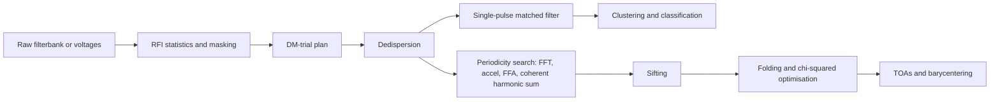

## Dispersion costs 8.3 µs per MHz of channel at 1 GHz and DM 1

### The delay law and the two constants in circulation

The cold-plasma delay relative to infinite frequency is $\tau(\nu)=\frac{e^2\,{\rm pc}}{2\pi m_ec}\,\frac{\rm DM}{\nu^2}$ **[V: Kulkarni 2020, Eq. 4]**. This assumes cold, tenuous, unmagnetised plasma with $\nu\gg\nu_p$ ([Kulkarni 2020](https://ar5iv.arxiv.org/html/2007.02886)). Between two frequencies:

```math
\Delta t = k_{\rm DM}\,{\rm DM}\,\left(f_1^{-2}-f_2^{-2}\right)
```

Here $\Delta t$ is in s, $f$ in MHz, DM in pc cm⁻³ and $k_{\rm DM}$ in s MHz² pc⁻¹ cm³ **[V: Kulkarni 2020, Eqs. 4–8]**. The physical constant is $k_{\rm DM}=e^2/(2\pi m_ec)\times{\rm pc}=4.148\,806\,4239(11)$ GHz² cm³ pc⁻¹ ms, i.e. **4148.806 s MHz² pc⁻¹ cm³**. Its inverse is $K=241.033\,1786(66)$ GHz⁻² cm⁻³ pc s⁻¹ **[V: Kulkarni 2020, Eqs. 8–9]**. Pulsar software instead uses the Manchester & Taylor (1972) convention ${\rm DM}=2.41\times10^{-4}\,D$, with $D$ in s MHz². This fixes $k_{\rm DM}\equiv1/2.41\times10^{-4}=$ **4149.378**, which is 0.0137% larger, "with the slop taken up by" DM ([Kulkarni 2020](https://ar5iv.arxiv.org/html/2007.02886); [van Straten & Bailes 2011, Eq. 4](https://arxiv.org/abs/1008.3973)). The practical consequence is a fractional DM bias of $1.4\times10^{-4}$, about 0.07 pc cm⁻³ at DM 500 **[D]**. That is far below search DM steps, but it matters when search DMs are compared with timing DMs or catalogues. Kulkarni recommends reporting the measured slope $\mathcal D=[t(\nu_1)-t(\nu_2)]/(\nu_1^{-2}-\nu_2^{-2})$ and deriving ${\rm DM}=K\mathcal D$, using 8-byte floats with unrounded constants **[V: Kulkarni 2020, Eqs. 21–22]**.

| Code | Constant as coded | Effective $k_{\rm DM}$ (s MHz² pc⁻¹ cm³) | Source |
|---|---|---|---|
| PRESTO | `delay_from_dm = dm/(0.000241 f^2)` | 4149.378 | [dispersion.c](https://github.com/scottransom/presto/blob/master/src/dispersion.c) |
| dspsr | `dm_dispersion = 2.41e-4` (comment quotes 2.410331(2)e-4) | 4149.378 | [Dedispersion.C](https://sourceforge.net/p/dspsr/code/ci/master/tree/Signal/General/Dedispersion.C) |
| dmt | "TEMPO2 value 1/2.41e-4" | 4149.378 | [dmt README](https://github.com/pravirkr/dmt) |
| TEMPO2 / PINT | $D=1/2.41\times10^{-4}$ for the DM delay | 4149.378 | [03-dspsr-psrchive-timing.md](03-dspsr-psrchive-timing.md) |
| peasoup (step planning only) | `4.15e-3` s GHz² | 4150 | [utils.hpp](https://github.com/ewanbarr/peasoup/blob/master/include/utils/utils.hpp) |
| Physical (CODATA) | $e^2/(2\pi m_ec)$ | 4148.806 | [Kulkarni 2020](https://ar5iv.arxiv.org/html/2007.02886) |

The comment in dspsr's source is worth noticing. Its "2.410331(2)×10⁻⁴" is Kulkarni's physical $K$ expressed in MHz units, but the code uses the rounded convention value **[D]**. A code that wants to match timing software must use 4149.378, not the CODATA value.

**In code:** PRESTO `delay_from_dm()` in `src/dispersion.c` refers delays to the highest channel, which is never shifted. Channel frequency is the channel centre, Doppler-corrected by the mean $v/c$ when barycentring ([02-presto.md](02-presto.md)). dspsr `Dedispersion::delay_time(freq) = (DM/2.41e-4)/freq^2`. dmt refers output times to $f_{\min}$ by default ([dmt README](https://github.com/pravirkr/dmt)).

### Smearing adds in quadrature

Cordes & McLaughlin write the effective time resolution as a quadrature sum. This is "approximately the quadratic sum", and it assumes roughly Gaussian broadening components **[V: CM03, Eq. 2]**:

```math
\Delta t=\left(\Delta t_{\rm DM}^2+\Delta t_{\delta{\rm DM}}^2+\Delta t_{\Delta\nu}^2+\tau_d^2\right)^{1/2}
```

The intra-channel dispersion smear is the derivative of the delay law across one channel of width $\Delta\nu_{\rm MHz}$:

```math
\Delta t_{\rm DM}=8.3\,\mu{\rm s}\;{\rm DM}\;\Delta\nu_{\rm MHz}\;\nu_{\rm GHz}^{-3}
```

**[V: CM03, Eq. 3]**. The exact derivative $2k_{\rm DM}\Delta\nu/\nu^3$ gives 8.2976 µs for $k_{\rm DM}=4148.808$ **[D]**. The other terms are as follows. The DM-error smear is $\Delta t_{\delta\rm DM}=\Delta t_{\rm DM}(\delta{\rm DM}/{\rm DM})$, evaluated with $\Delta\nu$ equal to the total bandwidth **[V: CM03, Eq. 4]**. The channel filter response is $\Delta t_{\Delta\nu}\sim(\Delta\nu_{\rm MHz})^{-1}$ µs **[V: CM03, Eq. 5]**. The empirical mean scattering time is $\log\tau_d=-3.72+0.411\log{\rm DM}+0.937(\log{\rm DM})^2-4.4\log\nu_{\rm GHz}$ (µs), with $\sigma_{\log\tau_d}\approx0.65$. The 4.4 assumes Kolmogorov turbulence **[V: CM03, Eq. 6]**. Setting $\Delta t_{\rm DM}=\Delta t_{\Delta\nu}$ gives the sensitivity-optimal channel width $\Delta\nu_{\rm MHz}=(\nu_{\rm GHz}^3/8.3\,{\rm DM})^{1/2}$. The minimum resolution is then $\Delta t_0=[2(\Delta t_{\rm DM}^{\min})^2+\tau_d^2]^{1/2}$ incoherently, and $\Delta t_0=(\Delta t_{\Delta\nu}^2+\tau_d^2)^{1/2}$ with coherent dedispersion **[V: CM03, Eqs. 8–10]** ([Cordes & McLaughlin 2003](https://arxiv.org/abs/astro-ph/0304364)).

A DM error costs peak flux for a Gaussian pulse of FWHM $W_{\rm ms}$ in a rectangular band **[V: CM03, Eqs. 12–14]**:

```math
\frac{S(\delta{\rm DM})}{S}=\frac{\sqrt\pi}{2}\,\zeta^{-1}\,{\rm erf}\,\zeta,\qquad \zeta=6.91\times10^{-3}\,\delta{\rm DM}\,\frac{\Delta\nu_{\rm MHz}}{W_{\rm ms}\,\nu_{\rm GHz}^3}
```

The FWHM of this curve in DM is $\Delta{\rm DM}\approx506\,W_{\rm ms}\nu_{\rm GHz}^3/\Delta\nu_{\rm MHz}$. This sets the natural scale for DM spacing and for the width of the S/N-versus-DM "bow" that clustering must merge.

The exact form of the smear across a band of centre $f_c$ and width $B$, used by dspsr, is $t_{\rm smear}=\tau(f_c-|B|/2)-\tau(f_c+|B|/2)$ **[C: PlasmaResponse.C]**.

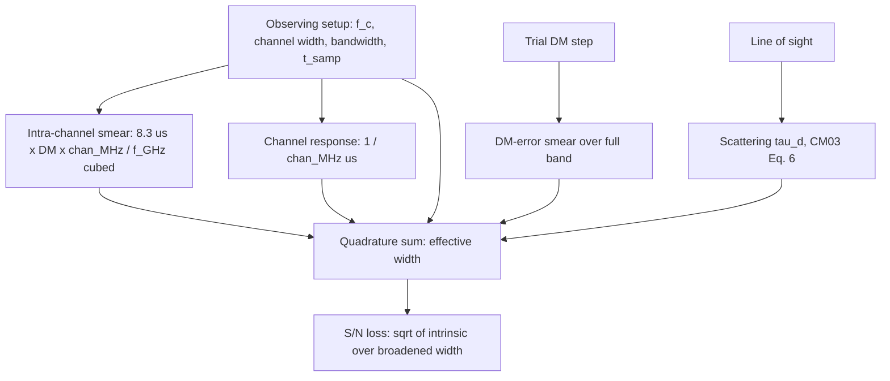

**In code:** dspsr `smearing_time()` and `dmsmear` (companion tool); peasoup `AccelerationPlan` computes $t_{\rm dm}=4.15\times10^{-3}|{\rm DM}-{\rm cDM}|(f_{\rm bot}^{-2}-f_{\rm top}^{-2})$ per channel, with $f$ in GHz **[C: utils.hpp]**; PRESTO `DDplan.py` computes `chan_smear(DM)` **[C: bin/DDplan.py]**.

## DM-trial plans keep the DM-error smear under one sample

### The criterion behind every planner

Cordes & McLaughlin set the trial spacing so that the residual DM-error smear is a fraction $\epsilon$ of the total:

```math
\frac{\delta{\rm DM}}{\rm DM}=\epsilon\,\frac{\Delta t}{\Delta t_{\rm DM}}
```

with $\Delta t\to\Delta t_0$ at the optimal resolution **[V: CM03, Eq. 11]**. Spacing therefore grows with DM, because both $\Delta t_{\rm DM}$ and $\tau_d$ grow. Zackay & Ofek give the information-theoretic count instead. The number of distinguishable DM trials for brute force is $N_\Delta=N_d/N_f$, where $N_d$ is the dispersion sweep across the band in samples. The sensitivity-optimal channel count is $N_f=\sqrt{N_d}$, from the noise-to-pulse ratio $\sqrt{N_f^2+N_d^2/N_f^2}/N_p$ **[V: Zackay & Ofek 2017, Eqs. 6–7]**.

### PRESTO DDplan.py

DDplan budgets smearing in milliseconds **[C: bin/DDplan.py]**:

```math
t_{\rm tot}=\sqrt{2(1000\,t_{\rm samp})^2+t_{\rm chan}({\rm DM})^2+t_{\rm sub}^2+t_{\rm BW}(\delta{\rm DM})^2}
```

Here $t_{\rm BW}$ is the full-band smear for a DM error of $0.5\,\delta{\rm DM}$, the worst case halfway between trials. $t_{\rm sub}$ is the smear for $0.5\times$ the subband DM step across $B/N_{\rm sub}$. The first-guess step is `guess_DMstep_approx = dt*0.0001205*f_ctr^3/(0.5*BW)`. This is exactly the condition $t_{\rm BW}=t_{\rm samp}$. Using $t_{\rm BW}\approx k_{\rm DM}(\delta{\rm DM}/2)(2B/f^3)$ and solving gives $\delta{\rm DM}=t_{\rm samp}f^3/(k_{\rm DM}B)=2.41\times10^{-4}\,t_{\rm samp}f^3/B$ **[D]**. The step is then snapped to the allowed list `[0.01, 0.02, 0.03, 0.05, 0.1, ..., 300]` with fudge factor 1.2. The downsampling factor doubles whenever channel smearing exceeds the current effective sample time ([02-presto.md](02-presto.md)).

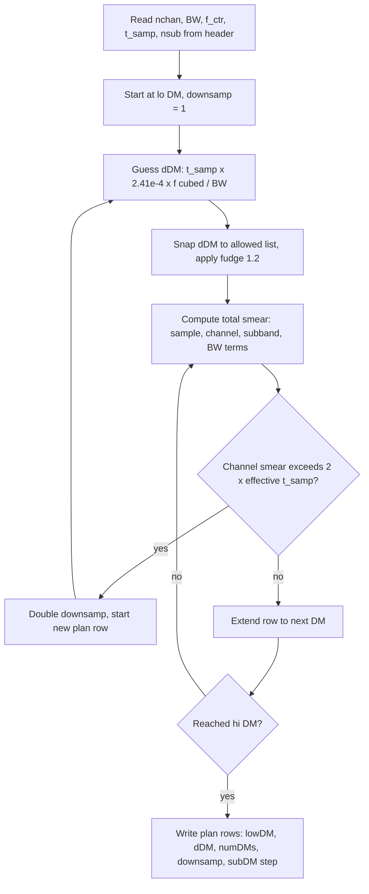

**In code:** PRESTO `DDplan.py` (`-w` writes a `dedisp_*.py` driver). heimdall `dedisp_generate_dm_list(dm_min, dm_max, pulse_width=40 µs, tol=1.25)` builds a list where consecutive trials raise the smearing by the tolerance factor. Its exact formula lives in the dedisp library (Barsdell et al. 2012) and was not transcribed for this page ([04-other-search-codes.md](04-other-search-codes.md)). peasoup reuses the same dedisp call. TransientX takes a plan file with columns `td fd dms ddm ndm snrloss maxwidth`. AstroAccelerate takes `range lo hi step inBin outBin` lines. riptide's DM plan selects a minimal subset of existing trials, and caps DM·|sin b| at 45 by default.

## Dedispersion trades exactness for a log factor

| Method | Operations | Exact for $\nu^{-2}$? | Source |
|---|---|---|---|
| Brute force (direct) | $N_fN_tN_\Delta$ | yes | [Zackay & Ofek 2017, Table 1](https://arxiv.org/abs/1411.5373) |
| Subband (two-stage) | $\approx N_t(N_fN_{\rm coarse}+N_{\rm sub}N_\Delta)$ | approximately; adds $t_{\rm sub}$ | [D] |
| Tree (Taylor 1974) | $N_fN_t\log_2N_f$ | no, linear sweeps | [Zackay & Ofek 2017](https://arxiv.org/abs/1411.5373) |
| FDMT | $\max\lbrace N_tN_\Delta\log_2N_f,\ 2N_fN_t\rbrace$ | yes | [Zackay & Ofek 2017](https://arxiv.org/abs/1411.5373) |
| Coherent | FFT of length $N\gg n_d$ per segment | removes intra-channel smear | [van Straten & Bailes 2011](https://arxiv.org/abs/1008.3973) |

### Brute force

Brute force shifts each channel by its delay and sums:

```math
I_{\rm DM}(t)=\sum_{c=1}^{N_f} I\!\left(f_c,\ t+\left\lfloor \frac{k_{\rm DM}{\rm DM}(f_c^{-2}-f_{\rm ref}^{-2})}{t_{\rm samp}}\right\rceil\right)
```

**[S]**. This is the textbook form. Rounding to the nearest sample is the usual choice.

**In code:** heimdall and peasoup call Barsdell's GPU `dedisp` ([Barsdell et al. 2012](https://arxiv.org/abs/1201.5380)), with adaptive time scrunching that gives each DM its own scrunch factor. They compute `nsamps − max_delay` output samples per gulp. AstroAccelerate uses its own many-core direct kernels (`aa_device_dedispersion_kernel.cu`; Novotný et al. 2023). dmt offers `DDMT`, `SDMT` and `DDMT-FFT`. sigpyproc offers `Filterbank.dedisperse` ([04-other-search-codes.md](04-other-search-codes.md)).

### Subband dedispersion

Stage 1 dedisperses $N_f$ channels into $N_{\rm sub}$ subbands at $N_{\rm coarse}$ nominal DMs. Stage 2 dedisperses those subbands to every fine DM within each coarse step. The cost falls from $N_tN_fN_\Delta$ to about $N_t(N_fN_{\rm coarse}+N_{\rm sub}N_\Delta)$. The price is an extra smear term $t_{\rm sub}\approx k_{\rm DM}\,\delta{\rm DM}_{\rm coarse}\,(f_{\rm sub,lo}^{-2}-f_{\rm sub,hi}^{-2})/2$ **[D]**. That is CM03 Eq. 4 applied within one subband, and it is DDplan's $t_{\rm sub}$ term.

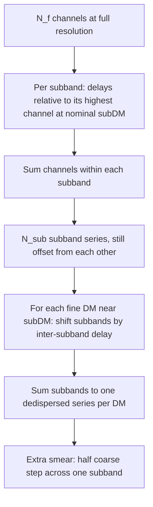

**In code:** PRESTO `prepsubband`/`mpiprepsubband` always use two stages. `subband_search_delays()` computes per-channel delays and subtracts each subband's top-channel delay, so each subband is internally dedispersed while the subbands remain offset for `float_dedisp()` to finish. `-sub -subdm X` writes `_DM<X>.subNN` files for re-dedispersion or folding near X. The default is `-nsub 32` ([prepsubband.c](https://github.com/scottransom/presto/blob/master/src/prepsubband.c)). TransientX's CPU real-time engine is subband ([Men & Barr 2024](https://arxiv.org/abs/2401.13834)). ASTROFLOW has a GPU `mode: subband`.

### Tree dedispersion

Taylor's tree "efficiently calculates" sums along straight-line dispersion paths, so it is approximate for $\nu^{-2}$ curves ([Zackay & Ofek 2017](https://arxiv.org/abs/1411.5373)). The standard remedy, not checked against a primary source here, is to pre-stretch the frequency axis to be linear in $\nu^{-2}$, or to apply the tree within subbands where the curve is nearly linear **[S]**.

**In code:** sigpyproc `Filterbank.tree_dedisperse` ([base.py](https://github.com/FRBs/sigpyproc3/blob/main/src/sigpyproc/base.py)).

### FDMT: exact sub-band merging in log₂N_f steps

Define $A_{f_0}^{f_2}(t_0,\Delta t)$ as the sum of $I(f,t)$ along the unique $\nu^{-2}$ curve from $(t_0,f_0)$ to $(t_0-\Delta t,f_2)$. Initialise with $\delta f=(f_{\max}-f_{\min})/N_f$ and $A_f^{f+\delta f}(t,\Delta t)=\sum_{i=0}^{\Delta t}I(f,t+i)$, or $=I(f,t)$ if the per-channel delay is under one bin **[V: Zackay & Ofek 2017, Eqs. 18, 20]**. At iteration $i=1\ldots\log_2N_f$, merge sub-band $[f_0,f_1]$ with $[f_1,f_2]$, where $f_2=f_0+2^i\delta f$ and $f_1=(f_0+f_2)/2$:

```math
C_{f_2,f_0}=\frac{f_1^{-2}-f_0^{-2}}{f_2^{-2}-f_0^{-2}},\qquad t_1=t_0-C_{f_2,f_0}\,\Delta t
```

```math
A_{f_0}^{f_2}(t_0,\Delta t)=A_{f_0}^{f_1}(t_0,\ t_0-t_1)+A_{f_1}^{f_2}(t_1,\ t_1-t_2)
```

If $t_1<0$ the second term is dropped, which is a plain copy **[V: Zackay & Ofek 2017, Eqs. 16–17]**. The delay range needed per sub-band is $\Delta t_{\max}(i,f_0)=N_\Delta\frac{f_0^{-2}-(f_0+2^i\delta f)^{-2}}{f_{\min}^{-2}-f_{\max}^{-2}}$ **[V: Eq. 22]**. Under a near-linear sweep, iteration $i$ has $N_b=N_f/2^i$ bands each needing $\approx N_\Delta2^i/N_f$ delays. Their product is $\approx\max\lbrace N_\Delta,N_b\rbrace$, so

```math
C_{\rm FDMT}\le 2N_tN_f+N_tN_\Delta\log_2N_f = 2N_s+\frac{N_sN_d}{N_f^2}\log_2N_f
```

where $N_s=N_fN_t$ **[V: Eqs. 25, 28–29]**. The dispersion kernel is power preserving, $|\hat H(f)|^2=1$.

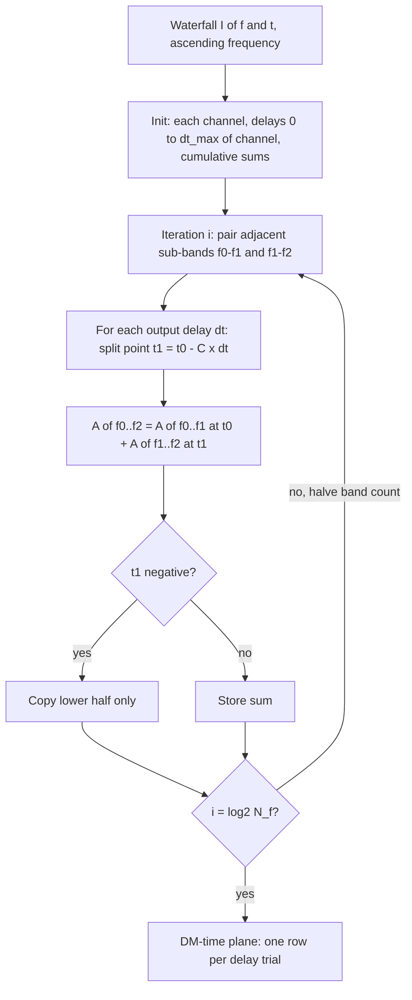

**In code:** dmt `dmt::algorithms::FDMT(f_min, f_max, nchans, nsamps, tsamp, dt_max, dt_min, dt_step, use_box_smearing, mode, Exec)` and the Python `compute_fdmt(...)`/`dmtlib.dedisperse(..., engine="fdmt_fft")`. Files are `lib/fdmt.cpp` and `lib/fdmt_plan*.cpp`. The input waterfall must be in ascending frequency, so SIGPROC data with `foff<0` must be flipped with `dmtlib.to_ascending()`. Every plan gives "the exact sigma of each DM trial", so S/N needs no calibration run ([dmt README](https://github.com/pravirkr/dmt)). PulsarX uses a pruned FDMT (pFDMT) that reuses intermediate results and prunes unused paths. It cuts dedispersion operations about 50× for ~500 candidates ([Men et al. 2023](https://arxiv.org/abs/2309.02544)). Its source file was not located (see [04-other-search-codes.md](04-other-search-codes.md)).

### Coherent dedispersion: deconvolve the chirp

The interstellar medium acts on the voltage spectrum as a phase-only filter. Writing $\nu_0$ for the channel centre and $\nu$ for the offset within the band:

```math
H(\nu_0+\nu)=\exp\!\left[i\,\frac{2\pi D\,\nu^2}{\nu_0^2(\nu_0+\nu)}\right],\qquad {\rm DM}=2.41\times10^{-4}D
```

with $D$ in s MHz² **[V: van Straten & Bailes 2011, Eq. 3]**, after Hankins (1971) and Hankins & Rickett (1975). Dedispersion multiplies by $H^{\ast}$. The sign depends on the FFT convention and sideband. The impulse response, a chirp, lasts $t_d=D(\nu_{\min}^{-2}-\nu_{\max}^{-2})$ **[V: Eq. 5]**. With overlap-save, each FFT segment discards $n_d=n_d^-+n_d^+$ wrap-around points, $n_d^\pm=r\,t_d^\pm$, where $r$ is the sampling rate and $t_d^\pm$ the smear in the upper and lower half-bands. The FFT length must exceed $n_d$, and efficiency improves when $N\gg n_d$ ([van Straten & Bailes 2011](https://arxiv.org/abs/1008.3973)).

dspsr implements the phase as **[C: Dedispersion.C]**:

```math
\phi(f)=-{\rm sign}(B)\,\frac{2\pi\,(10^6\,{\rm DM}/2.41\times10^{-4})}{f_0^2}\,\frac{f^2}{f_0+f}\;-\;2\pi f\,\delta_{\rm frac},\qquad H(f)=e^{i\phi(f)}
```

Here $f_0$ is the channel centre (MHz), $f$ the offset (MHz), $10^6$ converts MHz·s to consistent units, and $\delta_{\rm frac}$ the fractional-sample inter-channel delay. The FFT length is chosen by `OptimalFFT::get_nfft(nfilt)`. Starting from the smallest power of two above $n_{\rm filt}$, it minimises

```math
T(n_{\rm fft})=\frac{n_{\rm fft}\log_2 n_{\rm fft}}{n_{\rm fft}-n_{\rm filt}}
```

**[C: OptimalFFT.C]**. $n_{\rm filt}$ is the smear in samples, padded by 10% (`smearing_buffer = 0.1`) against cyclical-convolution pollution. `impulse_pos` samples are dropped from the start of each block and `impulse_neg` from the end **[C: PlasmaResponse.C]**. A synthetic filterbank (`-F N:D`) does one large forward FFT, applies the chirp per output channel, then does $N$ small inverse FFTs of length $n_{\rm fft}/N$. This coherently dedisperses each output channel with a shorter kernel **[D, from code structure]**.

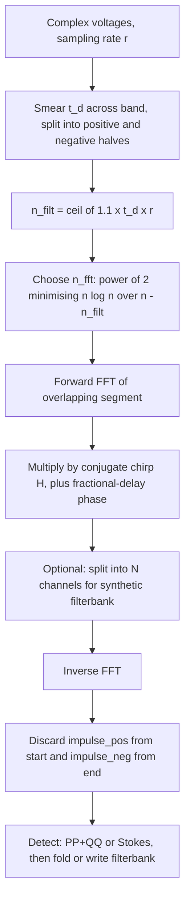

**In code:** dspsr `Dedispersion::build_compute`, `Convolution.C` (+CUDA), `Filterbank.C` with `-F N:D`, `OptimalFFT.C`, and `-x nfft` to override the length ([Dedispersion.C](https://sourceforge.net/p/dspsr/code/ci/master/tree/Signal/General/Dedispersion.C)). `digifil`/`digifits` write coherently dedispersed filterbanks. Detection forms $S_0=|p|^2+|q|^2$, $S_1=|p|^2-|q|^2$, $S_2=2(p_rq_r+p_iq_i)$ and $S_3=2(p_rq_i-p_iq_r)$ **[C: stokes_detect.ic]**. dmt offers `CohFDMT`. peasoup's `--cdm` refines acceleration steps near a coherent DM.

## RFI statistics all estimate a robust noise scale, then fence outliers

### rfifind: per-cell mean, std and peak FFT power

PRESTO's `rfifind` divides the data into intervals (default `-time 30` s) per channel. For each cell it stores the mean, the standard deviation and the maximum normalised power of a real FFT of the chunk. The FFT is searched with `search_fft()` using 4 harmonic sums, interbinning and a low-bin cut of 5, with normalisation `norm = std^2 * ptsperint`. Cells with std ≤ 1e-4 are skipped ([rfifind.c](https://github.com/scottransom/presto/blob/master/src/rfifind.c)). The flagging rules are **[C: rfifind_plot.c]**:

```math
P_{\rm reject}=\tfrac12\,Q^{-1}_{\chi^2_2}\!\left(\frac{Q_{\rm G}(\texttt{freqsig})}{\texttt{ptsperint}/2}\right)
```

This is `power_for_sigma(freqsig, 1, ptsperint/2)`: the single-bin power that is a freqsig-σ event after correcting for ptsperint/2 trials. Here $Q_{\rm G}$ is the Gaussian upper-tail probability and $Q^{-1}_{\chi^2_2}$ the inverse $\chi^2_2$ survival function. A mean or std cell is flagged when $|x-\text{interval median}|$ or $|x-\text{channel median}|$ exceeds `timesig` × the global robust std. Robust statistics come from `calc_avgmedstd`, keeping the central 0.8 (avg, std) or 0.5 (pow). Then a whole interval is masked if bad channels exceed `chanfrac`·numchan, and a whole channel if bad intervals exceed `intfrac`·numint. Defaults are timesig 10, freqsig 4, chanfrac 0.7, intfrac 0.3 and clip 6 ([rfifind_cmd.cli](https://github.com/scottransom/presto/blob/master/clig/rfifind_cmd.cli)).

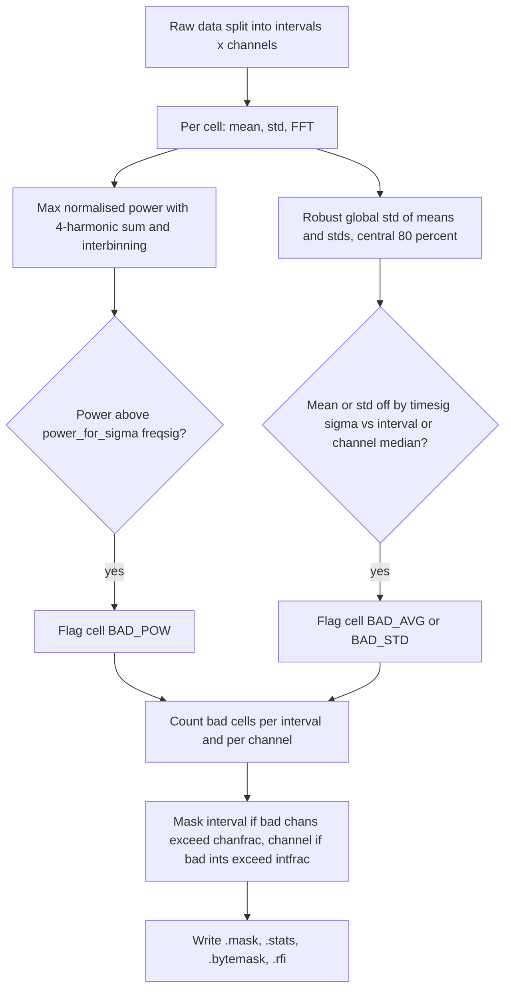

**In code:** PRESTO `rfifind` (`src/rfifind.c`, `rfifind_plot.c`, `mask.c`). `-nocompute` re-derives the mask from `.stats` with new thresholds, without reading raw data again.

### Zero-DM and its correlated variant

The zero-DM filter subtracts, per time sample, the band-averaged signal from every channel. That signal is the DM = 0 time series, which carries broadband undispersed RFI. Eatough, Keane & Lyne analyse this as a high-pass filter on dispersed pulses with cutoff near $500/{\rm DM}$ Hz ([Eatough et al. 2009](https://ar5iv.labs.arxiv.org/html/0901.3993)). In formula form **[D]**:

```math
x'(t,f)=x(t,f)-\frac{1}{N_f}\sum_{f'}x(t,f')
```

A dispersed pulse of width $W$ and sweep $t_{\rm sweep}$ contributes only about $W/t_{\rm sweep}$ of its amplitude to the mean in any sample. The loss is therefore small except at low DM. TransientX's `zdot` subtracts the component correlated with the zero-DM profile $z(t)$ instead, which handles channels with different RFI gains **[C: rfi_mitigation.rst]**:

```math
x_c(t)\leftarrow x_c(t)-\frac{\langle x_c\,z\rangle}{\langle z\,z\rangle}\,z(t)
```

**In code:** PRESTO `-zerodm` (rfifind, prepdata, prepsubband). heimdall `clean_filterbank_rfi()` does narrow- and broad-band zero-DM excision and replaces masked samples with random nearby values. AstroAccelerate has `zero_dm` and `zero_dm_with_outliers`. sigpyproc has `remove_zerodm`. TransientX and PulsarX have `zdot` (Men et al. 2019), and TransientX `baseline` subtracts a smoothed zero-DM profile. ASTROFLOW has `rfi.use_zero_dm`.

### Spectral kurtosis

For $M$ instantaneous power estimates $P_i$ per channel, with $S_1=\sum P_i$ and $S_2=\sum P_i^2$ **[V: Nita & Gary 2010]**:

```math
\widehat{SK}=\frac{M+1}{M-1}\left[\frac{M\,S_2}{S_1^2}-1\right]
```

This is unbiased, with $E[\widehat{SK}]=1$ for Gaussian noise. Its variance is $4M^2/[(M-1)(M+2)(M+3)]\to4/M$. For $N$-sample-averaged spectra whose components are gamma-distributed with shape $d$ ($d=1$ for complex FFT power, $d=1/2$ for real):

```math
\widehat{SK}=\frac{MNd+1}{M-1}\left[\frac{M\,S_2}{S_1^2}-1\right],\qquad \mu_2=\frac{2Nd(Nd+1)M^2\,\Gamma(MNd+2)}{(M-1)\,\Gamma(MNd+4)}\simeq\frac{2}{M}\left[1+\frac{1}{dN}\right]
```

**[V: Nita & Gary 2010, Eqs. 8–9]**. The distribution is skewed, so the proper thresholds are asymmetric. They sit at 0.13499% per tail (the "3σ" level), from Pearson Type IV/VI or the simpler Type III fit. For $N=10$, $M=300$, $d=1$ the Type III bounds are [0.76754, 1.28212], against symmetric $1\pm3\sqrt{\mu_2}$ bounds of [0.74288, 1.25712] ([Nita & Gary 2010](https://arxiv.org/html/1005.4371v1)). Codes that use symmetric bounds therefore over-flag low SK and under-flag high SK slightly.

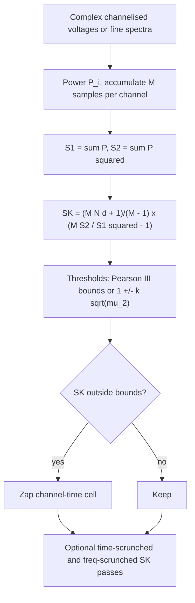

**In code:** dspsr `SKFilterbank.C` computes the $N=d=1$ estimator per channel and polarisation, plus time- and frequency-scrunched SK. `SpectralKurtosis.C` defaults to `std_devs(3.0)`. The flags are `-skz`, `-skzm`, `-skzs` and `-skz_config` ([SKFilterbank.C](https://sourceforge.net/p/dspsr/code/ci/master/tree/Signal/General/SKFilterbank.C)). The ±σ bounds around 1 are symmetric **[D, from defaults]**. your `sk_filter` uses median ± σ·1.4826·MAD bounds on SK rather than the analytic variance ([rfi.py](https://github.com/thepetabyteproject/your/blob/main/your/utils/rfi.py)).

### IQRM: lagged differences, IQR scale and a vote

IQRM flags channels using a per-channel statistic $x_i$, where larger means more RFI (for example the channel std or |lag-1 ACF|). It forms lagged differences $\Delta_i^k=x_i-x_{i-k}$ with edge clamping. Lags come from $k_0=1$, $k_{m+1}=\max(\lfloor1.5k_m\rfloor,k_m+1)$ up to radius $r$, plus negatives, so $r=10$ gives ±1, 2, 3, 4, 6, 9. For each lag, robust location and scale are **[V: Morello, Rajwade & Stappers 2022]**:

```math
\mu_k=Q_k(0.5),\qquad \sigma_k=\frac{Q_k(0.75)-Q_k(0.25)}{\Phi^{-1}(0.75)-\Phi^{-1}(0.25)}\approx\frac{\rm IQR}{1.349}
```

$x_i$ is "high relative to" $x_{i-k}$ if $\Delta_i^k-\mu_k>t\,\sigma_k$. That is a one-sided Tukey-style fence in Gaussian sigmas. Each such event casts a vote $(i-k)\to i$. A vote $i\to j$ is valid only if $i$ cast strictly fewer votes than $j$ received, and any index with at least one valid vote is masked. Recommended parameters are $t=3$ and $r\approx10\%$ of the channel count. Runtime is ~100× faster than real time on one core, and the cost is dominated by computing the statistic itself ([Morello et al. 2022](https://ar5iv.labs.arxiv.org/html/2108.12434)).

The MAD analogue is $\hat\sigma=1.4826\,{\rm median}|x-{\rm median}(x)|$, with $1.4826=1/\Phi^{-1}(0.75)$ **[S]** (Rousseeuw & Croux 1993). It is the same Gaussian-consistency idea as IQR/1.349, since IQR $=2\times0.6745\,\sigma$.

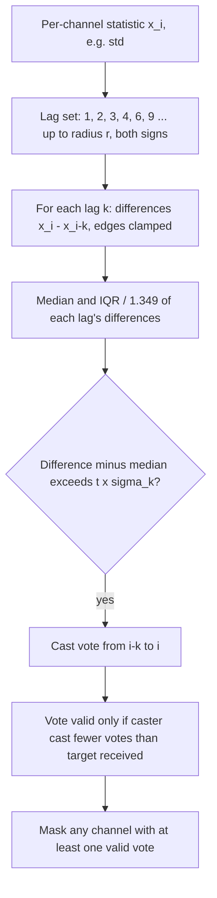

**In code:** sigpyproc `core/rfi.py:iqrm_mask` (lag differences $x_i-x_{i+k}$ over ±1..radius, Tukey fences in sigma units, cross-lag vote) via `Filterbank.clean_rfi(method="iqrm", threshold=3)`, with `double_mad_mask` as the alternative ([core/rfi.py](https://github.com/FRBs/sigpyproc3/blob/main/src/sigpyproc/core/rfi.py)). ASTROFLOW `src/core/iqrm.cu`. TransientX uses IQR fences differently: a skewness–kurtosis channel filter and an IQR time–frequency `mask`. It also uses Kadane's maximum-sum window (`kadaneF`, `kadaneT`) for slowly varying RFI ([rfi_mitigation.rst](https://github.com/ypmen/TransientX/blob/master/docs/pipeline/rfi_mitigation.rst)).

## Single-pulse S/N scales as area over root width

### The matched-filter result

For a pulse of area $A_i$ and width $W_i\gg W_n$, with per-sample rms $\sigma$ and noise correlation time $W_n$ **[V: CM03, Eq. 15]**:

```math
\left(\frac{S}{N}\right)_i=\frac{1}{\sigma\sqrt{W_n}}\,\frac{A_i}{\sqrt{W_i}},\qquad \sigma=\frac{S_{\rm sys}}{\sqrt{N_{\rm pol}\,\Delta\nu\,W_n}}
```

So S/N scales as $A_i/\sqrt{W_i}$, independent of $W_n$. Broadening to $W_b$ by scattering, DM error or orbital motion costs $(S/N)_b=(S/N)_i(W_i/W_b)^{1/2}$ **[V: CM03, Eq. 16]**. Iteratively adding adjacent samples is "a straight-forward and efficient approximation to optimal detection" ([Cordes & McLaughlin 2003](https://arxiv.org/abs/astro-ph/0304364)). The discrete boxcar statistic on a series with robust location $\mu$ and scale $\sigma$ is **[D, the $\delta\to0$ limit of Ransom 2026 Eq. 3]**:

```math
{\rm S/N}_w(t)=\frac{\sum_{j=t}^{t+w-1}(x_j-\mu)}{\sigma\sqrt w}
```

It is computed in $O(1)$ per output from a prefix sum $C_k=\sum_{j<k}x_j$, as $S_w(p)=C_{p+w}-C_p$ **[V: Morello et al. 2020, Eqs. 37–38]**. For a top-hat pulse of width $W$ searched with boxcar $W_b$, the recovered fraction is $\min(W,W_b)/\sqrt{WW_b}$ **[D]**. A factor-2 mismatch therefore costs 29%. A correct-width boxcar recovers ~94% of the matched-filter S/N of a Gaussian pulse. With widths spaced by factors of 2, the average efficiency for an unknown-width Gaussian is $E\approx0.930$ **[V: Morello et al. 2020, Eq. 25]**. TransientX's paper reports about 9% loss for a boxcar against a scattered Gaussian ([Men & Barr 2024](https://arxiv.org/abs/2401.13834)).

The width ladders differ in a way this formula explains. TransientX steps widths by $w_{n+1}/w_n=1/(1-L)^2$ with `snrloss` $=L$ **[C: boxcar.cpp]**. By the mismatch formula, the worst-case loss between neighbours is exactly $1-\sqrt{w_n/w_{n+1}}=L$ **[D]**. heimdall's powers of two ($L=29\%$ worst case) and PRESTO's ladder `[1,2,3,4,6,9,14,20,30,...]` (ratio ~1.5, $L\approx18\%$) are points on the same curve **[D]**.

### False alarms set the threshold

Gaussian noise statistics are assumed, which is "a good assumption when the time-bandwidth product ≳5". The expected number of detections in an S/N bin of width $\Delta$ is $\Delta N_p\approx2NN_{\rm DM}\Delta f(S/N)$, where $f$ is the Gaussian PDF, $N$ the number of samples and $N_{\rm DM}$ the number of trials **[V: CM03, Eq. 18]**. A practical budget is $N_{\rm FA}\approx N_{\rm eff}\,\tfrac12{\rm erfc}(\eta/\sqrt2)$ with $N_{\rm eff}\approx\sum_{\rm DM}\sum_wN_t/w$ **[D]**. At $\eta=6$ this is $9.9\times10^{-10}$ per independent trial.

### How each code normalises

| Code | Detrend | Noise scale | Widths | Source |
|---|---|---|---|---|
| PRESTO `single_pulse_search.py` | piecewise linear per block of `-d`×1000 samples (`-f`: median) | trimmed std of central 95% × 1.148; blocks with std outside median ± 4σ dropped | 1–30 bins default, up to 300 | [single_pulse_search.py](https://github.com/scottransom/presto/blob/master/bin/single_pulse_search.py) |
| heimdall | median-of-5 scrunch pyramid to baseline, radius `baseline_length/(2dt)` | `GetRMSPlan` to unit RMS; optional `-boxcar_renorm` | powers of 2 up to 4096, time-decimated above 4096 | [remove_baseline.cu](https://sourceforge.net/p/heimdall-astro/code/ci/master/tree/Pipeline/remove_baseline.cu), [matched_filter.cu](https://sourceforge.net/p/heimdall-astro/code/ci/master/tree/Pipeline/matched_filter.cu) |
| AstroAccelerate SPDT | – | width-dependent mean and σ interpolated from an MSD plane, optional outlier rejection | iterative decimated boxcar bank | [aa_device_SPS_long.cu](https://github.com/AstroAccelerateOrg/astro-accelerate/blob/master/src/aa_device_SPS_long.cu) |
| TransientX | per-channel equalise + zero-DM baseline | `sqrt(1/(wn·var))`, optional IQR | geometric, ratio $1/(1-L)^2$ | [boxcar.cpp](https://github.com/ypmen/TransientX/blob/master/src/singlepulse/boxcar.cpp) |
| dmt | – | exact per-trial σ from the plan | `lib/boxcar_*.cpp` | [dmt README](https://github.com/pravirkr/dmt) |

PRESTO's documented definition, `sigma = sum(signal - bkgd)/RMS/sqrt(boxcar_width)`, keeps S/N invariant under downsampling while the pulse is resolved. heimdall's boxcar is centred: $y_i=S[i+\lceil w/2\rceil]-S[i-\lfloor w/2\rfloor]$ on the prefix scan **[C: matched_filter.cu]**. AstroAccelerate's width-dependent σ matters because, after decimation and partial-sum reuse, the noise in a width-$w$ output is not exactly $\sigma\sqrt w$ (Adámek & Armour 2020).

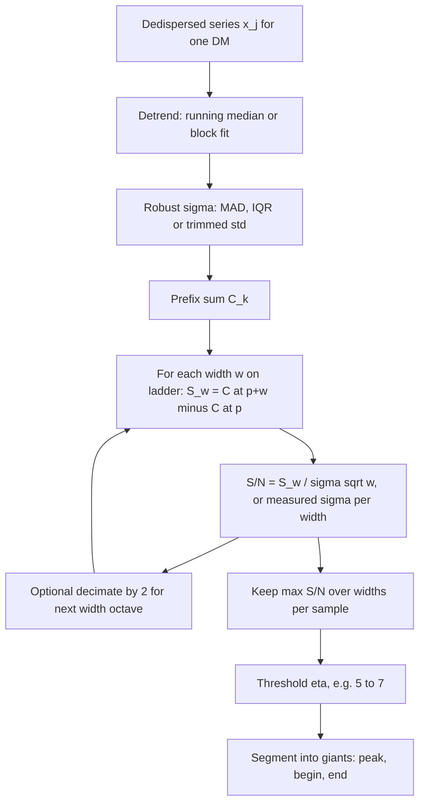

### Clustering: friends-of-friends versus DBSCAN

One astrophysical burst lights up many adjacent (time, DM, width) cells. This is the S/N-versus-DM bow whose width is set by CM03 Eq. 14. heimdall declares giants $i$ and $j$ coincident when **[C: are_coincident.cuh]**:

```math
|s_i-s_j|\le\tau_{\rm tol}\max(2^{b_i},2^{b_j}),\qquad |b_i-b_j|\le b_{\rm tol},\qquad |d_i-d_j|\le d_{\rm tol}
```

$s$ is the sample index, $b$ the filter index (width $2^b$ samples) and $d$ the DM-trial index. The defaults are $\tau_{\rm tol}=3$, $b_{\rm tol}=3$ and $d_{\rm tol}=200$ trials. Connected components are found on the GPU by replacing each label with the minimum label of its root chain. Each cluster reports its max-S/N member and a member count ([label_candidate_clusters.cu](https://sourceforge.net/p/heimdall-astro/code/ci/master/tree/Pipeline/label_candidate_clusters.cu)). TransientX instead places above-threshold points in (time, DM-smearing) space into a kd-tree and runs DBSCAN with `eps = -r` (ms, at least 1.5·tsamp) and `min_samples = -k`. The minimum-points criterion additionally rejects isolated noise points ([cluster.cpp](https://github.com/ypmen/TransientX/blob/master/src/singlepulse/cluster.cpp)). This is the main conceptual difference between the two. No primary clustering paper was read for this page.

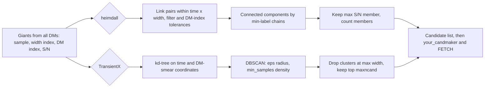

**In code:** heimdall `find_giants.cu`, `label_candidate_clusters.cu` and `merge_candidates.cu` (output: 9-column `.cand`). sigpyproc `algorithms/heimdall.py` is a Python reference re-implementation. TransientX `cluster.cpp`. PRESTO prunes duplicates only within `downfact/2` per DM. your_candmaker takes heimdall's $\log_2$ width directly ([04-other-search-codes.md](04-other-search-codes.md)).

## FFT powers are χ² with two degrees of freedom, once normalised

### Normalisation and red noise

For pure noise, DFT powers are exponentially distributed ($\chi^2_2$), with mean and std $N\langle d_j^2\rangle$. The normalised power $P_k=|A_k|^2/(N\langle d_j^2\rangle)$ then obeys **[V: REM02, Eq. 10]**:

```math
{\rm Prob}(P\ge P')=e^{-P'}
```

Red noise makes the local mean frequency dependent. The fix is $P_{k,\rm norm}\simeq P_k/P_{\rm local}$ **[V: REM02, Eq. 12]**, with the local level taken from the median divided by $\ln2$. That works because a unit exponential has median $\ln 2$, and a median is robust to strong narrow-band signals ([REM02](https://arxiv.org/abs/astro-ph/0204349)).

**In code:** PRESTO `rednoise`/`deredden()` sets bin 0 to $1+0i$. Block lengths grow logarithmically as `startwidth·ln(binnum)` (default 6), capped at `endwidth` (100), until `binnum/T ≥ endfreq` (6 Hz). Each block's level is median/ln2, and amplitudes are divided by $\sqrt{\rm level}$ linearly interpolated between block midpoints ([misc_utils.c](https://github.com/scottransom/presto/blob/master/src/misc_utils.c)). Inside accelsearch the default is block-median normalisation `norm = 1/sqrt(median(|A|^2)/ln2)`. Alternatives are `-locpow`, `-photon` and `-nonorm`. Since v6.3.3, rednoised input that passes a 10% scale check is searched as `-nonorm`, which gives 6–11% fewer false candidates above σ = 2 ([02-presto.md](02-presto.md)). peasoup takes a running median, `Dereddener`, `Zapper`, then mean/rms stats ([pipeline_multi.cu](https://github.com/ewanbarr/peasoup/blob/master/src/pipeline_multi.cu)). riptide subtracts a running median in the time domain (`rmed_width` 4 s, at least 101 points). PRESTO `zapbirds` (v6.1+) fills zapped bins with $\chi^2_2$ noise at the local mean power rather than a constant.

### Scalloping, Fourier interpolation and interbinning

A sinusoid at non-integer Fourier frequency $r$ spreads as **[V: REM02, Eqs. 18c–d]**:

```math
A_k=A_0\,e^{-i\pi(k-r)}\,{\rm sinc}[\pi(k-r)],\qquad P_k=P_0\,{\rm sinc}^2[\pi(k-r)]
```

At the worst offset, $|k-r|=1/2$, $|A_k|=2|A_0|/\pi$. That is "nearly 60% loss of signal power", and the average power loss is ~23%. Exact recovery correlates local bins with the sinc template **[V: REM02, Eq. 30]**:

```math
A_r\simeq\sum_{k=r-m/2}^{r+m/2}A_k\,e^{-i\pi(r-k)}\,{\rm sinc}[\pi(r-k)]
```

The cheap approximation is interbinning, $A_{k+1/2}\simeq\frac{\pi}{4}(A_k-A_{k+1})$ (van der Klis 1989). It reduces the worst amplitude loss from $1-2/\pi\approx36\%$ to ~7.4%, which occurs at offset $\pm(1-\pi/4)\approx0.215$ bin. Interbins have different noise properties and are not independent trials **[V: REM02, Eq. 31]**.

**In code:** PRESTO accelsearch uses `ACCEL_NUMBETWEEN 2` / `ACCEL_DR 0.5`, i.e. half-bin steps from spreading and correlation. coherentsearch uses the exact m = 16-bin form of Eq. 30 ([accel.h](https://github.com/scottransom/presto/blob/master/include/accel.h)). peasoup uses `form_interpolated` (interbinning) in `kernels.cu`. sigpyproc uses `FourierSeries.form_spec(interpolate)`.

### Harmonic summing and significance

The sum of $m$ normalised powers is $\chi^2_{2m}/2$ **[V: REM02, Eq. 11]**:

```math
{\rm Prob}(P_m\ge P')=\sum_{j=0}^{m-1}\frac{(P')^j}{j!}\,e^{-P'}=Q_{\chi^2_{2m}}(2P')
```

PRESTO turns this into the "equivalent Gaussian sigma" **[C: characteristics.c]**:

```math
\ln p=\ln Q_{\chi^2_{2m}}(2P_m)+\ln N_{\rm trials},\qquad \sigma_{\rm eq}=Q_{\rm G}^{-1}(e^{\ln p})
```

`chi2_logp` switches to the asymptotic incomplete-gamma expansion (A&S 26.4.19) when $\chi^2>1200$ or when dof > 30 and $\chi^2>100$. `power_for_sigma` is the inverse. The trials count per harmonic stage of $m=2^i$ harmonics is $(r_{\rm hi}-r_{\rm lo})/m$ without acceleration, and with acceleration and jerk it is **[C: accel_utils.c]**:

```math
N_{\rm trials}=\frac{(r_{\rm hi}-r_{\rm lo})}{m}\,(N_z+1)\frac{\Delta z}{6.95}\,(N_w+1)\frac{\Delta w}{44.2}
```

This matches the paper's $N_{\rm trials}\sim\frac{N_rN_z}{6.95\,m}\frac{N_w}{44.2}$ **[V: Andersen & Ransom 2018, Eq. 6]**. The constants 6.95 and 44.2 behave as the correlation lengths of the response in $z$ and $w$, but neither the code nor the paper explains them. Top-of-file sigmas in `_ACCEL` files include this correction. Per-harmonic and ACCEL_sift sigmas are single-trial, so that they can be compared across DMs ([PRESTO FAQ](https://github.com/scottransom/presto/blob/master/FAQ.md)). The Gaussian-equivalent conversion of a trials-corrected $p$-value, $\sigma=\Phi^{-1}(1-p)$, is standard **[S]**.

PRESTO's harmonic stages are 2, 4, 8, 16 and 32. Stage $N$ adds the planes of harmonics $(2k+1)/N$, $k=0\ldots N/2-1$, at rounded sub-plane coordinates `r_sub = rint(2·r·h/N)·0.5`, `z_sub = nearest(0.5·z·h/N)·2` and `w_sub = nearest(0.05·w·h/N)·20`. Each stage is thresholded at its own power cut **[C: accel_utils.c]**. Because `-zmax`, `-flo` and `-fhi` refer to the highest harmonic, subharmonics drift proportionally less.

Morello et al. put incoherent harmonic summing in context. With a unitary DFT, $I(a,h)=\sum|X_{k_0i}|^2$ is noncentral $\chi^2$ with $\lambda=a^2P(h)$. The best achievable FFT upper limit is $U_{\rm FFT}=\min_{h\le32}U_I(h)$ **[V: Morello et al. 2020, Eqs. 32, 36]**. The FFA beats it at every period and duty cycle, and by more at short duty cycles. Interbinning costs a further factor of 1/1.074 in FFT efficiency.

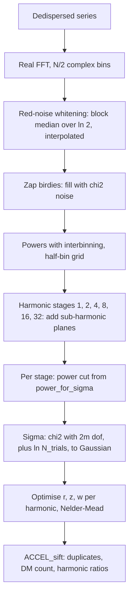

**In code:** PRESTO `realfft` (N/2 complex64 values with Nyquist packed into the imaginary part of bin 0, forward sign −1), `accelsearch` (`add_search_ffdotpows`, `candidate_sigma`) and `ACCEL_sift.py`. ACCEL_sift's harmonic removal checks integer ratios 1–16 plus 3/2, 5/2, 2/3, 4/3, 5/3, 3/4, 5/4, 2/5, 3/5 and 4/5. peasoup uses `HarmonicFolder.fold`, `PeakFinder` and `HarmonicDistiller`. AstroAccelerate uses `aa_device_periods.cu` and `aa_device_harmonic_summing*.cu`. sigpyproc uses `PowerSpectrum.harmonic_fold`.

## Acceleration and jerk become bins of drift: z = aT²h/(cP)

### Fourier-domain correlation

For a pulsar with line-of-sight acceleration $a$ and jerk $\dot a$, observed for $T$ seconds, harmonic $h$ drifts by **[V: Andersen & Ransom 2018, Eqs. 1–2]**:

```math
z=\dot f\,T^2=\frac{a\,h\,f\,T^2}{c}=\frac{a\,h\,T^2}{c\,P},\qquad w=\ddot f\,T^3=\frac{\dot a\,h\,f\,T^3}{c}
```

with $r=fT$. The signal model is $n(u)=a_0\cos[2\pi(r_0u+\frac{z_0}{2}u^2+\frac{w}{6}u^3)+\phi]$ with $u=t/T$. Constant acceleration is valid for $T\lesssim P_{\rm orb}/10$. Jerk helps when $T\approx5$–15% of $P_{\rm orb}$. The search correlates local Fourier amplitudes with "a frequency-reversed and complex-conjugated template", i.e. the numerically computed Fourier response of the model, over a short span $\Delta r$ ([REM02](https://arxiv.org/abs/astro-ph/0204349); [Andersen & Ransom 2018](https://arxiv.org/abs/1807.07900)). Written as a correlation **[D, from REM02's description]**:

```math
A(r_0,z_0,w_0)=\sum_k A_k\,R^{\ast}_{z_0,w_0}(r_0-k)
```

Here $R_{z,w}(\delta r)$ is the complex response of a unit sinusoid with drift $z$ and jerk $w$, at offset $\delta r$ from its mean frequency.

PRESTO builds the responses from Fresnel integrals (`fresnl`). The kernel half-width is `int(0.5·1.1·|z|) + NUMFINTBINS` with `NUMFINTBINS = 16` (or `3·NUMFINTBINS` at high accuracy). Jerk widths use the parabola extremes $r_{0,1}=\frac12(w/6\mp z)$. The grid is $\Delta r=0.5$, $\Delta z=2$ and $\Delta w=20$. Correlations run by overlap-save on 8K FFTs with 7470 good points (to zmax 300), now chosen from measured good lengths. Independent candidates must lie more than 15 bins apart ([responses.c](https://github.com/scottransom/presto/blob/master/src/responses.c); [accel.h](https://github.com/scottransom/presto/blob/master/include/accel.h)). Reported $f$ and $\dot f$ are mid-observation averages, while prepfold's reference epoch is the start. This is a convention trap when passing candidates between programs.

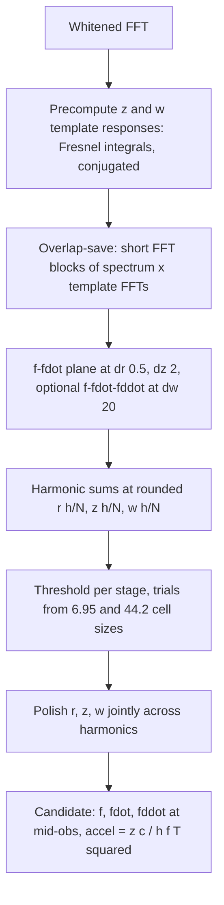

**In code:** PRESTO `accelsearch` (defaults `-zmax 200`, `-numharm 8`, `-sigma 2`, `-wmax` off; files `responses.c`, `corr_routines.c`, `maximize_rz.c`, `maximize_rzw.c`). AstroAccelerate FDAS (`aa_fdas_device.cu`, `aa_device_acceleration_fdas.cu`, `aa_device_jerk_search.cu`) does the same correlation with overlap-save cuFFT ([Dimoudi et al. 2018](https://github.com/AstroAccelerateOrg/astro-accelerate/blob/master/README.md)). The GPU forks (PrestoZL, presto_on_gpu) are listed in [02-presto.md](02-presto.md).

## Time-domain resampling undoes the Doppler parabola before the FFT

The equivalent time-domain approach stretches the series so that a constant-acceleration signal becomes strictly periodic, then runs an ordinary FFT and harmonic sum per trial acceleration. The textbook form, not line-verified here, maps $\tau(t)=t+\frac{a}{2c}t^2$ (sign set by the acceleration convention) **[S]**. peasoup centres the parabola on the midpoint, which avoids a net frequency shift **[C: kernels.cu]**:

```math
x'_i=x\!\left[\operatorname{round}\!\left(i+\alpha\,i\,(i-N)\right)\right],\qquad \alpha=\frac{a\,t_{\rm samp}}{2c}
```

This corresponds to $t'\approx t+a\,t(t-T)/(2c)$ in seconds **[D]**. The acceleration step is chosen so that the residual smear stays within tolerance **[C: utils.hpp]**:

```math
\delta a=\frac{2\,t_b\cdot24\,c}{T^2}\sqrt{\epsilon^2-1},\qquad t_b=\sqrt{t_{\rm dm}^2+W^2+t_{\rm samp}^2}
```

Here $\epsilon\approx1.1$ is the tolerance (≈10% smearing), $W$ is the `pulse_width` parameter, and $t_{\rm dm}$ is the per-channel smear at $|{\rm DM}-{\rm cDM}|$. Zero is included whenever the range spans it. Resampling costs one FFT per acceleration trial, whereas the Fourier method costs one correlation per $z$. That is why GPUs, where FFTs are cheap, favour resampling.

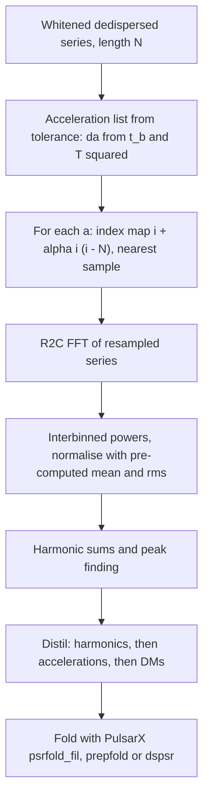

**In code:** peasoup `TimeDomainResampler.resampleII` / `getAcceleratedIndexII` in `kernels.cu` and `AccelerationPlan` in `utils.hpp`. Template-bank Keplerian resampling (circular orbits, or BT/ELL8 elliptical) generalises the same idea to full orbits ([peasoup README](https://github.com/ewanbarr/peasoup)). sigpyproc has `TimeSeries.resample(accel)`.

## The FFA folds every period exactly at O(N log N) per octave

### Why folding is the optimal test

For a known pulse template, the most powerful test is to fold and correlate with the template, $Z=x\cdot s$ (Karlin–Rubin). A mismatched template $s'$ has efficiency $E=s\cdot s'$ and raises the detectable amplitude to $U'_z=U_z/E$ **[V: Morello et al. 2020, Eqs. 22–24]**. With boxcar widths spaced by ×2, $E_{\rm FFA}\approx0.930$ and $U_{\rm FFA}\approx1.075\,\Phi^{-1}(\alpha)$ **[V: Eq. 26]**. The FFA is the machinery that makes folding at every trial period affordable.

### The folding transform

Reshape a series into $m$ rows of $p$ bins. Brute-force folding at the $m$ trial periods between $p$ and $p+1$ samples costs $O(pm^2)$. The FFA (Staelin 1969) costs $O(mp\log_2m)$. Per octave of period, the cost is $C=bN\log_2N$, and the full search is $O(bN\log_2N)$, where $b$ is the minimum number of bins **[V: Morello et al. 2020, Eqs. 39–40]**. "Integration paths with non-integer values of s are identical to that with the closest integer value", so this is the finest period resolution sampling allows. The recursion itself, in its standard form (riptide's `transforms.hpp` was not read line by line), merges the two halves of the row block **[S]**:

```math
F_{m}[s](\phi)=F^{\rm top}_{m/2}\!\left[\lfloor s/2\rfloor\right](\phi)+F^{\rm bot}_{m/2}\!\left[\lfloor s/2\rfloor\right]\!\left(\phi+\lceil s/2\rceil\right)
```

Here $s=0\ldots m-1$ is the total drift in bins across the $m$ rows, $\phi$ is the phase bin (taken modulo $p$), and the shift is a circular roll.

### riptide's ranging and exact S/N

The FFA only folds at integer bins per period. riptide therefore downsamples first by $d_0$ such that $d_0\,t_{\rm samp}\,b_{\min}=P_{\min}$. At each downsampling factor it runs the FFA for every integer $b\in[b_{\min},b_{\max}]$ (default 240–260). The factor then grows geometrically until $P_{\max}$ is reached, and `ceilshift(rows, cols, pmax) = ceil(cols·(rows−1)·(1−cols/pmax))` limits which rows are evaluated ([periodogram.hpp](https://github.com/v-morello/riptide/blob/master/src/riptide/cpp/periodogram.hpp)). Each folded profile is scored with a zero-mean, unit-norm boxcar of height $h=\sqrt{(n-w)/(nw)}$ and baseline $-b$, where $b=\frac{w}{n-w}h$ **[C: snr.hpp]**:

```math
{\rm S/N}=\frac{(h+b)\,d_{\max}-b\sum_i x_i}{\sigma}
```

$d_{\max}$ is the maximum circular $w$-bin window sum. Substituting $h$ and $b$ gives exactly Ransom's Eq. 3, $(S_w-\delta S_{\rm tot})/(\sigma\sqrt{w(1-\delta)})$ with $\delta=w/n$ **[D]**: both codes use the same statistic. Trial widths step by `wtsp = 1.5` up to `ducy_max = 0.2`. The default period range is 1–30 s, with at least 8 periods in the data (`fpmin`).

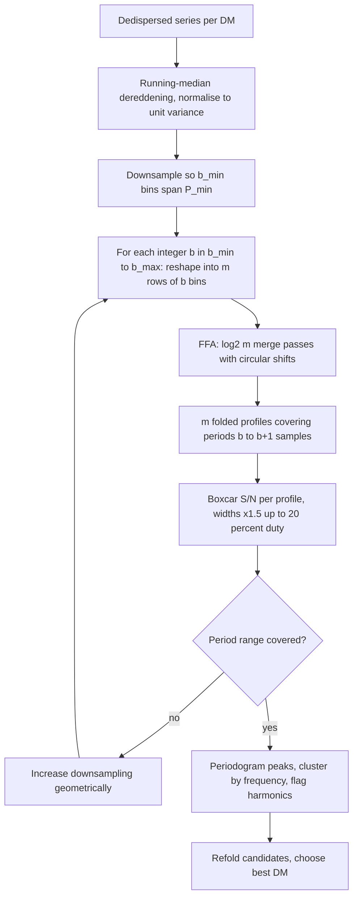

**In code:** riptide `ffa_search` (`search.py`), `cpp/transforms.hpp`, `periodogram.hpp`, `snr.hpp`, and the pipeline `rffa`/`rseek`. PRESTO has no FFA ([02-presto.md](02-presto.md)).

## Coherent harmonic summing rebuilds the profile from 60 complex harmonics

Incoherent harmonic summing discards the phases of the harmonics, and that throws away the pulse shape. Ransom's 2026 method keeps them. At each trial $r$ it interpolates the complex amplitudes of $H$ harmonics (typically 60) from a spectrum normalised to unit mean power. It stacks them as a half-complex spectrum with DC set to 0, inverse-real-FFTs that to an $n=2H$-bin profile (zero mean by construction), and applies a boxcar bank (×1.5 spacing, 1 bin to 30% duty) scored with **[V: Ransom 2026, Eq. 3]**:

```math
{\rm S/N}=\max_{w,p}\frac{S_w(p)-\delta\,S_{\rm tot}}{\sigma\sqrt{w(1-\delta)}},\qquad \delta=\frac wn,\quad S_w(p)=\sum_{i=0}^{w-1}P_{(p+i)\bmod n}
```

The profile bins are band-limited and therefore correlated, so the exact boxcar variance is **[V: Ransom 2026, Eq. 4]**:

```math
{\rm var}(S_w)=2\sum_{j\ {\rm filled},\ j<n/2}|D_j|^2+\tfrac12|D_{n/2}|^2,\qquad D_j=\frac{\sin(\pi jw/n)}{\sin(\pi j/n)}
```

This differs from $\sigma\sqrt{w(1-\delta)}$ by $\approx1+3/(4n)$. Decimation adds sensitivity at higher frequencies for free: taking every $k$-th harmonic gives the profile at $k\times$ the trial frequency with one short inverse FFT. In >860,000 injections at matched false-alarm rate, the method recovered 76% of pulsars, against 64% for riptide (recommended configuration) and 42% for accelsearch. Its threshold was unchanged in red noise. It ran 1.4–2.2× faster than riptide on one core and up to 27× faster on 48 cores ([Ransom 2026](https://arxiv.org/abs/2610.11749)). PRESTO's ROADMAP quotes riptide at "50–71%" across configurations, so the 64% figure depends on configuration. There is no acceleration search in this method yet.

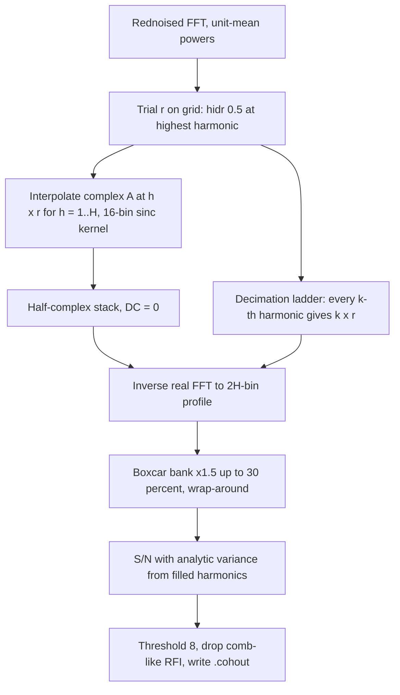

**In code:** PRESTO `coherentsearch` (v6.2+, a C port of CoherentSearch.jl; `cs_interp.c`, `cs_metric.c`, `cs_chunk.c`). It interpolates with weights $1/(\delta r-j)$ scaled by `conj(sin(π dr) e^{iπ dr})/π`, which is REM02 Eq. 30 in tabulated form. Defaults are `-nharms 60`, `-m 16`, `-hidr 0.5`, `-threshold 8`, `-maxdecim 6` and 0.1–125 Hz. `-measuredsigma` swaps the analytic σ for a MAD estimate. The analytic noise "assumes exactly" PRESTO's realfft → rednoise normalisation ([02-presto.md](02-presto.md)). Related profile-from-FFT tools are PRESTO `fourier_fold.py` and sigpyproc `FourierSeries.recon_prof`.

## Folding statistics: reduced χ² for radio bins, H-test for photons

### Phase model and folding

Folding assigns each sample the phase **[S]**:

```math
\phi(t)=\phi_0+f(t-t_0)+\tfrac12\dot f(t-t_0)^2+\tfrac16\ddot f(t-t_0)^3
```

The sample goes into bin $\lfloor n_b\,(\phi\bmod1)\rfloor$, and $t$ is barycentric if the series was barycentred. PRESTO's `fold()` treats each sample as finite-duration and spreads it across the bins it overlaps. It supports $f$, $\dot f$, $\ddot f$, binary delays and on/off pairs ([fold.c](https://github.com/scottransom/presto/blob/master/src/fold.c)). For one bin of phase drift, the required step sizes are $\delta f\lesssim1/(n_bT)$ and $\delta\dot f\lesssim2/(n_bT^2)$ **[D]**. prepfold sets its trial spacing from the phase drift $\Delta\phi=\Delta f\,T+\Delta\dot f\,T^2/2$, quantised in profile bins: ±2 wraps for P and Ṗ, and ±3 rotations across the band for DM.

### Reduced χ² against a flat profile

prepfold's statistic is epoch-folding χ² (Leahy et al. 1983), valid only when the off-pulse reduced χ² is about 1 **[C: fold.c]**:

```math
\chi^2_{\rm red}=\frac{1}{n_b-1}\sum_{j=1}^{n_b}\frac{(p_j-\bar p)^2}{\sigma_p^2},\qquad \sigma_p^2=\sigma^2_{\rm data}\,N_{\rm data}\,\Delta_{\rm bin}
```

Here $p_j$ is the profile, $\Delta_{\rm bin}$ the profile bin width as a fraction of a period, and $N_{\rm data}$ the number of samples. Under the null hypothesis and white noise, $(n_b-1)\chi^2_{\rm red}\sim\chi^2_{n_b-1}$. Because samples are spread over bins, adjacent bins correlate. prepfold therefore replaces $n_b-1$ with an effective dof from a Monte Carlo fit (after Demorest and Brisken) **[C: fold.c]**:

```math
{\rm dof_{eff}}=(n_b-1)\cdot{\rm DOF_{corr}}(x),\qquad {\rm DOF_{corr}}(x)=0.96\,x\,(1+x^{1.806})^{-1/1.806},\qquad x=\frac{P}{n_b\,t_{\rm samp}}
```

The significance is `chi2_logp(redchi·dofeff, dofeff)`, converted to an equivalent sigma and printed as "Prob(Noise) < … (~X sigma)". It is single-trial. The P/Ṗ/DM search never refolds. It shifts the `npart × nsub` sub-profiles by the phase delays implied by each trial and re-sums them, maximising $\chi^2_{\rm red}$. The standard form of those delays, for sub-integration $i$ at time $t_i$ and subband $j$ at frequency $\nu_j$, is **[S]**:

```math
\Delta\phi_{ij}=\delta f\,t_i+\tfrac12\delta\dot f\,t_i^2+f\,k_{\rm DM}\,\delta{\rm DM}\,(\nu_j^{-2}-\nu_{\rm ref}^{-2})
```

`-fixchi` rescales so that the off-pulse $\chi^2_{\rm red}=1$ ([prepfold_pipeline.c](https://github.com/scottransom/presto/blob/master/src/prepfold_pipeline.c)).

### Z²ₘ and the H-test

For $N$ event phases $\theta_i$ (radians), with no binning, the H-test statistics are **[V: de Jager & Büsching 2010, Eqs. 4–5]**:

```math
Z_m^2=\frac{2}{N}\sum_{k=1}^{m}\left[\Big(\sum_i\cos k\theta_i\Big)^2+\Big(\sum_i\sin k\theta_i\Big)^2\right],\qquad H=\max_{1\le m\le20}\left(Z_m^2-4m+4\right),\qquad {\rm Prob}(\gt H)=e^{-0.4H}
```

The tail $e^{-0.4H}$ ($\lambda=0.398$) is valid to large $H$, replacing the old de Jager et al. 1989 tables, which had a hard tail above $H=23$. As a rule of thumb $H\approx1.9X^2$, where $X$ is the Gaussian significance ([de Jager & Büsching 2010](https://arxiv.org/abs/1005.4867)). It is the natural statistic for event data (`prepfold -events`), but none of the radio codes surveyed here was found to compute it.

The other profile statistic in use is the boxcar S/N of Ransom Eq. 3 / riptide `snr1`, discussed above. PulsarX adds a Tikhonov-regularised least-squares folding (TLSM) to sharpen profile time resolution ([Men et al. 2023](https://arxiv.org/abs/2309.02544)). Its equations were not available.

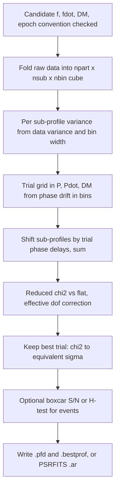

**In code:** PRESTO `prepfold`/`prepfold_multi` (`fold.c`, `prepfold_pipeline.c`, `prepfold_utils.c`). Defaults are `-npart 64`, `-pstep 2`, `-pdstep 4`, `-dmstep 2`, `-npfact 2` and `-ndmfact 3`. PulsarX `psrfold_fil` (DM/F0/F1/F2 optimiser, CLFD cleaning) is the folder recommended for peasoup. dspsr `Fold` caps nbin at 1024 with a minimum bin width of 1.2 samples. sigpyproc has `Filterbank.fold(period, dm, accel, nbins, nints, nbands)`.

## TOAs come from a Fourier phase gradient, then 500 s of Roemer delay

### Template matching

Taylor's (1992) Fourier-domain method fits a scale $b$ and shift $\tau$ between the profile and a template. With $P_k=|P_k|e^{i\phi_k}$ and $S_k=|S_k|e^{i\theta_k}$ the DFTs of the profile and template, $n_b$ profile bins and per-harmonic noise $\sigma$ **[S, Taylor 1992, Phil. Trans. R. Soc. A 341, 117, not retrieved]**:

```math
\chi^2(b,\tau)=\sum_{k=1}^{n_h}\frac{|P_k-b\,S_k\,e^{-i2\pi k\tau/n_b}|^2}{\sigma^2},\qquad \hat b=\frac{\sum_k|P_k||S_k|\cos(\phi_k-\theta_k+2\pi k\tau/n_b)}{\sum_k|S_k|^2}
```

```math
\sigma_\tau^2=\frac{\sigma^2}{2\hat b\sum_k k^2|P_k||S_k|\cos(\phi_k-\theta_k+2\pi k\tau/n_b)}\left(\frac{n_b}{2\pi}\right)^2
```

Minimising over $\tau$ is equivalent to maximising $\sum|P_k||S_k|\cos(\cdot)$. This gives sub-bin precision without interpolating. The radiometer scaling of TOA precision, quoted in the Lorimer & Kramer form, is $\sigma_{\rm TOA}\approx W/({\rm S/N})\propto\frac{S_{\rm sys}}{\sqrt{t_{\rm obs}\Delta\nu}}\frac{P\,\delta^{3/2}}{S_{\rm mean}}$, where $\delta=W/P$ **[S]**.

**In code:** PSRCHIVE `pat` defaults to PGS (Fourier phase gradient). `ScalarTemplateMatching.h` states that it "implements the Taylor (1992) algorithm, using the Van Wijngaarden–Dekker–Brent method". The alternatives are GIS, PIS, ZPS, SIS, FDM (MCMC), COF and RVM, plus matrix template matching (`-p`) across Stokes ([pat.C](https://sourceforge.net/p/psrchive/code/ci/master/tree/More/Applications/pat.C); [ScalarTemplateMatching.h](https://sourceforge.net/p/psrchive/code/ci/master/tree/More/General/Pulsar/ScalarTemplateMatching.h)). PRESTO `get_TOAs.py` uses a pure-Python FFTFIT (`-A classic|aarchiba`) against a Gaussian, `.bestprof` or multi-Gaussian template. A comparison of PGS, FDM and the other methods is in [Wang et al. 2022](https://arxiv.org/abs/2111.13482).

### Predictors: polycos and 2-D Chebyshev

Folding with a timing model uses a predictor rather than evaluating the full model per sample. A TEMPO polyco gives phase and frequency from $\Delta T=1440\,(t-{\rm TMID})$ in minutes **[V: TEMPO polyco spec]**:

```math
\phi(t)={\rm RPHASE}+60\,\Delta T\,F_0+\sum_{n=1}^{N_c}C_n\,\Delta T^{\,n-1},\qquad f(t)=F_0+\frac{1}{60}\sum_{n=2}^{N_c}(n-1)\,C_n\,\Delta T^{\,n-2}
```

($F_0$ in Hz; [TEMPO polyco spec](https://tempo.sourceforge.net/ref_man_sections/tz-polyco.txt); PINT `evalabsphase` implements the same.) A TEMPO2 predictor is a piecewise 2-D Chebyshev series in time and frequency, with $x=-1+2({\rm mjd}-{\rm mjd_s})/({\rm mjd_e}-{\rm mjd_s})$ and $y=-1+2(\nu-\nu_s)/(\nu_e-\nu_s)$ **[C: cheby2d.c]**:

```math
\phi({\rm mjd},\nu)=\sum_{i,j}c_{ij}\,T_i(x)\,T_j(y)+\frac{D_{\rm const}}{\nu^2}
```

It is evaluated by 2-D Clenshaw recurrence with a ½·c₀ term. $D_{\rm const}$ is the file's `DISPERSION_CONSTANT`. Frequency comes from the derivative series, scaled by $2/[({\rm mjd_e}-{\rm mjd_s})\,86400]$ ([cheby2d.c](https://bitbucket.org/psrsoft/tempo2/src/master/cheby2d.c)).

**In code:** dspsr `Fold::get_folding_predictor` (`-E` par → polyco or t2pred, valid for −864 s to +24 h; `-P` loads a predictor). TEMPO2 `-polyco` / `-pred`. PRESTO `prepfold -timing`, with automatic polycos for folds longer than 2 h since v6.3.0. The cubic `bary2topo()` fit it replaces drifts by 0.002 turns at 2 h, 0.1 at 8 h and 3 turns at 20 h for a 2 ms pulsar ([02-presto.md](02-presto.md)).

### Barycentering

TEMPO2 writes the topocentric-to-barycentric correction as **[V: Edwards, Hobbs & Manchester 2006, Eq. 8]**:

```math
\Delta_\odot=\Delta_A+\Delta_{R\odot}+\Delta_p+\Delta_{D\odot}+\Delta_{E\odot}+\Delta_{S\odot}
```

The terms are atmospheric, Roemer, parallax, dispersion, Einstein and Shapiro delays. The Roemer term is $\Delta_{R\odot}=-\mathbf r\cdot\hat{\mathbf R}_{BB}/c$, with $\hat R_0=(\cos\alpha\cos\delta,\sin\alpha\cos\delta,\sin\delta)$ plus proper-motion terms **[V: Eq. 13]**. The Einstein term integrates time dilation, $\Delta_{E\odot\oplus}=c^{-2}\int(U_\oplus+v_\oplus^2/2+\ldots)\,dt$ **[V: Eq. 9]**. The Shapiro term is $\Delta_{S\odot}=-\sum_j\frac{2Gm_j}{c^3}\ln[|\mathbf r_j|(1-\cos\psi_j)]$, summed over the Sun, Venus, Jupiter, Saturn, Uranus and Neptune **[V: Eqs. 32–33]** ([Edwards et al. 2006](https://arxiv.org/abs/astro-ph/0607664)). For scale, the Roemer delay reaches ~500 s (1 AU/c), and $2GM_\odot/c^3\approx9.85$ µs sets the solar Shapiro scale **[D]**. A full timing model then evaluates $\phi(t)=\phi_0+F_0\Delta t+\frac12F_1\Delta t^2+\ldots$ at barycentric time, minus binary delays. Dispersion is referenced to infinite frequency with the same $k_{\rm DM}$ convention as the search **[S]**.

A search code does not need the full model. It needs a uniform barycentric time grid and Doppler-corrected frequencies. PRESTO `prepdata`/`prepsubband` compute topocentric TOAs every 20 s and convert them with `barycenter()`. Since v6.0 this uses ERFA, agreeing with TEMPO to ~10 µs absolute and ~1 µs differential, and the ephemeris argument is ignored. The bary−topo difference in output bins becomes a `diffbins` list where single samples are inserted or dropped, so the output is barycentric but not resampled. The mean $v/c$ Doppler-corrects channel frequencies ([prepdata.c](https://github.com/scottransom/presto/blob/master/src/prepdata.c)). Birdies are topocentric, which is why PRESTO finds them on a topocentric DM 0 series and zaps barycentred spectra with `-baryv`.

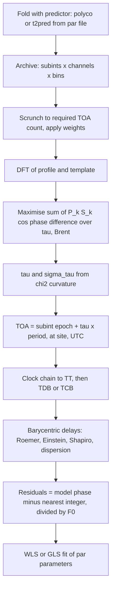

**In code:** PSRCHIVE `pat` (output formats parkes, tempo2, itoa, princeton). TEMPO2 `formBats.C`, `shapiro_delay.C`, `dm_delays.C`, `tt2tdb.C`, `doFit.C`. PINT `get_TOAs(..., ephem, planets, include_bipm)` with WLS/GLS/Downhill/LM fitters. PRESTO `prepdata` (`barycenter()` via ERFA) and `get_TOAs.py` ([03-dspsr-psrchive-timing.md](03-dspsr-psrchive-timing.md)).

## Where the codes agree and where they will silently disagree

| Step | Shared mathematics | Convention that differs between codes |
|---|---|---|
| Dispersion | $k_{\rm DM}{\rm DM}\,\nu^{-2}$ | $k_{\rm DM}$ 4148.806 vs 4149.378 vs 4150; reference frequency (top channel in PRESTO, $f_{\min}$ in dmt, infinite frequency in timing) |
| DM plan | CM03 Eq. 11 | half-step vs full-step error; whether $t_{\rm samp}$ enters once or $\sqrt2$ times (DDplan) |
| Dedispersion | sums along $\nu^{-2}$ curves | ascending vs descending frequency input; rounding of delays |
| RFI | robust location and scale, fence at $t\sigma$ | MAD (1.4826) vs IQR (1.349) vs trimmed std (×1.148); symmetric vs Pearson SK bounds |
| Single pulse | $\sum(x-\mu)/(\sigma\sqrt w)$ | width ladder; centred vs leading boxcar; analytic vs measured σ per width |
| FFT search | $\chi^2_{2m}$ tails | trials-corrected vs single-trial sigma; f/ḟ at midpoint (accelsearch) vs start (prepfold) |
| Folding | $\chi^2_{\rm red}$ or boxcar S/N | effective dof correction; nbin choice |
| TOAs | Taylor 1992 phase gradient | template, harmonics used, output TOA format |

## Conclusion

Seen as mathematics, the whole search chain is a sequence of approximations to one ideal: correlate the dedispersed, barycentred data with the true pulse template at the true spin and orbital parameters. Each code chooses where to approximate. The tree assumes linear sweeps. Subbanding assumes that a coarse DM error is tolerable within a subband. Interbinning trades 7% of amplitude for avoiding a full sinc interpolation. Incoherent harmonic summing throws away the harmonic phases. Boxcars stand in for Gaussian or scattered profiles. The 2026 results sharpen the ranking. Exact FDMT (dmt, PulsarX) makes dedispersion approximation optional at no asymptotic penalty. Coherent harmonic summing recovers the harmonic phases that incoherent summing discards, and so beats both the FFA and accelsearch on isolated pulsars. Acceleration and jerk remain the only places where the approximations are still forced by cost. The uncertain points are as follows. The 6.95 and 44.2 trial constants are unexplained. Taylor (1992) and the FFA recursion are quoted here in standard form only. The heimdall/dedisp DM-list formula and the PulsarX pFDMT/TLSM equations remain untranscribed.

For building a pipeline, the lesson is that interoperability failures come from conventions, not formulas. A candidate passed from accelsearch (midpoint epoch, $k_{\rm DM}=4149.378$, trials-corrected sigma) to a folder that assumes start epoch or CODATA dispersion will be folded slightly wrong, with nothing to warn the user. Any shared intermediate format should therefore record the dispersion constant, the reference frequency, the f/ḟ epoch, the noise estimator and the significance definition as explicit fields. [06-our-plan.md](06-our-plan.md) takes this up.

## Sources

Primary papers: [Kulkarni 2020, arXiv:2007.02886](https://ar5iv.arxiv.org/html/2007.02886); [Cordes & McLaughlin 2003, arXiv:astro-ph/0304364](https://arxiv.org/abs/astro-ph/0304364); [Zackay & Ofek 2017, arXiv:1411.5373](https://arxiv.org/abs/1411.5373); [van Straten & Bailes 2011, arXiv:1008.3973](https://arxiv.org/abs/1008.3973); [Nita & Gary 2010, arXiv:1005.4371](https://arxiv.org/html/1005.4371v1); [Morello, Rajwade & Stappers 2022, arXiv:2108.12434](https://ar5iv.labs.arxiv.org/html/2108.12434); [Eatough, Keane & Lyne 2009, arXiv:0901.3993](https://ar5iv.labs.arxiv.org/html/0901.3993); [Ransom, Eikenberry & Middleditch 2002, arXiv:astro-ph/0204349](https://arxiv.org/abs/astro-ph/0204349); [Andersen & Ransom 2018, arXiv:1807.07900](https://arxiv.org/abs/1807.07900); [Morello et al. 2020, arXiv:2004.03701](https://arxiv.org/abs/2004.03701); [Ransom 2026, arXiv:2610.11749](https://arxiv.org/abs/2610.11749); [de Jager & Büsching 2010, arXiv:1005.4867](https://arxiv.org/abs/1005.4867); [Edwards, Hobbs & Manchester 2006, arXiv:astro-ph/0607664](https://arxiv.org/abs/astro-ph/0607664); [Barsdell et al. 2012, arXiv:1201.5380](https://arxiv.org/abs/1201.5380); [Men et al. 2023, arXiv:2309.02544](https://arxiv.org/abs/2309.02544); [Men & Barr 2024, arXiv:2401.13834](https://arxiv.org/abs/2401.13834); [Wang et al. 2022, arXiv:2111.13482](https://arxiv.org/abs/2111.13482).

Code: [PRESTO](https://github.com/scottransom/presto); [dspsr](https://sourceforge.net/p/dspsr/code/ci/master/tree/); [PSRCHIVE](https://sourceforge.net/p/psrchive/code/ci/master/tree/); [TEMPO2](https://bitbucket.org/psrsoft/tempo2/src/master/); [PINT](https://github.com/nanograv/PINT); [TEMPO polyco spec](https://tempo.sourceforge.net/ref_man_sections/tz-polyco.txt); [heimdall](https://sourceforge.net/p/heimdall-astro/code/ci/master/tree/); [AstroAccelerate](https://github.com/AstroAccelerateOrg/astro-accelerate); [dmt](https://github.com/pravirkr/dmt); [TransientX](https://github.com/ypmen/TransientX); [PulsarX](https://github.com/ypmen/PulsarX); [riptide](https://github.com/v-morello/riptide); [peasoup](https://github.com/ewanbarr/peasoup); [sigpyproc](https://github.com/FRBs/sigpyproc3); [your](https://github.com/thepetabyteproject/your). Underlying research notes: [algorithms_math.md](../research_notes/Pulsar%20tools%20formats%20and%20math%20reference/algorithms_math.md), [presto.md](../research_notes/Pulsar%20tools%20formats%20and%20math%20reference/presto.md), [dspsr_psrchive_timing.md](../research_notes/Pulsar%20tools%20formats%20and%20math%20reference/dspsr_psrchive_timing.md), [other_search_codes.md](../research_notes/Pulsar%20tools%20formats%20and%20math%20reference/other_search_codes.md).
