# Reuse fourteen codebases on one physical-unit core

The plan for `filterbank/` is fourteen independent modules (definitions, io, rfi, dedisp, singlepulse, periodicity-fft, ffa, chs, fold, sift, classify, timing, realtime, adapters) that share exactly one thing: a definitions layer whose types are written in **physical units**. Each channel has a frequency in MHz, start times are an integer MJD plus seconds, and every mask, DM plan and candidate records the frequency axis and epoch it refers to. A product of one module can then be checked and converted before another module uses it, instead of being trusted as a bare array index. The code is personal and educational and will never be public, so licensing is not a design constraint, and **reusing the best existing code directly is the default**. We vendor and compile working C, C++ and CUDA as-is wherever it fits: `dmt` FDMT, riptide's FFA core, PRESTO v6.3.3 accelsearch and coherentsearch, PrestoZL's GPU jerk search, PulsarX's folder, TransientX's clustering and RFI filters, AstroAccelerate's brute-force and single-pulse kernels, and heimdall's GPU matched filter. Rust is used where it buys CPU speed or safety (readers, unpacking, glue kernels), not as a rule. No credit or origin comments go into the code. Instead, one file, `docs/CREDITS.md`, records what was taken from where, and one **math map per source library** under `docs/math-maps/` records the equations each library uses and where they live in its code. The `filterbank/` directory holds only code and build files; every explanation lives under `docs/`. Every stage runs on the CPU, on macOS, plus a CUDA backend on the Linux GPU host wherever it pays. Python orchestrates through one `fb` command and one Python API, with a deliberately small dependency list. Files are read and written only at the edges, by readers and writers that work in both directions for every legacy format. That is what lets PRESTO, heimdall, TransientX, PSRCHIVE and PINT serve as cross-check oracles at every stage. Phase 0 is done. Phase 1 builds the definitions layer, the Rust I/O and the credits scaffolding, and fixes the existing converter. Its most serious bug is that it copies packed 1/2/4-bit PSRFITS bytes into a `.fil` without reversing the bit order, which scrambles channels within every byte.

This file is part of the reference set. The format details behind the I/O decisions are in [01-data-formats.md](01-data-formats.md), the PRESTO internals in [02-presto.md](02-presto.md), DSPSR, PSRCHIVE and timing in [03-dspsr-psrchive-timing.md](03-dspsr-psrchive-timing.md), the other search codes in [04-other-search-codes.md](04-other-search-codes.md), and the equations in [05-algorithms-math.md](05-algorithms-math.md). [00-overview.md](00-overview.md) is the entry point.

## Reuse the best code directly; credit it in one file, map its math per library

The earlier plan built a permissive core and reached the GPL codes only through subprocesses. That constraint is gone: the code is personal and educational and never public, so licences do not shape the design. What replaces the licence question is a simpler engineering rule with three reuse modes, in order of preference. **Vendor as-is** means copying the upstream C, C++ or CUDA source files unchanged into `filterbank/vendor/<library>/`, compiling them with our build, and calling them through a thin C ABI. This is the default whenever the upstream code already does the job well and does not drag in heavy dependencies. `dmt` (C++20 with CPU SIMD including NEON, plus CUDA, [dmt README](https://github.com/pravirkr/dmt)) and riptide's C++ core ([riptide](https://github.com/v-morello/riptide)) are the clearest cases. **Adapt** means vendoring, then editing to remove a dependency or to read our types: for example, replacing GSL calls in PRESTO's accelsearch, or stripping Boost, PlotX and XLibs from the TransientX and PulsarX files we need ([TransientX](https://github.com/ypmen/TransientX)). **Rewrite** in Rust is reserved for places where Rust buys real CPU speed or correctness, or where the original is Python (sigpyproc3's numba readers, `your`'s cut-outs), or where upstream code is too entangled to lift.

No credit, origin or licence comments are added to our code. Vendored files are copied byte-for-byte, so whatever text upstream put in them stays; we neither add nor strip anything. Upstream README, LICENSE and documentation files are not copied into `filterbank/`; what they say is summarised under `docs/`. Two kinds of document carry the record instead.

**`docs/CREDITS.md`** is the single list of what was taken from where. It has one row per reused unit, with these columns: our path in `filterbank/`; upstream project; upstream file(s) and function(s); upstream commit and date; reuse mode (vendored, adapted, rewritten, algorithm only); the upstream licence, for the record only; and the paper to cite. A small check script in `filterbank/` (a build file, not documentation) fails CI if a directory under `filterbank/vendor/` has no CREDITS row, or if a row points at a path that no longer exists.

**`docs/math-maps/<library>.md`** is one file per source library describing the math it implements and where. Each entry gives the quantity (for example "dispersion delay", "boxcar S/N", "harmonic-sum sigma") and the equation in LaTeX, with units and assumptions. It then gives the upstream file and function that computes it, the `filterbank/` path that now computes it, the paper and equation number, and the test that checks our version against the original. The math is already gathered in [05-algorithms-math.md](05-algorithms-math.md) by topic; the math maps re-cut it by library, so that someone reading vendored code can find the equation, and someone reading an equation can find the code. The planned set follows.

| Math map | Main entries |
|---|---|
| `presto.md` | `delay_from_dm`, subband delays, DDplan smearing budget, rfifind statistics and thresholds, real FFT packing, `dered_engine`, interbinning, Fresnel responses, harmonic-sum coordinates, `candidate_sigma` and trials, fold `redchi` and `DOF_corr`, coherentsearch interpolation and analytic sigma, single-pulse sigma, sifting ratios, barycentring via ERFA |
| `prestozl.md` | GPU f-fdot-fddot correlation layout and harmonic-sum kernels, mapped to the PRESTO equations they reproduce |
| `dmt.md` | FDMT recursion (Zackay & Ofek Eqs. 16–22), DDMT and SDMT, box smearing, exact per-trial noise, DM grids, Kadane plan |
| `astroaccelerate.md` | Brute-force dedispersion kernel, SPDT decimated boxcar bank with width-dependent MSD, outlier-rejected MSD, FDAS and jerk templates |
| `heimdall.md` | Median-of-5 baseline, RMS, prefix-sum matched filter, giant finding, friends-of-friends coincidence, zero-DM RFI with random replacement |
| `transientx.md` | Geometric boxcar widths from `snrloss`, DBSCAN on (time, DM delay), zdot, kadaneF/T, skewness–kurtosis IQR filter, ddplan |
| `pulsarx.md` | pFDMT, Tikhonov-regularised least-squares folding, DM/F0/F1 optimiser |
| `riptide.md` | FFA transform, ranging and downsampling ladder, boxcar S/N `h = sqrt((n−w)/(n·w))`, running-median deredden, dynamic peak threshold |
| `peasoup.md` | Time-domain acceleration resampling, acceleration step, running-median deredden, interbinned spectrum, harmonic folding, distillers, template banks |
| `sigpyproc3.md` | Sub-byte unpacking and bit order, ZERO_OFF rules, IQRM, MAD masks |
| `sigproc.md` | Header keyword encoding, RA/Dec packing, LSB-first packing |
| `psrdada.md` | Header keys, ring-buffer geometry, `OBS_OFFSET` byte arithmetic |
| `dspsr.md` | Coherent dedispersion chirp and overlap-save sizing, optimal FFT length, Stokes detection, spectral kurtosis, fold bin choice |
| `psrchive.md` | PGS (Taylor 1992) template fit and uncertainty, other `pat` estimators by reference |
| `your.md` | Candidate cut-out geometry, DM–time butterfly, decimation, Savitzky–Golay and SK masks |
| `fetch.md` | Input normalisation and two-branch model structure |
| `tempo2.md` | Chebyshev predictor evaluation (`cheby2d.c`), polyco output, delay chain |
| `pint.md` | Polyco evaluation, timing-model delay chain, WLS and GLS fitting |
| `clfd.md` | Profile features and Tukey fences for folded-data cleaning |

The table below is the master choice of source per function, with its reuse mode. Each module section explains the reasoning.

| Function | Source (primary) | Reuse mode | Second source / oracle |
|---|---|---|---|
| fil / PSRFITS read | sigpyproc3 `io/pfits.py`, `io/bits.py`; PRESTO `psrfits.c` gap logic | Rewrite in Rust (the originals are Python and a C reader tied to PRESTO structs) | PRESTO `readfile`, `your` |
| DADA, GUPPI, VDIF | psrdada `header.tex` keys and `ipcbuf` C; DSPSR `Kernel/Formats` | Vendor psrdada client C; DSPSR through `digifil` | DSPSR `digifil` |
| RFI, block statistics | PRESTO `rfifind.c`, `rfifind_plot.c`, `mask.c`, `minifft.c` | Adapt (strip PGPLOT plotting) | rfifind itself |
| RFI, real time | IQRM (sigpyproc3 `core/rfi.py`), zero-DM, SK (DSPSR `SKFilterbank.C`), TransientX zdot/kadane/skew-kurtosis | Rewrite IQRM and SK in Rust; adapt TransientX filters | sigpyproc3, TransientX |
| DM planning | PRESTO `DDplan.py`; TransientX ddplan | Vendor DDplan logic into Python | DDplan.py output |
| Dedispersion | `dmt` FDMT and DDMT (CPU and CUDA); AstroAccelerate brute-force kernel; PRESTO subband | Vendor `dmt` whole; adapt the AstroAccelerate kernel; small Rust brute-force reference | `prepsubband`, `dmt` |
| Single-pulse detection | heimdall baseline, matched filter, giants, clustering; AstroAccelerate SPDT; TransientX boxcar and DBSCAN | Vendor heimdall CUDA kernels (Thrust is in the CUDA toolkit); adapt TransientX C++ for CPU | heimdall, TransientX, `single_pulse_search.py` |
| FFT, deredden, zap | RustFFT/realfft, cuFFT; PRESTO packing, `dered_engine`, zapbirds noise fill | Vendor PRESTO routines; RustFFT replaces FFTW so no system FFT library is needed | PRESTO `realfft`, `rednoise` |
| Accel / jerk search | PRESTO v6.3.3 accelsearch (CPU); PrestoZL `accelsearch_cu` (GPU); peasoup resampler and template bank | Adapt PRESTO C (FFTW calls to RustFFT through a shim, GSL to small built-ins); vendor PrestoZL and peasoup CUDA | accelsearch, PrestoZL, peasoup |
| FFA | riptide C++ core; gaffa (GPU) | Vendor riptide core as-is; adapt gaffa CUDA | riptide `ffa_search` |
| Coherent harmonic search | PRESTO `coherentsearch` (`cs_*.c`) | Adapt (same shims as accelsearch) | `coherentsearch` byte-identical output |
| Folding | PulsarX `psrfold_fil`; PRESTO `fold.c`, `prepfold_pipeline.c`; DSPSR `FoldCUDA.cu` | Adapt PulsarX C++ (strip XLibs/PlotX); vendor PRESTO fold math | prepfold, PulsarX |
| Sifting | PRESTO `sifting.py`, `coherent_sift.py`; peasoup distillers; riptide harmonic flags | Vendor the Python logic, retargeted at Arrow tables | ACCEL_sift.py |
| Classification | `your` `Candidate` cut-outs; FETCH model family; PICS-style folded model | Rewrite cut-outs in Rust; FETCH architectures retrained | FETCH predictions |
| Timing | PSRCHIVE `PhaseGradShift.C` (PGS); TEMPO2 `cheby2d.c`; PINT fitters | Adapt PGS and `cheby2d.c`; PINT as an optional import | `pat`, `tempo2`, PINT |

### Few dependencies, one command

"Must not lack any functionality" and "minimal installations" pull in opposite directions, and vendoring is how we satisfy both. The **required** set is a Rust toolchain, a C/C++ compiler, Python with NumPy and pyarrow, and, on Linux GPU hosts only, the CUDA toolkit (which already ships cuFFT and Thrust). Everything else that the upstream codes normally pull in is either vendored or replaced. cfitsio is compiled from vendored source by the build script rather than installed. FFTW is replaced by RustFFT, which is pure Rust with NEON and AVX paths ([RustFFT](https://github.com/ejmahler/RustFFT)). The few GSL routines PRESTO needs (χ² tail probabilities, Nelder–Mead, median) become small built-ins, checked against GSL in tests. Boost, PlotX, XLibs and SOFA are not needed for the TransientX and PulsarX files we lift. PGPLOT is never built: diagnostic plots come from matplotlib, the one optional plotting dependency. **Optional extras** are installed only when a feature is used: `onnxruntime` for classify, `pint-pulsar` for timing fits, `astropy` for barycentring outside the vendored ERFA. Oracle tools (PRESTO, heimdall, TransientX, PulsarX, DSPSR, PSRCHIVE, TEMPO2, FETCH) run in containers for testing and are never installed into the working environment.

Ease of use follows the same line. One `pixi install` (or `pip install -e filterbank`) builds everything for the host, with CUDA parts built only when `nvcc` is found. One `fb` command exposes every module. Each pipeline has a one-line default form, for example `fb pipeline sp obs.fil` or `fb pipeline periodic obs.fits`, which writes a YAML file of every parameter it chose, so a run can be reproduced or tuned by editing that file. The Python API mirrors the CLI one to one.

## Physical units, not array indices, hold the modules together

The earlier plan had a `FilterbankHeader` with `fch1`, `foff` and a float `tstart`. That shape cannot describe what PSRFITS actually carries, and the format notes show that most interoperability bugs live in exactly that gap. PSRFITS stores a per-channel `DAT_FREQ` per row, per-row `DAT_SCL`/`DAT_OFFS`/`DAT_WTS`, a `ZERO_OFF`, and a start split into `STT_IMJD`, `STT_SMJD` and `STT_OFFS` ([ATNF PSRFITS v6.1](https://www.atnf.csiro.au/research/pulsar/psrfits_definition/PsrfitsDocumentation.html)). SIGPROC has a single double `tstart`, and a `fchannel` table that tops out at 4096 channels and that heimdall and PRESTO ignore ([header.h](https://github.com/SixByNine/sigproc/blob/master/src/header.h), [SigprocFile.C](https://sourceforge.net/p/heimdall-astro/code/ci/master/tree/Formats/SigprocFile.C)). So the canonical header is the *superset*, and the legacy headers are lossy projections of it that writers produce on demand.

### The seven canonical types

All seven are defined once in `definitions/schemas/*.yaml`. Code generation produces Rust (serde structs), Python (msgspec dataclasses), C++ (POD headers for CUDA) and Arrow schema JSON from them, following Rerun's single-IDL pattern ([rerun ARCHITECTURE.md](https://raw.githubusercontent.com/rerun-io/rerun/main/ARCHITECTURE.md)). The methods that matter (validation, delay tables, conversions) live in the `fb-defs` Rust crate and are exposed to Python, so they are never reimplemented per language.

| Type | Key fields (units) | Why it is shaped this way |
|---|---|---|
| `ObsHeader` | `chan_freq_mhz: [f64; nchan]` (channel centres, file order); `chan_bw_mhz` (signed); `start: MjdTime{imjd: i32, sec: f64}` plus `time_scale` (UTC-topo or TDB-bary); `tsamp_s: f64`; `npol`, `pol_type` (`AA+BB`, `AABB`, `AABBCRCI`, `IQUV`), `pol_policy` (sum/mean/select); `data_state` (Raw{nbits, signed, zero_off} / Scaled / Normalised); optional per-row `scales`, `offsets`, `weights`; `source`, `ra/dec` (rad, J2000), `telescope` (TEMPO2 name), `beam`, `backend`, `az/za`; `obs_id` (UUID); `provenance: Vec<Step>` | Non-uniform channels work for free, because every downstream delay is computed from frequencies, not from `fch1+i*foff`. `imjd + sec` keeps sub-ns precision. A single f64 MJD near 60000 quantises at about 1.2 µs (my arithmetic: 6e4 x 2.2e-16 d x 86400 s/d). `data_state` records whether scales were applied, a choice the ATNF spec leaves open ("normally analysed directly without application of the scale factors") |
| `Block` | `header: Arc<ObsHeader>`; `data: [npol][nchan][nsamp]` f32 (or packed u8 with a lazy unpack view); `isamp0: u64` (absolute sample index since start); `nsamp`; `gaps: Vec<SampleRange>` with `fill` (zero/median/noise); `row_scales` slice | Absolute sample indices make gap detection and gulp overlap arithmetic exact. Channel-major (FT) is the layout dedispersion engines want: `dmt` takes `(nchans, nsamps)` ([dmt README](https://github.com/pravirkr/dmt)). io does the corner turn once |
| `RfiMask` | `obs_id`; rows of `{t_start, t_end: MjdTime, f_lo_mhz, f_hi_mhz, flags: u8, method: str}`; global `zap_chans_mhz`, `zap_times`; `params` (method thresholds); `provenance` | Valid across downsampling, subbanding, band flips and re-gridded files. `to_indices(&ObsHeader) -> BitMask2D` is computed only at apply time. `flags` reuses PRESTO's `.bytemask` bits (PADDING 0x01 … BAD_AVG 0x40) ([mask.h](https://github.com/scottransom/presto/blob/master/include/mask.h)) so a `.mask` round-trips |
| `DmPlan` | `segments: [{dm_lo, dm_hi, ddm, downsamp, nsub}]` (DDplan or TransientX style); `k_dm` (with named convention); `freq_axis_mhz` snapshot plus `freq_hash`; `tsamp_s`; `ref_freq_mhz`; host-computed `delay_table[dm][chan]` (integer samples plus fractional part); `max_delay_samples`; `smearing_budget` per segment | **GPU kernels never compute delays.** The host computes the table once and CPU and CUDA consume the same integers, so rounding is identical by construction. `max_delay_samples` is the gulp overlap the real-time ring buffer needs |
| `Series` | `data: [ndm][nsamp]` f32; `dm[]`; `header` (frequency range, `ref_freq_mhz`, `time_scale`, `downsamp`, `bary_corr` list if samples were added or dropped); `sigma[]` per trial (exact when the engine provides it); `provenance` | Encodes PRESTO's convention that the `.inf` epoch is the first sample at the centre of the highest channel ([FAQ.md](https://github.com/scottransom/presto/blob/master/FAQ.md)). `dmt` instead refers times to `f_min` ([dmt README](https://github.com/pravirkr/dmt)), so we record the reference and never assume it |
| `Candidates` | Arrow RecordBatch with schema metadata `{schema_version, kind: single_pulse/periodic/folded, ref_freq_mhz, ref_epoch, time_scale, obs_id, k_dm, provenance}`. Single-pulse columns: `t_imjd, t_sec, dm, snr, width_s, width_samp, boxcar_idx, dm_idx, members, t_begin, t_end, f_lo_mhz, f_hi_mhz, beam, detector`. Periodic: `f_hz, fdot, fddot, r, z, w, accel_ms2, sigma, power, coh_power, nharm, dm, method`. Folded: `p, pdot, dm, redchi, sigma, nbin, archive_uri` | Width means different things in different tools: heimdall's `filter_idx` is log2 samples, `your_candmaker` uses log2, PRESTO uses Downfact in samples, and sigpyproc uses `width_bins` ([pipeline.cu](https://sourceforge.net/p/heimdall-astro/code/ci/master/tree/Pipeline/pipeline.cu), [your_candmaker.py](https://github.com/thepetabyteproject/your/blob/main/bin/your_candmaker.py), [candidates.py](https://github.com/FRBs/sigpyproc3/blob/main/src/sigpyproc/core/candidates.py)). So we store seconds *and* samples and convert only in writers. No inspected tool uses Arrow, so we define the internal schema ourselves and export to the legacy formats |
| `FoldParams` | `f0, f1, f2` at `pepoch` (MjdTime, TDB) *or* `predictor` (polyco set / TEMPO2 Chebyshev set); `binary` (BT/ELL1 parameters); `dm`, `k_dm`; `nbin`, `nsub`, `nint`, `ref_freq_mhz` | accelsearch reports f and fdot at the observation midpoint, prepfold at the start ([FAQ.md](https://github.com/scottransom/presto/blob/master/FAQ.md)). An explicit `pepoch` removes that ambiguity |

The **dispersion constant** is a field, not a literal. PRESTO (`dm/(0.000241 f^2)`, [dispersion.c](https://github.com/scottransom/presto/blob/master/src/dispersion.c)), DSPSR ([Dedispersion.C](https://sourceforge.net/p/dspsr/code/ci/master/tree/Signal/General/Dedispersion.C)), `dmt` and TEMPO2/PINT all use **1/2.41e-4 = 4149.378 s MHz² pc⁻¹ cm³**. That is 0.0137% larger than the physical value 4148.806 ([Kulkarni 2020](https://ar5iv.arxiv.org/html/2007.02886)). We default to the convention for compatibility, record it in `DmPlan` and `Candidates`, and refuse to compare DMs across conventions without an explicit conversion. The bias is about 0.07 pc cm⁻³ at DM 500: harmless for search, visible in timing.

### Validation happens on every join

Modules are independent, so the checks happen where products meet. Every join is a `fb-defs` function that returns either a value or a typed error. The Python orchestrator calls these functions; it never re-derives the logic.

| Join | Check | On failure |
|---|---|---|
| `RfiMask` + `Block` | Same `obs_id`, or overlapping time range and frequency coverage. Warn if the mask cell is coarser than one block or covers under 90% of the band | Error on disjoint ranges; warn on partial |
| `DmPlan` + `Block` | `freq_hash` equal; `tsamp_s` equal to the block's `tsamp_s x downsamp`; band direction consistent | Error ("plan built for a different frequency axis"), with an offer to rebuild |
| `Block` + `Block` (concatenate, multi-file) | `isamp0` contiguity. For PSRFITS, cross-check against `OFFS_SUB` (row centre) and `NSUBOFFS`, preferring `OFFS_SUB` as PRESTO does ([psrfits.c](https://github.com/scottransom/presto/blob/master/src/psrfits.c)); `NSTOT` truncation of the last row | Insert a gap record with the configured fill; never silently splice |
| `Series` + `Series` | Same `ref_freq_mhz`, `time_scale`, `k_dm`; bary and topo never mixed | Convert or error |
| `Candidates` + `Candidates` (sift, coincidence across beams or elements) | `to_reference(ref_freq, epoch)` converts arrival times by the dispersion delay, and periodic `f` by `fdot x dt` | Automatic conversion; provenance records it |
| `FoldParams` + `Block` | Predictor validity span covers the block; frequency span covers the band | Error |
| Timing input | TOA site, time scale and `k_dm` match the par file conventions | Error |

Every stage appends a `Step {stage, software, version, git_sha, backend, params_hash, input_ids, utc}` to the provenance chain. This is *data* lineage carried inside output products; it is unrelated to code credits, which live only in `docs/CREDITS.md`. It is serialised into Arrow metadata, into PSRFITS `HISTORY` rows, and into a `.prov.json` sidecar for formats with no slot (SIGPROC's `rawdatafile` holds 80 characters at most). This addresses the gap the PRESTO notes flag: results changed across PRESTO 6.x versions (zapping noise from v6.1.0, rednoise normalisation from v6.3.3), and PRESTO's own files do not record the version ([CHANGELOG.md](https://github.com/scottransom/presto/blob/master/CHANGELOG.md)).

## One definitions layer, three languages, files only at the edges

The architecture has five hard rules. **`filterbank/` holds only code and build files**: no Markdown, no READMEs, no explanatory documents; those live under `docs/`. **Stages never touch files**: a stage is `stage(inputs, config) -> outputs + Candidates`, the same function in batch and in streaming. **Readers and writers live only at the edges**, and they are bidirectional, so any intermediate can be handed to or taken from a legacy tool. **Every stage has a CPU backend**, the reference implementation, which runs on macOS Apple Silicon. CUDA backends are optional plugins on Linux, discovered through entry points. **GPU work goes Python to C++/CUDA directly** (nanobind and DLPack), not through Rust, to avoid a second owner of CUDA contexts and streams ([nanobind ndarray](https://nanobind.readthedocs.io/en/latest/ndarray.html)). The one exception is the standalone real-time daemon, which may load the same compiled PTX through cudarc ([cudarc](https://docs.rs/crate/cudarc/latest)).

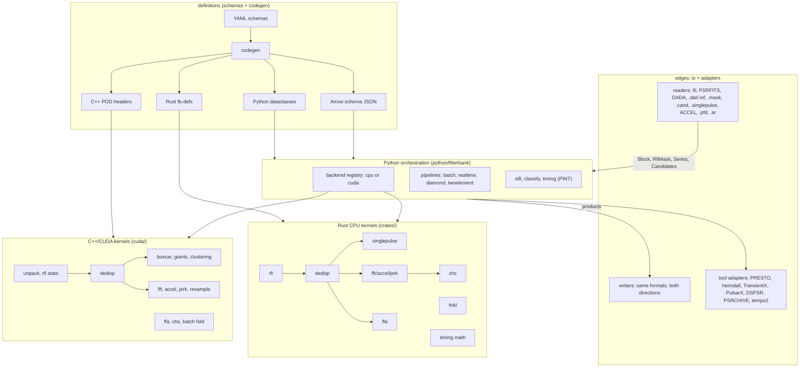

Vendored C and C++ code is compiled by the owning crate's build script (the `cc` crate) and called through a narrow `extern "C"` shim that converts our types to the upstream's arguments. The shim is our code; the vendored files stay untouched or minimally adapted. Vendored CUDA is compiled by CMake into the same nanobind modules as our own kernels. The crates follow dependency bands enforced in CI, as Rerun does ([rerun ARCHITECTURE.md](https://raw.githubusercontent.com/rerun-io/rerun/main/ARCHITECTURE.md)). `fb-defs` depends on nothing. `fb-io` depends only on `fb-defs`. The DSP crates depend on `fb-defs` and never on each other, except that `fb-chs` and `fb-accel` may use `fb-fft`. `fb-py` is the only crate that links PyO3, and it sits on top, the polars layout ([polars Cargo.toml](https://redirect.github.com/pola-rs/polars/blob/main/Cargo.toml)). Bulk arrays cross languages through the buffer protocol and DLPack. Tables cross through the Arrow PyCapsule interface and pyo3-arrow ([Arrow PyCapsule Interface](https://arrow.apache.org/docs/format/CDataInterface/PyCapsuleInterface.html), [pyo3-arrow](https://docs.rs/crate/pyo3-arrow/latest)). nanobind silently copies without `noconvert()` and does not synchronise a DLPack stream argument ([nanobind ndarray](https://nanobind.readthedocs.io/en/latest/ndarray.html)), so every CUDA entry point takes an explicit stream and asserts no conversion.

### Proposed directory tree

The repository root holds two trees with a strict split: `filterbank/` is code and build files only, and `docs/` is every explanation, reference, credit and math map.

```
docs/                       # all documentation (repo root)
  README.md  converter.md
  CREDITS.md                # the one record of what was taken from where
  math-maps/                # one file per source library: equations and code locations
    presto.md prestozl.md dmt.md astroaccelerate.md heimdall.md transientx.md pulsarx.md
    riptide.md peasoup.md sigpyproc3.md sigproc.md psrdada.md dspsr.md psrchive.md
    your.md fetch.md tempo2.md pint.md clfd.md
  reference/  00-overview.md ... 06-our-plan.md
  reports/  research_notes/
  modules/                  # user guide per module: CLI, Python API, examples

filterbank/                 # code and build files only
  pyproject.toml  pixi.toml  Cargo.toml  justfile  CMakeLists.txt
  definitions/
    schemas/          obs_header.yaml block.yaml rfi_mask.yaml dm_plan.yaml series.yaml
                      candidates_single_pulse.yaml candidates_periodic.yaml candidates_folded.yaml
                      fold_params.yaml provenance.yaml
    codegen/          generate.py                 # CI fails on any diff in generated/
    generated/        rust/ python/ cpp/include/fbdefs/ arrow/
  converter/          # phase-0 code (its README moves to docs/converter.md); thin CLI over fb-io in phase 1
  crates/
    fb-defs/          # band 0: types, MjdTime, delay tables, joins, provenance
    fb-io/            # band 1: fil, PSRFITS search+fold, DADA, .tim, unpack, memmap blocks
    fb-formats/       # band 1: PRESTO .inf/.dat/.fft/.mask/.stats/ACCEL/.cand/.pfd/.singlepulse,
                      #         heimdall .cand, TransientX .cands, riptide csv, peasoup xml, tim/par text
    fb-rfi/           # band 2: shim over vendored rfifind; IQRM, zero-DM, SK in Rust; TransientX filters
    fb-dedisp/        # band 2: Rust brute force (reference); shims over vendored dmt and PRESTO subband
    fb-sp/            # band 2: baseline, normalise, boxcar bank, giants, FoF, DBSCAN
    fb-fft/           # band 2: realfft wrappers, PRESTO packing, deredden, zap, interbin
    fb-accel/         # band 3: shim over adapted PRESTO accelsearch (accel + jerk)
    fb-ffa/           # band 2: shim over vendored riptide core
    fb-chs/           # band 3: shim over adapted PRESTO coherentsearch
    fb-fold/          # band 2: adapted PulsarX folder, PRESTO fold math, predictors, PSRFITS fold writer
    fb-timing/        # band 2: PGS/FFTFIT TOAs, polyco and Chebyshev evaluation, .tim writer
    fb-realtime/      # band 3: ring buffer client, gulp scheduler, standalone daemon binary
    fb-py/            # band 4: the only PyO3 crate
  cuda/
    CMakeLists.txt  include/fbcuda/*.cuh
    src/ unpack/ rfi/ dedisp/ sp/ fft/ accel/ ffa/ chs/ fold/ cornerturn/
    bindings/         # nanobind modules
    tests/            # Catch2 + nvbench
  python/filterbank/
    core/             # registry, array contract, config, provenance helpers
    stages/           # io rfi dedisp singlepulse periodicity ffa chs fold sift classify timing
    adapters/
      formats/        # thin Python wrappers over fb-io / fb-formats
      tools/          # subprocess wrappers: presto heimdall transientx pulsarx dspsr psrchive tempo2 fetch
    pipelines/        # batch.py realtime/ diamond.py twoelement.py periodic.py timing.py
    cli/              # `fb` entry point
  vendor/             # upstream source copied as-is or minimally adapted; no added comments
    dmt/ riptide/ presto/ prestozl/ heimdall/ astroaccelerate/ transientx/ pulsarx/
    peasoup/ gaffa/ psrdada/ cfitsio/ erfa/ tempo2_pred/ psrchive_pgs/
    vendor.toml       # machine-readable: upstream URL + commit per directory (read by the CREDITS check)
  models/             # ONNX classifiers + training code
  containers/         # oracle images: presto-6.3.3, heimdall, transientx+pulsarx, psrchive+dspsr+tempo2, riptide
  tests/  unit/ cross_backend/ oracle/ regression/ fixtures/ (git-lfs)
  bench/
  tools/              # check_credits.py (fails if vendor/ and docs/CREDITS.md disagree)
```

Because nothing is published, packaging optimises for one-step local builds, not for PyPI. `pixi install` (or `pip install -e filterbank`) builds the Rust extension with maturin and, when `nvcc` is present, the CUDA extension with scikit-build-core. The Python package detects at import time which backends were built. The Mac never builds or installs anything CUDA.

## Module by module: purpose, port source, backends, CLI, oracle

Each module below states its contract in definitions types, the source it reuses and why, the CPU and CUDA plans, a standalone CLI, and the original tool it must agree with. Every CLI is both a `fb <module>` subcommand and a standalone Rust binary, so each module can be used without the rest.

### definitions: the only thing every module imports

**Purpose.** Hold the seven types, their schemas, code generation, the join validators, the dispersion math and the provenance chain. It must be small enough that no module ever wants to fork it.

| Aspect | Plan |
|---|---|
| Inputs / outputs | YAML schemas in; generated Rust, Python, C++ and Arrow out. At run time it provides constructors, validators and `to_indices`, `delay_table`, `to_reference` |
| Reuse from | No algorithm port. The dispersion law and smearing budget come from Cordes & McLaughlin 2003 Eqs. 2–4 and 11 ([CM03](https://arxiv.org/abs/astro-ph/0304364)); the constant convention from [Kulkarni 2020](https://ar5iv.arxiv.org/html/2007.02886); the IDL-plus-codegen pattern from [Rerun](https://raw.githubusercontent.com/rerun-io/rerun/main/ARCHITECTURE.md) |
| CPU backend | `fb-defs`: `MjdTime` arithmetic (imjd plus f64 seconds, normalised), `FreqAxis` (uniformity test, hash, ascending view), `DmPlan::delay_table` in f64 then rounded once, `RfiMask::to_indices`, typed `JoinError` |
| GPU (CUDA) | None. CUDA consumes generated POD headers and host-built delay tables only |
| CLI | `fb defs check plan.json --against obs.fil` · `fb defs show obs.fits` (prints the canonical header and what each legacy projection would lose) |
| Tests | Property tests (proptest): a DM-0 plan gives an all-zero delay table; `to_indices` survives downsample, flip and subband; MjdTime round-trips PSRFITS `STT_*` exactly; codegen drift check in CI. Oracle: the delay table equals PRESTO `delay_from_dm` per channel to 1e-9 s |

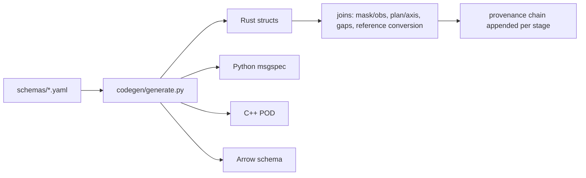

### io: read every format into ObsHeader without losing anything

**Purpose.** Turn files and streams into `Block`s and back. This is the most bug-prone module, so it carries the most tests. It ports **sigpyproc3's readers** (MIT, actively maintained, v2.0.0 in October 2026, follows "dspsr unpacker rules" for `ZERO_OFF`) ([pfits.py](https://github.com/FRBs/sigpyproc3/blob/main/src/sigpyproc/io/pfits.py)). It replaces sigpyproc3's refusal of gapped files with **PRESTO's `OFFS_SUB` gap detection and padding** ([psrfits.c](https://github.com/scottransom/presto/blob/master/src/psrfits.c)), and it keeps PRESTO's special case of reversing 8-byte groups for Parkes `FB_1BIT` data. Bit order is the trap. SIGPROC packs the earliest channel in the least-significant bits ([pack_unpack.c](https://github.com/SixByNine/sigproc/blob/master/src/pack_unpack.c)). PSRFITS packs "earlier samples in higher-order bits" ([ATNF](https://www.atnf.csiro.au/research/pulsar/psrfits_definition/PsrfitsDocumentation.html)). The tools also disagree on `ZERO_OFF`: PRESTO subtracts `|ZERO_OFF|` for all nbits, sigpyproc3 and DSPSR skip it for 2- and 16-bit, and `your` never applies it. So the reader makes `zero_off_policy` an explicit option, defaulting to DSPSR rules, and records the choice in `data_state`.

| Aspect | Plan |
|---|---|
| Inputs / outputs | Files or byte streams in; `ObsHeader` plus an iterator of `Block`s (FT, f32 or packed) out. Writers take `Block`s and write fil, `.tim`, PSRFITS search, PSRFITS fold (with fold), and DADA files |
| Reuse from | sigpyproc3 `io/pfits.py`, `io/bits.py`, `io/sigproc.py`; PRESTO `psrfits.c` gap logic and `sigproc_fb.c` coordinate decoding; the SIGPROC keyword table from `read_header.c`; psrdada header keys from [header.tex](https://sourceforge.net/p/psrdada/code/ci/master/tree/doc/header.tex) |
| CPU backend | `fb-io`: FITS headers through `fitsio` (cfitsio); SUBINT rows memory-mapped with `memmap2` and decoded directly, because `fitsio-pure` is about 10x slower on large column writes ([fitsio-pure README](https://docs.rs/crate/fitsio-pure/latest/source/README.md)). SIMD unpack for 1/2/4/8/16/32-bit in both bit orders; per-row `DAT_FREQ`/`SCL`/`OFFS`/`WTS`; `NSTOT` truncation; multi-file continuity; a corner turn to FT. A SIGPROC reader that rejects implausible string lengths and then retries byte-swapped. Writers emit `foff<0` by default, because PRESTO's `.fil` reader assumes it |
| GPU (CUDA) | `cuda/src/unpack`: packed bytes to f32 with scales applied on device, so real-time data crosses PCIe at 1–8 bits. The design reference is DSPSR's `GenericEightBitUnpackerCUDA.cu` ([Kernel/Classes](https://sourceforge.net/p/dspsr/code/ci/master/tree/Kernel/Classes/)), plus a corner-turn kernel after AstroAccelerate's `aa_corner_turn` |
| CLI | `fb io header obs.fits` · `fb io convert obs_0001.fits obs_0002.fits -o obs.fil --scales apply --zero-off dspsr --pol sum --gaps fill-median` · `fb io slice obs.fil --t 10:20s --f 1300:1400MHz -o cut.fil` |
| Tests | Sample-for-sample agreement with sigpyproc3 `PFITSReader` and `FilReader`. For PRESTO, the output of `prepdata -nobary -dm 0` matches our DM-0 series (rtol 1e-6). `your` is used for the scale/weight path (it differs on `ZERO_OFF` by design; tested as an expected difference). Round trips: PSRFITS to `Block` to PSRFITS and fil to `Block` to fil are byte-identical; 1/2/4-bit pack/unpack proptests in both orders; a synthetic file with a dropped row must produce one gap record |

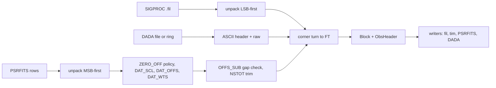

### rfi: produce masks in physical units, apply them on demand

**Purpose.** Produce `RfiMask` objects (detection) and cleaned `Block`s (application), as separate steps, so a mask computed on one file or element can be applied to another. We reuse **PRESTO `rfifind` in full**, vendoring its C statistics code without the PGPLOT plotting: per-interval, per-channel mean, std and maximum FFT power with interbinning and 4-harmonic summing; robust thresholds; chanfrac/intfrac whole-row masking; and defaults of 30 s, timesig 10, freqsig 4, chanfrac 0.7, intfrac 0.3 ([rfifind.c](https://github.com/scottransom/presto/blob/master/src/rfifind.c), [rfifind_plot.c](https://github.com/scottransom/presto/blob/master/src/rfifind_plot.c)). It is still "the standard RFI mitigation tool for major FAST pulsar surveys" ([arXiv 2512.16278](https://arxiv.org/pdf/2512.16278)). It is also the benchmark newer methods beat: SPOTLIGHT reports 98% fewer false detections than rfifind ([arXiv 2608.19102](https://arxiv.org/abs/2608.19102)). For real time we add three methods. **IQRM** uses lagged differences, an IQR/1.349 robust sigma and voting; it gave about 3x more genuine pulses and 3x fewer spurious candidates on MeerKAT and Lovell data ([Morello et al. 2022](https://ar5iv.labs.arxiv.org/html/2108.12434), [RFI2022 slides](https://events.ecmwf.int/event/258/contributions/2894/attachments/1577/2816/RFI2022_Morello.pdf)). **Spectral kurtosis** uses the DSPSR estimator `((M+1)/(M-1))(M S2/S1² − 1)` with Nita & Gary Pearson-III thresholds ([SKFilterbank.C](https://sourceforge.net/p/dspsr/code/ci/master/tree/Signal/General/SKFilterbank.C), [Nita & Gary 2010](https://arxiv.org/html/1005.4371v1)). **Switchable zero-DM** follows [Eatough et al. 2009](https://ar5iv.labs.arxiv.org/html/0901.3993); it is a high-pass filter with a cutoff near 500/DM Hz, so it must stay off for low-DM targets. TransientX's **zdot**, **kadaneF/T** and **skewness–kurtosis** filters, adapted from its C++, round out the set ([rfi_mitigation.rst](https://github.com/ypmen/TransientX/blob/master/docs/pipeline/rfi_mitigation.rst)).

| Aspect | Plan |
|---|---|
| Inputs / outputs | `Block`(s) in; `RfiMask` out (detect). `Block` plus `RfiMask` in; cleaned `Block` out (apply), with a fill of median, noise, or heimdall-style random replacement ([pipeline.cu](https://sourceforge.net/p/heimdall-astro/code/ci/master/tree/Pipeline/pipeline.cu)) |
| Reuse from | PRESTO `rfifind.c`, `rfi_utils.c`, `mask.c`; sigpyproc3 `core/rfi.py` (`iqrm_mask`, `double_mad_mask`); DSPSR `SKFilterbank.C`/`SKDetector.C`; TransientX `src/singlepulse` RFI filters; heimdall `clean_filterbank_rfi.cu`; clfd features plus Tukey rule for folded data ([clfd](https://github.com/v-morello/clfd)); `your` Savitzky–Golay bandpass ([rfi.py](https://github.com/thepetabyteproject/your/blob/main/your/utils/rfi.py)) |
| CPU backend | `fb-rfi`: vendored rfifind C behind a shim; IQRM, SK and zero-DM in Rust as reductions over (channel, block) with rayon; TransientX filters adapted C++; a streaming statistics accumulator so the same code runs on gulps. Order as deployed systems do: channel statistics, mask, zero-DM, baseline normalisation, then dedispersion |
| GPU (CUDA) | `cuda/src/rfi`: per-gulp variance, SK, IQRM statistics and zero-DM; CHIME runs SK on GPU at about 0.7% of X-engine compute ([arXiv 1808.10365](https://arxiv.org/pdf/1808.10365)). The rfifind FFT-power statistic uses batched cuFFT. The vote/fence step stays on the host (it is tiny) |
| CLI | `fb rfi rfifind obs.fil --time 2.0 -o obs.mask.parquet --write-presto obs_rfifind.mask` · `fb rfi iqrm obs.fil --radius 0.1 --threshold 3` · `fb rfi apply obs.fil obs.mask.parquet --zerodm -o clean.fil` |
| Tests | The rfifind port reproduces PRESTO's `.stats` within float tolerance and the `.mask` exactly on the same input. This must use PRESTO ≥6.1.2, because of the `mask.c` out-of-bounds fix ([CHANGELOG](https://github.com/scottransom/presto/blob/master/CHANGELOG.md)). IQRM matches sigpyproc3 `iqrm_mask` exactly; SK matches DSPSR; zero-DM is checked against its analytic transfer function. An injection harness measures recall with and without each filter |

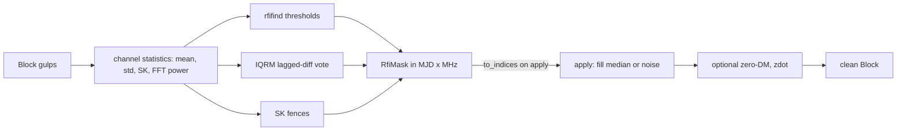

### dedisp: one plan, several engines, identical delays

**Purpose.** Turn a `Block` plus a `DmPlan` into `Series` (DM x time), with a brute-force reference engine, a production FDMT engine and a subband fallback behind one plan object. **`dmt` is the production core**: FDMT runs at 55x real time on 8 EPYC threads and 776x on one L40S for a 4096-channel MeerKAT setup. That is about 19x (CPU) and 6x (GPU) faster than `dmt`'s own brute force, with NEON SIMD for Apple Silicon and exact per-trial sigma ([dmt README](https://github.com/pravirkr/dmt)). For GPU brute force, the reference for arbitrary DM grids, we port **AstroAccelerate's kernel**, reported as about 4x faster than other available solutions for 8-bit, 8192-channel data ([Novotný et al. 2023](https://arxiv.org/abs/2311.05341)). Planning ports **PRESTO `DDplan.py`**, whose total smearing is `sqrt(2(1000 dt)² + chan² + subband² + BW(dDM)²)` with an allowed dDM ladder ([DDplan.py](https://github.com/scottransom/presto/blob/master/bin/DDplan.py)), plus TransientX's per-range downsampling ([dedispersion.rst](https://github.com/ypmen/TransientX/blob/master/docs/pipeline/dedispersion.rst)). Subband dedispersion stays a CPU fallback only: it adds about 40% extra smearing at 16 channels per subband and about 300% at 32 ([Barsdell et al. 2012](https://ar5iv.labs.arxiv.org/html/1201.5380)).

| Aspect | Plan |
|---|---|
| Inputs / outputs | `Block` plus `DmPlan` in; `Series` (per-trial sigma, `ref_freq_mhz` = highest channel centre by default, PRESTO-compatible) out. Streaming mode keeps `max_delay_samples` of history between gulps, as `dmt` joins blocks exactly ([dmt README](https://github.com/pravirkr/dmt)) |
| Reuse from | `dmt` `lib/fdmt*.cpp`, `lib/ddmt*.cpp`, `lib/dm_grids.cpp`, `lib/fdmt_plan_noise.cpp`; FDMT recursion from [Zackay & Ofek 2017](https://arxiv.org/abs/1411.5373); AstroAccelerate `aa_device_dedispersion_kernel.cu`; PRESTO `dispersion.c` subband delays and `prepsubband.c`; heimdall/dedisp `generate_dm_list` tolerance logic |
| CPU backend | `fb-dedisp`: vendored `dmt` CPU engines (FDMT, DDMT, OpenMP and NEON/AVX SIMD already in upstream) behind a C shim; a small Rust brute force (exact, rayon over DM) as the test truth; PRESTO subband engine vendored. All engines consume `DmPlan::delay_table`, so no engine computes its own delays |
| GPU (CUDA) | `cuda/src/dedisp`: vendored `dmt` CUDA FDMT, adapted AstroAccelerate brute-force kernel, fed by the same host-computed table in constant or global memory. `pFDMT` for candidate folding lives in fold |
| CLI | `fb dedisp plan obs.fil --dm 0:2000 --tol 1.25 --pulse-width 64us -o plan.json --write-ddplan` · `fb dedisp run clean.fil plan.json --engine fdmt --backend auto -o series.npz --write-presto-dat out/` |
| Tests | Brute force against PRESTO `prepsubband -nobary -nsub nchan` `.dat` at matching DMs (rtol 1e-5); FDMT against brute force within the delay-quantisation tolerance (bitwise equality is the wrong target); CPU against CUDA `assert_allclose`; streaming gulps against a single-shot result, which must be bitwise equal |

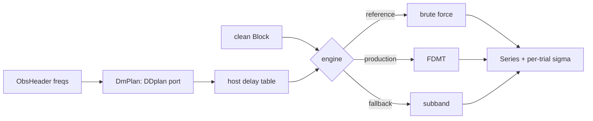

### singlepulse: heimdall's speed, AstroAccelerate's statistics, TransientX's clustering

**Purpose.** Turn `Series` into single-pulse `Candidates`. Every code converges on the same skeleton: baseline removal, normalisation, boxcar bank, threshold, cluster ([other search codes notes](04-other-search-codes.md)). We take the strongest piece of each. **Baseline**: heimdall's median-of-5 scrunch-and-stretch detrend, robust to RFI spikes ([remove_baseline.cu](https://sourceforge.net/p/heimdall-astro/code/ci/master/tree/Pipeline/remove_baseline.cu)). **Matched filter**: one prefix sum, then `y = S[i+ceil(w/2)] − S[i−floor(w/2)]` ([matched_filter.cu](https://sourceforge.net/p/heimdall-astro/code/ci/master/tree/Pipeline/matched_filter.cu)), over TransientX's geometric widths with `wfactor = 1/(1−snrloss)²` ([boxcar.cpp](https://github.com/ypmen/TransientX/blob/master/src/singlepulse/boxcar.cpp)) instead of heimdall's powers of two. **Width-dependent noise**: AstroAccelerate's SPDT interpolates mean and sigma per boxcar width and decimation level, which is the more sensitive estimate on GPU ([aa_device_SPS_long.cu](https://github.com/AstroAccelerateOrg/astro-accelerate/blob/master/src/aa_device_SPS_long.cu)). When `dmt` supplies exact per-trial sigma we use that instead. **Clustering**: TransientX's kd-tree DBSCAN is the default, because its `min_samples` density test rejects isolated noise points. TransientX reaches real time on one core for 4096 DMs x 4096 channels ([arXiv 2401.13834](https://arxiv.org/html/2401.13834v1)). heimdall's friends-of-friends, with tolerances of 3 time units scaled by width, 3 filter steps and 200 DM trials ([are_coincident.cuh](https://sourceforge.net/p/heimdall-astro/code/ci/master/tree/Pipeline/hd/are_coincident.cuh)), stays an option for heimdall-identical output.

| Aspect | Plan |
|---|---|
| Inputs / outputs | `Series` in; single-pulse `Candidates` (time at `ref_freq_mhz`, width in s and samples, members, extent) out |
| Reuse from | heimdall `remove_baseline.cu`, `get_rms.cu`, `matched_filter.cu`, `find_giants.cu`, `label_candidate_clusters.cu`, `merge_candidates.cu`; AstroAccelerate `aa_device_SPS_long.cu`, `aa_device_MSD*.cu`; TransientX `boxcar.cpp`, `cluster.cpp`; PRESTO `single_pulse_search.py` (its sigma definition and its dead-block and bad-block rules) |
| CPU backend | `fb-sp`: adapted TransientX boxcar and DBSCAN C++ for the CPU path, with a Rust driver; rayon over DM trials; prefix-sum boxcars O(N) per width; a kd-tree DBSCAN on (time, DM-delay); width capped at `max_width_s`, with TransientX's `--drop` of candidates at maximum width |
| GPU (CUDA) | `cuda/src/sp`: vendored heimdall prefix-scan boxcar, giant finder and GPU FoF labelling; SPDT width-dependent statistics; only candidate metadata returns to the host, as the Northern Cross deployment does ([arXiv 2609.20635](https://arxiv.org/abs/2609.20635)) |
| CLI | `fb sp search series.npz --snr 7 --max-width 0.1s --cluster dbscan --eps 1.5ms -o cands.parquet --write-heimdall out/ --write-singlepulse out/` · `fb sp search obs.fil --dm 0:2000` (runs rfi and dedisp with defaults) |
| Tests | On a seeded injection suite (DM, width, S/N, scattering grid), recall and parameter agreement against heimdall `.cand`, TransientX `.cands` and PRESTO `.singlepulse`: DM within one trial, time within max(width, 1 sample), S/N within 10%. That is the band heimdall's own two input modes meet (3% TOA/DM, 10% S/N, [arXiv 2609.20635](https://arxiv.org/abs/2609.20635)). FoF mode reproduces heimdall cluster membership exactly on the same series |

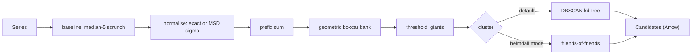

### periodicity-fft: FFT, deredden, accel and jerk search

**Purpose.** Turn `Series` into periodic `Candidates` for binaries and general FFT searches. The CPU engine is the adapted **PRESTO v6.3.3 accelsearch** C code. v6.3.3 is about 8x faster than v5.3.1–v6.1.1, from fused harmonic-sum stages and an AVX2/AVX-512/**NEON** gather ([CHANGELOG](https://github.com/scottransom/presto/blob/master/CHANGELOG.md)), and the NEON path is exactly what the Mac needs. We keep its numerics wholesale: 0.5-bin interbinning, dz = 2, dw = 20, harmonic stages 2–32 with `r_sub = rint(2rh/N)·0.5`, the χ² to equivalent-Gaussian `candidate_sigma` with trials `(rhi−rlo)(numz+1)(dz/6.95)/numharm`, and the GSL Nelder–Mead polish ([accel_utils.c](https://github.com/scottransom/presto/blob/master/src/accel_utils.c), [characteristics.c](https://github.com/scottransom/presto/blob/master/src/characteristics.c)). The GPU port is **PrestoZL `accelsearch_cu`**, which claims results "fully identical" to PRESTO and a 51–56x speedup ([PrestoZL](https://github.com/zhejianglab/PrestoZL)). That speedup was measured against PRESTO v4.0, so re-benchmark against v6.3.3 before relying on it. For binaries we also port **peasoup's time-domain resampler** (`out[i] = in[round(i + i·a·tsamp/(2c)·(i−N))]`) and its acceleration-step formula, plus its circular and elliptical **template banks**. peasoup runs on every TRAPUM beam ([kernels.cu](https://github.com/ewanbarr/peasoup/blob/master/src/kernels.cu), [utils.hpp](https://github.com/ewanbarr/peasoup/blob/master/include/utils/utils.hpp), [arXiv 2212.08528](https://arxiv.org/pdf/2212.08528)).

| Aspect | Plan |
|---|---|
| Inputs / outputs | `Series` (single DM) in; a spectrum (complex64, PRESTO packing with Nyquist in bin 0's imaginary part) as an intermediate; periodic `Candidates` with f, fdot, fddot at an explicit epoch (accelsearch's midpoint convention converted to `pepoch`) out |
| Reuse from | PRESTO `fastffts.c` packing, `misc_utils.c` `dered_engine` (log-growing median blocks), `zapbirds.c` with v6.1 χ²(2) noise fill, `accelsearch.c`, `accel_utils.c`, `responses.c`, `maximize_rz(w).c`, `characteristics.c`; PrestoZL CUDA kernels; peasoup `kernels.cu`, `pipeline_multi.cu`, template-bank reader; AstroAccelerate FDAS as an alternative GPU correlation path ([aa_fdas_host.cu](https://github.com/AstroAccelerateOrg/astro-accelerate/blob/master/src/aa_fdas_host.cu)) |
| CPU backend | `fb-fft` uses RustFFT/realfft (pure Rust, NEON and AVX, any size) ([RustFFT](https://github.com/ejmahler/RustFFT)) so no system FFT library is required; an optional FFTW build flag exists on Linux for benchmarking against PRESTO's FFTW-wisdom tuning. `fb-accel` compiles the adapted PRESTO accelsearch C (FFTW calls routed to RustFFT through a shim, GSL replaced by built-ins): block-threaded over spectrum blocks as in v6.3.2, with byte-identical output for any thread count |
| GPU (CUDA) | `cuda/src/fft` (cuFFT R2C, batched C2C); `cuda/src/accel` holds the vendored PrestoZL f-fdot(-fddot) correlation and harmonic sum, plus the vendored peasoup resample, FFT, interbin, harmonic-fold and peak path. VkFFT stays an optional Metal path for Mac GPU work ([VkFFT](https://github.com/DTolm/VkFFT)) |
| CLI | `fb fft run series_DM62.00.dat -o DM62.00.fft --rednoise --zap birds.txt` · `fb accel search DM62.00_red.fft --zmax 200 --wmax 600 --numharm 8 --sigma 2 -o accel.parquet --write-presto-accel out/` · `fb accel resample-search series.npz --accel -300:300 --template-bank circ.txt --backend cuda` |
| Tests | The `.fft` matches PRESTO `realfft` (rtol 1e-6) and `_red.fft` matches `rednoise`. The candidate list matches accelsearch v6.3.3 on the same `_red.fft` (same r, z, w bins; sigma within 1e-3). PrestoZL output equals PRESTO on the GPU host; the resample path agrees with peasoup `overview.xml` candidates. Version pinning matters, because PRESTO results are not byte-comparable across 6.x releases |


### ffa: riptide's near-optimal folding search

**Purpose.** Search long-period and low-duty-cycle pulsars, where the FFA "closely approaches the theoretical optimum" and beats FFT plus incoherent harmonic summing at every period and duty cycle ([Morello et al. 2020](https://arxiv.org/abs/2004.03701)). **riptide** is the MIT, maintained, cleanest-to-port source. Its C++ core is small. `transforms.hpp` is the O(m·p·log₂m) FFA transform. `periodogram.hpp` handles "ranging": an initial downsample, integer bins from `bins_min` to `bins_max`, and a geometric growth of the downsampling factor. `snr.hpp` gives the exact boxcar S/N with `h = sqrt((n−w)/(n·w))` ([periodogram.hpp](https://github.com/v-morello/riptide/blob/master/src/riptide/cpp/periodogram.hpp), [snr.hpp](https://github.com/v-morello/riptide/blob/master/src/riptide/cpp/snr.hpp)). The v0.2.6 fix for downsampled variance near integer factors must come with the port ([riptide CHANGELOG](https://github.com/v-morello/riptide/blob/master/CHANGELOG.md)). No Rust FFA exists anywhere, so this is new ground.

| Aspect | Plan |
|---|---|
| Inputs / outputs | `Series` in; a periodogram (period, width, S/N) as an intermediate; periodic `Candidates` (`method = "ffa"`) out |
| Reuse from | riptide `cpp/{transforms,periodogram,snr,downsample,running_median}.hpp`, plus `pipeline/` peak detection (median and IQR segments fit in log ν), clustering and harmonic flagging; gaffa CUDA, adapted ([gaffa](https://github.com/lintian233/gaffa)) |
| CPU backend | `fb-ffa`: riptide's C++ core vendored as-is (header-only templates, no dependencies) behind a C shim; depth-first FFA per (downsample, bins) cell; rayon over DM trials, which is riptide's own parallel unit; a running-median deredden matching `rmed_width`/`rmed_minpts` |
| GPU (CUDA) | `cuda/src/ffa`: adapted gaffa kernels, or one block per (DM, bins) cell with the butterfly in shared memory. This is lower priority, because riptide is memory-bandwidth-bound on CPU and the coherent harmonic search is both more sensitive and faster ([arXiv 2610.11749](https://arxiv.org/abs/2610.11749)) |
| CLI | `fb ffa search series.npz --period 1:30s --bins 240:260 --ducy-max 0.2 -o ffa.parquet --write-riptide out/` |
| Tests | Periodogram equal to riptide `ffa_search` with the same parameters (rtol 1e-5); candidate set equal to riptide `rffa` `candidates.csv` on the injection suite |


### chs: coherent harmonic summing, the most sensitive isolated-pulsar search

**Purpose.** Run the 2026 method that **recovered 76% of more than 860,000 injected pulsars at matched false-alarm rate, against 64% for riptide and 42% for accelsearch**. Its threshold is stable in red noise, and it runs 1.4–2.2x faster than riptide on one core ([Ransom 2026](https://arxiv.org/abs/2610.11749)). We port **PRESTO's `coherentsearch`** (v6.2.0, the C port of CoherentSearch.jl, byte-identical with the Julia code on its test file). It interpolates about 60 harmonics with an m = 16 kernel of weights `1/(dr−j)`, stacks them into a half-complex spectrum, inverse-FFTs that into a profile, and scores a ×1.5 boxcar bank with an analytic sigma. A decimation ladder folds every k-th harmonic ([cs_interp.c](https://github.com/scottransom/presto/blob/master/src/cs_interp.c), [coherentsearch.1](https://github.com/scottransom/presto/blob/master/docs/coherentsearch.1)). There is no acceleration dimension, so binaries stay in periodicity-fft. Its analytic noise "assumes exactly" PRESTO's realfft and rednoise normalisation ([ROADMAP.md](https://github.com/scottransom/presto/blob/master/ROADMAP.md)). That is why fb-fft reproduces PRESTO's normalisation bit for bit, rather than inventing its own.

| Aspect | Plan |
|---|---|
| Inputs / outputs | A dereddened spectrum (from periodicity-fft, PRESTO normalisation) in; periodic `Candidates` (`method = "chs"`, harmonics, duty cycle, known-pulsar label) out |
| Reuse from | PRESTO `src/coherentsearch.c`, `cs_interp.c`, `cs_chunk.c`, `cs_metric.c`, `cs_search.c`, `bin/coherent_sift.py`. CoherentSearch.jl's GPU path (Julia) is the design reference for our CUDA kernel |
| CPU backend | `fb-chs`: the adapted PRESTO `cs_*.c` files (same FFT and GSL shims as accelsearch); residue-tabulated interpolation weights, small batched inverse FFTs (realfft), runtime SIMD dispatch as in PRESTO v6.3.1; default `-nharms 60`, `-maxdecim 6`, and a `deep` preset of 120 harmonics |
| GPU (CUDA) | `cuda/src/chs`: one warp per trial frequency for interpolation, batched cuFFT C2R for the profile stack, fused boxcar scoring. The paper reports GPUs up to 9x faster than a 20-core workstation |
| CLI | `fb chs search DM62.00_red.fft --nharms 60 --threshold 8 --hifreq 125 -o chs.parquet --write-cohout out/` · `fb chs search --deep ...` |
| Tests | `.cohout` written by our port is byte-identical to PRESTO `coherentsearch` on the PRESTO test file and on our injection suite (the same bar PRESTO set for its own port). Recall of 76% or better reproduced on a 10,000-pulsar subset of the paper's injection setup |


### fold: PulsarX's batch design, prepfold's diagnostics, real predictors

**Purpose.** Fold many candidates per pass over the raw data into folded cubes, optimise P, Pdot and DM, and write archives. **PulsarX** is about 50x faster than prepfold on large candidate sets. It uses a pruned FDMT and Tikhonov-regularised least-squares folding, and it is the folder of choice for peasoup candidates on MeerKAT ([Men et al. 2023](https://arxiv.org/abs/2309.02544), [peasoup README](https://github.com/ewanbarr/peasoup)). One gap matters for porting: the notes could not locate the pFDMT and TLSM code by name in PulsarX or XLibs. Task one of this module is therefore to find those files, and the fallback is to implement both from the paper. Significance and the search grid come from **prepfold**. Samples are spread over the bins they cover. `redchi` is computed with `DOF_corr = dt_per_bin·0.96·(1+dt_per_bin^1.806)^(−1/1.806)`. The search shifts and combines npart x nsub sub-profiles rather than refolding ([fold.c](https://github.com/scottransom/presto/blob/master/src/fold.c), [prepfold_pipeline.c](https://github.com/scottransom/presto/blob/master/src/prepfold_pipeline.c)). Phase prediction evaluates **TEMPO polycos** (`PHASE = RPHASE + 60·DT·F0 + Σ COEFF·DT^(n−1)`) and **TEMPO2 2-D Chebyshev predictors** natively ([polyco spec](https://tempo.sourceforge.net/ref_man_sections/tz-polyco.txt), [cheby2d.c](https://bitbucket.org/psrsoft/tempo2/src/master/cheby2d.c)). That matters because prepfold's cubic fit drifts by 0.1 turns at 8 h for a 2 ms pulsar ([CHANGELOG v6.3.0](https://github.com/scottransom/presto/blob/master/CHANGELOG.md)).

| Aspect | Plan |
|---|---|
| Inputs / outputs | `Block` stream plus N `FoldParams` (or periodic `Candidates`) in; folded cubes `[nint][nsub][npol][nbin]` with fold statistics, optimised `FoldParams`, and folded `Candidates` out. Writers: PSRFITS fold mode (16-bit, `DAT_SCL`/`DAT_OFFS`, `POLYCO`/`T2PREDICT`/`PSRPARAM` tables), PRESTO `.pfd` plus `.bestprof` |
| Reuse from | PulsarX `src/pulsar/psrfold_fil.cpp` and its XLibs dependencies; PRESTO `fold.c`, `prepfold_pipeline.c`, `prepfold_utils.c`; DSPSR `Fold.C` `choose_nbin` rules and `FoldCUDA.cu` ([Fold.C](https://sourceforge.net/p/dspsr/code/ci/master/tree/Signal/Pulsar/Fold.C)); TEMPO2 `cheby2d.c`, `tempo2pred.c`; clfd for post-fold cleaning |
| CPU backend | `fb-fold`: adapted PulsarX folding C++ (XLibs and PlotX stripped) plus vendored PRESTO `fold.c`; one pass over the data, with each block subbanded once, then N candidates folded from the subbands (the PulsarX batching); prepfold-style P/Pdot/DM search on sub-profiles; predictor evaluation in f64 with MjdTime |
| GPU (CUDA) | `cuda/src/fold`: a batch fold kernel (candidates x subbands per block; phase from per-candidate polynomial coefficients) and sub-profile shift-and-add for the optimiser. PulsarX shows no GPU folding, so this is new; DSPSR's `FoldCUDA.cu` is the design reference |
| CLI | `fb fold run clean.fil --cands sifted.parquet --nbin 128 --nsub 64 --nint 64 --search pdm -o folds/ --write-psrfits --write-pfd` · `fb fold run obs.fil --par J1234.par --nosearch -o J1234.ar` |
| Tests | Best P, Pdot, DM and `redchi` match prepfold `.bestprof` on the same candidate (within one search step; sigma within 5%); profiles match PulsarX `.ar` through `pdv` dumps; the predictor evaluation matches `tempo2 -pred` to 1e-9 turns |

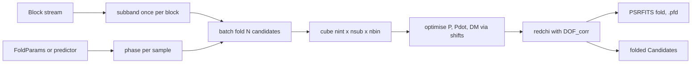

### sift: one sifter over every search backend

**Purpose.** Merge periodic candidates across DMs, methods and beams, remove duplicates and harmonics, and flag known pulsars and RFI. Because every backend emits the same Arrow schema, one sifter serves accel, FFA, CHS and template-bank results alike. It ports **PRESTO `sifting.py`**: `remove_duplicate_candidates`, `remove_DM_problems(min_num_DMs=2, low_DM_cutoff=2.0)`, and `remove_harmonics` over integer ratios 1–16 plus fractional ratios such as 3/2 and 5/3, with `f_err = r_err/T` ([sifting.py](https://github.com/scottransom/presto/blob/master/python/presto/sifting.py)). To that it adds `coherent_sift.py`'s known-pulsar, edge-peaked and broadband flags ([CHANGELOG v6.2.0](https://github.com/scottransom/presto/blob/master/CHANGELOG.md)) and peasoup's DM, acceleration and harmonic distillers ([pipeline_multi.cu](https://github.com/ewanbarr/peasoup/blob/master/src/pipeline_multi.cu)). Filename-regex DM parsing (`_DM(\d+\.\d{2,3})`) disappears, because the DM is a column. Single-pulse sifting (cross-beam and cross-element coincidence) also lives here, using `to_reference()` so that times from different beams are compared at one frequency.

| Aspect | Plan |
|---|---|
| Inputs / outputs | One or more `Candidates` tables in; a sifted `Candidates` table with `group_id`, `harmonic_of` and `flags` columns out |
| Reuse from | PRESTO `sifting.py`, `examplescripts/ACCEL_sift.py`, `bin/coherent_sift.py`, `compare_periods.py`; peasoup distillers; riptide `clustering.py` and harmonic flags; heimdall `coincidencer.C` for multi-beam single-pulse coincidence |
| CPU backend | Python over polars for the logic; Rust helpers in `fb-defs` for the O(N log N) harmonic-ratio match on large tables |
| GPU (CUDA) | None; table operations are not GPU-bound |
| CLI | `fb sift periodic accel.parquet chs.parquet ffa.parquet --sigma 4 --min-dms 2 --known psrcat.db -o sifted.parquet --write-presto-candlist cands.txt` · `fb sift coincide beamA.parquet beamB.parquet --dt 2ms --ddm 1` |
| Tests | On the same ACCEL files, the surviving candidate list equals `ACCEL_sift.py` output; harmonic flags match `coherent_sift.py` on `.cohout` input |

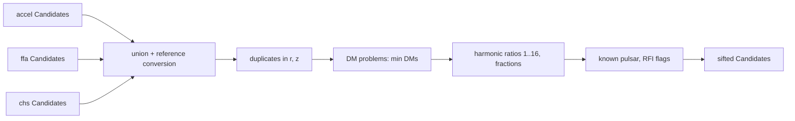

### classify: cut-outs plus ONNX models, recall measured in situ

**Purpose.** Produce frequency–time and DM–time cut-outs and score them with a model that runs identically on CPU, CUDA and Apple Silicon. Cut-outs port **`your` `Candidate`**: `get_chunk`, dedisperse, `dmtime(256)` from 0 to 2·DM, an optional DM optimisation, median decimation by `width//2`, and a resize to 256x256 ([candidate.py](https://github.com/thepetabyteproject/your/blob/main/your/candidate.py)). This produces FETCH-compatible HDF5 for interchange. The model family follows **FETCH**: two CNN branches (FT and DMT) merged before a softmax ([FETCH models](https://github.com/devanshkv/fetch/tree/tf2/fetch/models)). FETCH reports above 99.5% accuracy and recall ([arXiv 1902.06343](https://arxiv.org/abs/1902.06343v2)), but an independent 2025 study found much lower recall on injected signals ([arXiv 2511.17797](https://arxiv.org/pdf/2511.17797)). So we retrain on Diamond Array data, export to ONNX, and measure recall with our own injector. For folded candidates, a PICS-style CNN uses the profile, phase–time, phase–frequency and DM-curve planes ([PICS](https://arxiv.org/abs/1309.0776)).

| Aspect | Plan |
|---|---|
| Inputs / outputs | `Candidates` plus the source `Block` (or a folded cube) in; cut-out tensors as intermediates; a `Candidates` table with `p_real`, `model_id` and `label` columns out |
| Reuse from | `your` `candidate.py`, `your_candmaker.py`; FETCH `data_sequence.py` preprocessing (transpose, detrend, divide by std, median-subtract) and architectures; DRAFTS as the object-detector option for later ([DRAFTS](https://github.com/SukiYume/DRAFTS)) |
| CPU backend | Cut-out extraction in Rust (`fb-sp` dedisperse-window helper); inference through ONNX Runtime CPU or CoreML on the Mac |
| GPU (CUDA) | Cut-out extraction on device in the real-time path (the data is already resident); ONNX Runtime CUDA execution provider |
| CLI | `fb classify cutouts cands.parquet obs.fil --size 256 -o cutouts.h5` · `fb classify score cutouts.h5 --model models/dat_ftdmt_v1.onnx -o scored.parquet` · `fb classify train ...` |
| Tests | Preprocessing equal to FETCH `DataGenerator` on the same `your` HDF5; the FETCH model a, run via the adapter, used as the baseline; recall-versus-S/N curves from the injection harness are the acceptance metric, not self-reported accuracy |

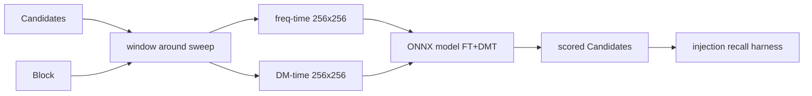

### timing: TOAs in-house, fitting through PINT

**Purpose.** Turn folded archives plus a template into TOAs, and fit timing models. The TOA estimator ports **PSRCHIVE's PGS**, the default `pat -A PGS` and the Taylor (1992) Fourier phase-gradient method minimised with Brent ([pat.C](https://sourceforge.net/p/psrchive/code/ci/master/tree/More/Applications/pat.C), [ScalarTemplateMatching.h](https://sourceforge.net/p/psrchive/code/ci/master/tree/More/General/Pulsar/ScalarTemplateMatching.h)). PRESTO's pure-Python FFTFIT is a cross-check. Fitting uses **PINT** in-process (BSD; WLS, GLS, downhill and wideband fitters, v1.1.8 released 2026-10-08) ([fitter.py](https://github.com/nanograv/PINT/blob/master/src/pint/fitter.py), [CHANGELOG](https://github.com/nanograv/PINT/blob/master/CHANGELOG.md)). TEMPO2 is an adapter. Matrix template matching and FDM stay with `pat` through the adapter for polarimetric timing. PSRCHIVE's calibration machinery (`pac`, `pcm`) is the part least worth re-implementing, and its Python bindings are reported incompatible with NumPy 2 ([PSRCHIVE Python manual](https://psrchive.sourceforge.net/manuals/python)), so it runs as subprocesses in an isolated environment.

| Aspect | Plan |
|---|---|
| Inputs / outputs | Folded cubes or PSRFITS fold archives plus a template profile in; TOAs (Arrow table: MjdTime, uncertainty in µs, frequency, site, flags) out; `.tim` (TEMPO2 `FORMAT 1`) and par in/out through the adapters |
| Reuse from | PSRCHIVE `More/Timing/PhaseGradShift.C`, `ArrivalTime.C`, `More/General/model_profile.C`; PRESTO `get_TOAs.py`, `fftfit.py`; TEMPO polyco math and TEMPO2 predictor evaluation shared with fold |
| CPU backend | `fb-timing`: adapted PSRCHIVE PGS (`PhaseGradShift.C`, `model_profile.C`) behind a shim; PGS fit with analytic uncertainty from ∂²χ²/∂τ², sub-band TOAs, template building (Gaussian components); exposed to Python for the PINT handoff |
| GPU (CUDA) | None needed: timing is light |
| CLI | `fb timing toas J1234.ar --template J1234.std --nsub 4 -o J1234.tim` · `fb timing fit J1234.par J1234.tim --fitter gls` (PINT) · `fb timing predict J1234.par --mjd 61000:61001 --site <site> --write-polyco --write-t2pred` |
| Tests | TOAs equal to `pat -A PGS -f tempo2` on the same archive and template, within 0.1 sigma; PINT residuals match `tempo2` within the cross-validation tolerance PINT reported against Tempo and Tempo2 ([Luo et al. 2021](https://arxiv.org/pdf/2012.00074)) |

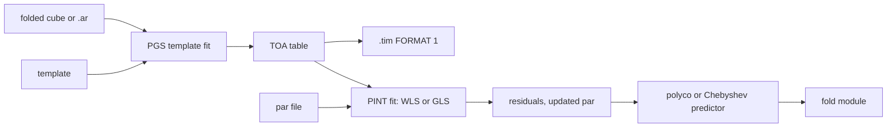

### realtime: the same stage code, scheduled on a ring buffer

**Purpose.** Run rfi, dedisp, singlepulse and classify continuously on Diamond Array Telescope data and on the two-element interferometer, with triggers and data dumps. Deployed FRB systems use native ring buffers plus a control plane, not Python schedulers. CHORD's pirate uses ring-buffer ingest, then RFI, GPU dedispersion and peak-finding, with gRPC for control ([pirate](https://kmsmith137.github.io/pirate/notes/intro.html)). We stay PSRDADA-compatible: an ASCII header block of `HDR_SIZE` (default one page, usually 4096 B), a key of `0x0000dada`, and 4 blocks by default ([dada_def.h](https://sourceforge.net/p/psrdada/code/ci/master/tree/src/dada_def.h)). Existing backends and heimdall can then attach to the same buffers. Gulps overlap by `DmPlan.max_delay_samples`, and each stage worker owns one CUDA stream. The two-element interferometer needs only an input adapter that turns correlated or beamformed output into `Block`s with a built `ObsHeader`. Running each element's total-power stream through singlepulse separately and requiring coincidence in `sift` is also a cheap RFI veto, in the spirit of heimdall's `-rfi_min_beams` ([parse_command_line.C](https://sourceforge.net/p/heimdall-astro/code/ci/master/tree/Pipeline/parse_command_line.C)). This is an inference; it needs testing on real Diamond Array data.

| Aspect | Plan |
|---|---|
| Inputs / outputs | A DADA ring buffer or network packets in; an Arrow IPC candidate stream, trigger events, dumped raw `Block`s (DADA or fil), and metrics out |
| Reuse from | psrdada `ipcbuf`/`dada_hdu` client C, vendored (it needs only POSIX shared memory and semaphores); heimdall `PSRDadaRingBuffer.C` header handling (`f0 = cfreq − bw/2 + chan/2`, [PSRDadaRingBuffer.C](https://sourceforge.net/p/heimdall-astro/code/ci/master/tree/Formats/PSRDadaRingBuffer.C)); pirate's two-stage disk writes and control model |
| CPU backend | `fb-realtime`: a gulp scheduler, an SPSC queue between stages, and a standalone daemon binary that can run the whole chain CPU-only (a test mode on the Mac) |
| GPU (CUDA) | The daemon loads the same CUDA kernels (PTX through cudarc, or the nanobind module under a Python supervisor); pinned host buffers; a corner turn on device |
| CLI | `fb realtime run --dada-key dada --config diamond.yaml` · `fb realtime replay obs.fil --rate 1.0 --dada-key dada` (feeds a file into a ring for tests) · `fb realtime twoelement --corr-port 5000 --config twoelement.yaml` |
| Tests | Replaying a file through the ring gives candidates identical to the batch pipeline on that file; sustained above 1x real time over multi-hour soak runs; live injection recall; latency percentiles logged |

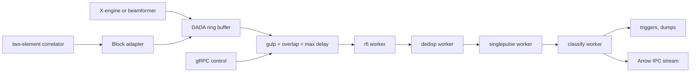

### adapters: every legacy format in both directions, every legacy tool as an oracle

**Purpose.** Keep the core interoperable. Format adapters are pure Rust readers and writers in `fb-formats`, with thin Python wrappers. Tool adapters are Python subprocess wrappers that run pinned containers and parse their output through the same format readers. Several formats carry traps the adapters must reproduce exactly. PRESTO's `.mask` omits per-interval channel lists for fully zapped intervals ([mask.c](https://github.com/scottransom/presto/blob/master/src/mask.c)). The `.cand` file is a raw array of 88-byte `fourierprops` structs with padding. `.pfd` byte-swaps if any of its first ints exceeds 100000 ([prepfold.py](https://github.com/scottransom/presto/blob/master/python/presto/prepfold.py)). heimdall writes one `.cand` per gulp with nine tab-separated columns.

| Format | Read | Write | Phase | Notes |
|---|---|---|---|---|
| SIGPROC `.fil`, `.tim` | yes | yes | 1 | `fchannel` tables; `nsamples` ignored; RA/Dec `hhmmss.s` packing with the −00° sign case |
| PSRFITS search | yes | yes | 1 | All of the io rules; writes `DAT_FREQ` per row and `HISTORY` provenance |
| PSRFITS fold | yes | yes | 5 | 16-bit `DATA`, `POLYCO`, `T2PREDICT`, `PSRPARAM` tables |
| DADA file and header | yes | yes | 1 | Ring buffer in phase 4 |
| GUPPI raw, VDIF | via DSPSR `digifil` | no | 4 | Native readers only if a Diamond Array backend needs them ([Baseband VDIF](https://baseband.readthedocs.io/en/stable/vdif/index.html)) |
| PRESTO `.inf` + `.dat` | yes | yes | 1 | Epoch as int plus fractional string; bary flag; on/off pairs as gaps |
| PRESTO `.fft` | yes | yes | 5 | Nyquist in bin 0 imaginary |
| PRESTO `.mask`, `.stats`, `.bytemask` | yes | yes | 1 (`.mask`), 2 (others) | `.mask` maps to and from `RfiMask` (writer requires a uniform interval grid) |
| PRESTO `_ACCEL_*`, `.cand`, `.cohout` | yes | yes | 5 | Struct padding in `.cand` |
| PRESTO `.singlepulse` | yes | yes | 1 | Downfact in samples |
| PRESTO `.pfd`, `.bestprof` | yes | yes | 5 | Byte-swap detection |
| heimdall `.cand` | yes | yes | 1 | `filter_idx` is log2 width |
| TransientX `.cands`, PulsarX `.cands` | yes | yes | 2, 5 | Candidate files for `psrfold_fil` |
| riptide CSV/JSON, peasoup `overview.xml` | yes | no | 5 | Oracle comparison only |
| `your`/FETCH candidate HDF5 | yes | yes | 2 | `data_freq_time`, `data_dm_time` |
| TEMPO polyco, TEMPO2 `t2pred.dat`, par, tim | yes | yes | 5–6 | Shared with fold and timing |

| Tool adapter | Used for | Container |
|---|---|---|
| PRESTO v6.3.3 (`readfile`, `rfifind`, `prepsubband`, `realfft`, `rednoise`, `accelsearch`, `coherentsearch`, `prepfold`, `single_pulse_search.py`, `ACCEL_sift.py`) | Oracle at almost every stage | `presto-6.3.3` (conda-forge `presto-pulsar`) |
| heimdall | Single-pulse oracle; optional real-time co-run | `heimdall` |
| TransientX, PulsarX | Single-pulse and fold oracles | `transientx-pulsarx` |
| DSPSR (`digifil`, `dspsr`), PSRCHIVE (`pat`, `pac`, `pam`, `pdv`), TEMPO2 | Baseband conversion, polarimetric timing, archive checks | `psrchive-dspsr-tempo2` |
| riptide, peasoup, PrestoZL, FETCH | Oracles for ffa, resample search, GPU jerk, classifier baseline | `riptide`, `peasoup` and `prestozl` (GPU host only), `fetch` |

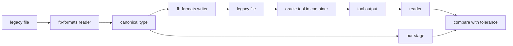

## Three data flows: real-time bursts, offline periodicity, folding into timing

### (a) Real-time Diamond Array single-pulse pipeline

The real-time chain uses only modules that phases 2–4 deliver, and everything after ingest runs on the GPU. The rfi stage computes masks per gulp and applies them in place. The `RfiMask` is also streamed to disk in physical units, so a dump can be re-searched offline with exactly the same flags.

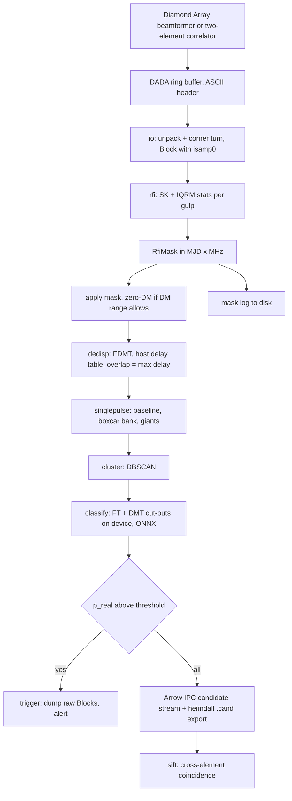

### (b) Offline periodicity search

The offline flow is the PRESTO tutorial chain ([02-presto.md](02-presto.md)) rebuilt on canonical types, with three search methods running side by side on the same dereddened spectra and a single sifter. Birdies are found on the DM-0 topocentric series and zapped with the barycentric velocity, as the tutorial does, because birdies are topocentric while the searched series are barycentred.

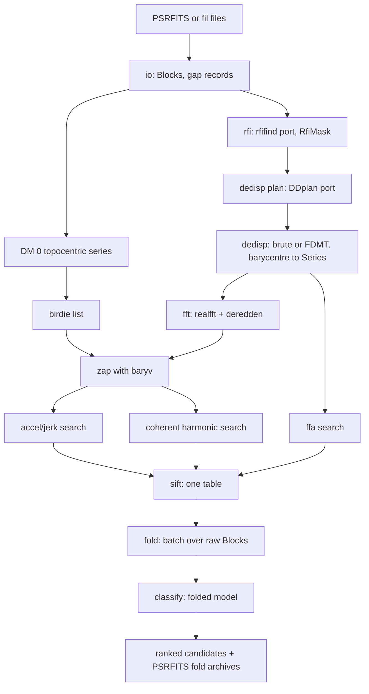

### (c) Folding and timing

Timing closes the loop. TOAs feed PINT, PINT produces an updated ephemeris, and the ephemeris becomes a predictor that the fold module evaluates directly. That removes prepfold's cubic-fit phase drift on long observations.

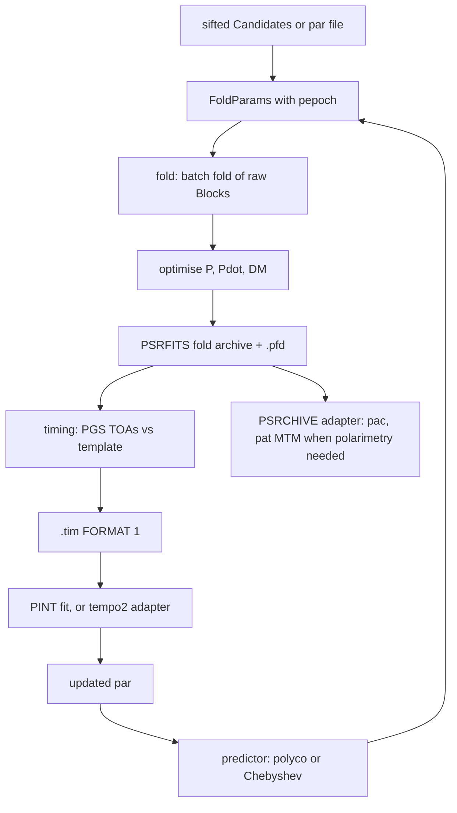

## Trust comes from agreeing with the codes everyone already uses

The test design has three layers, and the third is what makes the port credible. **Unit and property tests** run in each language: Rust proptest invariants (a DM-0 pulse dedisperses to itself, pack/unpack round-trips in both bit orders, MjdTime arithmetic is exact), CUDA Catch2 tests, and Python hypothesis tests. **Cross-backend equivalence** runs `assert_allclose(cpu(x), cuda(x))` parametrised over the backends present; it auto-skips without a GPU, so the Mac stays green. **Oracle tests** run the original tool in a pinned container on the same seeded synthetic data, plus a few real files, and assert agreement within stage-specific tolerances. Bitwise equality is the target only where we ported the code verbatim (rfifind `.mask`, coherentsearch `.cohout`, the FFT packing). Elsewhere the target is recall and parameter agreement, because FDMT and brute force legitimately differ in delay quantisation. PRESTO now validates itself the same way, with weekly real-data tests on Terzan 5 ([CHANGELOG](https://github.com/scottransom/presto/blob/master/CHANGELOG.md)).

CI runs a `macos-14` arm64 CPU job, plus a Linux job that compiles the CUDA code (nvcc needs no GPU) and import-checks the modules. The full GPU suite runs nightly on a label-gated self-hosted runner on the Diamond Array GPU node. GitHub's hosted GPU runners are paid ([GitHub changelog](https://github.blog/changelog/2024-07-08-github-actions-gpu-hosted-runners-are-now-generally-available)). Benchmarks always compare against **PRESTO v6.3.3 and `dmt`**, never older baselines. The published GPU speedups for accelsearch (51–90x) predate PRESTO's 8x CPU gain ([PrestoZL](https://github.com/zhejianglab/PrestoZL), [arXiv 1911.01353](https://arxiv.org/pdf/1911.01353)).

## Six phases from correct I/O to real-time triggers and timing

Phase 0 is complete: `filterbank/` is a normal directory with the converter's history kept, the converter lives at `filterbank/converter/`, and all documentation now lives in `docs/` at the repository root. The order of the remaining phases puts real-time single-pulse work ahead of periodicity, because the Diamond Array transient pipeline is the first operational target. Every phase ends with oracle tests, not just unit tests.

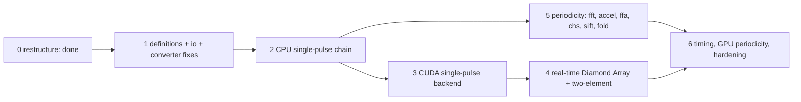

| Phase | Scope | Deliverables | Exit tests |
|---|---|---|---|
| 0 (done) | Submodule converted to a directory, history kept | `filterbank/converter/`; all documentation moved to `docs/` at the repository root | `fits2fil` output byte-identical to before the move |
| 1 | definitions, io, format adapters for the single-pulse path, converter fixes, credits and math-map scaffolding | `definitions/` plus codegen; `fb-defs`, `fb-io`, `fb-formats` (fil, tim, PSRFITS search, DADA, `.inf`/`.dat`, `.mask`, `.singlepulse`, heimdall `.cand`); `fb-py`; `python/filterbank/core`; `fits2fil` rebuilt on `fb-io`; oracle containers for PRESTO, sigpyproc3, `your` | Sample-for-sample parity with sigpyproc3 on the format matrix; PRESTO DM-0 `.dat` parity; all round trips byte-identical; each converter bug has a failing-then-passing test; `check_credits.py` green; read throughput recorded on Mac and Linux |
| 2 | CPU single-pulse chain on the Mac | `fb-rfi` (rfifind port, IQRM, SK, zero-DM, zdot, kadane); `fb-dedisp` (DDplan, brute, FDMT, subband); `fb-sp`; cut-outs and the FETCH adapter; TransientX/heimdall/`your` adapters; seeded injector; `fb sp search file.fil` end to end | rfifind `.mask` identical to PRESTO; injection recall at least that of PRESTO `single_pulse_search.py` and TransientX at matched false-alarm rate; heimdall-mode FoF reproduces heimdall clusters on the same series |
| 3 | CUDA backend for the single-pulse chain | `cuda/src/{unpack,rfi,dedisp,sp,cornerturn}`; nanobind bindings; CUDA build auto-enabled when `nvcc` is found; GPU CI | CPU and GPU agree within tolerance; recall at least that of heimdall on the injection suite; real-time factor measured for the Diamond Array configuration |
| 4 | Real-time Diamond Array and the two-element interferometer | `fb-realtime` daemon; DADA ring client; gulp overlap; workers per stream; Arrow IPC; ONNX classifier trained on Diamond Array data; triggers and dumps; gRPC control; two-element adapter and coincidence sift | Replay equals batch; above 1x real time over multi-hour soaks; live-injection recall measured; latency logged |
| 5 | Periodicity and folding | `fb-fft`, `fb-accel` (adapted accelsearch v6.3.3), `fb-ffa` (vendored riptide core), `fb-chs` (adapted coherentsearch), sift, `fb-fold` (batch folder, prepfold search, predictors), PSRFITS fold and `.pfd` writers; CUDA accel (PrestoZL port) and resample search (peasoup port) | `.cohout` byte-identical to PRESTO; accel candidates match v6.3.3; FFA periodogram matches riptide; sifted list matches `ACCEL_sift.py`; fold matches prepfold `.bestprof`; known-pulsar and injection recovery at least as good as the PRESTO v6.3.3 chain |
| 6 | Timing, remaining GPU kernels, hardening | `fb-timing` (PGS), PINT integration, tempo2 and PSRCHIVE adapters; CUDA FFA, CHS and batch fold; optional Metal or VkFFT kernels where profiling justifies them; user guides under `docs/modules/`; every `docs/math-maps/` file complete | TOAs match `pat -A PGS`; PINT residuals match tempo2; GPU periodicity agrees with CPU; benchmark report against PRESTO v6.3.3, heimdall and `dmt` |

### Phase 1, task by task

Phase 1 has one aim: every later module receives data that is right, in physical units, with its history attached. The converter fixes come out of this almost for free, because `fits2fil` becomes a thin CLI over `fb-io`. Each defect becomes a regression test that fails against the phase-0 code. The table maps each defect to the code that has it today.

| Converter defect | Where it is now | Consequence | Fix in `fb-io` |
|---|---|---|---|
| Sub-byte bit order not reversed | `extract_filterbank_block` returns packed `uint8` bytes unchanged | For nbits 1/2/4, channels are permuted within every byte, a pattern that repeats every 8/4/2 channels and is easy to miss on a plot | Unpack MSB-first (PSRFITS), repack LSB-first (SIGPROC) |
| `DAT_SCL`/`DAT_OFFS`/`DAT_WTS`/`ZERO_OFF` ignored | No reference to these columns anywhere in `filterbank/converter/` | Bandpass and RFI weights are silently discarded; signed and unsigned data are not offset consistently | `--scales apply/ignore`, `--zero-off dspsr/presto/none`, `--weights apply/ignore`; choice recorded in provenance |
| First-row `DAT_FREQ` only, with a median spacing | `_optional_freqs(first_row)`, `_build_frequency_axis` uses `np.median(np.diff(freqs))` | Non-uniform or changing channel frequencies pass silently. The `OBSFREQ` fallback treats `OBSFREQ` as the band centre, while the spec defines it as the centre of channel `OBSNCHAN/2`, a half-channel shift | Per-row `DAT_FREQ` into `ObsHeader`; uniformity check; `fchannel` table or error for non-uniform output |
| Single float64 `tstart` | `tstart_mjd = STT_IMJD + STT_SMJD/86400 + STT_OFFS/86400` | About 1.2 µs quantisation of the start epoch; `NSUBOFFS` ignored for later split files | `MjdTime{imjd, sec}` internally; the f64 only at the SIGPROC edge, with a sidecar carrying the exact value |
| No `OFFS_SUB`/`NSTOT`/gap checks | `iter_subints` yields every row; only `NCHAN`/`NPOL`/`NBITS`/`NSBLK` compared across files | Dropped rows shift all later samples in time; a partly filled last row adds junk samples; file-to-file discontinuities are spliced | Gap records with a fill policy; `NSTOT` truncation; inter-file continuity check |
| Polarisations written raw with `nifs = NPOL` | `nifs=metadata.npol` in `_build_filterbank_header` | heimdall reads only `nchans`, and AstroAccelerate rejects `nifs != 1`, so multi-pol files are unreadable or misread downstream | `--pol sum/mean/select`, defaulting to sum (PRESTO's convention), with the 2x level difference from `your`'s mean documented |

| Task | Work | Output | Done when |
|---|---|---|---|
| 1.1 Workspace | Cargo workspace with bands, `pixi.toml` (Rust, Python, cfitsio; CUDA toolkit on Linux only), `justfile`, CI for macOS arm64 and Linux compile-only | Buildable empty crates `fb-defs`, `fb-io`, `fb-formats`, `fb-py` | `pixi run test` green on both CI jobs |
| 1.2 Schemas and codegen | YAML for the seven types plus provenance; `generate.py` emits Rust, Python, C++ and Arrow | `definitions/generated/` | CI fails on any regeneration diff |
| 1.3 `fb-defs` core | `MjdTime`, `FreqAxis`, `ObsHeader`, `Block`, `RfiMask::to_indices`, `DmPlan::delay_table` with named `k_dm`, `Series`, `Candidates` schema builders, `FoldParams`, `Step`; typed join validators | Library plus Python exposure | Property tests pass; delay table equals PRESTO `delay_from_dm` to 1e-9 s |
| 1.4 Unpackers | 1/2/4/8-bit signed and unsigned, 16-bit, 32-bit float; LSB-first and MSB-first; the Parkes `FB_1BIT` group reversal; scale and offset application | `fb-io::unpack` with SIMD | Proptest round trips; equality with sigpyproc3 `io/bits.py` for every nbits and order |
| 1.5 PSRFITS search reader | Header parse through `fitsio`; memory-mapped SUBINT rows; per-row `DAT_FREQ`/`SCL`/`OFFS`/`WTS`; `ZERO_OFF` policies; `OFFS_SUB`/`NSUBOFFS` gaps; `NSTOT`; multi-file continuity; pol policy; corner turn to FT | `fb-io::psrfits::Reader` | Sample-for-sample parity with sigpyproc3 on ungapped files; PRESTO-style padding on the gapped fixture |
| 1.6 SIGPROC reader/writer | The full keyword table including `fchannel`, `signed`, `refdm`, `barycentric`; `nsamples` ignored; byte-swap detection; RA/Dec packing including −00°; `.tim` | `fb-io::sigproc` | Round trip byte-identical; PRESTO `readfile` reads our files with the same header values |
| 1.7 PSRFITS search writer | Writes `DAT_FREQ` per row, scales, `NSTOT`, `HISTORY` provenance | `fb-io::psrfits::Writer` | PSRFITS to `Block` to PSRFITS round trip; sigpyproc3 and PRESTO read our files identically |
| 1.8 DADA | Header parse and write (HDR_SIZE, standard keys, heimdall's BANDWIDTH/BW and CFREQ/FREQ fallbacks); file reader and writer | `fb-io::dada` | heimdall's frequency derivation reproduced; round trip |
| 1.9 Phase-1 format adapters | PRESTO `.inf`/`.dat` read and write; `.mask` to and from `RfiMask`; `.singlepulse` and heimdall `.cand` read and write | `fb-formats` | Byte-identical round trip of PRESTO-written files; a `.mask` with fully zapped intervals read correctly |
| 1.10 Bindings and registry | `fb-py` (PyO3, rust-numpy, pyo3-arrow; GIL released in kernels); `python/filterbank/core` backend registry; `fb` CLI skeleton | One-step local build (`pixi install`) | Python tests import and run the readers on Mac and Linux |
| 1.11 Converter rebuild | `fits2fil` over `fb-io`; new flags (`--scales`, `--zero-off`, `--weights`, `--pol`, `--gaps`); a `--legacy` flag reproducing phase-0 bytes; one regression test per defect | Updated `converter/` | Phase-0 hashes reproduced under `--legacy`; every defect test fails on phase-0 code and passes now |
| 1.12 Fixtures and oracles | Synthetic PSRFITS generator (nbits 1–32, ascending and descending bands, non-trivial scales, a dropped row, a partial last row, multi-file split, AABB and IQUV); containers for PRESTO 6.3.3, sigpyproc3 2.0, `your` 0.6.8; `tests/oracle` runner | git-lfs fixtures, container recipes | Oracle suite runs locally (Mac, through containers) and in Linux CI |
| 1.13 Credits and math maps | Create `docs/CREDITS.md` with rows for everything phase 1 reuses (sigpyproc3 readers and bit unpacking, PRESTO `psrfits.c` gap logic, `.inf`/`.mask` formats, SIGPROC keyword table, psrdada header, vendored cfitsio); write `docs/math-maps/` for sigpyproc3, sigproc, psrdada and the PRESTO I/O sections; `vendor/vendor.toml`; `tools/check_credits.py`; `Step` data lineage emitted by every reader and writer | Docs plus CI check | CI fails when a `vendor/` directory lacks a CREDITS row or a math map |
| 1.14 Benchmarks | criterion benches for unpack and read throughput; history saved | `bench/io` | GB/s recorded on the Mac and the GPU host |

## Conclusion

The decisive change from the earlier plan is what dropping the licence constraint unlocks: with direct reuse as the default, **the oracle and the implementation can be the same code**. A vendored rfifind, coherentsearch or accelsearch can be held to byte-identical output against its original, a far stronger test than "recall within 10%". It also inverts the risk profile. The hard problems are no longer search algorithms, which we copy, but the seams between codes that disagree on bit order, `ZERO_OFF`, polarisation scaling, reference frequency, epoch convention and the dispersion constant. The physical-unit definitions layer exists to own those seams. That is why phase 1, which looks unglamorous, is where most of the scientific correctness of the whole stack is decided. The converter's six defects are a small-scale preview of the bugs that unified-in-name-only stacks carry silently.

Two open questions should shape the work after phase 1. First, re-benchmark GPU accel and jerk search against PRESTO v6.3.3 on the Diamond Array GPU host before vendoring PrestoZL. The 8x CPU gain, with NEON on the Mac, may make the CPU port sufficient for offline work, leaving the GPU budget for the real-time chain. Second, locate PulsarX's pFDMT and TLSM sources, or commit to implementing them from the paper. Batch folding is the stage where a CUDA kernel would be genuinely new rather than reused, and it is where the offline periodicity pipeline will spend its time once coherent harmonic summing makes the search itself cheap. Finally, keeping all credit in `docs/CREDITS.md` and all equations in per-library math maps, rather than scattered through code comments, makes the record auditable in one place: anyone reading a vendored kernel can find its equation, paper and oracle test without leaving `docs/`.
